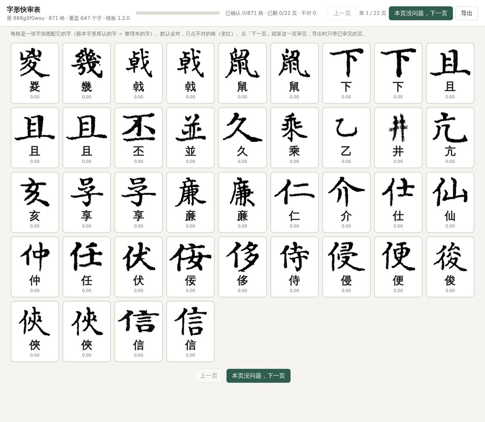
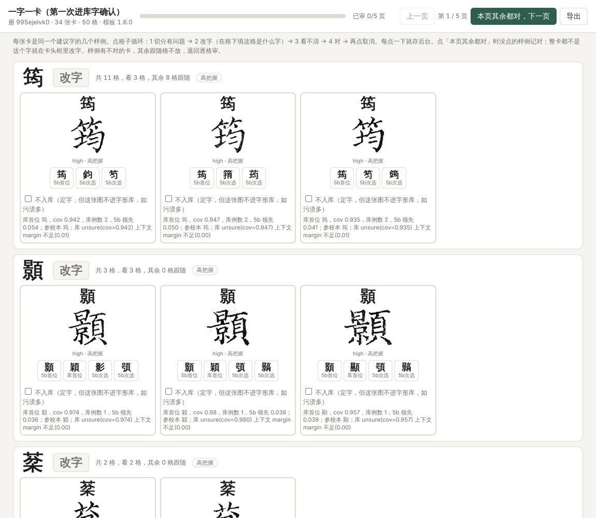
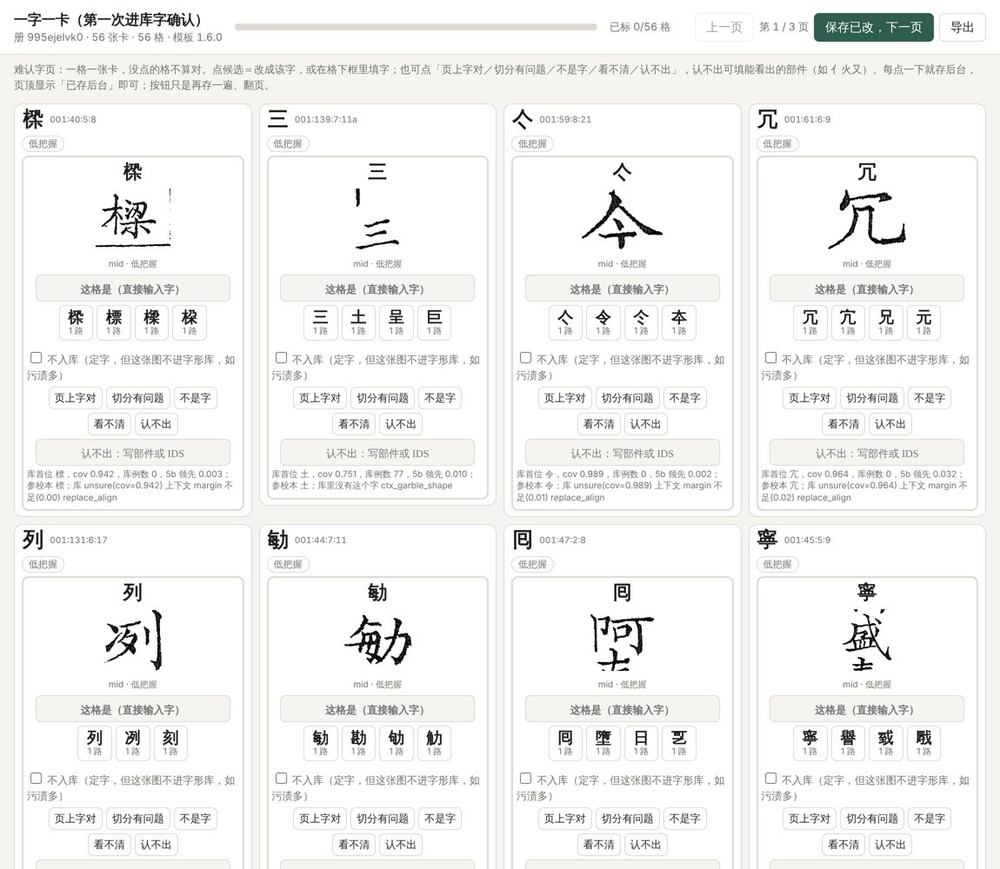
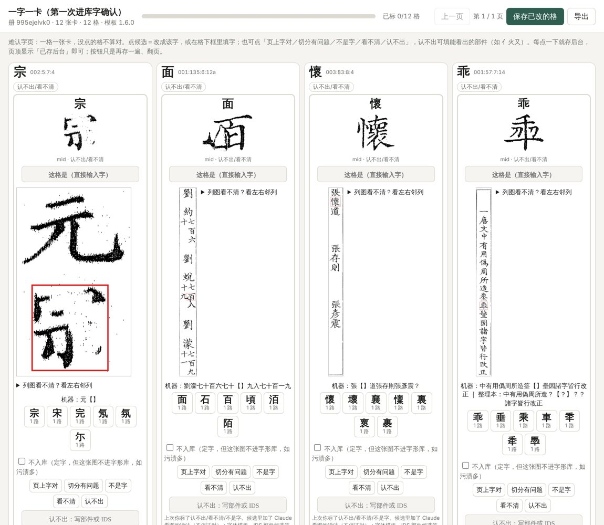

# 字形快速入库：四层页

> Sheldon 2026-11-10 定：**以后字形快速入库一律用这套流程**；有需要可以改页面模板和筛选条件，改了就改本文。其他文档讲到冷启动、补字、快审入库时都引用本文，不再各写一套。
> 来源：殿本（A23 补库、新字）、史記（SJ，快审表与快审减量）、全唐文（QTW，高／低把握页、认不出十二格）三书实测，A23 汇总。各书的经过见 ai-team `domain/CV/字形领域/字形库入新字-跨书通用流程-2026-11-10.md`。
> 相关：[冷启动快审流程](冷启动快审流程.md)（参校本钉位、借库首跑，是本流程的前置）、[快审减量](快审减量.md)（出第一层之前的筛选）、[人审页模板](../人审页模板.md)（页型与版本）。

## 一、什么时候用

补字对降人审率的作用**要看情况**：
- 有些字**第一次入库只能走这套流程**：库里 0 例，5a 无从匹配，只能人认、人确认后入库。
- **开新册时新字多**，这一步收益最大。
- 同一批册做过几轮之后，新字越来越少，作用才变得不明显（史記做过几轮后实测约 0.278%→0.26%）。所以每次动手前先量：待审里到底有多少是字库的事（史記一次 647 格待审只有 94 格属字库，真缺刻例约 35 格，其中 30 格库里其实有字，是形近误读，应归形近线）。

适用场景：
1. **开新书，跑前几册（冷启动）**：库几乎是空的，四层都有，第一、二层量最大。
2. **前几册稳定后，第一次跑后面的册**：新册带来一批新字头，主要落在第二、三层，第四层是生僻字。
3. **对一批书降待审率**：切分做好之后，下一步着重看无例／少例字，按书汇总后一起出页。
4. **换图源、重切分、rekey 之后**：旧刻例的图和字可能对不上（殿本换图源后旧页号人裁不采信），受影响的字头按本流程重新确认。
5. **撤借库、开 solo_5b 之前补覆盖**：指标是本书可信≥3 字头覆盖全书格≥99%；把差的字头挑出来补到 3 例。撤库重审后刻例不够的字头也走这里。

**前提与顺序**：
1. **切分清零**。格一移动，刻例的图与字就对不上；切分线的格（并格、半字、边框、碎片）先撤给切分线。
2. **补无例／少例字**，即本文。
3. **形近组**，单独一线。木入八、己已巳、日曰这类看图分不开的字不上本流程的页。
4. **余下人审**。

## 二、共同的选字前提
- 候选格是 iron / witness3 两路交叉确认的格（参校本与机器一致，且图上有证据），或下面各层明说的格。
- 可信刻例 = 人裁 + 参校本互证（`trusted_keben_counts`）；借库刻例只算 unsure，不算见证。
- 排除：
  - 形近组与日曰己已巳；
  - 印章、遮挡格；
  - [快审减量](快审减量.md) 里跳过的列首尾、双行小注、怪字符。
- 意思不同的形近字绝不归一（个/今）；未收字的近似异体打 approx 标记，备注写原码位。
- 入库前先清冷启动 seed 孤儿（无实例刻例）；带 `--allow-delete` 要用户点同意。
- 每字头只取约 3 个代表格给人看，按 glyph_match 首位 cov 从高往低取；确认入库后重跑，由库放其余格。字头多半只有 1–2 格时，不要一字头一张卡（全唐文头一版 735 张卡 92 页，被嫌慢）。

## 三、四层页

从上到下证据越来越弱，人每格花的时间越来越多。上一层打回的格降到下一层，不在原层反复。页面一律从本库模板出（`guji-manager review-pages …`），用 Artifact 发布并带 `capabilities {"db":{}}`；对页有意见就改模板，规矩见[人审页模板](../人审页模板.md)第八节。

分层的依据是全唐文 H-cold 实测（456 个人点的代表格，`qtw-tools/冷启动加速/对照.md`）：

| 条件 | 对率 |
|---|---|
| 库首位＝5b 首位，cov .90–.95 | 97.5%（≥.95 反降到 87%，框线碎片混入） |
| 5b 领先第二名 ≥.03 | 98.8%（.015–.03：94.6%，.005–.015：83.1%，<.005：67.2%） |
| 库首位≠5b 首位 | 库首位几乎全错，5b 对 78–89% |
| 库里该字 0 刻例 | 5a 全错，5b 对 83.4% |

| 层 | 页型 | 范例（截图在 `图/字形快速入库/`） |
|---|---|---|
| 1 快速审阅单 | `char_grid` | 史記补字确认 https://claude.ai/artifact/LyXGceVEwC24oMmSFuTPki |
| 2 高置信度 | `char_card --per-card 3`（带「本页其余都对」） | 全唐文 高把握确认页·c38第一批 https://claude.ai/artifact/4pkMSzCDwo8TnrStCZS6w8 |
| 3 低置信度 | `char_card --per-card 1 --no-rest-ok` | 全唐文 低把握逐格页·c38第一批 https://claude.ai/artifact/BNC529AFdA12reNRi3A23D |
| 4 难认字 | `char_card` ≥1.6.0，带整列图、邻列图、上下文 | 全唐文 认不出的十二格 https://claude.ai/artifact/VFMTzT4tdhxbxTGz4or9En |

### 分层规则（代码，2026-11-13 定）

分层不再出页时临场判断，一律跑 `guji-manager review-pages layer`，规则在 `guji_manager/review_pages/layering.py` 模块头，改规则改那里并在本节记依据。**书与书之间只调参数，不改逻辑**：

| 书级参数 | 含义 | 史記 | 怎么定 |
|---|---|---|---|
| `--ref-trust` | 参校本可信度 none / medium / high / very_high | very_high | 开书时抽参校本对位格人核定级，定了就不再改；改了要在本节记 |
| `--col-len` | 每列字数（判列尾） | 21 | 版式 |

```bash
guji-manager review-pages layer --cells 待审格.txt --pack-dir '<包根>/{vol}' \
  --exemplars $GUJI_DATA_HOME/main/<ws>/output/glyph_store/exemplars.jsonl \
  --ref-trust very_high --col-len 21 --out rows.jsonl
# rows.jsonl 每行带 layer（quick/high/low/hard/align）、why、pre（预选字）、cands（5b 前十＋库首位＋参校本）
```

固定的几条（不随书变）：
- 一二三、己已巳、日曰一律进难认字看上下文，不进快审和高把握。
- 列首、列尾、双行小注格不进快审（可进高把握）。
- 参校本字在形近组（人入八、十士土干、木本末未…及 cv 形近表）不进快审。
- 参校本可信度 ≥ high 时，参校本字不在 5b 前三、而 5b 首位分 ≥ .93 → `align`（对位可疑）：上低把握页不预选参校本字，同时列给切分线查对位。史記 r53 这类 13 格里 7 格图上是别的字（参校本字对到了邻格）。
- 快审条件按 `ref_trust` 取（见模块头表）。very_high：5b 首位＝参校本字、5b 首位分 ≥ .90、库首位 cov ≥ .90。

依据（史記 r53，Sheldon 人点 216 格回测）：「参校本字在 5b 前三」放进快审 83 格错 7；加「5b 首位＝参校本字」和「cov ≥ .90」后 53 格错 1（切分）。第一版快审页（133 格，没去小注／列尾／日曰）标红 12 格（9%），超了 2% 的验收线，原因就是这些规则没进代码。

### 第一层：快速审阅单（5×8＝40 格一页，每格只有图和字）



- **选字**：
  - 三路独立证据一致：库首位（含借库）＝5b 首位＝参校本的字。
  - cov 在 .90–.95，去掉尺寸或框线异常的格。
  - 不在形近组。
  - 目标对率≥99%，人扫一眼就能翻页。同字头的格排在一起，便于一眼看出不一样的那张。
- **出页**：
  ```bash
  guji-manager review-pages char sheet <工作区> <册> grid.html --grid 40 --per-char 3
  ```
  现在的 `char sheet` 只按「借库首位＝整理本字」选格。「＝5b 首位」和 cov 上限还要加进工具，是待做项；加之前，先用 [快审减量](快审减量.md) 的 `triage` 分流筛一遍。
- **怎么点**：默认全对，只点不对的格（变红），点「本页没问题，下一页」算审完这页。
- **收**：
  ```bash
  guji-manager review-pages char pull rows.json result.json
  guji-manager review-pages char ingest result.json --batch H-cold-<册段>-<MMDD>q
  ```
- **验收**：
  - 看每页标红率。整批标红超过 2%，或某一页超过 5%，说明选字门槛松了：停下来查原因，收紧条件，剩下的格降到第二层。
  - 从默认算对的格里另抽 ≥100 格盲读，错 ≤1 格。
  - 标红的格不入库，降到第三层。

### 第二层：高置信度（一字一卡，每卡几张图，带「本页其余都对」）



- **选字**：
  - 只差一路证据的格：（库首位＝5b 首位，或 5b 领先第二名≥.03）**且** cov≥.90 **且** 库里该字有例，但参校本不一致或缺。实测对率 97.5–98.8%。
  - 第一层退下来的整字头。
  - 5b 领先量取包里 `rare_candidates` 的 emb 候选：同一格按分排序，首位减次位。
  - **一、二、三（单横画字）一律不入高把握**，进第四层看上下文（Sheldon 2026-11-12 定）：单横画的覆盖率本来就不稳，图上分不出几横，要靠上文判。
- **出页**：用 `review-pages cold-items`／`cold-pages`（`review_pages/cold_start.py`，PR #444）一条命令分出高、低两张页，高把握页即本层。命令和待审 tsv 的列见[冷启动快审入库](冷启动快审入库.md)「高把握／低把握两张页」一节。
- **怎么点**：一张卡放同字头的几个代表格，看图是否同一个字、是否像库里的样子；错的点掉，其余点「本页其余都对」。
- **验收**：
  - 点过「本页其余都对」的页，格按确认算。
  - 一个字头里挑出任何错格，这个字头剩下的格整体降到第三层，不按「其余都对」收。
  - 抽 ≥100 格盲读，0 错。

### 第三层：低置信度（一格一卡，给候选）



- **选字**：其余的格。
  - 5b 领先<.03；
  - 库首位≠5b 首位；
  - 库里 0 例；
  - cov<.90；
  - 第一、二层打回的格。
- **候选**：5b 前三＋库首位＋参校本的字。5b 首位排第一（库首位≠5b 首位时 5b 对率高得多）；0 例字不放库首位。
- **出页**：`cold-pages` 出的低把握页。Sheldon 11-10 定：这一层不带整列图和上下文，保持一格一卡、轻量。
- **怎么点**：每格必须有一个明确动作：
  - 点候选，或填字；
  - 「页上字对」「切分有问题」「不是字」「看不清」「认不出」。
  没点的格不算对。
- **验收**：
  - 每格都有结局才算完。
  - 「认不出／看不清」的格转第四层；「切分有问题」转切分线；「不是字」走非字图形规矩。
  - 第一次入库、只有 1 格的字头，入库后在下一册见到第二例时用 5a 留一复核一次。

### 第四层：难认字（带上下文、整列图、左右邻列，候选更多）



- **选字**：
  - 第三层标「认不出／看不清」的格；
  - 5b 前五都低分的格；
  - 参校本在这一格是「？」或缺字的格。
- **候选**：在第三层候选之外再加以下几类，同字去重，每个候选标来源：
  - 5b 放宽到前 40；
  - IDS 部件兜底（`guji rare … --slot-comp … --comp …`，扩展 B 以后的字也够得到）；
  - 整理本字及该列 ±1 槽；
  - 单笔画字（一二三十）固定备选；
  - 看图读出的字，标明「不保证对」。
  做法见[冷启动快审入库](冷启动快审入库.md)「难认字页的候选怎么扩」。
- **出页**：
  ```bash
  guji-manager review-pages hard-items …
  guji-manager review-pages build char_card --per-card 1 --no-rest-ok …
  ```
  `hard-items` 给每格加整列图（本格红框）、左右邻列图和同列 ±8 格上下文；`char_card` 要 ≥1.6.0。
- **验收**：每格只能落在三种结局之一，不许悬着。
  - 定字：近似异体打 approx，备注写原码位。
  - 明确搁置：写原因，不入库。
  - 转切分线或非字。
  不知道的字不硬定。墨团、半个字、小注碎片默认「看不清／不入库」，不要花人点的时间。

## 四、事件与落库

细的命令在[冷启动快审入库](冷启动快审入库.md)第 3、4 节，这里只列口径。

- **批号**：`H-cold-<册段>-<MMDD>` 加层后缀：快审单 `q`、高置信度 `b`、低置信度 `c`、难认字 `d`。分波收再加数字，如 `…c2`。
- **事件**：
  - 人裁一律 `confirm`、actor=user、带锚。
  - payload source：一字一卡页写 `cold_start_char_card`，快审单写 `char_review`（`char ingest` 现写法）。不要写 vision／llm／knn_infer／auto，否则 cv 的 `counts_as_human` 不当人裁。
- **哪些格算确认**：
  - 第一、二层：翻过的页、点过「本页其余都对」的页，格按确认算；第三、四层只算点过的格。
  - 切分有问题、看不清、认不出的格不写 confirm，另列清单。
  - 勾了「不入库」的格写 `no_glyph_lib: true`。
- **机器判断**：机器自己看图的判断写 provenance=auto、evidence.confirmed、actor=model，不改人裁。**actor 只能写 user/model/align，机器判断不能冒充用户裁。**
- **落库**：
  - `guji events route` ＋ `glyphdb_admit`，manager 要 ≥0.4.30：人裁确认同字的 auto 刻例会升成 human。
  - route 后**不要** `rebuild --no-replay`。
  - `guji db sync` 带 `--no-admit` 时，自己跑 admit。
- **推库**：
  - 一律设 `GUJI_ACTOR`，推前先拉中心库最新。
  - **不要在 export 后紧接 `db sync`**：它会用中心库覆盖本地 store，而 store 才是真源。
  - 推中心库先报条数，等用户点头。
- **换图源的册**：旧页号人裁不采信（apply 内置换图源闸）。

## 五、整批验收
- 入库前，按书、按层各做 ≥100 格盲读。第一层错 ≤1%，其余各层 0 错。
- 5a 留一验证（史記阈值 0.95／领先 0.02：召回 55.8%，错 0.85%）。
- 出新快照 g<N> 前后对比。
  - 护栏：5a match_precision 1.0000、同图异字、消失字头。
  - **rekey 之后一律用 g 快照对比 (图 md5, 字) 对**：护栏的「同图异字」抓不到整体错位（殿本 g20 教训）。
- 重跑后按层统计人审率变化，看补字到底降了多少，决定下一册还做不做、做哪几层。
- 撤借库：本书可信≥3 字头覆盖≥99%，且借库开／关 A/B 不退。

## 六、怎么改这套流程
- **改页面**：改 `guji_manager/review_pages/` 里的模板，升页型版本，写 CHANGELOG；用到的书线重 build，发布到原地址。
- **改筛选条件**：比如分层阈值 `cold_start.py` 的 `LEAD_HI`／`COV_HI`、第一层的 cov 上限。改的时候要带新的实测对率表，同时改本文第三节。
- 各书只在自己的开书经验里记实例数字，流程本身只改本文。

## 七、踩坑小结
| 坑 | 做法 |
|---|---|
| 切分未清就补字 | 先清切分 |
| 「库里没有这个字」实为形近误读 | 先核库里有没有整理本字的样本，再分线 |
| 库首位≠5b 首位时信 5a | 5b 对率更高；0 例字 5a 全错 |
| cov≥.95 当最稳 | 反而混入框线碎片，第一层取 .90–.95 并去尺寸异常 |
| 一字头一张卡、字头只有 1–2 格 | 按格数并卡，或直接放第一层 |
| 借库刻例被当见证 | 只算 unsure |
| route 后跑 `rebuild --no-replay` | 人裁被冲掉；踩了就 `db pull --force` 再 route |
| export 后 sync 覆盖本地 store | store 为真源，先 sync 后 export |
| rekey 后 patches 图没跟着挪 | g 快照对比图字对 |

## 八、自动链（不需要人点页；2026-11-11，史记字形线）

> 背景：Sheldon 一两天点不了人审页，要求把「机器能放心定的补样本」做成可重复脚本。人审页（第三节）仍是人能点时的首选；自动链只处理**机器三方一致、可盲读复核**的格，其余一律只记台账待批、**不入库**。
> 脚本：`tools/开书/字形快速入库_自动.py`（子命令 scan／sample／gate／admit）。

### 8.1 选格规则（缺省值即史记 g16 实测值，改动要在此记）
一格可自动入库，须同时满足：
1. 参校本字（坐标 ref_char）＝对位字（align_char）＝ glyph_match 库首位，cov ≥ 0.975，与第二名差 ≥ 0.025；
2. 该字头自有样本（human＋auto，不含借库）< 8；每字补到约 10 条，按页散开、差大的优先；
3. 不在已有人裁、不在库里。
不满足但仍缺样本的（如首位≠参校、异体码位、形近组内字）只进 `待批.tsv`，要人看图再进第三节的页。
**形近组字头一律不走自动入库**：脚本内置 SIMILAR（日曰己已巳、末未木、王玉主、冡冢、子于、約田、還環、入八人、卞十、面而、宫官、東束、大太犬、春泰、丈文、衞椒、土士、志忘），`--exclude-file` 可追加形近线清单；命中的格写入 `待批.tsv`（类别=形近组）。过去的教训：盲读时逐格看；史记 g16 因 文/丈 看错一条放行（v2:01:55:5:18b），导致 08:40:3:20b 丈→文，已撤。

### 8.2 流程（一册或多册包）
```bash
# 1 扫描：出 auto_candidates.jsonl、scan_report.json（可自动入库数、缺样本待审格数），不动库
python tools/开书/字形快速入库_自动.py scan --packs <产物包根> --ws <书工作区> --vols 01 02 … --out out/
# 2 （可选）rapidocr/5b 另跑出 <格号>\t<字>，scan 加 --ocr 要求与参校一致；不给则不做 OCR 过滤（三方一致＋盲读闸已是主要保障，OCR 只是再加一道，可省）
# 2 从**原页图**裁格（坐标约定见 8.5）：
python tools/开书/字形快速入库_自动.py crop --out out/ --packs <产物包根> --ws <书工作区> --patches patches/ [--ids ids.txt]
# 3 抽金标（按字头候选数高/中/低三档分层各 1/3；--n 取 max(100, 候选数×5%)，即 5% 复核同时就是金标）：无标签盲读图 blind_*.png + 答案 key.tsv（≥100 格，种子可改）
python tools/开书/字形快速入库_自动.py sample --out out/ --n 120 --seed 11 --patches patches/
# 4 盲读：人或模型只看 blind_*.png，写 reads.tsv（序号<TAB>读出的字）；不许看 key.tsv
python tools/开书/字形快速入库_自动.py gate --out out/ --reads out/reads.tsv     # 0 错才写 gate.ok
# 5 另按形近组、异体码位逐格目视候选（blind 只抽样，不抽全量）；有疑问的格从清单里删掉
# 6 入库：没有 gate.ok 拒绝。provenance=auto，批次 sj-fill-auto-<月日>，idx 必须是 int
python tools/开书/字形快速入库_自动.py admit --out out/ --ws <书工作区> --patches patches/
# 7 同步数据目录的 glyph_store（用 export_store 写到 $GUJI_DATA_HOME/<分支>/<ws id>/output/glyph_store，不是工作区里那份），再出快照：
guji glyph-db snapshot -w <ws> && guji glyph-db snapshot-upload --pin <N> --execute -w <ws> && guji glyph-db pin-verify --pin <N> -w <ws> && guji db sync -w <ws>
```
推库必须显式 `guji db push --with-glyph`（manager ≥ v0.4.42），推前备份本机 glyph_store 与 glyph.db。

### 8.3 闸与台账
- 盲读 ≥100 格 **0 错** 才放；有错则整批不放，查原因（史记第一批 7.8% 错就是选格太松）。
- 每批记入人审介入台账：自动入库条数、盲读数、错率；需人裁的格只写 `待批.tsv`（格号、类别、说明）。
- 史记 g16：候选 510 格全过图、剔 12、随机 120 格盲读 0 错、入库 498；事后发现 1 条文/丈误放（目视过图时形近格仍可能看错，所以第 5 步不能省）。
- 史记 r41（g17）十册试跑：可自动入库 3,368 条（1,031 字头）、缺样本待审 243 格。

### 8.4 推库前的确认
真正 admit、出新快照、推中心库不可撤销：先把清单、金标错率、`db push` dry-run（glyph_exported 等）报给总览确认再推。

### 8.5 坐标约定与首次试跑结果
- `cell_shrink` 的 `bbox_page` 坐标原点在页面**右上角**、x 从右往左量（cv `products/kinds/chars.py` 头注 raw_page_px@top-right）。PIL 用左上原点，须翻转：`x0'=(W-1)-x1`，`x1'=(W-1)-x0`，y 不变。按左上原点裁会大量落空白或邻字。`crop` 子命令已按此实现；验证例 01:6:5:5=快、03:119:2:8=治。
- 盲读读出的字与答案（参校字）不同时，要逐格对图裁决：图上字形与答案那个**异体**一致不算错；图上是另一字才算错。
- 史记 r41 首次试跑（接 55 组形近清单，3,252 候选，分层盲读 168 格）：**闸不过**，至少 8 格真错（詁/詰、丸/九、荆/判、桀/祭、厪/塵、斤/行、湣/潛、苡/設），错的多是形近但不在形近组清单里的对。结论：只靠「三方一致＋cov/gap」不够，admit 拒绝。详见 /mnt/project-files/shiji/rounds/r41/自动入库闸结果-1111.md。要放行，须先把候选收窄（常用字、OCR 与 5b 同意、glyph_match 前几名含形近字的剔除）再盲读。

### 8.6 收窄后第二轮（2026-11-11）
scan 缺省已加 `--min-own 4`（自有样本<4 的字头不自动补，r41 真错全在此区）与 OCR 必要条件（`ocr` 子命令，须在装有 rapidocr_onnxruntime＋cv2 的 python 里跑，从原页图紧框识别；传给 scan 的 `--ocr`）。字体渲染相似度试过，不能区分真错与正确，未采用；5b 结果不在 glyph_match 包里，未接。收窄后候选 495 条（190 字头），新分层盲读 120 格仍有 2 格无法证明对（图糊 雅/翟；刻本同形 毫/亳），闸不过。**结论：自动链暂只做 scan＋gate＋待批台账，不入库**；候选里的异体／形近疑难格需人过图（四层页）。详见 /mnt/project-files/shiji/rounds/r41/自动入库闸结果-1111.md。

### 8.7 自动入库边界（史记 r41 两轮反例，供各书参考）
- **规律**：「库首位＝参校字＝对位字、cov≥0.975、gap≥0.025」三方一致在字头自有样本多时可靠，在样本少时不可靠：首轮 168 格盲读至少 8 格真错（詁/詰、丸/九、荆/判、桀/祭、厪/塵、斤/行、湣/潛、苡/設），全在字头自有样本≤3（own 1–3 的 104 格里 8 错，own≥4 的 64 格 0 错），且都是图上字与参校字形近而不在形近组清单里。
- **有效的收窄**：自有样本≥4（`--min-own`，缺省 4）、rapidocr 紧框识别首位字＝参校字（首轮 14 个真错/疑似里拦掉 12 个，剩荆、桀两格 OCR 与参校同读，需人看）。**无效的**：字体渲染相似度（真错与全体分布一致）。
- **收窄后仍不过闸**：495 候选抽 120 格，2 格无法证明对（图糊、刻本两字同形）。盲读者自己也会读错异体（黯/黔、藤/滕），裁决需对图逐格。
- **边界**：自动链只做 scan＋ocr＋sample＋gate＋台账，admit 由 gate.ok 管；闸不过就不入库。异体、图糊、刻本同形的格只走人审四层页。各书沿用此边界，换书时重测 own 阈值而不是照抄 4。
