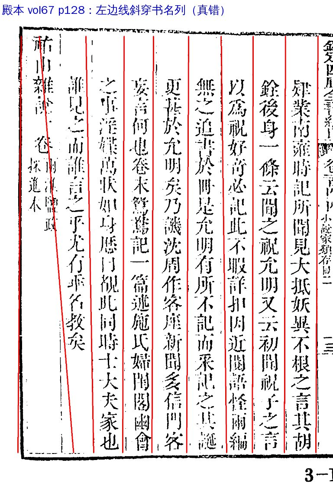
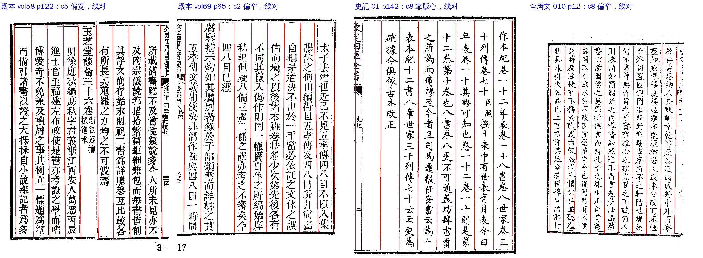
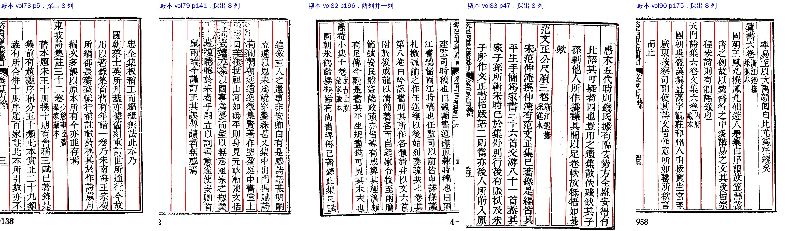

# S03 `col_width_out_of_band`：列宽异常

> [待审原因总览](../README.md)

**一句话**：本页列宽不均，版框可能量错，先看整页

## 定义与判定

- 大类：切分位置（S）；判定顺序 priority 22（排在 S01、S02 后面）。
- 去向：先改算法，改完剩下的并入 llm（route `algo`）；最终谁看：人；网页卡片 `page`（整页看）。
- 负责改算法／数据：A22。
- yaml 里写的判定依据：页打 flag `col_width_out_of_band`（cv#929 border_detect_gate 1.3，送审不拦）。

**实际上这条判法没接**：`review/reasons.py` 的 `RULES` 里没有它（源码注释原话「没有判法的原因（如 col_width_out_of_band 还没接）永远不中」），所以现在没有任何格会判成 S03，三本书都是 0。不是被别的原因吃掉了。

旗是怎么打的：Step1 border_detect 量出每列宽÷列距，内列要在 0.9–1.1、首末列在 0.85–1.3（殿本 2,969 页实测 99.9% 在带内，`seg/columns.py`）；出了带先按「列宽均匀约束」重拟合，拟合不出就在页上打这面旗，供人核，页照样过闸往下走。

## 什么样的页会打这面旗（例子）

图上红线是 Step1 最后用的界行。

### 例 1：真错（三本书只有这一页）

殿本 vol67 p128：最左那条线斜着穿过书名列「江山雜識 一卷」（单条界行漂了 77 像素），右边第 1 列也偏。页上 17 格待审，其中 10 格已经判成 S01 整页对不上，第 1 列另有「妖>如」「異>埴」「根>柱」这种错位读字。

### 例 2：打了旗，但列网是对的（占绝大多数）

这些页的列本来就不匀：靠版心那列宽、卷端题列宽、印得歪。线都落在真界行上，页上待审格几乎为零，有的也全是格位对得上整理本的认字问题。这一类不该送审。

### 例 3：没过列网闸的正文页（真正被漏掉的）

列数探少了（9 列只探出 7、8 列，或两列并成一列），border_detect_gate 按 `column_count` 拒收。**拒收的页后面每一步都是 0 格**：不进任何待审原因，也不算进总格数，人审单上看不到。这几页都是普通正文，每页约 150 字。

## 现状（2026-11-06，三本书现行 ★main 包）

| 书 | 正文页 | 打旗页 | 其中拒收 | 过闸页上的待审格 | 看图 |
|---|---:|---:|---:|---:|---|
| 四库总目 | 16,516 | 20 | 2 | 22（vol67 p128 占 17） | 真错 1 页；拒收 2 页里 vol82 p196 是正文、vol73 p160 是空白页 |
| 史记 | 1,466 | 16 | 5 | 6（都是格位对得上的认字格） | 多是表页（已定搁置）和卷首双叶横拼大图；正文页列网都对 |
| 全唐文 | 2,137 | 2 | 0 | 0 | 列网对 |

另外，**列数探错被拒收、但没打这面旗**的正文页还有：殿本 vol73 p5、vol79 p141、vol83 p47、vol90 p175。连同 vol82 p196，殿本共 **5 页正文、约 750 字现在不在任何人的单上**。这几页的文本出口有没有字还要核。

## 怎么提高（待讨论）

1. **不要按格接这条判法**：30 页打旗页只有 1 页真错，而且它已经被 S01 接住；按格接上只会把例 2 那些好页上的几格认字问题改标成 S03，派错人。
2. **改成页级原因，专管例 3**：判法改成「border_detect_gate 拒收、page_type=body、页上有字（排除空白页）」，出单时出一条整页项（卡片本来就是 `page`）；打旗但过闸的页不送审。要动 yaml（A31）和出单支持整页项（A20），A22 给判据。上线后殿本这 5 页会从「看不见」变成「整页人审」，人审率分母也该把它们算进去。
3. **这 5 页本身**：列网漏了一两条线，给单页 `vline_overrides` 让它过闸，切出格后大多能放行；vol67 p128 同样给单页 override（−17 格）。
4. 史記卷首双叶横拼大图：SJ 标页型或拆叶。

## 怎么处理

1. 看整页，确认是真列网错还是列宽本来就不匀。
2. 真错：单页 `vline_overrides`；成批出现报 A22 改 border_detect。
3. 本来就不匀的特殊列宽，写进书级 `columns:` 配置（带宽、strict／loose）。

## 回流与防再犯

确认过的特殊列宽写进书级配置；override 过的页重跑后看旗是否消失。

## 不要做

不要为了消旗把列宽带调宽到盖住真错页（vol67 p128 这种）。

深挖原文：ai-team `domain/CV/质检/待审原因深挖/S03-列宽异常.md`。
