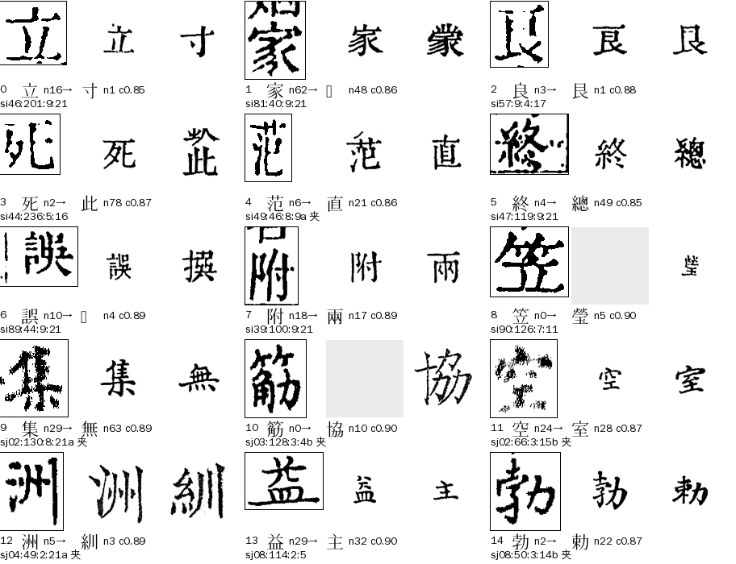
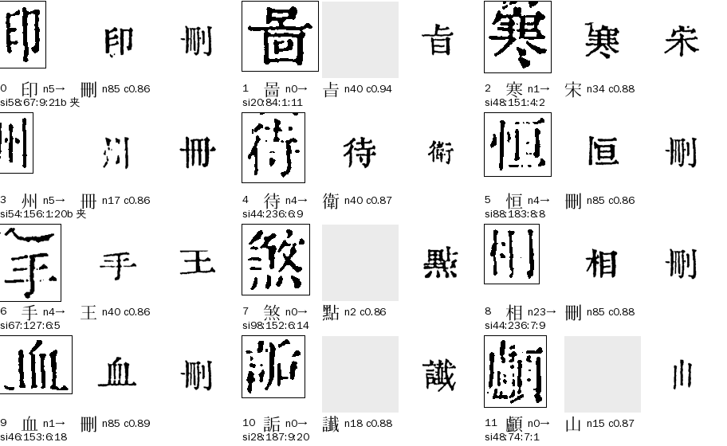
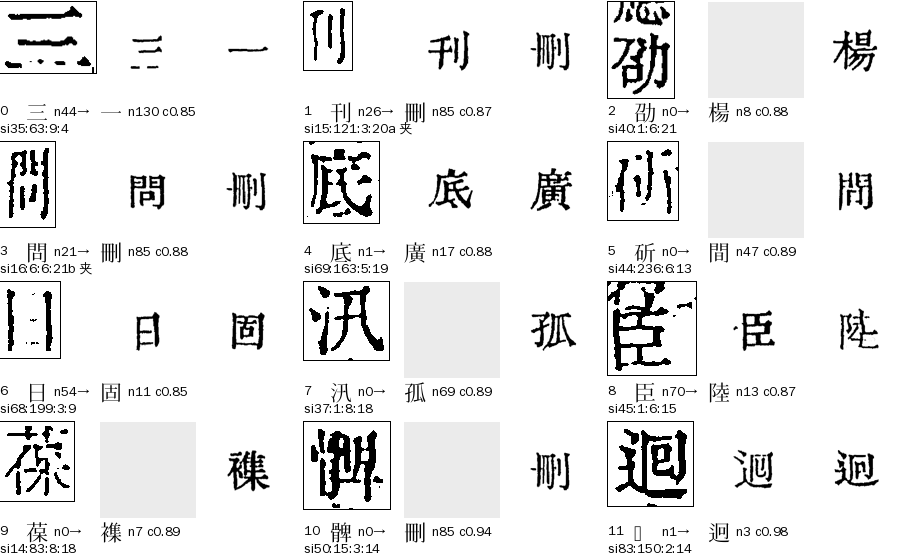
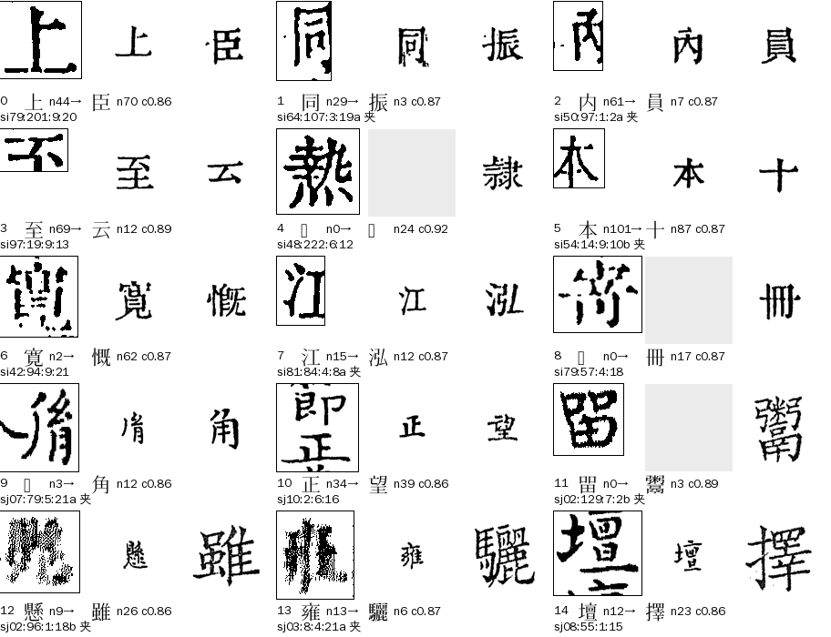
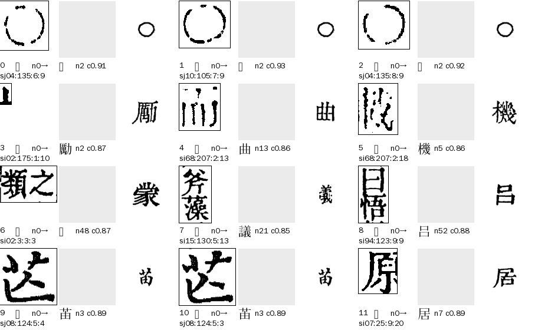

# L05 `garble_gate`：像框线或墨点

> [待审原因总览](../README.md) · [流程与参数](流程与参数.md) · [benchmark](benchmark.md)

**一句话**：名字叫「像框线或墨点」，看图却几乎都是**整字**：格图印得糊、断笔、点状，库里最像的刻例覆盖率落在 0.85–0.90，**库首位是个错字**，乱码闸把这个错字拦下了（拦对了）；而坐标对位给出的整理本字，图上基本就是它。真正是框线、墨块、并格的只有 42 格（无对位那类），圈点○ 8 格。

## 一、什么情况下判成 L05

判法在 `guji_manager/review/reasons.py`：`RULES[R.GARBLE_GATE] = c.codes & {ctx_garble_shape, shadow_veto, ctx_garble_rare}`，priority 52。前面的原因（复审、切坏 S04、遮挡 D、整页整列对不上 S01/S02、H01、字组 Z、R03/R01、**L01 库里没有**）都没命中，格上才轮到它；后面是 R02、V01、N01 等。

这三个疑问码都是 cv `seed_admit` 在**放行之前**加的拦截，来源两路：

| 疑问码 | 谁加的 | 条件 | 本次 238 格 |
|---|---|---|---:|
| `ctx_garble_shape` | context 通道的乱码闸（`context_garble_guard`） | 上下文定了一个字，但没有证人同意（整理本对齐字、坐标对位字、OCR 候选里没有一个与它语义相同），且库首位覆盖率 cov < `context_garble_cov`（0.90） | 220 |
| `ctx_garble_rare` | 同上 | 同样没证人，字是罕用码位（不在 U+4E00–9FFF），且 cov < `context_garble_rare_cov`（0.95） | 11 |
| `shadow_veto` | 影子模型否决（`shadow_veto`） | 现行规则已放行的格，影子模型很有把握选了另一个字，降回待审 | 7 |

**关键事实**：库匹配（`glyph_match`）对这些格的判决全是 `unsure`（0.85 ≤ cov < 0.996，中位 0.871），没到 L01 的「库里没有」（cov < 0.85）。`unsure` 把候选交给上下文，但候选里只有库首位这一个（199/238 格只有 1 个候选），上下文排了个 margin 1.0 的字——就是库首位。**这个字在 194/196 个有整理本字的格里不等于整理本字**；闸因为「没有证人」把它拦下。所以闸没有错拦，错的是库首位。L05 和 L01 是同一件事的相邻两档：L01 是 cov < 0.85，L05 是 0.85 ≤ cov < 0.90（罕用字到 0.95）。

出单时 `pending_reason_detail` 目前为空；去向 route `algo`（先改算法，剩下的并入 llm），网页卡片 `free`，负责 A24。

## 二、现在的情况（2026-11-06）

用三书各册 ★main 包现算（出单同一套判法，只计正文页；殿本 99 册，史記有包的 10 册，全唐文有包的 11 册），L05 共 **238 格**，分布在 82 册 210 页上（193 页只有 1 格，不是糊页问题）：

| 书 | L05 格 | 占该书待审 | 夹注格 |
|---|---:|---:|---:|
| 四库总目（殿本） | 184 | 4,715 的 3.9% | 25 |
| 史記 | 52 | 845 的 6.2% | 27 |
| 全唐文 | 2 | 125 的 1.6% | 0 |
| 合计 | 238 | | 52 |

（总览表里史記写 57，是出单当时的数；现算 52，差 5 格是 #258 之后改判 L01、以及包版本不同。）

### 看图分成因（目视初判，Claude 逐格看拼图，不是人工金标）

| 类 | 意思 | 殿本 | 史記 | 全唐文 | 合计 | 能不能放行 |
|---|---|---:|---:|---:|---:|---|
| A1 | 5b 首位＝整理本字，**只因 coord_min_cov 0.90 挡下** | 62 | 17 | 0 | 79 | 把 `rare_ref_coord_min_cov` 放到 0.85 即放 |
| A2 | 同上，但库首位恰是字组成员（刪／冊／衛／王…） | 12 | 0 | 0 | 12 | 再开 `rare_ref_coord_group_top` |
| A3 | 5b 首位＝整理本字，被别的护栏挡下 | 12 | 5 | 0 | 17 | shadow_veto 等，不动 |
| B | 有整理本字，5b 首位不是它 | 69 | 17 | 2 | 88 | 暂时只能人审 |
| C | 整理本这一位没字（无对位） | 29 | 13 | 0 | 42 | 不是 L05 该管的，该分流 |

#### A1：调到 0.85 就能放（79 格）

图里每格三块：本格图（黑框）、整理本字的库刻例（灰＝库里没有这个字）、库首位的库刻例。印得糊、断笔、粗，但图上就是整理本字；库首位是形近或无关的字（刪、冊、此、全、直、主…）。5b（字体嵌入，不依赖字形库）首位与整理本字一致，坐标对位的字也是它：三个来源指向同一个字，只有库不同意（cov 0.85–0.90）。

其中整理本字在本书库里 0 例的 24 格、1–2 例的 20 格——库对这个字没有判力，库首位本来就不可信。

#### A2：库首位在字组里（12 格）

糊墨格最爱落到几个「吸引子」上：库里 刪（10 格）、冊（4）、衛、王、宋、䜟、點、山等。它们恰是字组成员，`rare_ref_coord` 的老护栏「坐标对位字或库首位在字组里不放」把它们一起拦了。**整理本字不在组里**，字组流程没有可判的事：这 12 格图上全是整理本字（印、問、恒、相、血、待、手、寒、州、啚、顱、三…）。

#### A3：别的护栏挡下（17 格）

- 整理本字本身在字组里：4 格（刊、問、日、二；字组流程判）；
- `shadow_veto`：6 格（其中 4 格已有现役对位、前三候选里有异体：史記 微／雄、殿本 髀，库认成徽、徹、維；另 2 格屯／𮞉）；
- 整页没有现役对位（线上坐标支只在整页 amap 非空时才跑）：5 格；
- `near_form` 等硬疑问：2 格。

这些图上也基本是整理本字，但护栏的理由成立（形近、异体、对位不可信），保持人审。

#### B：整理本字多半是对的，但 5b 没认出（88 格）

5b 首位不是整理本字：整理本字排第 2–3 的 21 格、第 4 名以后 18 格、前十都没有的 49 格（含 29 格库里 0 例的罕用字，5b 对罕用字本来就不可靠）。图上多半仍是整理本字，但这类里有半字、被框线吃掉一边（至、别、寰）、整页墨糊（史記 02 册第 106 页夹注 4 格），不能凭坐标对位放。放行需要新证据（文意、5b 前三、人裁一次入库），见第四节。

#### C：整理本这一位没字（42 格）

无对位（`ref_blank`）。看图：圈点○ 8 格、符号△ 1 格；框线碎片／墨块 15 格；两字并一格 13 格；整字（只是没对位）5 格。前三种是切分或标点问题，不是「像框线或墨点」的识别问题，与 S04 切坏格重叠；最后 5 格是真字（原、顧、苗…），该归 R02。**这 42 格不应该占 L05。**

### 几个数字

- `ctx_garble_shape` 拦下的格里，上下文给的字与整理本字不同：194/196（99%）。如果闸放行这些格，会是 194 个错放。
- 库首位「吸引子」：刪 10、○ 7、𫎇 4、冊 4、全 3、直 3、此 3、主 3。
- 整理本字在本书库刻例：0 例 62、1–2 例 31、3 例以上 103。

## 三、已做的事和提高空间

- **离线回放（本次）**：把线上 `rare_ref` 坐标支的纯函数套在这 238 格上，`rare_ref_coord_min_cov` 0.90→0.85 放 79 格，再开 `rare_ref_coord_group_top` 放 91 格（殿本 74、史記 17），占 L05 的 38%。91 格逐格看图，整理本字全对。**回放脚本在 ai-team `待审原因深挖/L05-scripts/replay_rare_ref.py`，`tools/l05_profile.py` 能在任一书上复现。**
- **新开关（cv #1204，缺省关）**：`rare_ref_coord_group_top`。`rare_ref_coord_min_cov` 本来就是书级参数（缺省 0.90）。要不要在殿本、史記打开，等 sheldon 定。
- 详细讨论（B 类怎么救、C 类怎么分流、吸引子字清理、判据与参数）见 [流程与参数](流程与参数.md)；指标和复跑方法见 [benchmark](benchmark.md)。

## 四、怎么再降（供讨论）

1. **A1＋A2 放行（−91）**：书级参数，缺省关，先做金标（殿本抽 30、史記全看，按册留出，错放 0 才开）。这是最稳的一步。
2. **C 类分流（−42，只改原因、不放行）**：无对位格不该判成「库认不出」。圈点○、△归非字／符号，框线碎片、并格归 S04，整字归 R02。要改 `reasons.py` 的优先级或加前置判据，**改原因码分法要先通知 A31–A34**。
3. **B 类（88）**：整理本字 5b 前三的 21 格可参照 L01 方案 2（候选集＝库首位＋整理本字＋5b 前三，大模型只读文意在候选里选，≥2 来源才放）；库里 0 例的 29 格（首次入库）走人裁一次入库，同字合并成卡。
4. **吸引子清理**：刪、冊 等拦了十几格，看库里这些字的刻例里有没有混进糊图（刪 n85）。没有的话说明是形状本身像（竖笔多），可考虑对吸引子字提高 cov 要求。**这一条没做实验。**
5. **不建议**：放宽 `context_garble_cov`（把闸调松）。194/196 的拦截是对的，调松就会把这些错字放行；要放行的是整理本字，不是库首位。
