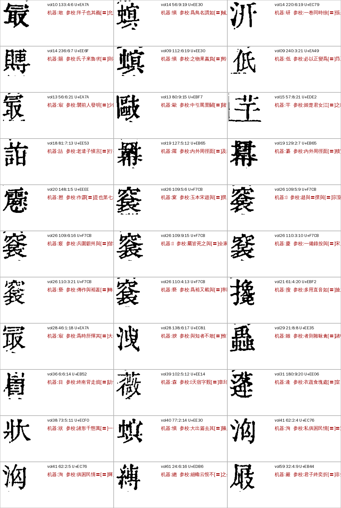
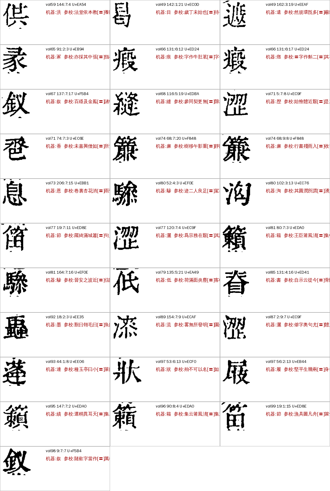

# R03 `glyph_pending` 待收字：现在为什么是 0、上线后会进什么（A24，2026-11-06）

> [待审原因总览](../README.md)

派单：Z06 顺带看。不调 API、不重跑整册。主办线程是「映射殆知阁私用码为真字」，本文只回答统计与上线口径，不碰码表判定。底稿、逐格表、脚本在 ai-team `domain/CV/质检/待审原因深挖/R03-*`、`Z06-scripts/`。

## 一句话

**R03 统计为 0 是环境没接上，不是真没有**。判 R03 要同时有两样东西：数据目录里的登记表（`config/pua/glyph_pending_codes.json`）和殆知阁源（`corpus/daizhige/0001–0005.jsonl`，回查私用码用）。统计／出单环境缺其中任何一样，这些格就全落回 R01（参校本缺字）。补齐后殿本 ★main 99 册现算 **R03 = 64 格（37 个码位）**，R01 同步 −64；线上单目前只有 1 格是 R03（vol31 180:9:20，那次出单的环境带齐了）。史記、全唐文没有殆知阁私用码，R03 永远是 0。

## 判定条件和现状

判定（`reasons.py`，priority 49）：整理本这一位是私用码，且它的永久编号「来源:码位」在登记表里 → R03。detail 写永久编号（如 `daizhige:U+F7CB`）。回查窗口：整理本这位前后各 20 字去殆知阁源里找原码位（`pua_lookup`），所以**源文件和登记表缺一不可**。

我的现算（各册 ★main 包，`reasons_for_pending`，同一套代码三种环境）：

| 环境 | R03 | 说明 |
|---|---:|---|
| 没设数据目录（`GUJI_WORKSPACE` 不指向工作区） | 0 | `load_glyph_pending` 吞掉异常返回空集；stats 里 `glyph_pending_registry_missing` = 99（每册 1） |
| 有登记表、没有殆知阁源 | 0 | 回查不出码位，格上没有 `pua_code` |
| **两样都有** | **64** | 37 个码，`glyph_pending_by_window` = 64；最多 U+F7CB 7 格（vol26 集中） |
| 线上单（`pending-stats` 现读） | 1 | 单上写的是出单时的原因，只有 vol31 一格带了 R03 |

登记表现状：151 项，其中 37 项是殆知阁码（都在码表里 verdict=pending），**114 项是 `siku-qiefen-v2:U+F10xx`**（码表 142 码只含殆知阁码，这 114 项没有对照）；码表里 verdict=pending 的殆知阁码有 44 个，**7 个没进登记表**（U+EBE4、EB2C、EACC、EC8C、EDC0、EA50、ECDC；R01 线程已发现，R01 里这类格 7 个）。

逐格表 ai-team `R03-逐格-殿本64格.tsv`（含参校本前后文、机器字、我的文意读法）。

## 完整流程和参数

1. 码表 `config/pua/pua_table.jsonl`（142 码）→ verdict=pending 导出 → 登记表 `glyph_pending_codes.json`（A31 推库，`guji db sync`）。**双向校验**：现在只校「登记表里有、码表不是 pending」（`pua_table_registry_mismatch`），漏了反方向（码表 pending、登记表没有），要补。
2. 出单／统计环境：数据目录要有 `config/pua/`（登记表＋码表）和 `corpus/daizhige/*.jsonl`；殆知阁源可从 `sikuquanshu.daizhige.net/data/0001–0005.jsonl` 直接下，不进语料指纹。
3. `reasons_for_pending` → `glyph_pending_by_window`（按窗口回查判成待收字的格数，**风险提示**：回查错了格会被悄悄藏起来，出单报告要单列）。
4. 去向：`deferred`、`reviewer none`，不派人审、不进大模型；页面显示字图不留字；等码表定字后统一回填。detail 只写永久编号。

## benchmark

定义两层：

| 指标 | 目标 | 现在 |
|---|---|---|
| ① 环境自检：出单后 `stats.glyph_pending_registry_missing == 0` 且 `pua_table_codes > 0` 且 `pua_table_registry_mismatch` 双向为 0 | 全满足才算 R03 数可信 | 现在不满足（双向差 7 码） |
| ② 窗口回查对不对：同码位的格图必须是同一个刻形。`Z06-scripts/r03_bench.py`：裁图取墨迹包围盒缩到 32×32，两两墨迹 IoU（容 ±2 像素平移） | 同码对 IoU 明显高于异码对 | 殿本 64 格：同码对 47 对均值 **0.56**，异码 1,969 对均值 0.35、第 99 百分位 0.48；47 对里只有 4 对低于 0.48，目视逐对看都是同一刻形（碎墨、邻字笔画造成） |
| ③ 目视抽核 | 首次上线抽 20 格 | 我看了全部 64 格图：窗口回查没有发现错格；17 个多格码的格图都是同一形（ED8E 节／笛 一对单看有点不像，放大看是同一个竹字头异体） |

## 怎么提高

- **R03 本身没有可降的**：它不是待审，是已判定「暂时找不到字」的留后。该做的是让统计和出单环境带齐数据，**A31 的出单与统计脚本（run3.py）要在环境里放 `config/pua/` 和 `corpus/daizhige/`**，并检查 ①。
- **补登记表 7 个码**：从码表重导（A24，`export_registry.py` 加反向校验）；对应格数 R01 报告里说是 7。
- **机器首位不能信，这正是 R03 不该放行的理由**：我按文意读出了 13 个码（31 格）的字，机器首位只对 8 格（26%）。例：U+EE30 机器说 愼（3 格），文意是 螟（螟蛉、螟蜮、螟螣）；U+EC76 机器说 洵，文意是 洶（洶湧、民情洶洶）；U+EC9F 机器说 歴／灑，文意是 澀（艱澀）。**这个读法给主办线程当线索**，不是金标，录入字形库时按 sheldon 定的规矩一律注明「最相近的异体字」：

| 码 | 格数 | 机器首位 | 文意读法 | 依据（参校本前后文） |
|---|---:|---|---|---|
| EE30 | 3 | 愼愼愼 | 螟 | 果蠃負〓蛉、〓蜮、去其〓螣 |
| EC76 | 3 | 洵洵洵 | 洶 | 民情〓〓、所謂〓湧 |
| EC9F | 3 | 歴灑灑 | 澀 | 艱〓、尤〓體 |
| EA7A | 3 | 敢㝡㝡 | 最（㝡） | 發明〓少、其〓大者、其義〓允 |
| EDA0 | 3 | 籍績籍 | 籟 | 清〓集、天〓集 |
| EB44 | 2 | 巖履 | 屐 | 折〓、幾兩〓 |
| EB65 | 2 | 羅纂 | 冪 | 面〓及積實 |
| F848 | 2 | 亷亷 | 簾 | 影重〓靜、雨入〓收 |
| EF0E | 2 | 驂驂 | 驂 | 良足〓駕、近〓信陽 |
| ECF0 | 2 | 狀狀 | 狀 | 萬〓一一、名〓 |
| EE35 | 2 | 雖墨 | 蟲 | 禽〓諸物、〓魚曰 |
| EE06 | 2 | 逄連 | 蓬 | 塊處〓室、小〓萊 |
| EA49 | 2 | 低低 | 低 | 為〓昻、炎塵〓客帽 |

- 其余 24 个码（33 格）我没把握，F7CB（7 格，人名「趙與〓」）机器给了 6 个不同字，只能等码表审核。

## 要谁做

| 事 | 谁 |
|---|---|
| 出单／统计环境接 `config/pua/` 与 `corpus/daizhige/`，出单后看 ① 三个数 | A31 |
| 登记表补 7 个码、加反向校验 | A24 |
| 上线首次抽核 20 格（已全看，无错格） | 已做 |
| 13 个码的文意读法当线索 | 「映射殆知阁私用码为真字」线程（sheldon 点头后才录字形库） |
