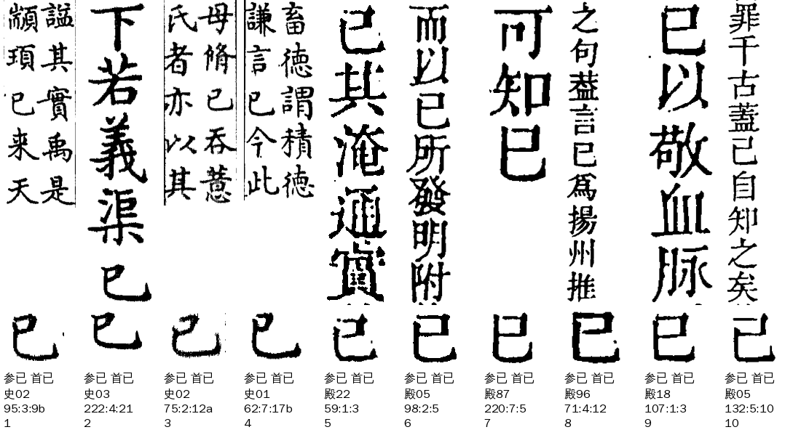
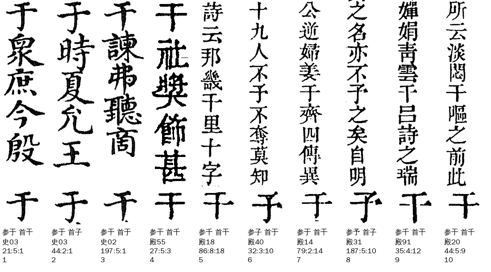
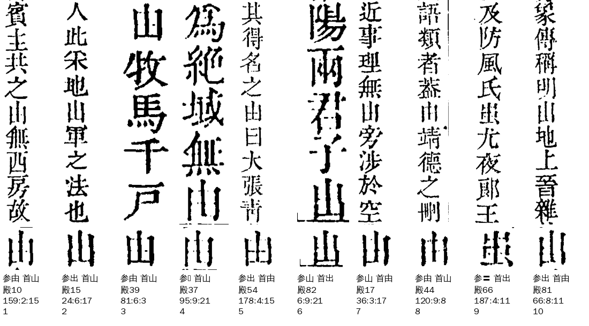
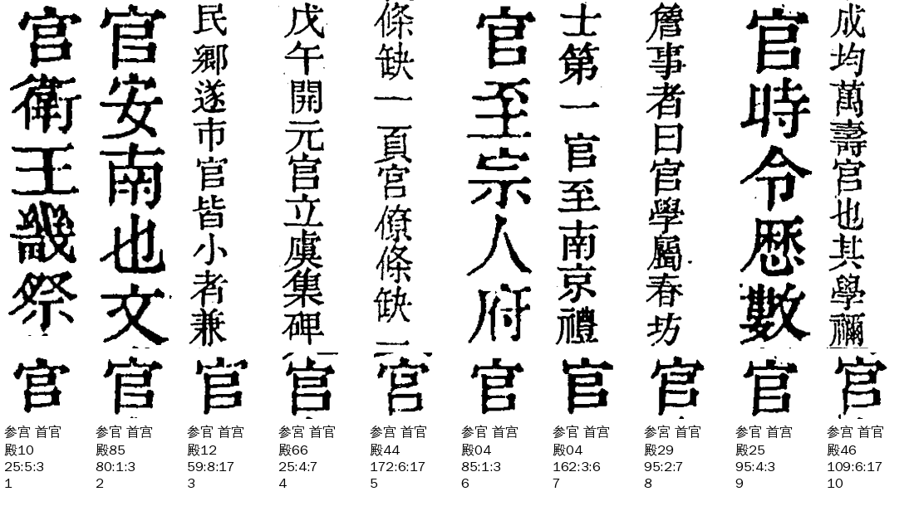
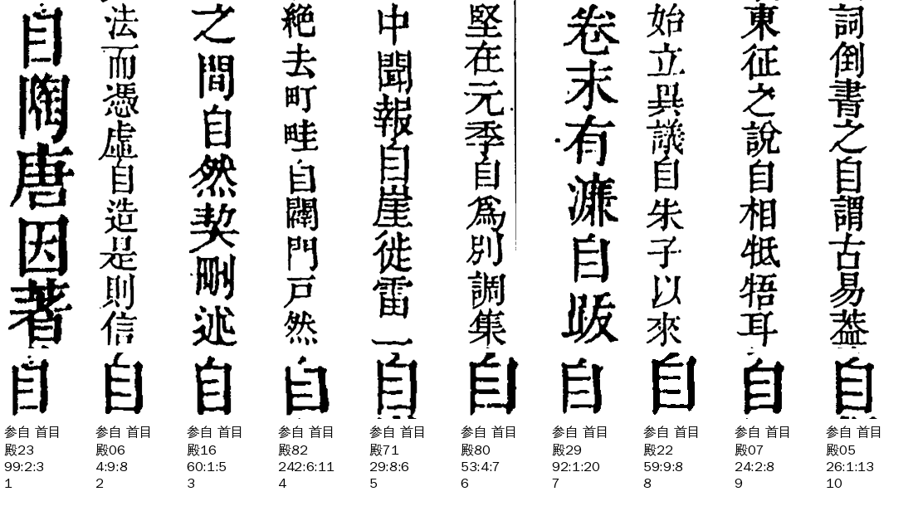
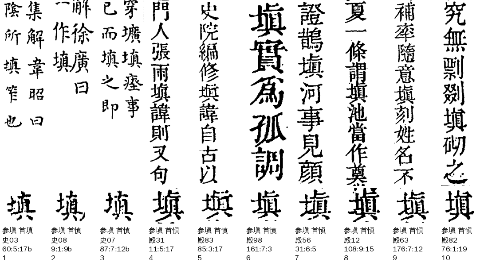
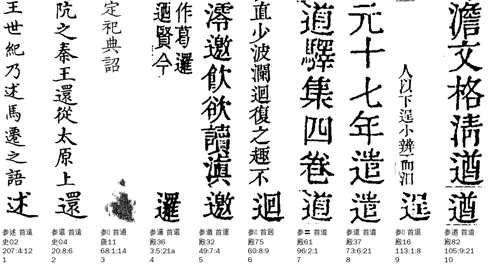
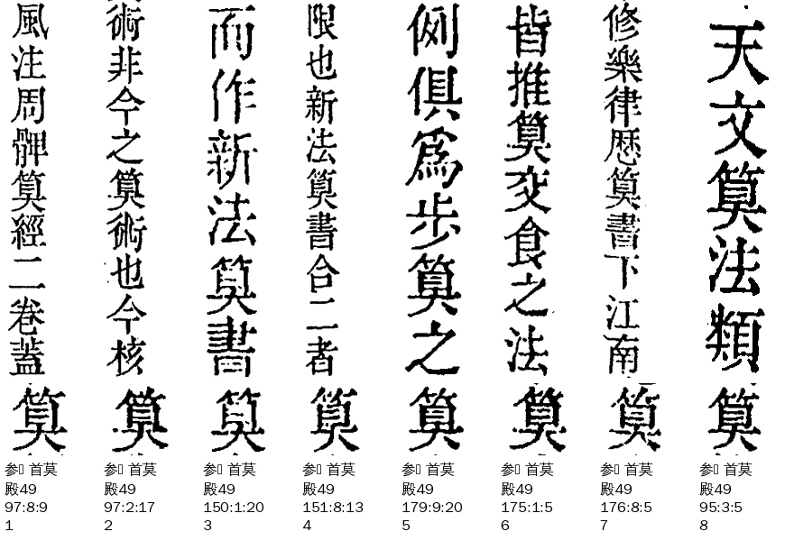
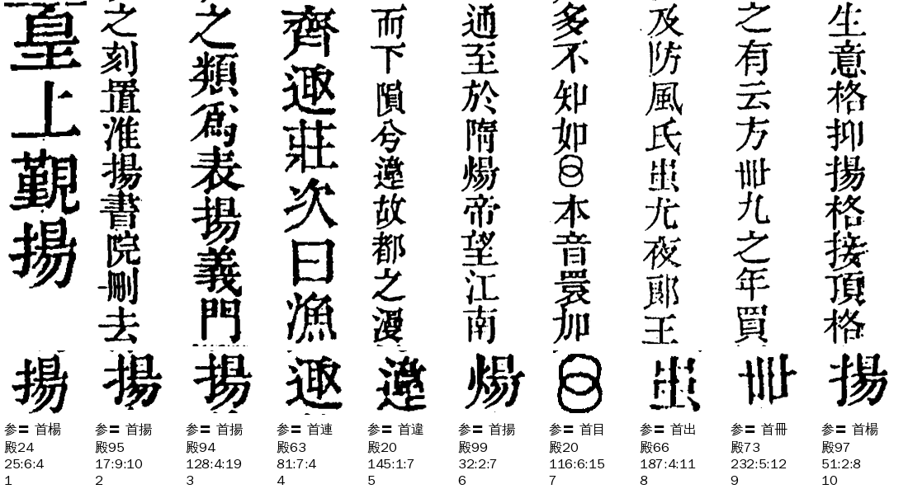

# Z01 `group_abstain`：形近字·没把握

> **11-07 新定义（manager#304，[Z类梳理](../Z类梳理.md)）**：Z01 只收「解法一个字都没给」的格，补放、联合判、复核都算（复核降审全弃权的格从这里来）；原 Z05 并进来的 `why=weak`（给了一个字但缺第二路）改归 Z07；字组已定字（含复核 keep）不归 Z。三书新口径 殿本 484、史記 40、全唐文 27。下文是 11-06 旧口径的分析。

> [待审原因总览](../README.md)

**一句话**：形近字，几种判法都没给出字，请按前后文选

## 一、这个原因是什么

古籍里有一批字长得很像、意思不同（于千子干、山出由、門族、辶族、己已巳……），光靠字形库分不开。cv 的**字组流程**（`groups/flow.py`）把这类格收进对应的「字组」，再让组里声明的几种判法（solver）来定字：字频、整字字形（ids）、笔画、文意规则（ctx L1）、文意表／大模型（ctx L2/L3）、看图（vis）等。

**组里的解法一个字都没给**，这一格就是 Z01（2026-11-07 起按 manager#304 的新分法：Z 类只按「解法给出了什么」分，场景写进 detail `<组>:lift|joint|review`）。和别的 Z 码的区别：

| 码 | 情形 |
|---|---|
| **Z01 `group_abstain`** | 一个字都没给（补放、联合判、复核都算） |
| Z07 差一路确认 | 只一路给了字，规定的第二路没确认（原先混在 Z01 的 weak 格） |
| Z02 `group_conflict` | 给了 ≥2 个不同字 |
| Z03 `group_demoted` | 复核，给的字与已放行字不同 |
| Z04 `group_ref_dissent` | 给的字与参校本另一个真字不同（参校本〓的落 R01） |

## 二、判定条件（代码怎么判）

- 判定代码：`guji_manager/review/reasons.py` 的 `_group_kind`，判序就是函数里的顺序：字组已定字（admit/keep/provisional）、`form_open`、`ref_missing/solo_weak` 不算 Z；参校本〓且是唯一反证落 R01；然后 Z04 → Z02 → Z03 → Z07 → **解法都没给字 → Z01**。
- Z 类整体排在 H01 极难形近之后：己已巳、日曰三处同字的格归 H01，不在 Z01。
- 一格要先「进组」才可能是 Z01。进组条件在 cv `flow.entry`：库首选 cov ≥ 0.85；与首选分差 < 0.03 的候选都在组员（或陪衬字）里；现役对位的整理本字（有的话）也是组员；现役对位缺、坐标对位字是组外字时不进组（cv#1189）。共字组（日曰目）可以联合进（joint）。
- 去向 `route: llm`：先由大模型按文意统一过一遍（只收 high），其余进人审点选页（`ui: pick`）。负责改算法／数据：A24。

## 三、现状（2026-11-07，新判法、★main 包逐格现算，正文页）

| 书 | Z01 格 |
|---|---:|
| 四库总目（殿本） | 485（其中 121 格在 19 册旧包里） |
| 史記 | 40 |
| 全唐文 | 27 |
| 合计 | **552** |

按「卡在哪」分：

| 桶 | 说明 | 格数 | 主要字组 |
|---|---|---:|---|
| ① 等离线裁定 | 文意 L3／看图 vis 记 `llm_pending`，问题已备好、还没人答 | **257** | 于千子干 56、本木 41、門族 38、侯𠋫 17、官宫 15、辶族 15 |
| ② 旧包 | 19 册殿本还是 cv 0.5/0.6.1 包，ctx 记 `cache_miss`／`llm_api_400` | 121 | 微㣲 15、門族 9 |
| ③ 组里只有字形判法 | 组只声明 ids／freq，字形分差不够就弃权，没有文意这一路 | 116 | 山出由 26、xjz 21、囗族 12、宋未朱 11、變𠮓 9 |
| ④ 文意判过没把握 | ctx low_conf／other | 47 | 日目 9、塡愼 7、官宫 7 |
| ⑤ 其他 | | 11 | |

参校字和库首选都是组员、只是不同字（组内之争）的有 399 格，最多的是 本>木 45、干>千 18、自>目 13、宫>官 11。

逐格明细、分类表：ai-team `domain/CV/质检/待审原因深挖/Z01-群组没把握.md`（第三版）、`Z01-cells-v3.tsv`。下面第四节的图是 11-06 旧单里的例子，其中第 1 类（己已巳同字）现已归 H01，第 4 类（整理本字是少见字）cv#1189 后大多不再进组。

## 四、什么样的字会落到 Z01（看图举例）

图的上半是这一格所在列的上下文，下半是本格；底下标「参」＝整理本这一位的字，「首」＝字形库首选，再下面是书、册、格号。

### 1. 己已巳／日曰：字形分不开，三处同字（115 格）

参校字、机器字、库首选都是「已」，库分 ≥ 0.95，但「己已巳」彼此只差 0.02 以内。H01 `hard_pair` 原先要求三者里有两个不同的字，这类三者同字的就掉进了 Z01（A31 已在 manager#243 改判法，以后归 H01）。看图 10 格里，按上下文约 6 格能定，**整理本错了 3 格**（「脩己」「以己所發明」「己以敬」都作「已」），所以不能按整理本定字。

### 2. 组内两字之争：于千子干予、山出由、官宫（约 250 格）

参校字和库首选都是组员，但不是同一个字。于千子干在刻本上只差一笔的弯直；山出由多是印淡、上横断笔。看图发现整理本也常错，比如「不予不奪」整理本作「子」、「雲干呂」作「千」，所以只能靠文意。

### 3. 字形其实分得开，但组里没有字形判法：自／目、塡／愼

- 自>目：图上都清楚是「自」，上面一撇很明显（自然、自造、自為、自謂），库首选却是「目」，自只差 0.001～0.03。目自组（mz）只有文意判法，文意碰到「自為／目為」这类两可的就弃权。
- 塡>愼：10 格全是土旁「塡」（塡詞、塡河、塡池、塡砌），库首选却是忄旁「愼／慎」。tsh 组也只有文意判法。

### 4. 整理本字是少见字，库里没有刻例：門辶囗族、𮅕（约 150 格）

整理本这一位是「遒、邀、邏、闕、闋、閘、圃、圉」这类少见字，字形库里没有它们的刻例，首选只好落到常见的组员上（道、運、間……），组又只会在组员里挑，于是必然弃权。这类格的整理本字大多只有坐标对位（现役对位缺这一格），入口看不到它，格才进了组。

𮅕 是 vol49 算學諸書里「算」的刻形，8 格全被库认成陪衬字「莫」。

### 5. 整理本这一位是〓（18 格）

整理本录不出的字记成〓。图上 7 格是扌旁「揚」，其余是蚩、卌、迴，还有圈号〇被拉进日目组当成「目」。这些格应先过私用码表，按 R01 处理。

## 五、怎么处理（现行）

1. `llm_queue export` 导出，开干净会话按前后文意在候选里选；两路都 high、同字、字形分够才放行（不在线调 API）。
2. 放不掉的进人审点选页，按同字全书格数排序。
3. 人裁结果回流成刻例；同一字对反复出现就加进字组白名单（`pair_whitelist`）。
4. 不要做：越过参校本只放本书白名单组；己已巳、日曰不按整理本定字。

## 六、怎么提高（待讨论，2026-11-07 更新）

| 措施 | 改哪 | 影响 | 放行？ | 状态 |
|---|---|---:|---|---|
| 第 6 轮包导出待裁、干净会话统一审 | `llm_queue export/import`，推裁定库，从 seed_admit 重放 | ① 257 | 只收 high | 待排 |
| 旧包重跑 | 第 6／7 轮 | ② 121（转入①） | — | 随轮次 |
| 山出由、xjz、囗族、宋未朱 加文意解法 | cv 组定义加 ctx、进 `group_flow_llm_groups`、补提示词 | ③ 约 70 | 之后走① | 待定，A24 |
| 目自组加「上撇」、塡愼组加偏旁字形判法 | cv 新字形解法（留出 0 错才上线） | 约 25 | 是 | 待定 |
| 己已巳日曰同字改归 H01 | manager reasons.py | 已移出 | — | 已做（manager#243） |
| 组外坐标对位字不进组 | cv `group_flow_coord_outside_skip` | 已移出 | 只改原因 | 已做（cv#1189） |
| 对位保留扩展区字 | cv align_ref 2.8 | 殿本对位缺位约 −109 | — | 已合 dev，第 7 轮（cv#1192） |

剩下的组内之争整理本不可靠（看图时 于千子干、己已巳 整理本都有错），最终还是文意加人审。
