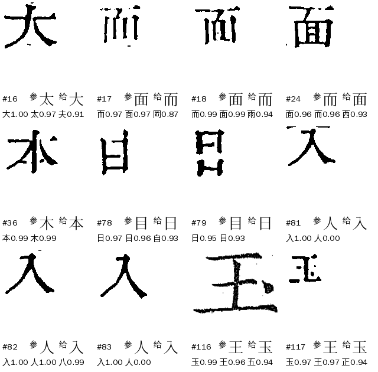
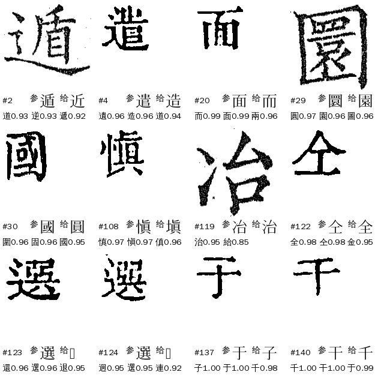
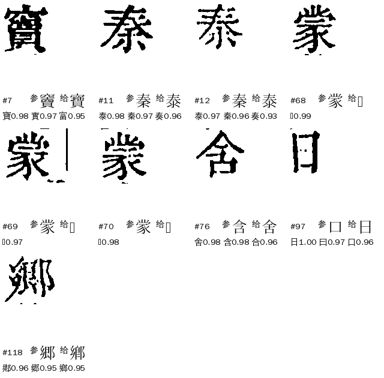
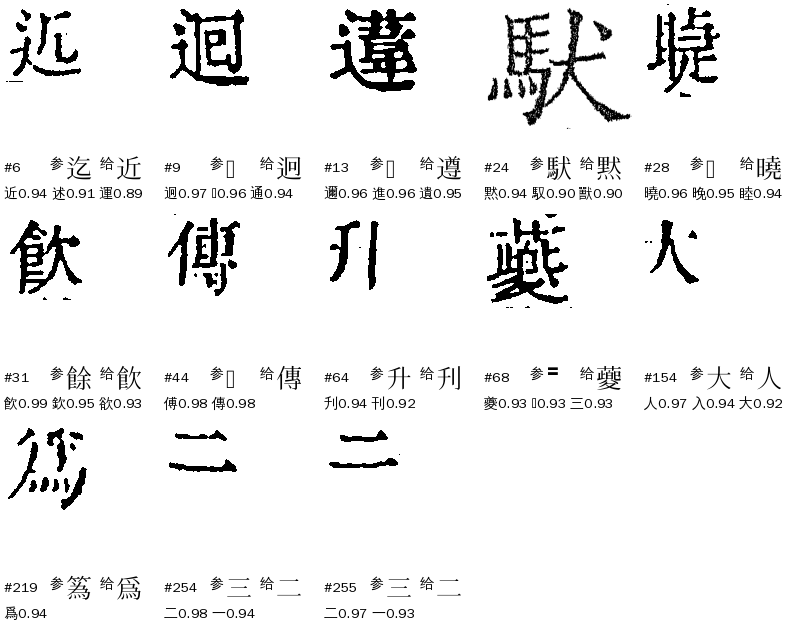

# Z04 `group_ref_dissent`：形近字·与参校本不同

> [待审原因总览](../README.md) ｜ 11-07 按 Z 类新分法（manager#304）重做；旧口径（11-06，292 格）的对账在文末
> 新定义依据：manager#304，[Z类梳理](../Z类梳理.md)。


**一句话**：形近字组里，**解法给了一个字**，但参校本（整理本）在这一位是**另一个真字**，组流程不敢放，留待审。它是个守卫：现在它拦下的格里，图上是参校字和图上是给字**各占一半**（可判的 56 格里 26 对 30），所以不能「信参校本」，也不能「信解法」，只能分组、分字对判。

## 一、什么情况下判成 Z04

判法在 `guji_manager/review/reasons.py` `_group_kind`（Z 类只按**解法给出了什么**分，场景写进 detail）。格带 `evidence.group`（进过字组流程）后：

1. 字组已定字（admit／keep／provisional）、`form_open`（V02）→ 不是 Z；
2. **补放闸 `why` 是 `ref_dissent`／`coord_dissent`，而参校字是真字 → Z04**；参校字是〓的不算（整理本缺字，落 R01）；
3. 复核（decision=demote）且疑问码是 `group_flow_ref_dissent`（整理本是组里另一形、方法没跟上）→ 也是 Z04；
4. 其余按「没给字 Z01／给 ≥2 字 Z02／复核一字不同 Z03／差一路确认 Z07」往下走。

| why | 含义 | 来自（cv `groups/flow.py` `group_flow_pass`） |
|---|---|---|
| `ref_dissent` | 现役对位（align_ref 的 replace）的参校字是**本组另一个字**，而给字的只有文意、或字形路没跟上；或组声明了 `lift_ref_agree`／`lift_img_ref_veto`，补放字必须和参校字同字 | `lift_ref_guard`、`lift_ref_veto`、`lift_img_ref_veto`、`lift_ref_agree` |
| `coord_dissent` | 现役对位缺这一格，只有**坐标对位**的参校字：它是组外字、陪衬字，或是组里另一字而给字的只有单遍文意 | `lift_ref_guard`（坐标分支） |

去向 `route=llm`（大模型读文意统一过一遍，只收 high），网页卡片 `pick`，负责 A24。

## 二、现在的情况（2026-11-07，新定义）

三书各册 ★main 包现算（出单同一套判法，只计正文页）：

| 书 | Z04 格 | 占该书待审 | ref_dissent | coord_dissent |
|---|---:|---:|---:|---:|
| 四库总目（殿本，99 册） | 137 | 5,299 的 2.6% | — | — |
| 史記（10 册） | 6 | 815 的 0.7% | — | — |
| 全唐文（11 册） | 4 | 208 的 1.9% | — | — |
| 合计 | **147** | | 108 | 39 |

（`ref_dissent`／`coord_dissent` 分书的数不重要，略。）对位：现役对位 84 格、坐标对位 63 格。场景：全部是补放（lift），复核降审那一路这次 0 格。

- 与 Z 类梳理报告（`ai-team domain/CV/质检/待审原因深挖/Z类-形近字组六码梳理.md`）数一致：147（137／6／4）。
- 36 格来自 cv < 0.6 的旧包（mn 蒙𫎇 16 格、men 4、rr 5…），下一轮重跑自然消失。
- 给字的解法（按首个给字者计）：字形 IDS（`ids`）86 格，文意（`ctx`）37，码位（`codepoint`）9，横画量（`yr_bars`）9、`ss_bars` 4、`bars` 1，字频 1。
- 三书用的「信参校本」旋钮不同（见第五节）：殿本不信整理本，史記开了 `reference_trust: very_high`，所以史記只剩 6 格。

**和 11-06 旧口径（292 格）比**：参校字是〓的 20 格去了 R01（卿𨜊约 235 格由 cv#1218 放行，Z04 里这 20 格是其中殿本被 Z04 先拿走的部分）；组外字那一类 cv#1189 生效，135 格里 121 格离开；新进 33 格（第 6 轮新包、复核疑问码并入）。对账表见文末。

## 三、什么样的字会进来

147 格逐格看过图（左边带框的是本格图，下面写参校字、给字、库前三）。先按**参校字相对这一组是什么**分三类（结构，自动可分），再标目视：「参」＝图上是参校字（给字错，守卫拦对）、「给」＝图上是给字（参校字错，守卫拦错）、「异」＝两个都是同一个字的不同写法、「难」＝目视分不开。**目视是 Claude 初判，不是人工金标**；「难」的 78 格要人确认。

| 类 | 说明 | 格 | 参 | 给 | 异 | 难 |
|---|---|---:|---:|---:|---:|---:|
| D 组内之争 | 参校字是本组另一字，字形细部决定 | 103 | 16 | 24 | 4 | 59 |
| C 参校字是陪衬字 | 参校字在组的陪衬表里（蒙 的 䝉／家，寶 的 寳…） | 30 | 1 | 5 | 8 | 16 |
| A 组外字 | 参校字既不是组员也不是陪衬字，现役对位给的 | 14 | 9 | 1 | 1 | 3 |
| 合计 | | **147** | 26 | 30 | 13 | 78 |

可判的 56 格里参校字对 26、给字对 30，**拦对率 46%**（11-06 旧口径是 69%——差别主要是旧口径里那 135 格「库没有这个字、被组吞掉」图上多是参校字，现在已出组）。

### D 组内之争（103）：字形细部，参校本与解法各对一半

参校字是本组另一个字，两个字只差一两笔：

- **入人八**（17）：参校字是人／入／八之一，给字来自 `ids`＋`rr_img` 两路字形（12 格，含 1 格文意＋`rr_img`）或单 `ids`（5）。可判 12 格**全是给字对**（参校字错），0 格参校字对，5 格难。这是 D 里最可能放的一块。
- **门族**（22）：参校字与给字都是 間問閒開關…，部件内部差几笔，缩略图看不出，要放大逐格人看。
- **而面**（8）：给字都是 而／面，3 格给字对、1 格参校字对、4 难。
- **于千子干**（11）：解法给 子／千／于，可判 9 格里 8 格是**参校字对**（予、于、干、下），守卫全拦对，**不能放**。
- **一二横画**（10）：`yr_bars` 量横，9 格难（切残的横画碎片）。
- 其余：戊戌戍 5、十士 4（`ss_bars`）、形近对 xjz 4、辶族 3 …





### C 参校字是陪衬字（30）

参校字在组的 `tolerate` 陪衬表里。给字与它是同字另一写法的占约四分之一（蒙／𫎇、寶／寳），图上两个都对；16 格难判（mn 蒙𫎇 16 格全在 cv 0.5.2x 旧包里，下一轮自消，其余多是写本形）。



### A 组外字（14）

现役对位给的参校字不在组里。组只会在组员里挑字，挑出来是错的，9 格图上是参校字。`group_flow_coord_outside_skip`（cv#1189，缺省开）管的是**现役缺位、坐标对位**的组外字，第 6 轮包已生效：11-06 的 135 格里 121 格离开 Z04；剩下这 14 格是现役对位给的，不在这个闸的范围。


### 守卫拦错的格（给字对、参校字错，30）

主要是 入人八（12）、而面（3）、日目（2）、人大…；参校字错的原因多是整理本这位排成了形近字（面／而、人／入），说明参校本在这几个字对上不可信。

## 四、流程：什么字会进、怎么判、什么情况落到 Z04

```
格 ─(1)进组？──(2)组里判字──(3)与参校本互证守卫──(4)兜底──放行 or 待审(原因)
```

**(1) 进组**（cv `groups/flow.py` `entry`）：格没放行、不是人裁、没撞硬护栏；库首位 cov ≥ `group_flow_min_cov`(0.85)，所在组在册配置的 `group_flow` 名单里；与首位分差 < `group_flow_delta`(0.03) 的候选全在该组（或 `tolerate` 陪衬）；有现役对位字的，它也得在组里。**现役对位缺位、坐标对位字是组外字时，`group_flow_coord_outside_skip`（缺省开）不进组。**

**(2) 判字**：按组声明的方法依次跑（`groups/methods.py`）：文意 `ctx`（L1 规则／L2 模型／L3 答案表）、字形 `ids`、码位、字频、横画 `bars`、专用字形（`rr_img`、`ss_bars`…）。`combine=first` 取第一个给字的，`agree` 要全部同字。

**(3) 与参校本互证守卫**（`group_flow_pass`，按顺序，命中就是 Z04）：

| 顺序 | 条件 | why | 参数 |
|---|---|---|---|
| 1 | 现役对位的参校字是组里另一字，且只有文意给字 | ref_dissent | `group_flow_lift_ref_guard`(缺省开)；`strong_over_ref`（日曰：文意 strong 可越过） |
| 2 | 参校字是组里另一字，不论谁给字 | ref_dissent | 组声明 `lift_ref_veto`，或书级 `group_flow_lift_ref_veto` |
| 3 | 字形只给了参校字以外的组员、文意没给 | ref_dissent | 组声明 `lift_img_ref_veto`（入人八） |
| 4 | 要求补放字＝参校字（部首族、陪衬字挡门） | ref_dissent／ref_missing | 组声明 `lift_ref_agree`、`tolerate_ref_agree` |
| 5 | 现役缺位，坐标对位字是组外字 | coord_dissent | `lift_ref_guard`；二审小组确认可越过（`strong_over_ref`）；**坐标对位是 〓 的现在不进 Z04（落 R01）**，qing 组由 `PROVISIONAL.gap` 兜底（cv#1218） |
| 6 | 现役缺位，坐标对位字是组里另一字，给字只有单遍文意 | coord_dissent | 同上 |

**(4) 兜底**：同义异体组暂归一（`group_flow_provisional`，`registry.PROVISIONAL`，含 `gap`：整理本缺字也算一路证人）；书级「按整理本走」（`group_flow_abstain_ref_ok`、`follow_ref_variants`、`reference_trust`）；字块图像＋文意 L4（`vis_model`，管线不在线问，读裁定库）。都不满足，格带 `group_flow_ref_dissent`／`group_flow_coord_dissent` 疑问码，原因 Z04。

## 五、参数（每本书自己试）

框架固定，下面这些是**每本书可以调的旋钮**（册 yaml `params.seed_admit`，`guji book show --effective` 看生效值）。

| 旋钮 | 作用 | 缺省 | 殿本 | 史記 | 全唐文 |
|---|---|---|---|---|---|
| `group_flow` | 开哪些字组 | 通用组 | 全开 | 全开 | 全开 |
| `group_flow_min_cov` / `delta` | 进组的库首位 cov 下限、分差 | 0.85 / 0.03 | 缺省 | 缺省 | 缺省 |
| `group_flow_coord_outside_skip` | 坐标字是组外字不进组 | 开（#1189） | 缺省 | 缺省 | 缺省 |
| `group_flow_lift_ref_guard` | 补放与参校本互证 | 开 | 缺省 | 缺省 | 缺省 |
| `group_flow_lift_ref_veto` | 这几组参校字是组里另一字就不放 | 空 | 空 | 空 | 空 |
| `group_flow_abstain_ref_ok` | 这几组复核弃权时按参校字走、同义异体取参校形 | 空 | 空 | zh bie cp_yin3b cp_yan2 shuo weim xiang | 空 |
| `group_flow_lift_shape_ref` | 字形路给参校字且无异议也补放 | 空 | 空 | 空（`reference_trust` 带 ry） | 空 |
| `reference_trust` | 一键信参校本：none／high／very_high | none | none | very_high | none |
| `ref_topk_follow` | 参校字在库前 5 名、与首位差≤0.05 按参校字放 | 关 | 关 | 开 | 关 |
| `ref_lib_coord`（`_cov` 0.96／`_gap` 0.01／`_dissent`） | 参校字＝库首位＝本格字放行 | 关 | 80/99 册开 | 关（`reference_trust` 已含） | 开（`_dissent` 开） |
| `follow_ref` / `follow_ref_seen` | 看图核实过的字对按参校形放 | 空 | follow_ref 9 对（册内另有 47 册各自追加） | follow_ref、follow_ref_seen `傳=傅,太=大,大=太` | follow_ref 10 对 |
| `lane_coord_few_stroke` | 少笔画字（一二三下十子予）盲放禁区 | 空 | 空 | 空（只是建议） | 空 |
| `group_flow_provisional`／`_to` | 同义组暂归一／本书暂归一字形 | 开／空 | 缺省 | 缺省 | 彝 |
| `group_flow_tolerate_extra` | 书级追加陪衬字（只放宽进入） | 空 | 空 | 空 | 空 |

> 取值来自 2026-11-06 的 `config/book_defaults.yaml`；册 yaml 可再覆盖。**没有一个旋钮是只管 Z04 的**，Z04 是这条链上几处守卫的同一个出口。

## 六、怎么提高

换书时先看体检信号（`python tools/z04_profile.py --ws … --text … --out …` 出表）：

| 信号 | 看什么 | 本书（殿本）值 | 意味着 |
|---|---|---|---|
| 守卫拦对率 | 可判格里图＝参校字的比例 | 46%（26/56） | 接近一半：参校本在这些字对上不可信，不能开 `reference_trust`，也不能放开守卫，要分字对金标 |
| 组外字占比 | A 类 / Z04 | 10%（14/147） | 高于 30% 说明入口过宽，先确认 `coord_outside_skip` 开着 |
| 陪衬字占比 | C 类 / Z04 | 20% | 同义异体暂归一被陪衬字挡 |
| 难判占比 | 难 / Z04 | 53% | 要给该组专门的字形金标 |
| 旧包占比 | cv<0.6 包的格 / Z04 | 24% | 先重跑再看 |

方向（都没改代码，改前要 sheldon 点头，改原因分类要先通知 A31–A34）：

1. **入人八两路字形一致越过参校本（−12，最先做）**：`lift_img_ref_veto` 现在把「字形给了参校字以外的组员、文意没给」全拦下。本批 17 格里可判 12 格全是给字对（0 错放），5 格难。建议给 rr 加书级豁免：`ids`＋`rr_img` 两路同字时不拦。要按 11-05 定的「越过整理本白名单按书按组 30 格金标」做；全唐文、史記各 1 格，不够，金标先在殿本做。
2. **于千子干不动**：可判 9 格里 8 格是参校字对，守卫全拦对。`z04_bench.py --rule '字组=="zy"'`：放 11，对 1，错放 8。
3. **同义异体暂归一（陪衬字挡兜底，−8 左右）**：蒙𫎇 16 格在旧包，重跑后自消；其余把「分差内全在同字写法里」放宽到只看陪衬字，逐组看图。
4. **而面、门族、一二横画、十士（约 40 格）**：目视定不了，给每组出字对看图页（`review-pages build pair_whitelist`）定金标，再谈放行。
5. **出组之后别丢字（见第七节）**：#1189 把 121 格组外字推出 Z04，其中已有 123 格（含其他原因出来的）被放行；**13 格图上是给字、却被放成参校字**，要核。

预计：Z04 147 格里，真放行最多 −12（入人八）−8（异体），另有约 40 格要金标再定，其余约 90 格留大模型读文意＋人审。

## 七、benchmark

对任何 Z04 改动看这五个数（`ai-team domain/CV/质检/待审原因深挖/Z04-scripts/z04_bench.py`，体检用 `tools/z04_profile.py`）：

1. **规模**：各书 Z04 格数、占比。
2. **拦对率**：金标里图＝参校字的比例（现 46%）。
3. **候选规则评分**：放给字的格里 对／错放／未知；**错放必须 0**，未知越少越可信。例：
   - `字组=="rr"`：放 17，对 12，错放 0，未知 5；
   - `字组=="em"`：放 8，对 3，错放 1，未知 4（不能整组放）；
   - `字组=="zy"`：放 11，错放 8（不要放）。
4. **出组去向**：旧 292 格里 178 格移出 Z04，去向与放行字对不对，见文末对账；移出之后别丢字、别放错。
5. **跨书**：同一规则在史記、全唐文各按组抽 30 格金标，不继承殿本。

金标现状：`Z04-逐格-三书147格.tsv` 的「目视初判」（Claude 初判，r／g／y 共 69 格可当临时金标，v／m／s 共 78 格待人判）。要定正式金标，用 `review-pages build gold_sample` 出给 sheldon，每格选「参校字／给字／两个都对／分不清」。

## 八、不要做

- 不要按参校本直接改字：拦对率只有 46%，入人八、而面里参校本错了一半以上。
- 不要放于千子干的 `ids` 给字：9 格里 8 格图上是参校字。
- 不要把「出组」当解决：出组的格被别的通道放成什么字，要对（第七节第 4 条）。
- 不要为 Z04 单开修法：它是几处守卫的共同出口，改守卫要同步看 Z01／Z02／Z07。

## 九、回流与防再犯

- 人审确认的真错（参校字错）记进 `follow_ref_seen`（看图核实过的字对），下一轮自动按对处理。
- 新字组上线后先看它在 Z04 的格数与第六节信号，再决定要不要给它 `lift_ref_veto`／`lift_img_ref_veto`。

## 十、旧口径（11-06，292 格）对账

旧 292 格对新 147 格：保留 114、移出 178、新进 33。178 格移出之后：

| 去向 | 格 | 说明 |
|---|---:|---|
| 已不在待审（第 6 轮包已放行） | 123 | 117 格放成**参校字**（`coord_fallback` 41、`witness3` 28、`rare_ref` 23、`match_ref` 19…），5 格放成给字，1 格其他 |
| R01 参校本缺字 | 19 | 旧口径里参校字是〓的 |
| ref_final_diff（P02） | 8 | |
| 仍在 Z 类别的码（Z03 7、Z01 7、Z02 1、Z07 1） | 16 | |
| 其他（L04 6、P01 3、N01 2、V01 1） | 12 | |

**放行字与目视对账**：123 格里，我目视图上是参校字的 54 格全部放成了参校字（对）；目视图上是给字的 13 格里 12 格也被放成参校字，其中 1 格是 human 通道（人裁）、2 格是写法异体（𫝊／傳 一类，不算错），**约 10 格疑似错放**：近→迄、迴→𮞉、曉→𥈤、飲→餘、刊→升、爲→䈧、二→三 ×2、人→大……见图 9，逐格见 ai-team `Z04-旧292格去向对账.tsv`。这些是 #1189 出组后由 `coord_fallback`／`witness3`／`rare_ref`／`match_ref` 放的，不是字组的事，已报协调者转 A31。



## 现状来源

2026-11-07 三书各册 ★main 包现算（殿本 99 册 cv 0.5.25–0.6.16，史記 10 册、全唐文 11 册）；分析稿、逐格表、脚本与全部拼图在 ai-team `domain/CV/质检/待审原因深挖/Z04-与参校本不同.md`、`Z04-逐格-三书147格.tsv`、`Z04-旧292格去向对账.tsv`、`Z04-scripts/`、`Z04-图/`。
