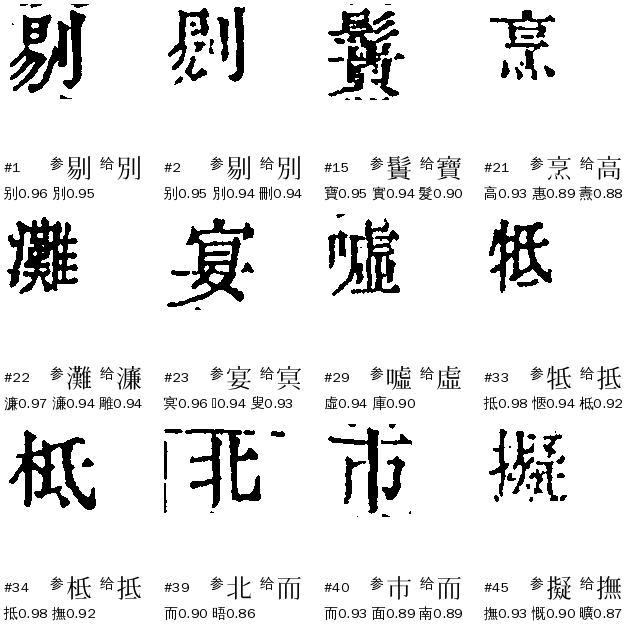
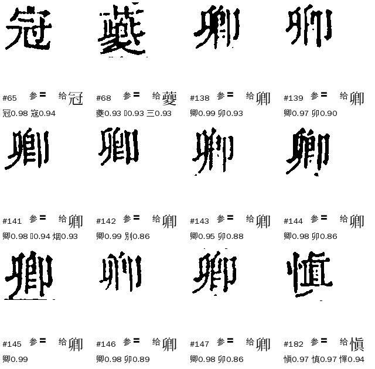
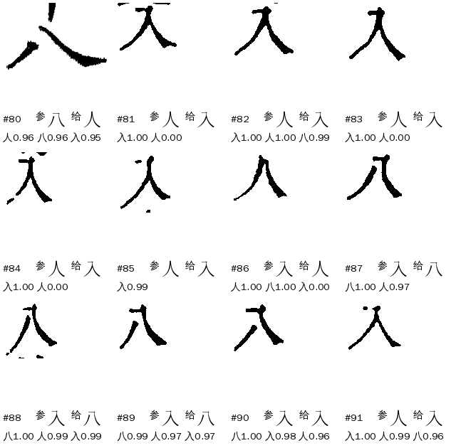
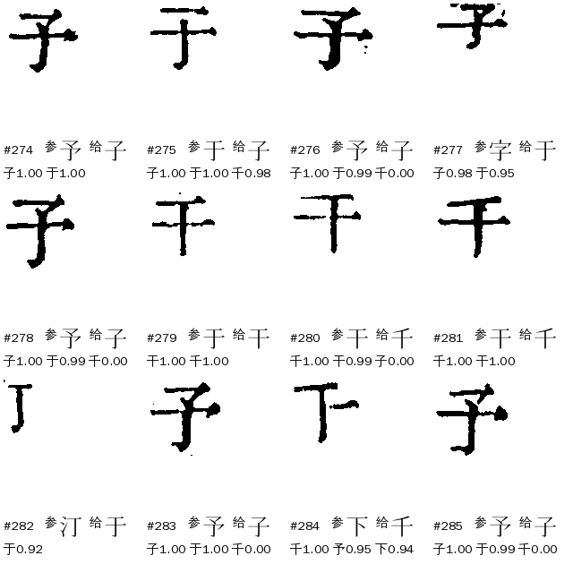
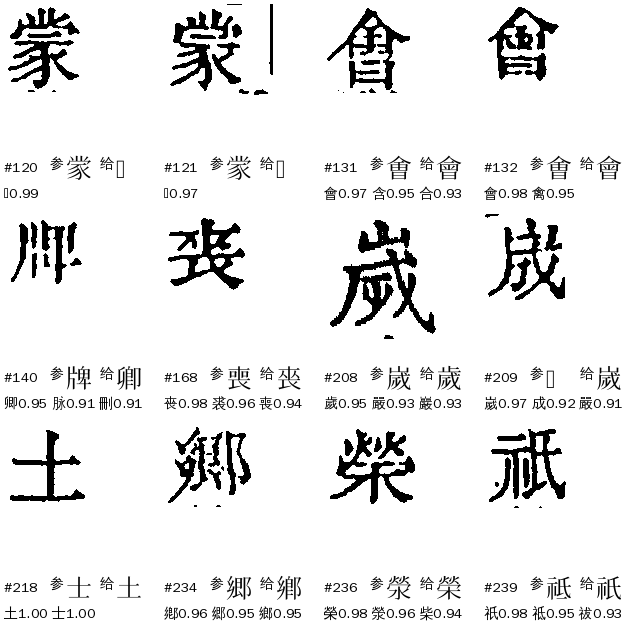
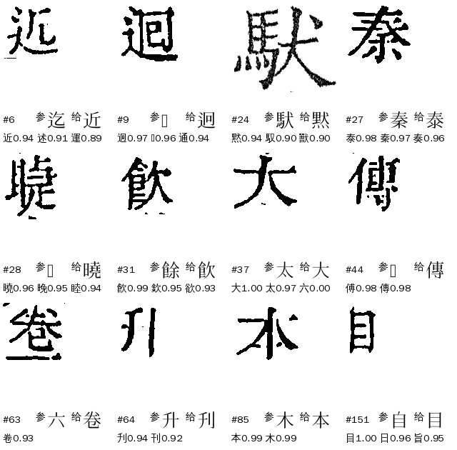

# Z04 `group_ref_dissent`：形近字·与参校本不同

> **11-07 新定义（manager#304，[Z类梳理](../Z类梳理.md)）**：Z04 收「解法给了一个字，参校本（现役或坐标对位）是另一个真字」，补放（ref／coord_dissent）、复核（`group_flow_ref_dissent`）都算；**参校字是〓的不算，落 R01**（原 245 格，卿𨜊 235 格已由 cv#1218 暂归一放行）。三书新口径 殿本 137、史記 6、全唐文 4。下文是 11-06 旧口径的分析。

> [待审原因总览](../README.md)

**一句话**：形近字组里，**解法给了字**，但参校本（整理本）在这一位的字和它不一样，组流程不敢放，留待审。它是个**守卫**：拦下来的格里，约七成图上确实是参校字（见下），所以它拦得对；要降的是「拦下之后还要人看」的格数，不是去推翻守卫。

## 一、什么情况下判成 Z04

判法在 `guji_manager/review/reasons.py` `_group_kind`：格带 `evidence.group`（进过字组流程）后，按顺序看——

1. 带 `form_open` 疑问码 → Z06；
2. **没有任何 solver 给字** → Z01（弃权）；
3. 组流程的 `why` 是 `ref_dissent`／`coord_dissent`／`ref_dissent_follow` → **Z04**；
4. 其余再分 Z02 判法打架、Z03 复核推翻、Z05 证据弱。

所以 Z04 的前提是：**有 solver 给了字**（否则是 Z01），而且组流程的「与参校本互证」闸把它拦了。`why` 两种：

| why | 含义 | 来自（cv `groups/flow.py` `group_flow_pass`） |
|---|---|---|
| `ref_dissent` | 现役对位（align_ref 的 replace）的参校字是**本组另一个字**，而给字的只有文意、或字形路没跟上；或部首族／门族等组声明了 `lift_ref_agree`，补放字必须和参校字同字 | `lift_ref_guard`、`lift_ref_veto`、`lift_img_ref_veto`、`lift_ref_agree` |
| `coord_dissent` | 现役对位缺这一格，只有**坐标对位**的参校字：它是组外字、或是组里另一字而给字的只有单遍文意 | `lift_ref_guard`（坐标分支） |

只有**补放（lift）**一路会产生 Z04：2026-11-06 三书现算的 292 格全是 `mode=lift`，复核降审那一路（`review_ref_agree`）一格也没有。去向 `route=llm`（大模型读文意统一过一遍，只收 high），网页卡片 `pick`，负责 A24。

## 二、现在的情况（2026-11-06）

三书各册 ★main 包现算（出单同一套判法，只计正文页）：

| 书 | Z04 格 | 占该书待审 | ref_dissent | coord_dissent |
|---|---:|---:|---:|---:|
| 四库总目（殿本，99 册） | 277 | 4,715 的 5.9% | 135 | 142 |
| 史記（10 册） | 10 | 845 的 1.2% | 6 | 4 |
| 全唐文（11 册） | 5 | 125 的 4.0% | 3 | 2 |
| 合计 | 292 | | 144 | 148 |

- 派单里的 219 是线上单口径，★main 包现算 292（线上单比包旧）。逐格表：ai-team `domain/CV/质检/待审原因深挖/Z04-逐格-三书292格.tsv`。
- 其中 38 格来自 cv < 0.6 的旧包（mn 蒙𫎇 16 格是 vol03–05 的 0.5.2x 包；那时还没有「坐标字是同字另一写法不算组外字」的豁免），下一轮重跑自然消失。
- 292 格里 291 格只有一个字被给出，1 格两个解法给了不同字；给字的解法（按首个给字者计）：字形 IDS（`ids`，含与 `rr_img` 同给的 8 格）约 149 格、文意（`ctx`）约 52、码位（`codepoint`）32、字频（`freq`）24、横画量（`ss_bars`／`yr_bars`／`bars`）34。
- 三书用的「信参校本」旋钮不同（见第五节）：殿本不信整理本，史記开了 `reference_trust: very_high`，所以史記只剩 10 格。

## 三、什么样的字会进来

292 格逐格看过图（左边带框的是本格图，下面写参校字、给字、库前三）。先按**参校字相对这一组是什么**分四类（结构，自动可分），再标目视：「参」＝图上是参校字（给字错，守卫拦对）、「给」＝图上是给字（参校字错，守卫拦错）、「异」＝两个都是同一个字的不同写法、「难」＝目视分不开。**目视是 Claude 初判，不是人工金标**，「难」的 123 格要人确认。

| 类 | 说明 | 殿本 | 史記 | 全唐文 | 合计 | 参 | 给 | 异 | 难 |
|---|---|---:|---:|---:|---:|---:|---:|---:|---:|
| A 组外字被吞 | 坐标对位的参校字既不是组员也不是陪衬字，库首位却落在组里 | 128 | 5 | 2 | **135** | 74 | 15 | 13 | 33 |
| B 参校字是〓 | 整理本这一位缺字（〓），被当成「组外字」拦了 | 20 | 0 | 0 | **20** | 0 | 8 | 9 | 3 |
| C 参校字是陪衬字 | 参校字在组的陪衬表里（家、卿、徵…），库里分差内跟着给字 | 29 | 0 | 0 | **29** | 3 | 4 | 8 | 14 |
| D 组内之争 | 参校字是本组另一字，字形细部决定（门族、十士、于千子干、入人八…） | 100 | 5 | 3 | **108** | 15 | 14 | 5 | 74 |

### A 组外字被吞（135）

库里没有这个字（或只有糊的），格图和库里某个组员的覆盖率也有 0.92–0.96，库首位落进组，组流程在组员里挑字，挑出来的当然是错的；参校字（坐标对位）才是真字。最典型的是 `shan` 刪删：11 格的字是 嘲、惻、爾、闕、柵、制、副…，库首位全是「刪」（左下像冊、右边是刂），解法 `ids` 给 刪，图上全是参校字。



这一类 cv#1189（`group_flow_coord_outside_skip`，缺省开，已合 dev、进 v0.6.16）正是针对它：现役对位缺位、坐标对位字是组外字就**不进组**。★main 包都是 0.6.4 及更早生成的，下一轮重跑后这 135 格不再是 Z04，改落 L01／P02 等。注意：它们不是「解决了」，是换了个去处；其中 74 格图上是参校字，15 格是给字（出组后这 15 格会丢掉一个本来对的字形判）。

### B 参校字是〓（20）

整理本这一位是 〓（整理本缺字、知道有字不知道是哪个字）。组流程把坐标对位的 〓 当成「组外字」，`coord_dissent` 拦下（只有 `solo_margin` 的彝组豁免）。20 格全是殿本：卿 10、揚 5、冠、夔、愼、𨽾、歴、闕。图上 17 格是给字（卿、揚、冠、夔…的某个写法），另 3 格目视难定。〓 说明参校本根本没给证据，拦它没有道理——这是 Z04 里**最干净的一块**，下面第六节提方案。



### C 参校字是陪衬字（29）

参校字在组的 `tolerate` 陪衬表里（蒙 组的 䝉／家，徵，寶 的 寳 等），给字与它是同字另一写法的占约一半。这类图上常「两个都对」，少数是真错（辶族 的 适→適、于千子干 的 干／千）。

### D 组内之争（108）

参校字是本组另一个字，形近到只差一两笔，看图也难：门族 22、十士 21、于千子干 18、入人八 13、日曰型 横画 10、官宮 6、戊戌戍 4 …

- **于千子干**（18）：解法 `ids` 给 子／千，图上 13 格是参校字（予、于、干、下），守卫全拦对，**不能放**；
- **十士**（21）：`ss_bars` 量横画给 十，参校字是 士（19/20）；格图是残字加几粒点，约一半隐约有第二横，要量横金标定，不是目视能定的；
- **入人八**（13）：`ids`＋`rr_img` 两路字形一致给字的 9 格，图上全是给字，参校字错——这是 D 里**唯一一块可能放**的；
- **门族**（22）：参校字与给字都是 間問閒開關…，部件内部差几笔，缩略图看不出，要放大逐格人看。




### 同义异体写法（跨 A–D，35）

给字与参校字是同一个字的两种写法（卿／𨜊、歲／嵗、蒙／𫎇、會／會、仝全…），守卫拦它是白拦：同义异体殿本按规矩暂归一（`PROVISIONAL`），但兜底要求库首位**分差内**的候选全在同字写法里，常被一个形近陪衬字（嚴、卯）挡住。



### 守卫拦错的格（给字对、参校字错，41）

主要是参校字是个形近字或 〓（迄→近、遺→遵、人入八…），说明守卫确有代价：拦下对的字，只是代价小（宁可送审）。



## 四、流程：什么字会进、怎么判、什么情况落到 Z04

```
格 ─(1)进组？──(2)组里判字──(3)与参校本互证守卫──(4)兜底──放行 or 待审(原因)
```

**(1) 进组**（cv `groups/flow.py` `entry`）：格没放行、不是人裁、没撞硬护栏；库首位 cov ≥ `group_flow_min_cov`(0.85)，所在组在册配置的 `group_flow` 名单里；与首位分差 < `group_flow_delta`(0.03) 的候选全在该组（或 `tolerate` 陪衬）；有现役对位字的，它也得在组里。**现役对位缺位、坐标对位字是组外字时，`group_flow_coord_outside_skip`（缺省开）不进组**。

**(2) 判字**：按组声明的方法依次跑（`groups/methods.py`）：文意 `ctx`（L1 规则／L2 模型／L3 答案表）、字形 `ids`、码位、字频、横画 `bars`、专用字形（`rr_img`、`ss_bars`…）。`combine=first` 取第一个给字的，`agree` 要全部同字。

**(3) 与参校本互证守卫**（`group_flow_pass`，按顺序，命中就是 Z04）：

| 顺序 | 条件 | why | 参数 |
|---|---|---|---|
| 1 | 现役对位的参校字是组里另一字，且只有文意给字 | ref_dissent | `group_flow_lift_ref_guard`(缺省开)；`strong_over_ref`（日曰：文意 strong 可越过） |
| 2 | 参校字是组里另一字，不论谁给字 | ref_dissent | 组声明 `lift_ref_veto`，或书级 `group_flow_lift_ref_veto` |
| 3 | 字形只给了参校字以外的组员、文意没给 | ref_dissent | 组声明 `lift_img_ref_veto`（入人八） |
| 4 | 要求补放字＝参校字（部首族、陪衬字挡门） | ref_dissent／ref_missing | 组声明 `lift_ref_agree`、`tolerate_ref_agree` |
| 5 | 现役缺位，坐标对位字是组外字（含 〓） | coord_dissent | `lift_ref_guard`；〓 仅 `solo_margin>0` 的组豁免；二审小组确认可越过（`strong_over_ref`） |
| 6 | 现役缺位，坐标对位字是组里另一字，给字只有单遍文意 | coord_dissent | 同上 |

**(4) 兜底**：同义异体组暂归一（`group_flow_provisional`，`registry.PROVISIONAL`）；书级「按整理本走」（`group_flow_abstain_ref_ok`、`follow_ref_variants`、`reference_trust`）；字块图像＋文意 L4（`vis_model`，管线不在线问，读裁定库）。都不满足，格带 `group_flow_ref_dissent`／`group_flow_coord_dissent` 疑问码，原因 Z04。

## 五、参数（每本书自己试）

框架固定，下面这些是**每本书可以调的旋钮**（册 yaml `params.seed_admit`，`guji book show --effective` 看生效值）。换书时先看第六节的「体检信号」决定开哪个。

| 旋钮 | 作用 | 缺省 | 殿本 | 史記 | 全唐文 |
|---|---|---|---|---|---|
| `group_flow` | 开哪些字组 | 全集 | 全开 | 全开 | 全开 |
| `group_flow_min_cov` / `delta` | 进组的库首位 cov 下限、分差 | 0.85 / 0.03 | 缺省 | 缺省 | 缺省 |
| `group_flow_coord_outside_skip` | 坐标字是组外字不进组 | 开（#1189） | 缺省 | 缺省 | 缺省 |
| `group_flow_lift_ref_guard` | 补放与参校本互证 | 开 | 缺省 | 缺省 | 缺省 |
| `group_flow_lift_ref_veto` | 这几组参校字是组里另一字就不放 | 空 | 空 | 空 | 空 |
| `group_flow_abstain_ref_ok` | 这几组复核弃权时按参校字走、同义异体取参校形 | 空 | 空 | zh bie cp_yin3b cp_yan2 shuo weim xiang | 空 |
| `group_flow_lift_shape_ref` | 字形路给参校字且无异议也补放 | 空 | 空 | 空（`reference_trust` 带 ry） | 空 |
| `reference_trust` | 一键信参校本：none／high／very_high | none | none | very_high | none |
| `ref_topk_follow` | 参校字在库前 5 名、与首位差≤0.05 按参校字放 | 关 | 关 | 开 | 关 |
| `ref_lib_coord`（`_cov` 0.96／`_gap` 0.01／`_dissent`） | 参校字＝库首位＝本格字放行 | 关 | 80/99 册开 | 关（`reference_trust` 已含） | 开（`_dissent` 开） |
| `follow_ref` / `follow_ref_seen` | 看图核实过的字对按参校形放（同义异体／逐对看图后） | 空 | follow_ref 9 对（册内另有 47 册各自追加） | follow_ref、follow_ref_seen `傳=傅,太=大,大=太` | follow_ref 10 对 |
| `lane_coord_few_stroke` | 少笔画字（一二三下十子予）盲放禁区，史記 r12 建议 `一二三下十子予` | 空 | 空 | 空（只是建议，没有册写它） | 空 |
| `group_flow_provisional`／`_to` | 同义组暂归一／本书暂归一字形 | 开／空 | 缺省 | 缺省 | 彝 |
| `group_flow_tolerate_extra` | 书级追加陪衬字（只放宽进入） | 空 | 空 | 空 | 空 |

> 这张表的取值来自 2026-11-06 的 `config/book_defaults.yaml`；册 yaml 可再覆盖。**没有一个旋钮是只管 Z04 的**，Z04 是这条链上几处守卫同一个出口。

## 六、怎么提高

先给体检信号（换书时跑 `pending-stats`、按 `Z04-scripts/z04_bench.py` 出表）：

| 信号 | 看什么 | 本书（殿本）值 | 意味着 |
|---|---|---|---|
| ref 在组外占比 | A 类 / Z04 | 46% | 进组入口过宽（库里字太少，库首位落进组）→ 先开 `coord_outside_skip` |
| 参校字为〓占比 | B 类 / Z04 | 7% | 守卫误拦（〓不是证据） |
| 守卫拦对率 | 可判格里图＝参校字的比例 | 69%（92/133） | 低于 50% 说明参校本不可信，应开 `reference_trust` |
| 同义异体占比 | 异 / Z04 | 12% | 暂归一兜底被陪衬字挡 |
| 难判占比 | 难 / Z04 | 42% | 要给该组专门的字形金标 |

五个方向（**都没改代码**，改前要 sheldon 点头，改原因分类要先通知 A31–A34）：

1. **A 类出组（已合 dev）**：#1189，预计 Z04 −135（殿本 −128）。不是放行，是改归因；出组后这批 74 格图上是参校字，应由下游（L01／P02）按「坐标对位字＋库证据」处理，另议。
2. **B 类 〓 不拦（建议，−20）**：`coord_dissent` 对 〓 不当组外字，把 `solo_margin` 的豁免推广成书级开关（暂名 `group_flow_gap_ref_ok`），条件：库首位 cov ≥ 0.95、解法给字、无 `ctx_contra`。本批 20 格，图上 17 格对（`z04_bench.py --rule 'ref类=="〓缺字"'`：放 20，对 17，错放 0，未知 3），3 格难判，要先让人确认再开。
3. **同义异体暂归一放宽（−10 左右）**：卿𨜊 等 `PROVISIONAL` 组加 `gap=True`（整理本缺字也算一路证人，现在只有 yi_560）；陪衬字挡兜底的格（歲 嵗 嚴）改成只看同字写法的分差。
4. **入人八两路一致越过参校本（−9）**：`ids`＋`rr_img` 同字且与参校字不同时放给字，按 11-05 定的「越过整理本白名单按书按组 30 格金标」流程做：本批 9 格全对、0 错放，但样本远不够 30，要先做金标。
5. **难判的 123 格给人看一次**：门族、十士、于千子干、陪衬字，给每组出字对看图页（`review-pages build pair_whitelist`），金标建成才谈放行；于千子干守卫拦对率 13/13，**不要放**。

合计预计：结构性出组 −135，真放行最多 −40，其余约 100–120 格留大模型读文意＋人审。**没有任何方向能把 Z04 清零**，因为 D 类是字形细部之争，要金标。

## 七、benchmark

对任何 Z04 改动，看这五个数（`ai-team domain/CV/质检/待审原因深挖/Z04-scripts/z04_bench.py`）：

1. **规模**：各书 Z04 格数、占比（`pending-stats`）。
2. **拦对率**：金标里图＝参校字的比例（现 69%）。
3. **候选规则评分**：放给字的格里 对／错放／未知；**错放必须 0**（硬门槛），未知越少越可信。
4. **出组去向**：出 Z04 的格落到哪个原因，别丢格。
5. **跨书**：同一规则在史記、全唐文各按组抽 30 格金标，不继承殿本。

金标现状：`Z04-逐格-三书292格.tsv` 的「目视初判」（Claude 初判，r／g／y 共 168 格可当临时金标，v／m／s 共 123 格待人判，无法判 1 格）。要定正式金标，用 `review-pages build gold_sample` 把待人判的格出给 sheldon，每格选「参校字／给字／两个都对／分不清」。

## 八、不要做

- 不要按参校本直接改字：参校本在 D 类里有 14 格是错的，在 B 类里是 〓。
- 不要放于千子干的 `ids` 给字：13 格图上全是参校字。
- 不要把 A 类当成「解决」：出组不等于放对。
- 不要为 Z04 单开修法：它是几处守卫的共同出口，改守卫要同步看 Z01／Z02。

## 九、回流与防再犯

- 人审确认的真错（参校字错）记进 `follow_ref_seen`（看图核实过的字对），下一轮自动按对处理。
- 新字组上线后先看它在 Z04 的格数与第六节信号，再决定要不要给它 `lift_ref_veto`／`lift_img_ref_veto`。

## 现状来源

2026-11-06 三书各册 ★main 包现算（殿本 99 册 cv 0.5.25–0.6.4，史記 10 册、全唐文 11 册）；分析稿、逐格表、脚本与全部逐格拼图在 ai-team `domain/CV/质检/待审原因深挖/Z04-与参校本不同.md`、`Z04-逐格-三书292格.tsv`、`Z04-scripts/`、`Z04-图/`。
