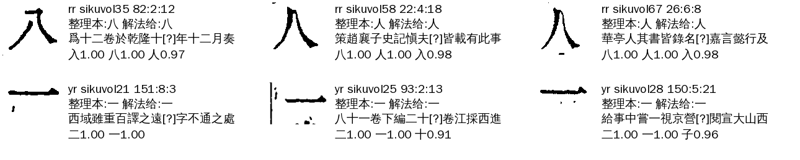
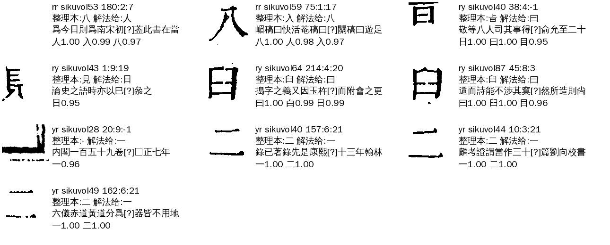
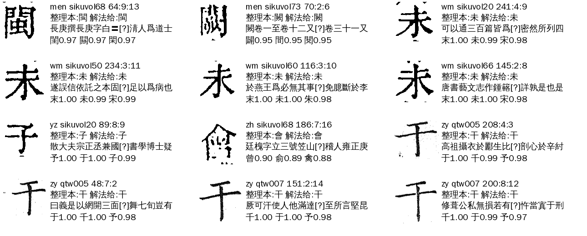
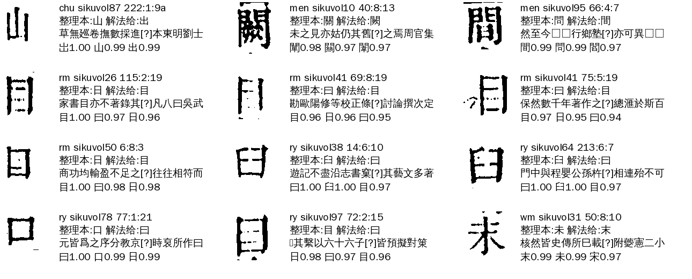

# Z07 `group_unconfirmed`：形近字·差一路确认（A24，2026-11-07）

> [待审原因总览](../README.md) · 原因码一句话：字组只给出一个字，但这个组规定还要另一路（文意、数横、共字组搭档）确认，那一路没表态

11-07 Z 类六码梳理（[Z类梳理](../Z类梳理.md)）新设的码，manager#304 起产出。原来散在 Z01（`why=weak`）和 Z02（`why=joint`）里。同一份在 ai-team `domain/CV/质检/待审原因深挖/Z07-差一路确认.md`（带逐格表、脚本）。

## 一、什么情况下判成 Z07

`reasons._group_kind`：格进了字组流程（补放 lift 或联合判 joint），字组没定字（不是 admit／keep／provisional），**所有解法给出的字去重后正好一个**，并且：

| 场景（detail 里写） | cv 来源 | 意思 |
|---|---|---|
| `组:weak` | `flow.decide` 补放时组声明了 `lift_needs`，给字的解法里没有它们（`group_flow_weak`） | 例：yr 一二 规定要文意或数横给字，只有整字 ids 给了 |
| `组:joint` | `flow.decide_joint` 共字组联合判，本组给了字、搭档组没表态（弃权或文意待裁） | 例：zy 于干子 文意给 于，搭档 yz 没裁定 |

解法给了两个以上不同的字是 Z02，一个字也没给是 Z01，`decision=demote` 是 Z03／Z04。

## 二、现在的情况（三书 ★main，dev f36f1c9 现算）

| 书 | 格数 | weak | joint |
|---|---|---|---|
| 殿本 | 110 | 57 | 53 |
| 史記 | 0 | 0 | 0 |
| 全唐文 | 14 | 0 | 14 |
| 合计 | 124 | 57 | 67 |

124 格逐格切图看过，按「解法给的字和整理本（现役对位，缺时坐标对位）是否一致」分四类：

| 类 | 格数 | 组 | 看图结论 |
|---|---|---|---|
| A 字形给字＝整理本字（weak） | 40 | yr 36、rr 4 | **全对** |
| B 字形给字≠整理本字或无整理本（weak） | 17 | yr 10、ry 5、rr 2 | 留人审。yr 9 格在第 21 列（列尾），ids 判一、整理本二，看图都是**二**（ids 错） |
| C 联合判，现役对位缺，坐标对位字＝本组给的字，没人给别字（joint） | 41 | zy 32、wm 5、men 2、yz 1、zh 1（全唐文 14 格全在这类） | **全对**（干于子、未、闕閩、會）。只是搭档组文意待裁／弃权 |
| D 其余 joint | 26 | rm 9、wm 5、ry 4、zh 4、men 2、chu 1、zy 1 | 真要人审：目 vs 日曰、末未、㑹會、山出等，整理本和图常对不上 |

## 三、流程与参数

1. 格进字组：补放（lift，seed 没放行的形近字格）或联合判（joint，两组共字）。
2. 解法依次给字（`FlowSpec.solvers`）。补放时检查 `lift_needs`；联合判时 `decide_joint` 要搭档组也同意。
3. 没过 → `decision=review, why=weak|joint` → Z07。

已有可放宽的书级参数（cv `seed_admit`）：

| 参数 | 作用 | 对 Z07 |
|---|---|---|
| `group_flow_lift_shape_ref: [组]` | `lift_needs` 没满足，但字形路给的字＝整理本（缺时坐标对位）字、没解法给别字 → 补放 | 开 `[yr, rr]`：命中正好 A 类 40 格，B 类 0 格 |
| `group_flow_ref_pair: [组]` | 联合判卡住时整理本字（**现役对位**）＝本组给的字、反对只有图像路 → 取 | C 类现役对位都缺，不命中 |
| `group_flow_ref_pair_coord: true`（cv#1221，seed_admit 1.55，新） | 同上，但现役对位缺时认坐标对位字，且**没有任何解法给别字**（比 ref_pair 严） | 命中正好 C 类 41 格，其余 83 格 0 命中。须同时把这些组放进 `group_flow_ref_pair` |

## 四、benchmark

- 集合：三书 ★main 当前 Z07 124 格，逐格表 ai-team `待审原因深挖/Z07-差一路确认-逐格.tsv`（真字＝看图＋文意定）。
- 指标：放行格数、错放数（放行字≠真字）。现在：放行 0、错放 0。
- 按上面两个参数开：放行 81（A 40＋C 41），错放 0；剩 43 格（B 17＋D 26）真人审。

## 五、怎么提高

1. **开参数（要 sheldon 点头）**：殿本 `group_flow_lift_shape_ref: [yr, rr]`；殿本、全唐文 `group_flow_ref_pair_coord: true`（`group_flow_ref_pair` 含 zy wm men yz zh）。第 7 轮重跑生效。
2. B 类 yr 列尾 9 格：ids 在第 21 列把二判成一，与 registry 里 `_YR_FLOW` 注释说的列尾边框问题同源。留人审是对的；以后可以让 `yr_bars` 在列尾不弃权。
3. D 类 rm（目／日曰）：整理本录日、图上是目或曰，靠文意终审，不放宽。

## 六、不要做

- 不要让单 ids 无整理本证人补放 yr（B 类就是反例）。
- 不要让 `ref_pair_coord` 在有图像路反对时也取（D 类里有这种格）。
