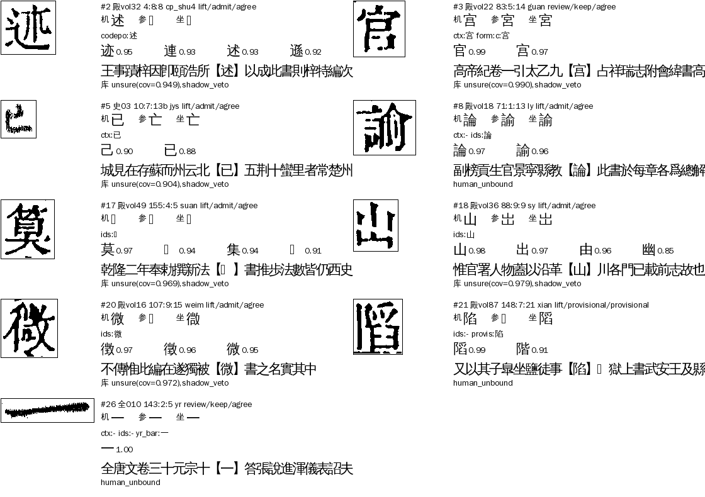

# Z05 `group_weak`：形近字·证据弱（字符级深挖，A24，2026-11-06）

> [待审原因总览](../README.md) · 原因码一句话：判法给了字，但证据不够强

派单见 ai-team `domain/CV/质检/待审原因深挖/派单-2026-11-06.md`（第 5 批）。按 sheldon 11-06 定的格式：先说什么情况判成这个原因、现在什么情况，配图；再写完整流程（什么字会进来、判断标准、参数）、benchmark，最后谈怎么提高。同一份在 ai-team `domain/CV/质检/待审原因深挖/Z05-证据弱.md`（带逐格表、种子、脚本）。**原因码分类的改动在 manager#285；cv 没改代码。**

## 〇、结论更新（11-06 sheldon 定）：Z05 停用，并入其他原因

sheldon：分类改对可以直接改、不用先通知 A31–A34；Z05 没有独立成因，应取消落到别的组。已做（manager#285）：
- `_group_kind` 不再产出 Z05：字组已定字（admit／keep／provisional）的格不算字组的事（9 格，落 L05／L04）；`why=ref_missing／solo_weak`（整理本缺位，7 格）也不算，落后面的 R 类；其余 `why=weak`、有文意给字但字形拆不开的格（20 格）并入 Z01 群组没把握。
- 枚举 `group_weak` 与 yaml 条目保留并标「已停用」，旧数据读得出，不再产出。总览表同步。
- 下面第一～五节是停用前对 36 格的成因分析，类 A／B／C／D／E 与新归属对应：A→L05／L04，B、E→R 类，C、D→Z01。

**一句话：Z05 不是一种成因，是字组里「其余情况」的落脚处——现算只剩 36 格，其中 9 格根本不是证据弱（字组已经放了字，是后面的闸拦下的），另有 9 格下一轮重跑自己会消失。真正要人看的约 17 格。**

## 一、什么情况判成 Z05（判定条件）

manager `review/reasons.py` `_group_kind`（priority 44）按顺序排除：`form_open`→Z（形态待开）；解法一个字都没给→Z01；`why` 是 `ref_dissent／coord_dissent／ref_dissent_follow`→Z04；解法给了 ≥2 个不同字或 `why` 是 `conflict／joint`→Z02；`decision=="demote"`→Z03；**最后一行 `return GROUP_WEAK`**。也就是格带 `group` 证据、解法恰好给了 1 个字、没被复核降审，却还在待审的，一律 Z05。去向 `route=llm`（大模型过一遍只收 high），负责 A24。

## 二、现在什么情况（★main 包现算，正文页，2026-11-06）

| 书 | Z05 格 |
|---|---:|
| 殿本（siku-zongmu / 96mid1ogzk，99 册） | 30 |
| 史記（988g3f0wsu，10 册 ★main） | 4 |
| 全唐文（995ejelvk0，11 册 ★main） | 2 |
| 合计 | **36** |

线上口径 29（35／5／3 的总览表比包旧）。逐格表：ai-team `Z05-逐格-三书36格.tsv`。我逐格看了图（目视初判，Claude，非金标），按「这一格为什么留在待审」分五类：

| 类 | 说明 | 格数 | 下一步 |
|---|---|---:|---|
| A 字组已定字，后面的闸拦下 | `decision` 是 admit／keep／provisional，格上带 `shadow_veto`（6）或 `human_unbound`（3）。名叫「证据弱」其实是别的闸拦的 | 9 | **改分类（manager PR）**，落 L05／L04 |
| B 整理本缺位被部首族门挡 | `why=ref_missing`：整理本没字、坐标对位也没有，`lift_ref_agree` 要求字形与整理本两路一致才补放 | 5 | 1 格可放，其余人审 |
| C 只有字形一路给字（入人八 rr_img、日曰 ry_shape、一二 ids） | `why=weak`：给字的解法不许单独补放（`lift_needs`） | 13 | 5 格下一轮出组，其余人审 |
| D 字组弃权但文意给了字 | `why=abstain`：文意给了字，字形拆不开族内写法或与整理本不合 | 7 | 3 格下一轮暂归一放，其余人审 |
| E 彝组整理本缺字、只有 ids 一路 | `why=solo_weak`：`solo_margin` 要每段 margin 都够 | 2 | 人审 |

### 图（每格：原图格｜机=机器字、参=整理本字、坐=坐标对位字，下面是各解法给的字、库前四候选、前后文、疑问码）

- A：[图 A](图/z05-A1.png)（宮宫、山出、述、算、微、陷、一、論諭、已：shadow_veto 6、human_unbound 3）
- B：[图 B](图/z05-B1.png)（別、遺、隸、士、徵微：整理本缺位）
- C：[图 C1](图/z05-C1.png)、[图 C2](图/z05-C2.png)（入人八 2、日曰 5、一二 6）
- D／E：[图 D](图/z05-D1.png)、[图 E](图/z05-E1.png)



## 三、完整流程：什么字会进来、怎么判、有哪些参数

Z05 的格都在 cv `group_flow` 里（`open_guji_cv/groups/flow.py`）走过一遍，五类对应五个出口：

| 出口 | 条件（flow.py） | 参数 | 进 Z05 的字组 |
|---|---|---|---|
| ① 后闸拦下 | 字组 `decision=admit/keep/provisional`，随后 seed_admit 的 `shadow_veto`（影子模型很有把握选了别的字，缺省开）或 `human_unbound_review`（人裁绑丢，缺省开）退回待审，`evidence.group` 还留着 | `shadow_veto`、`shadow_conf`；`human_unbound_review`、`human_unbound_shift_ok` | cp_shu4 guan jys suan sy weim ly xian yr |
| ② 整理本缺位 | 补放时给字的与部首族 `lift_ref_agree` 冲突：整理本字、坐标对位字都没有（`why=ref_missing`）；`lift_ref_missing_ctx` 允许文意单独放 | 组声明 `lift_ref_agree`、`lift_ref_missing_ctx`；书级 `lift_shape_ref`／`abstain_ref_ok` | bie chuo li ss zheng |
| ③ 解法不许单独放 | 给字的只有 `lift_needs` 之外的解法（rr_img、ry_shape、ids），`why=weak`；`yr_bars` 数横在这几格弃权（横带稀疏、顶上两点） | 组声明 `lift_needs`；yr_bars 阈值 `YR_*`（bars.py） | rr ry yr |
| ④ 字组弃权 | 没有解法给字，或文意给了字但字形拆不开族（`_pick_form`）；暂归一兜底（`PROVISIONAL`）不命中（整理本缺位、旧包没有该表项）；`abstain_ref_ok` 仅 lift 模式 | `provisional`、`provisional_to`；书级 `abstain_ref_ok` | hou kgc xz tsh zh |
| ⑤ 只凭字形 | 整理本缺字（〓）、只有一路解法给字，`solo_margin` 每段够才放 | 组声明 `solo_margin` | yi_560 |

**坐标对位在组外字**（`group_flow_coord_outside_skip`，cv#1189，缺省开，Z01 深挖加的）：现役对位缺这一格、坐标对位字是组外字，这格不进组，所以 C 类 5 格（矣、旨、見、球、三）和 zh 1 格下一轮不再进字组——**现在这批包是 cv 0.6.4／0.6.14，早于 #1189**。

## 四、benchmark

定义两份种子（目视初判，不是金标），加一个脚本（ai-team `Z05-scripts/z05_bench.py`）：

1. **Z05 全部 36 格**：每格目视给真字、把握。门槛：任何放行类规则，放出的字与真字不一致 = 0，读不定的不算放。
2. **审计 80 格**：全册 39.5 万个带字组证据的格里，补放放行、放行字≠整理本字、且只有字形类解法（无文意）支持的 80 格（ly 14、ts 19、wm 13、wj 11、em 8、sy 8、gm 7）。49 格能读定：**ts 19／19 对（量横判土，整理本作士）、sy 8／8 对（ids 判出，整理本作山）、ly 13／14 对（1 格是「教諭」被判成論）、em 1／8 对**；wj、gm、wm 31 格未判（要 sheldon 看）。指标：拦截规则拦下 B 格，其中原来放错 C、原来放对 D。

em 八格的图：[图 em](图/z05-em-audit.png)（每格下面：机器字、整理本字、坐标对位字、前后文；ids 一律判而，上下文是东面、西面、平面、點線面體、花面、句股面线）。

现状数字（z05_bench.py 输出）：Z05 36；分类规则搬出 9；放行候选（ref_missing 多路同字含文意）放出 1、错 0；em 拦截规则拦 8、拦对 7、拦错 1。

## 五、怎么提高

### 能改的

| 办法 | 效果 | 状态 |
|---|---|---|
| ① **分类：字组已定字的格不落 Z05**（`_group_kind` 在 decision 为 admit／keep／provisional 时返回空）。shadow_veto 的落 L05 乱码闸、human_unbound 的落 L04（已有 `human_unbound` 细分）等后面的原因 | Z05 36→27；L05 +6 | manager PR（草稿，**要先通知 A31–A34**，别人在按原因码派单） |
| ② 重跑后自己消失：`coord_outside_skip`（cv#1189）出组 6（矣旨見球三，zh 一格）；混合组暂归一（象彖𧰼、冠寇冦㓂，cv#839）放 3（象數 2、寇 1），这几格在旧包（0.5.33、freeze-1.1.0）里 | −9 | 不用改代码，下一轮重跑 |
| ③ **殿本 em（而面）加 `group_flow_lift_ref_veto: [em]`** | 审计里 em 补放放行 8 格，7 格放错（東面、西面、平面、點線面體、花面、句股面線，ids 一律判而），整理本是对的；开关拦 8、拦对 7、拦错 1（vol84 掩面而走，ids 判面 .845 对）。**这 7 格现在已放行在成品里，是错字** | 书级配置，要 A31 写册配置＋重跑 vol22 40 49 61 77 |
| ④ ref_missing 多路同字含文意补放：vol69 32:4:21 十士（ss_bars、ts:ctx、ts:bars、ts:ids 都判士，库首位十错） | −1 | 只 1 格，不值得写代码；留人审或记成规则种子 |

重跑后预计：Z05 36 → **约 18**（A 9、自消 9），其中 1 格规则可放，约 17 格只能人审。

### 只能人审的（约 17 格），按成因

- **B 4 格**：別（ids 对）、遺（ids 对，库首位遣错）、隸（𨽾 是隸异体）三格 ids 一路给对；徵微一格 codepoint 解法判徴（錯），唐慎微，图是微。单路给字，整理本缺位，不能放。
- **C 8 格**：一二 ids 判一而图是二 3 格（vol69、vol83×2；另 vol63 一格也是，但坐标对位是组外字三、下一轮出组），yr_bars 因顶部短横稀疏、两点干扰弃权；日曰 `ry_shape` 判曰而图是臼（玉杵臼、窠臼）2 格——`ry_shape` 对组外陪衬字臼无能为力；入人八 rr_img 判八、整理本入 1 格；史記日曰框内曰／白看不清 1 格；一二框线残块 1 格（vol28:20:9:-1，图是框线，该归 seg_defect）。`weak` 门挡对了。
- **D 3 格**：候（ctx 对，整理本 𠉀 是同字，`hou` 不在 `PROVISIONAL`，可加 `("hou","候","候𠉀")`，𠋫另立字头不进）、塡（图与整理本都是塡，ctx 判愼，与图不合）、會㑹（史記夹注半格，joint 模式不跑 `abstain_ref_ok`）。
- **E 2 格**：彝组整理本缺字，`solo_margin` 没过；vol41 的「朱彝尊」文意定彝、vol78 难定。

## 六、等 sheldon 定的事

1. **殿本 em 加 `group_flow_lift_ref_veto: [em]`？** 7 格已放行的错字（整理本是对的）会回待审重判，代价是 vol84 一格对的也回待审。建议加。定了以后用 send.py 给 A31 回一行，列进第 6 轮配置清单。
2. **分类改动（①）通知 A31–A34 后合？** 不涉及放行、只改原因归属。
3. shadow_veto 与「字组＋整理本同字」冲突的 4 格（述、宮、算、微），影子闸判错了。这 4 格是 L05 的事，要不要让「字组放行字＝整理本字」时影子闸不否决，等 L05 的人裁结论再议（这里只 4 格，不建议现在动）。

## 七、复现

```
python3 Z05-scripts/run_z05.py <siku|sj|qtw>        # 逐册拉 ★main 包，取 Z05 格（cv<0.6 的旧包会多）
python3 Z05-scripts/crops_ctx.py                    # 取页图、裁格、补前后文
python3 Z05-scripts/sheet_cls.py                    # 按类出拼图
python3 Z05-scripts/extract_all.py                  # 全册扫描带字组证据的格（审计底数）
python3 Z05-scripts/z05_bench.py Z05-逐格-三书36格.tsv Z05-audit-只靠字形放行与整理本不同-80格.tsv
```
云端装法同 Z01／Z04：假工作区（`workspace.yaml`＋`.central.json`）、`GUJI_DATA_HOME`、`guji db pull --no-rebuild`、`guji products pack fetch`、`guji source pull`。
