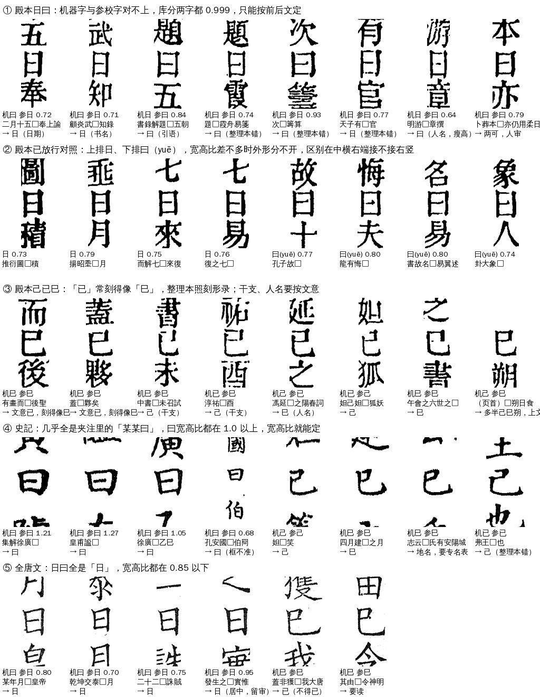
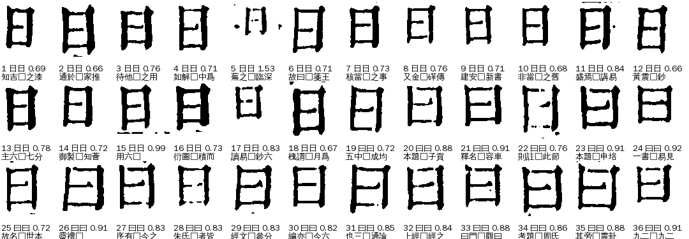

# H01 `hard_pair`：极难形近

> [待审原因总览](../README.md)

**一句话**：日曰、己已巳这类刻法几乎不分的字，留到加标点、识专名时一起按文意定

## 定义与判定

- 大类：极难形近（H）；判定顺序 priority 30（小的先判，第一条命中即主原因）。所以这一格即使同时有字组、护栏、参校本不一致这些疑问，也先归 H01，不再进 Z／N／P。
- 判定依据：本格机器字、整理本字、库首选里出现的字全在 {日 曰 己 已 巳} 内，且至少两个不同（`reasons.py` `HARD_CHARS`）。
- 去向：留到标点、专名阶段（route `deferred`）；最终谁看：不出人审（算法放行或留后）；网页卡片 `choose3`。
- 负责改算法／数据：A24。
- 旧字段对应：{"cls": ["ji_yi_si"], "cause": ["C"], "v2": "H 极难形近"}

## 什么样的字会归进来

两组字：日／曰（ry 组），己／已／巳（jys 组）。一格要同时满足两条才归进来：一是机器字、整理本字、库首选都在同一组里；二是这三者不全一样，比如机器给日、整理本是曰，或机器和整理本都是曰、库首选却是日。

每格的说明三行：机器字、参校字和宽高比（只日曰组有）；前后文（□是本格）；按文意读出的字。图是原图裁的本格，上下各带一个字。

看图能看出这几点：

- **殿本日曰（图①）**：两字刻得一样瘦高，字形库两字都给 0.999，机器字等于随手挑。前后文一读就清楚：「二月十五日」「顧炎武日知錄」是日；「書錄解題曰」「題曰霞舟易箋」「次曰籌算」是曰，后两格整理本录成了日。也有两可的，如「卜葬本日／曰亦仍用柔日」。
- **殿本日曰外形分不开（图②，更多见下图）**：已放行的日和曰宽高比都在 0.73～0.80，看外框分不出来。区别在笔画：曰的中横只接左竖，右端留缺口；日的中横两头都接上。
- **殿本己已巳（图③）**：「已」常刻得像「巳」，整理本就照刻形录成巳，如「有畫而已後聖」「蓋已夥矣」。干支（「己未召試」「淳祐己酉」）和人名（「馮延巳」）只能按文意定。
- **史記（图④）**：几乎全是夹注里的「集解徐廣曰」「皇甫謐曰」，曰宽扁，宽高比 1.05～1.27。地名「巳氏／己氏」要专名表。
- **全唐文（图⑤）**：日曰全是日（「某年月日」「乾坤交泰日月」），宽高比都在 0.85 以下。

## 现状（2026-11-06，★main 包口径，正文页）

四库总目 432、史记 117、全唐文 21 格，共 570 格。来源 ai-team `domain/CV/质检/三书待审原因统计/`；逐格明细在 ai-team `domain/CV/质检/待审原因深挖/H01/H01-三书570格.tsv`，深挖报告 `H01-极难形近.md`。

| | 四库总目 | 史记 | 全唐文 |
|---|---:|---:|---:|
| 日曰 | 345 | 98 | 15 |
| 己已巳 | 87 | 19 | 6 |
| 机器字＝整理本字 | 59 | 97 | 7 |
| 夹注格 | 4 | 94 | 0 |
| 前后文被页边截断 | 52 | 5 | 1 |

还停在这里的原因：

1. 字形库分不开：两字库分都到 0.999，护栏（`conflict`、`never_match`、`shadow_veto`）把格留下。
2. 没有文意裁定：11-01 起管线不在线调模型，文意只读裁定库，这些格不在库里。
3. 整理本不能当依据（sheldon 11-05：己已巳「匹配到任一个就归组，之后按文意定，完全不能参考整理本」）。实际也靠不住：殿本日曰约 7% 的格整理本和文意不同；己已巳约 25%，大多是已照刻形录成巳。

### 宽高比按书差别很大

已放行、机器字＝整理本字的格，字块宽／高：

| 书 | 日 中位 | 日 ≥1.0 | 曰 中位 | 曰 ≤0.85 |
|---|---:|---:|---:|---:|
| 四库总目 | 0.71 | 1.4% | **0.87** | **37.8%** |
| 史记正文 | 0.80 | 2.7% | 1.30 | 0.2% |
| 史记夹注 | 0.77 | 0.7% | 1.21 | 0.8% |
| 全唐文 | 0.71 | 1.0% | 1.10 | 0.6% |

殿本的曰瘦高，和日大量重叠；史记、全唐文两字基本不重叠。

## 怎么提高（待讨论）

| 做法 | 能降多少 | 条件 |
|---|---:|---|
| 史记、全唐文开书级折叠参数（史记：`fold_jiazhu`、`fold_aspect [0, 1.0]`、`fold_aspect_jiazhu [0, 1.0]`，只判曰；全唐文：`fold_aspect [0.85, 9]`，只判日；两书都加 `fold_aspect_ctx_veto 0.5`） | 史记约 95、全唐文 14 | 参数与标定步骤见 cv `doc/字组/折叠组.md`（cv#1197）。按精度口径，史记「判日」一侧、全唐文「判曰」一侧约 4% 会判错，所以都只开一侧；`ctx_veto` 防切分框不准（「孔安國曰」宽高比 0.68）。已发 SJ、QTW 自己标定（11-06） |
| 殿本**不开** `fold_aspect` | — | 开了 H01 里约 136 格曰会判成日。第 6 轮已撤（A31 11-06） |
| 文意裁定：干净会话逐格判，写裁定库，`fold.via=ruling` 放行 | 殿本约 360、其余两书约 20 | 只收 high；这一码原定留到标点、专名阶段，要不要提前做待定 |
| 文意窗口跨页取（页首接上一页尾，页尾接下一页首） | 让约 58 格判得了 | 只改取窗口，下一轮统一重跑 |
| 殿本日曰加局部笔画判据（中横右端缺口） | 未知 | 11-06 用页面框试过一版，不合格（框常切掉上下横），要用字块原图重做；先在已放行格上做到 0 错 |
| 剩下的人审 | 约 50 格 | 两可读法、专名（巳氏／己氏）、页边截断又看不出 |

## 不要做

- 不要按整理本放行这一类（见上，整理本在这里错得多）。
- 宽高比阈值不要跨书照搬：殿本和史记、全唐文完全不同，每本书先按已放行格标定（cv `scripts/fold_aspect_dist.py`，框架见 cv `doc/字组/折叠组.md`）。
