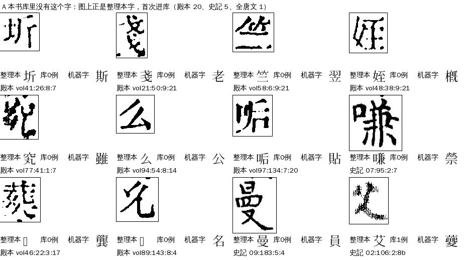
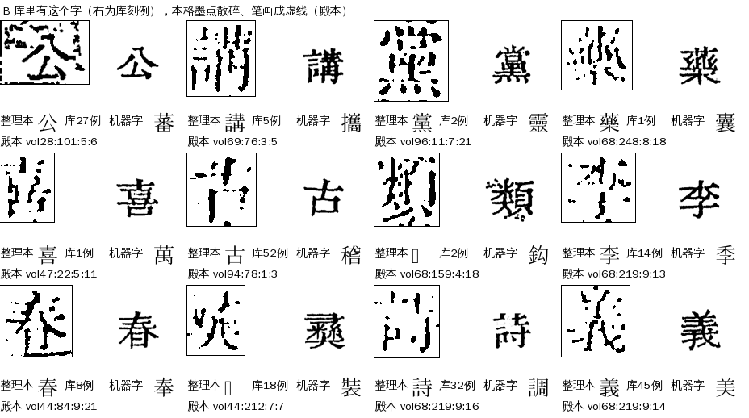
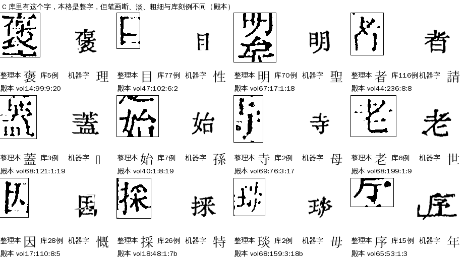
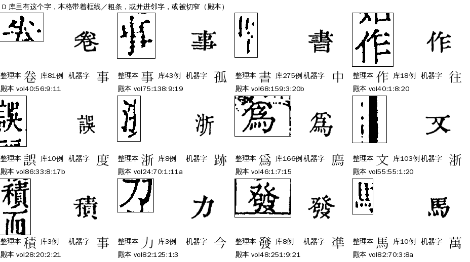
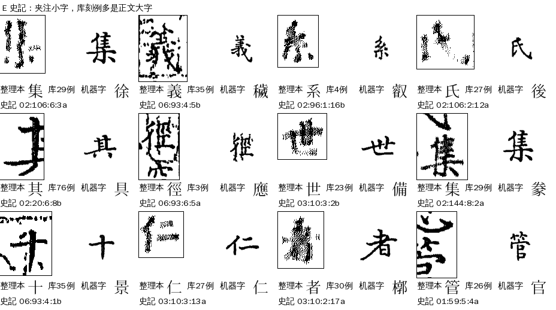
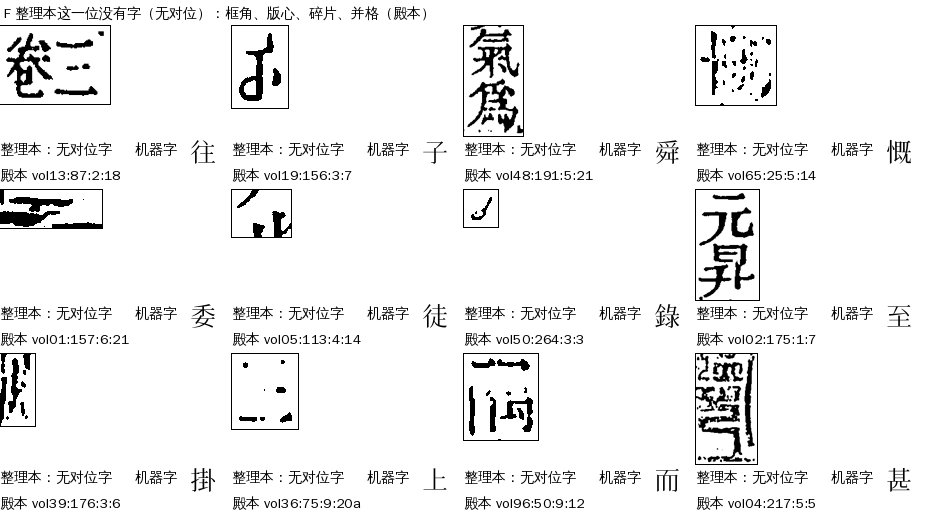

# L01 `lib_missing`：少见的字

> [待审原因总览](../README.md) · [流程与参数](流程与参数.md) · [benchmark](benchmark.md)

> **2026-11-07 判法调整（第 6 轮梳理，Sheldon 同意，A23）**：L01 只留「参校字本书库 0 例」（第一次进库）。原来混在里面的两种改归别处：①5a 判 diff 而本书库已有这个字（≥3 例）的印糊整字 → 带乱码闸码落 L05，否则落 L04（细分 `lib_diff`）；1～2 例落 L02；②整理本这一位没字（`ref_blank`）→ R02。没接字形库时仍按 5a 判 diff 归 L01。依据与数字见 [第6轮库相关梳理](../第6轮库相关梳理-2026-11-07.md)（调整前三书第 6 轮 L01 共 641 格，其中真·第一次进库约 358）。下文细分表里的 `own_has`、`ref_blank` 现在不再出现在 L01。

> **2026-11-06 再调整（L03 线程，Sheldon 同意）**：L03 里参校字本书库 0 例的格也改判 L01（不论机器字是否＝参校字），刻例数只算本书版本、不算借来的。按同一批 ★main 包现算 L01 再增：殿本 +197（全部来自 L03）、史記 +22（借来的不再算，P01／P02、L02 各有一些 0 例格挪来）、全唐文 +0。边界一览见 [L03 页](../lib_sparse_agree/README.md#l01l02l03-边界一览11-06-起)。
>
> **2026-11-06 口径变更（#258）**：本书库里整理本字 0 例的 L02 格改判 L01（`all_zero:<字>`），殿本 +366、史記 +36、全唐文 +1（现算），L01 合计由 448 变 851 格。下文第一至四节讲的是**老口径 448 格**（库认不出）；新增这批见第三节之后的「新增：首次入库」。

**一句话**：字形库里找不到「像这一格」的刻例（库里最像的字，覆盖率也不到 0.85），机器不敢认，也没法拿整理本字去核。名字叫「少见的字」，但看图，真正没见过的字只占一成不到，大多数是**库里有这个字，只是这一格拍得太糟**。

## 一、什么情况下判成 L01

判法在 `guji_manager/review/reasons.py`：`RULES[R.LIB_MISSING] = c.lib_miss`。格上只要带 `lib_miss` 疑问码，或者疑问里有一条以「库里没有」开头的，就是 L01。

**另一条路（11-06 起，manager #258）**：本该判 L02（参校字库里 ≤2 例、机器字不同）而参校字在库里 **0 例**的格，也改判 L01，详情写 `all_zero:<字>` 等。这类格多是坐标对位、产物没打 `lib_miss` 码，图上就是参校字，只是本书库里还没有，判的是「第一次进库」（见 [L02 页](../lib_sparse_dissent/README.md)）。按 11-06 ★main 现算，四库总目 277、史记 32、全唐文 1 格由此进 L01（L02 改判前后之差，库用 g19／g6；按中心库最新 glyph.db 算 L01 增量是 366、36、1，A24 `tools/l01_profile.py`），下面第二、三节的数字不含它们。

这个疑问码从字形库匹配那一步（cv `glyph_match`）来：把格图和库里的刻例逐个比，**所有候选的覆盖率都低于 0.85（`COV_LOW`）**，判 `verdict=diff`，格上记「库里没有这个字」。覆盖率 ≥0.996 才算 same，0.85–0.996 是 unsure（带几个候选交上下文去选）；L01 是比 unsure 还低的那一档。

要点：

- **它不看整理本字对不对，也不看库里有没有整理本字**，只看这一格图和库里任何刻例都不像。
- 判定顺序 priority 51。前面是复审、切坏格 S04、遮挡 D、整页／整列对不上 S01/S02、极难形近 H01、字组 Z、私用码待收 R03、整理本缺字 R01（整理本是〓）。后面是 L05 `garble_gate`（52）、R02 `ref_gap`（53）、异体对 V01、形近护栏 N01、库样本≤2 的 L03/L02、P01/P02。所以**凡是同时带「库里没有」的格，不管后面还有什么疑问，都归 L01**。
- 去向一定人审（route `human`），网页卡片 `pick`，负责改算法／数据 A24。
- 出单时 `pending_reason_detail` 写成 `<细分>:<整理本字>`，细分看整理本字在字形库里有几个刻例（`lib_missing_kind`）：

| 细分 | 意思 |
|---|---|
| `own_has` | 本书库里有这个字的刻例，这一格仍不像 |
| `all_zero` | 本书和借来的库都没有这个字（真缺字） |
| `own_zero_borrow_has` | 本书没有、借来的库有 |
| `ref_blank` | 整理本这一位没有字（无对位字），谈不上库里有没有 |

## 二、现在的情况（2026-11-06）

用三书各册 ★main 包现算（出单同一套判法，只计正文页；殿本 99 册，史記有包的 10 册，全唐文有包的 11 册）：

| 书 | L01 格 | 占该书待审 | own_has | all_zero | own_zero_borrow_has | ref_blank |
|---|---:|---:|---:|---:|---:|---:|
| 四库总目（殿本） | 354 | 4,715 的 7.5% | 231 | 20 | 0 | 103 |
| 史記 | 89 | 845 的 10.5% | 64 | 5 | 3 | 17 |
| 全唐文 | 5 | 125 的 4% | 1 | 1 | 0 | 3 |
| 合计 | 448 | | 296 | 26 | 3 | 123 |

派单里写的 232 是线上单的数（线上单比 ★main 包旧），逐格明细按包现算的 448 格走，见 ai-team `domain/CV/质检/待审原因深挖/L01-逐格-三书448格.tsv`。

## 三、什么样的字会被归进来

殿本 354 格逐格看过拼图，史記、全唐文看了拼图和抽样，按**格图上看到的样子**分类。每类给图：左边带框的是**本书这一格**，右边是**字形库里整理本字的刻例**（没有刻例就空着），底下写整理本字、库里有几例、机器认成了什么。

| 类 | 殿本 | 史記 | 全唐文 | 一句话 |
|---|---:|---:|---:|---|
| A 真缺字 | 20 | 8 | 1 | 库里（本书）没有这个字，图上正是整理本字 |
| B 点状散墨 | 36 | 30 | 0 | 库里有，格图墨点散碎、笔画成虚线 |
| C 断笔淡残 | 127 | 24 | 0 | 库里有，格图笔画断、淡、粗，或只剩半边 |
| D 框线并格窄边 | 68 | 10 | 1 | 库里有，格图带着框线粗条、并进邻字或被切窄 |
| F 无对位 | 103 | 17 | 3 | 整理本这一位没有字：框角、版心、碎片、并格、没对上的整字 |

（史記的 B、C、D 里，64 格 own_has 有 56 格是夹注小字，另见 E。分类是按格图的形状特征自动分、再看拼图抽查，边界是模糊的：C 里有半边的残字，B 和 C 里也有并格。）

### A 真缺字（殿本 20、史記 8、全唐文 1）

整理本字本书库里一个刻例都没有，图上就是它：姪、塔、息、斤、苴、么、讓、菊、竺、戔、圻……人裁一次入库，同字以后就能自动认。史記 5 格是库完全没有的字（曼、淺、艾、髳、嗛），另 3 格是借来的库有、本书没有（分、種、一）。26 格里整理本字出现在 5b（字体特征嵌入）前五的有 19 格。

### B 点状散墨（殿本 36、史記 30）

笔画由一粒一粒的墨点连成虚线，是印得浅、纸面磨损或扫描二值化把淡笔画打碎了。库刻例是实笔画，一比覆盖率只有 0.7–0.8。

### C 断笔淡残（殿本 127、史記 24）

最大的一类。整字都在，但笔画断、淡，或粗细和库刻例差得多；也有只切到半个字、或边上拖着一笔邻字的。图上人一眼能认出是整理本字，机器的库首位却落到别的字（理→褒、性→目、請→者），因为库里最像的那个字也只有 0.8 左右的覆盖率，谁也不比谁强。

### D 框线并格窄边（殿本 68、史記 10、全唐文 1）

格图里带着一条粗黑边（版框、栏线），或者切格时把邻字并了进来（下图「採數」两字一格、「文」带着整条黑边），或者被切窄只剩半个字。这些其实是切分的毛病，只是被「库里没有」盖住，归成了 L01。

### E 史記夹注

史記 own_has 64 格里 56 格是夹注小字。夹注字小、印得糙，库里的刻例多是正文大字，覆盖率上不去。

### F 无对位（殿本 103、史記 17、全唐文 3）

整理本这一位没有对位字，所以也谈不上「库里有没有」，但格上照样带了「库里没有」，被 L01 抢先归了类。103 格看图：框角和版框残片约 26、并格（书口「卷三」「數卷」、两字一格）26、窄条碎片 16、只剩半个字的整字 29、散墨 6。其中 61 格的前后文里有没对上的格，是整片没对上的区域。

## 三之二、新增：首次入库（#258，殿本 366、史記 36、全唐文 1）

这批格**不是**库认不出：整理本字在本书库里 0 刻例，格图印得清楚，坐标对位，库判 unsure（cov 约 0.93–0.96），机器选了个形近字（面代囟、狀代从）。5b 嵌入里整理本字前一 94、前三 214、前五 247（殿本 366 格）。看图它们基本就是整理本字，是生僻字第一次出现。细分写 `all_zero:<字>`，处理照旧：人裁一次入库，同字以后自动认；放行规则要先过金标。详见[流程与参数](流程与参数.md)第三节。

## 四、已经知道的几件事

- **库里不缺字**：殿本 own_has 231 格的整理本字，库里有 3 个以上刻例的 197 格，≥50 个的 57 格。库里只有 1–2 个刻例的 34 格，按「库样本≤2」本该归 L02，被 L01 抢先了。
- **机器字几乎都不是整理本字**：有整理本字的 325 格里，机器字等于整理本字的只有 4 格。机器字就是库首位，库首位覆盖率只有 0.36–0.85（中位 0.80），是「不得不选一个」的结果，不是认出来了。
- **上下文帮不上**：L01 格交上下文去选时，候选只有库首位这一个，整理本字不在候选里。有整理本字的 322 格中，上下文候选里带整理本字的只有 4 格。
- **5b 嵌入候选有一半能找到整理本字**：殿本 own_has＋all_zero 251 格里整理本字在 5b 前五的有 121 格（前一的 76 格）；史記 69 格里 26 格。
- **去掉 L01，大多数落到 L05**：448 格里 354 格同时带 `ctx_garble_shape`，没有「库里没有」就是 L05 `garble_gate`；67 格是 P01，12 格是 R02，其余零散。也就是说 L01 和 L05 讲的是同一件事的两面：格图糊了。
- **集中在糟页上**：殿本 232 页里，118 格落在每页≥3 格的页上；vol44 的 212、236 页各 11 格，vol68 199 页、vol69 76 页各 7 格，整页墨糊。史記 47 页里 41 格在 ≥3 格的页上（02 册 106 页 11 格）。
- **同字成批**：殿本 own_has＋all_zero 251 格只有 175 个字，120 格落在出现 ≥2 次的字上（者 6、三 5、一 5、上 5、本 4、言 4、其 4、浙 4）；人审页「同字头一张卡」可以合着审。

## 五、怎么处理（现行）

1. 人审点选（`char_card`）：看图，是整理本字就确认；是真缺字，确认即进库成刻例。
2. 按同字全书格数排序，先审影响多册的。

判定流程、参数、清理清单见[流程与参数](流程与参数.md)，体检指标与基线见[benchmark](benchmark.md)。怎么提高另行讨论，逐格数据、几个方向的数字和风险见 ai-team `domain/CV/质检/待审原因深挖/L01-少见的字.md`、`L01-逐格-三书448格.tsv`。

## 六、回流与防再犯

进库后下一轮同字自动放行；生僻字多的书开书时先借库。

## 七、不要做

- 不要按「库里没有」就当成缺字去补库：本书库里已有整理本字刻例的 own_has 占 66%，这些格补一个糊图进库只会拉低库质量。
- 不要把机器字当线索：L01 格的机器字是库首位的勉强结果，与整理本字不同不代表整理本错。
