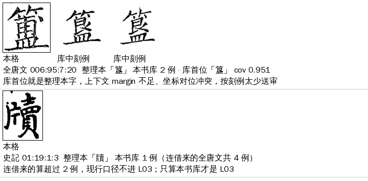

# L03 `lib_sparse_agree`：刻例太少

> [待审原因总览](../README.md)

> **2026-11-07 停用（Sheldon 同意，A23）**：本码不再产出，旧数据照读；本书库 1～2 例的格一律落 [L02](../lib_sparse_dissent/README.md)。原因：L02、L03 根因相同（库对这个字没有判力），只差机器字有没有被护栏改回参校字，两码路由还不同；第 6 轮 L03 只剩 31 格。见 [第6轮库相关梳理](../第6轮库相关梳理-2026-11-07.md)。下文是停用前的口径。

**一句话**：这个字在本书字形库里只有 1～2 个刻例（只算本书版本），库对它还认不准。机器最后给的字和整理本一样，但没有独立的字形证据，所以留人确认。

> **2026-11-06 边界调整（Sheldon 同意，A23）**：①刻例只算本书版本的人裁刻例，借来的不算；②本书库 **0 例**的格一律归 L01（第一次进库），不再留在 L03。L03 从殿本 302 格降到 105 格，197 格挪去 L01。只改归类，不放行任何格，不动 cv。

## 定义与判定

- 大类：字形库（L）；判定顺序 priority 57，排在 N01 形近护栏（56）之后、L02 刻例太少·不一致（58）之前。按 priority 从小到大逐条试，第一条命中的就是主原因。
- 去向：一定人审（route `human`），网页卡片 `pick`。按 `iterate/leverage.py` 归 tier 0「第一次进库」（与 L01 同档，用户 11-03 定同字全书一卡）。
- 负责改算法／数据：A23。
- 旧字段对应：cause I，taxonomy L4，v2「L 库样本过少·上下文=整理本」。

### 判定条件（代码原样）

一格同时满足以下各条，就判为 L03：

1. **前面 priority 更小的原因都没命中**。实际起作用的主要是这几条：没有遮挡、页／列对得上、不在字组、不是 H01 那几个字、整理本不是〓、**没有 `lib_miss` 疑问码**（L01）、没有乱码闸（L05）、整理本这一位有字（R02）、不是组外异体对（V01）、没有形近护栏码（N01）。
2. **整理本字在本书字形库的刻例数是 1 或 2**：`1 <= lib_own_n(ref) <= LIB_SPARSE`。0 例的格在 `classify()` 里改判 L01。
3. **机器字＝整理本字**：`c.char == c.ref`。这里的机器字是 seed_admit 产物里该格的 `char`。

```python
# guji_manager/review/reasons.py
LIB_SPARSE = 2                                                     # 第 26 行
def _sparse(c, ctx):
    n = lib_own_n(c, ctx); return n is not None and n <= LIB_SPARSE
R.LIB_SPARSE_AGREE: lambda c, x: _sparse(c, x) and c.char == c.ref,
def classify(c, ctx):   # L02／L03 命中、而本书库 0 例 → L01
    ...
        if r in (R.LIB_SPARSE_DISSENT, R.LIB_SPARSE_AGREE) and _first_entry(c, ctx):
            return R.LIB_MISSING
```

刻例数 `lib_own_n` 由 `lib_own_counts(glyph_db)` 给出：`glyphs.n_confirmed` 求和，**只算 `meta.book_edition` 那个版本**（本书），借来的版本不算；库里没记版本时退回全部求和。**不给字形库时这条永远不中**，这些格会落到后面的 P01／L04／P02。

#### L01／L02／L03 边界一览（11-06 起）

| 参校字在本书库的刻例数 n | 机器字＝参校字 | 机器字≠参校字 |
|---|---|---|
| 0 | L01 少见的字 | L01 少见的字 |
| 1～2 | **L03 刻例太少** | L02 刻例太少·不一致 |
| ≥3 | 往后判（L04／P01／P02，L04 不动） | 往后判 |

另外，带 `lib_miss` 码（5a 判 diff）的格不论 n，仍按 priority 51 先归 L01。

### 实际是怎么走到这一步的

拿殿本来说，L03 的格几乎都走同一条路（★main 包 293 格里 276 格是这样）：

1. **5a 库匹配（glyph_match）**：整理本字在库里 0～2 例，库首位是刻例多的形近字（兌→分、耆→書、悲→志、午→年），判 `unsure`，cov 约 0.91～0.98。
2. **Step6 上下文（context_decide）**：在库候选里按文意选字，选中的是形近字。
3. **seed_admit 上下文护栏 `_context_guard`**（cv `open_guji_cv/steps/seed_admit.py` 第 4536 行，开关 `context_guard_ref_prefer`）：坐标对位给出的整理本字和上下文选的字语义不同，库又不是 `same`，于是不放行，打疑问码 `ctx_guard_ref`，**默认字改成整理本字**。所以这一格的 `char` 和整理本相同，命中上面的第 3 条。
4. **rare_ref（5b 生僻字放回）不碰这些格**：`lane_keep_ref_review=True`（cv 第 785 行；`_LANE_REF_REVIEW` 第 2571 行）规定带 `ctx_guard_ref` 的格不按整理本字放回（A24 10-23，起因是 vol18:115:6:3 本／木）。
5. **出单**：cv `scripts/zhengli/republish.py` `add_causes`（第 455 行）调 `reasons_for_pending(..., glyph_db=<工作区>/output/glyph.db)`（第 702 行），写进待审单的 `pending_reason`。

另一条少数路（16 格）：库首位就是整理本字，但 cov 不够，又有「上下文 margin 不足」。这时 `char` 也是整理本字，同样落到 L03。

### 代码在哪

| 做什么 | 位置 |
|---|---|
| enum、priority、hint、detect 文案 | `guji_manager/review/pending_reasons.yaml`（`lib_sparse_agree`，第 268 行） |
| 判定 | `guji_manager/review/reasons.py`：`LIB_SPARSE`、`_sparse`、`RULES`、`lib_counts`、`classify`、`book_cells`（读 seed_admit／align_ref／glyph_match 拼 `Cell`）、`reasons_for_pending` |
| 上游让格停下来的护栏 | cv `open_guji_cv/steps/seed_admit.py`：`_context_guard`、`lane_keep_ref_review`、`_rare_ref_pass`、`rare_ref_decide` |
| 出单写原因 | cv `scripts/zhengli/republish.py` `add_causes`；回填 `scripts/zhengli/backfill_pending_reason.py` |
| 分档 | `guji_manager/iterate/leverage.py` `FIRST_ENTRY` |

### 结构上不够清楚的地方（2026-11-06 调研；1–3 条已在 11-06 边界调整里处理）

1. **（已改）detect 文案和代码不一致**。yaml 写的是「上下文＝整理本」，代码判的却是 seed_admit 的 `char`＝整理本。实际上 L03 的格大多是上下文选了**别的字**，被护栏改回整理本字（见上面第 3 步）。卡片 hint「第一次正式进库」也不准：≤2 包括已经有 1～2 个人裁刻例的字（殿本 293 格里 102 格是这样）。
2. **（已改：0 例一律 L01）和 L01 的界线不是按刻例数分的**。L01 看的是疑问码 `lib_miss`（glyph_match verdict=diff，意思是「库里没有像这一格的刻例」），不看刻例数。所以库里 0 例、但库判 unsure 的格落在 L03 而不是 L01（殿本 191 格）。L01 文档里的「字形库里还没有这个字」也因此不准。
3. **（L01–L03 已统一用本书版本 n_confirmed）「刻例数」有三种算法**：
   - `reasons.lib_counts`：按 `glyphs.n_confirmed` 求和，**含借来的版本**。史記库借了全唐文，借来的刻例也算进去。
   - `reasons.lib_split_counts`（L01 细分用）：按 exemplars 数，本书与借来分开。
   - seed_admit 的 `_keben_counts`：按 exemplars 数。
4. **结果取决于出单机器上的字形库**。republish 读的是 `<工作区>/output/glyph.db`，不是册 yaml 钉的 `glyph_pin` 版本，同一包换台机器出单，数可能不同。`pending-stats --glyph-db` 只影响旧口径 L4，不重算 `pending_reason`。三书统计脚本（ai-team `三书待审原因统计/run3.py`）没接字形库，所以下面总览表里 L02／L03 原先是 0，L04 偏多。
5. 判定本身很短，一个阈值加一个等式，不难读。难的是要读懂上面 seed_admit 那条链，才知道一格**为什么**会走到这里，而 reasons.py 里看不到这条链。

## 现状（2026-11-06）

> 下表是**边界调整前**的口径。调整后同一批包、同一份库现算：殿本 302→**105** 格（84 字；本书 1 例 73 格、2 例 32 格；197 格 0 例挪去 L01），史記 0→**1**（01:19:1:3 牘，本书 1 例，借来的不再算），全唐文 1→1（簋）。最多的字：丸 𭧂 𤦺 紅 溪 各 3。

按各册 ★main 包现算，正文页，接各书中心库当天的 glyph.db：

| 书 | 有 ★main 的册 | L03 格 | 字 | 本书库 0 例 / 1 例 / 2 例（格） | 线上单 |
|---|---:|---:|---:|---|---:|
| 四库总目（殿本，96mid1ogzk） | 99 | **293** | 239 | 191 / 73 / 29 | 224 |
| 史記（988g3f0wsu） | 10 | 0 | 0 | — | 无现行单 |
| 全唐文（995ejelvk0） | 11 | 1 | 1 | 2 例 | 1 |

- 殿本最多的字：耆 9、𥈤 瑾 𨦟 各 4，丸 悲 𭧂 𤦺 各 3。
- 史記如果**只算本书库**（不算借来的全唐文），也只有 1 格（01:19:1:3 牘，本书 1 例，连借来的共 4 例）；史記的少样本字多数落在 L02（57 格，机器字≠整理本）。
- 殿本这批字的库很薄：本书库 3380 字、2.2 万例，悲、耆、瑾、豆、埋这类常用字也是 0 例。全唐文库 4019 字、3.1 万例。

## 例图

每行依次是：本格裁图（带框），本书库里这个字的刻例，库首位字的刻例。下面一行是格号、整理本字、本书库刻例数和库首位。




殿本线上单 224 格的逐格对照图（6 张）、逐格表和看图结论见 ai-team `domain/CV/质检/待审原因深挖/L03-刻例太少/`。看图结果：224 格里 222 格确实是整理本字，1 格整理本错位（上面最后一例），1 格字块切残。

## 怎么处理（现行）

1. 人审点选（`char_card`），同字全书一卡，确认即进库成刻例。
2. 刻例到 3 例以上，下一轮同字自然不再进 L03。0 例的字现在归 L01，审一次进库后变成 1 例，同字后面的格才会进 L03。

## 回流与防再犯

同 L01：人裁进库，下一轮同字自动放行。

## 不要做

- 不要拿借来的、别的字体族的刻例直接放行殿本格（11-05 字体族实测：殿本与史記、全唐文不同族）。

## 待研究（还没定）

降人审的方向（改阈值口径、5b 首位＝整理本时放回、码位核对等）写在 ai-team `domain/CV/质检/待审原因深挖/L03-刻例太少.md`，等定了再改这里。
