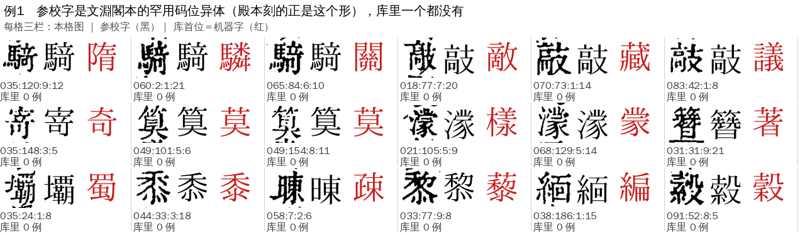
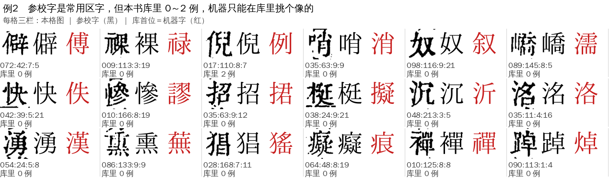
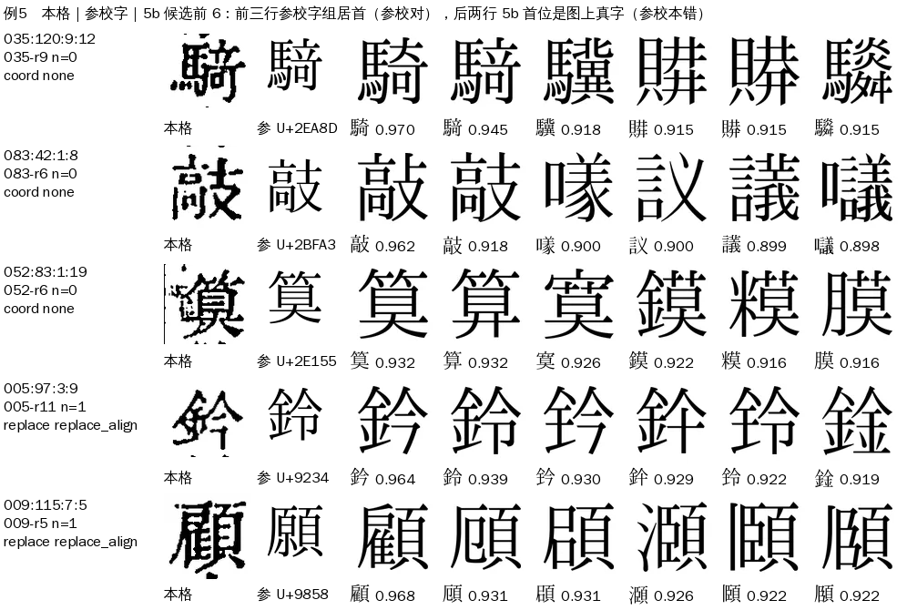

# L02 `lib_sparse_dissent`：刻例太少·不一致

> [待审原因总览](../README.md)

**一句话**：参校字在本书字形库里只有 0～2 个刻例，机器字（库匹配首位）和参校字不一样。

## 定义与判定

- 大类：字形库（L）；判定顺序 priority 58（小的先判，第一条命中即主原因）。
- 判定依据（`review/reasons.py`）：`lib_n(参校字) ≤ 2` 且 机器字 ≠ 参校字。`lib_n` 是本书字形库里这个字的刻例数（`glyphs.n_confirmed` 求和），**不给 `--glyph-db` 就判不出**，这类格会落到后面的 P01／P02／L04。
- 排在它前面、先把格拿走的原因：遮挡、切分、极难形近（H01）、字组（Z）、参校本缺字（R01）、**L01 少见的字**（只认产物里的 `lib_miss` 码）、乱码闸（L05）、参校本没字（R02）、异体对（V01）、形近护栏（N01）。剩下的格，参校字刻例 ≤2、机器字又不同，才是 L02。
- 去向：大模型统一过一遍（只收 high，其余回人审）（route `llm`）；大模型选中的若正是这个少样本字，回人审。网页卡片 `pick`。
- 负责改算法／数据：A23。
- 旧字段对应：{"cause": ["I"], "taxonomy": ["L4"], "v2": "L 库样本过少·机器字≠整理本"}

## 什么样的字会进 L02

一句话：**参校字是本书库里还没有（或只有一两个）的字，机器只能从库里已有的字里挑一个最像的，所以必然和参校字不同。**
2026-11-06 殿本线上单 286 格逐格看图，274 格图上就是参校字，机器字是错的。按字分四种：

### 1. 参校字是文淵閣本的罕用码位异体，殿本刻的正是这个形（155 格，48 个字）

殿本按坐标对位到文淵閣／殆知閣文本，那边用扩展区码位记了异体；殿本刻的就是这个异体，可本书库里一个刻例都没有，
连它的通行字（騎、敲、濛、簪）也没有，机器只好挑个偏旁相同的字。

| 参校字 | 格数 | 通行字 | 机器字（库首位）乱选成 |
|---|---:|---|---|
| 𮪍 | 19 | 騎（右作竒） | 驎、關、駉、駒、隋 |
| 𫾣 | 13 | 敲 | 敵、離、蘇、議 |
| 𭔃 | 13 | 寄（codepoints 已登记 𭔃→寄） | 奇、書、帝 |
| 𮅕 | 12 | 筭／算 | 莫 |
| 𪷟 | 9 | 濛 | 濠、𫎇、樣 |
| 𬖂 | 7 | 簪 | 著、書、智 |
| 𭐏 | 6 | 壩 | 蜀、編、删 |
| 𮮐、𮕵、𰖍 | 各 5 | 黍、衷、暕 | 黍、衷、疎 |

### 2. 参校字是常用区字，但本书库里 0～2 例（约 120 格）

普通的字，只是这本书的库还没收到：仲→僭、奴→叙、湧→漢、洺→洛、嶠→濡、熏→蕪。图上就是参校字。

### 3. 参校本错，图上是另一个形近字（7 格）

两个都是常用字、字形只差一笔一画：話／詁、鈴／鈐、貝／具、願／顧，另有 1 格参校 龜、图是 迥 一类。这类是 L02 里真正需要人看的。

### 4. 存疑（6 格）

形近对加上字小、墨重或切坏，看不准：巿／市、束／東、惜／階、孚／乎、湖／溯（夹注小字）、軒（切坏）。

### 5b 候选能分开这两类

线上单每格带 5b 候选（`alt`，字体渲染＋异体扩展）。第 1、2 种格，5b 首位就是参校字或它的通行写法；
第 3 种格，5b 首位是图上的真字（鈐、顧），跟参校字不一样。

| 档 | 判法 | 格数 | 其中参校本错／存疑 |
|---|---|---:|---|
| A | 5b 首位＝参校字 | 96 | 0／0 |
| B1 | 参校字是罕用码位，5b 首位是它的通行写法 | 125 | 0／0 |
| B2 | 参校字是常用字，5b 首位是由它扩出的另一个字 | 32 | 5／4 |
| C | 参校字不在 5b 首位 | 34 | 2／2 |

## 现状（2026-11-06）

| 书 | 口径 | 格数 | 说明 |
|---|---|---:|---|
| 四库总目（殿本） | ★main 包＋g19 字形库重算 | 361 | 99 册；其中 284 格与线上单相同，另 77 格线上单还没出到 |
| 四库总目（殿本） | 线上单（本页看图用的这份） | 286 | 参校字库里 0 例 231 格、1 例 31、2 例 24；coord 234、replace 52；单版本 r4～r14 不等 |
| 史记 | ★main 包＋g6 字形库重算 | 42 | 只有 10 册有 ★main；13 格参校字是文淵閣私用码；其余多为常用形近对（阬／院、殽／殺、譏／識），没看图 |
| 全唐文 | 线上单与 ★main 一致 | 1 | 011:85:9:9 参校 緊、机器 紫，图是 緊 |

总览表里本类原先记为 0，是因为三书统计没接字形库（见本页「判定依据」）。

## 成因

1. **库覆盖面窄（主因，约 95%）**：殿本 g19 只有约 3,400 个字。参校字不在库里，机器字只能是库里最像的那个，必然不同。
   这类格判的其实是「第一次进库」，和 L01、L03 同性质；231 格参校字一例都没有，只是因为是坐标对位、产物没打 `lib_miss` 码，才没进 L01。
2. **参校本用罕用码位记异体**：照录还是归一是码位口径（A24／Sheldon 定，见 `config/codepoints.yaml`），不影响「图与参校字一致」。
3. **常用形近对，参校本确实错**：只能人审。
4. **线上单陈旧**：有的单比现在的字形库早好几轮，统一重跑重出单后会少一些。

## 怎么处理（现行）

1. L2 文意裁；大模型选中的若正是这个少样本字，回人审。

## 怎么提高（待讨论）

| 办法 | 改什么 | 预计（殿本） | 前提 |
|---|---|---|---|
| ① 同字一卡 | `iterate/leverage.py`：L02 也按参校字并卡（现在按（参校字, 库首位）字对并卡，库首位是乱选的） | 223 张卡 → 171 张；前 20 个字占 124 格 | 不放行，没风险；确认后进库，下一轮同字不再进 L02 |
| ② 5b 当证人放行 | 参校字组在 5b 居首、领先组外最好候选 ≥ 0.02，只限 A、B1 档 | 约 142 格（放宽到 0 可到 221），目测零错 | 碰 Sheldon 11-03「第一次进库必须人裁」，要他定；要先拿已有 L01／L03 人裁结果当金标算错放率 |
| ③ 判法归位 | `reasons.py`：参校字库里 0 例时归 L01 | 不降人审，231 格从 L02 挪到 L01 | L01 归 A24，要和 A24、A31 对齐 |
| ④ 形近对留人审 | 不动 | 约 13 格 | — |

## 回流与防再犯

人裁确认后回流成刻例；同一个字确认够 3 例，后面的格就不再是 L02。

## 不要做

- 不要拿库首位当机器的意见：参校字不在库里时，库首位是乱选的。
- 判 L02 必须给字形库（`--glyph-db`），否则统计永远是 0。

## 数据与复现

- 逐格表、看图全页、脚本：ai-team `domain/CV/质检/待审原因深挖/L02-附件/`（`殿本L02-286格.tsv` 带分档与目测结论）。
- 深挖报告：ai-team `domain/CV/质检/待审原因深挖/L02-刻例太少不一致.md`。
- 线上单从中心库 `files` 表取（`feedback/lists/proofing/<文本号>/<册>.pending.json`），格图按单上 `sprites[].sha256` 从 R2 取。
