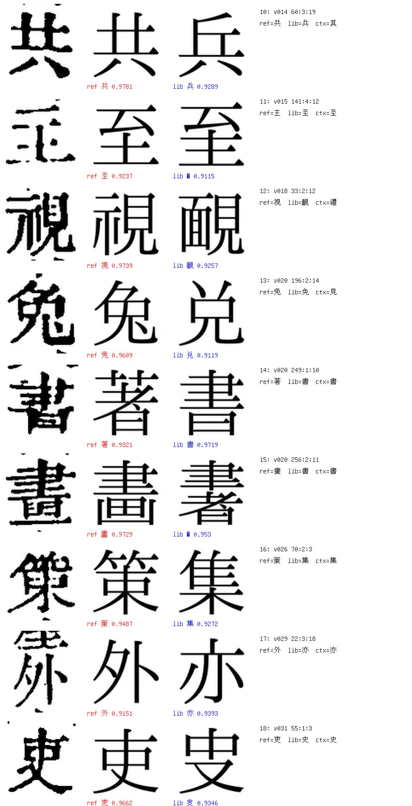
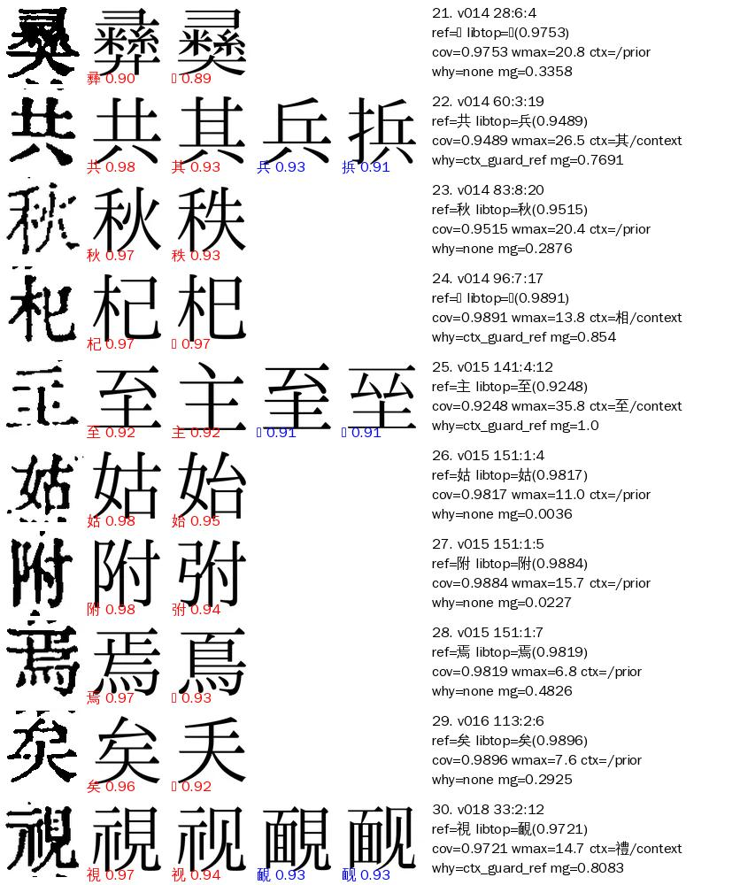
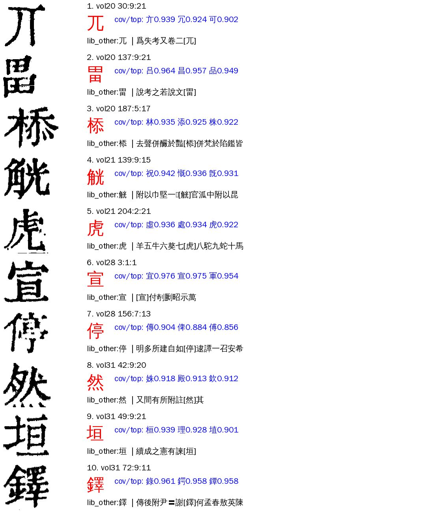
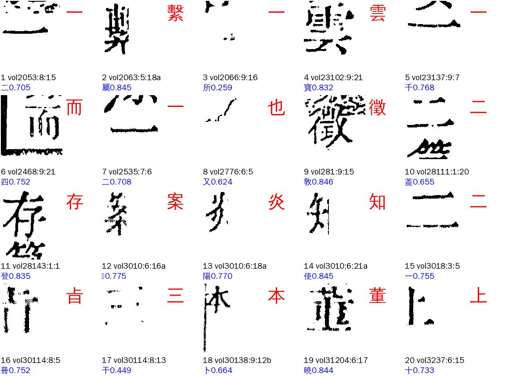
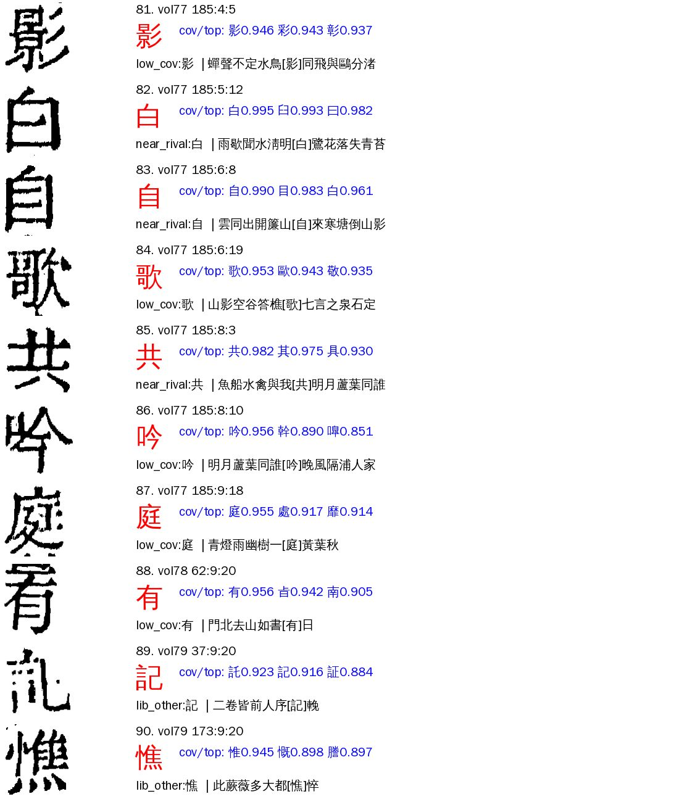

# L04 `lib_unrecognized`：库认不出

> [待审原因总览](../README.md)

> **2026-11-08 判法调整（A22 残片判据、A31 转 sheldon 定「改分类可直接改」，A24）**：细分 `lib_diff`（5a 判 diff、本书库 ≥3 例的印糊整字）里，cell_shrink 给这格打了 `boundary_ink` 旗（框线或邻字墨溢进格框）的，改归 S04 切坏（细分 `bleed`），不再算「库认不出」。殿本 vol20–99 第 7 轮包：lib_diff 151 → 114，S04 多 37。A22 判据另三条（越界墨面积、列图拉歪 >8%、夹注误拆）要看图像，`reasons.py` 读不到，没接，由 A22 在切分自检（seg_selfcheck）里做；见 ai-team `待审原因深挖/R02-L04-列端切半根治-A22.md` 第三节。

> **2026-11-07 判法调整（Sheldon 同意，A23）**：①新收 5a 判 diff（cov<0.85）、本书库已有这个字（≥3 例）、没带乱码闸码的印糊整字，细分 `lib_diff`（原落 L01）；②旧人裁锚点漂移（细分 `human_unbound`，数据问题不是库问题）改归 X01 裁定有冲突，L04 不再收。见 [第6轮库相关梳理](../第6轮库相关梳理-2026-11-07.md)。

**一句话**：机器认的字就是参校本的字，但字形库没给出「就是它」的把握，又没有别的放行通道接住，所以留审。

这一页讲清四件事：什么样的格会进 L04、按什么标准和参数判、每种情况怎么处理、怎么量（benchmark）。最后一节是开新书时的做法。

## 一、什么样的格会进 L04

### 判定（代码原样）

```python
# guji_manager/review/reasons.py（priority 61）
R.LIB_UNRECOGNIZED: lambda c, x: c.has_ref and c.char == c.ref,
```

一格同时满足下面三条就是 L04：

1. **前面 priority 更小的原因都没中**：没遮挡、页列对得上、不是字组格、不是日曰己已巳、参校本不是〓、库没判「没有这个字」（L01）、没撞乱码闸（L05）、不是组外异体对（V01）、没有形近护栏码（N01）、参校字刻例不太少（L02/L03）、不是对位改字段（P01）。
2. **这一位有参校字**（`has_ref`）。
3. **seed_admit 给这格的字＝参校字**（`c.char == c.ref`）。

**L04 是个兜底**。它不看库认不认、也不看刻例数。所以：

- 名字叫「库认不出」，实际上一半的格库首位就是参校字，只是分数没到放行线（见下面的细分）。
- 出单时**一定要接字形库**（`reasons_for_pending(..., glyph_db=…)`）。不接库，L02/L03 判不了，那些格会落进 L04。11-06 三书统计没接库，殿本 L04 算出 392 格，线上单（接了库）只有 69 格，差的就是这个。
- L01／L02／L03 之间的边界由 L03 线程调整（Sheldon 11-06 同意）；**L04 不动**，仍是上面的兜底判定，不按刻例数划进来。

### 这些格是怎么停下来的

机器字＝参校字、参校本又可信，为什么没放？这一格在 seed_admit 里走过这几关：

1. **5a 库匹配（glyph_match）**：要判 `same` 得 cov ≥ 0.992 且 wmax ≤ 12（cv `clustering/verify.py` 的 `COV_HIGH`、`MISS_WMAX`）。L04 三书 83 格**没有一格到 same**，全是 `unsure`。
2. **上下文（context_decide）和护栏**：上下文选的字和参校字不同、库又不是 same 时，`context_guard_ref_prefer` 不放上下文字，把默认字改回参校字，打 `ctx_guard_ref`。这就是 `char==ref` 的来路之一。
3. **`ref_lib_coord`（参校字＝库首位＝本格字就放）**：这是 L04 格最该走的放行通道。它要求：
   - 库首位就是参校字，cov ≥ `ref_lib_coord_cov`（殿本 0.96），与语义不同的对手领先 ≥ `ref_lib_coord_gap`（0.01）；开了 `reference_trust: high` 的书（史記）门槛是 0.90／0.005；
   - 疑问码都在白名单 `_REF_LIB_COORD_DOUBTS` 里；
   - 没有人裁绑丢且旧裁字≠本格字；
   - 字组解法没有异议；不是 日曰目己已巳入人八一二。
   
   这一关没过，格就留在 L04。下面的细分就是**逐条看哪一关没过**。
4. **看图裁定（`vis_rulings`）**：裁定库里有这格窗口的高把握看图裁定（group O，prompt_ver vis-o1，子类在 `_VIS_RULING_SUBCLASSES` 里，cv #1184 起含 L04）就放行。这是对话看图审的回流口。

### 细分（`pending_reason_detail`，`<细分>:<参校字>`）

`reasons.lib_unrecognized_kind` 按先后取第一个命中的：

| 细分 | 意思 | 该谁处理 |
|---|---|---|
| `lib_other` | 库首位**不是**参校字。多半是糊墨、笔画粘连，库认成笔画少的形近字（畫→書、全→今、望→聖） | 只能看图：对话看图审，残缺、存疑的留人审 |
| `human_unbound` | 有一条人裁绑丢了（重切后格号变），旧裁字和本格字对不上（所／乾、地／康） | 数据：重锚或作废那条人裁事件，书 Project |
| `doubt_blocked` | 带 `ref_lib_coord` 白名单外的疑问码（如 `coord_conflict`） | 看那个疑问码属于谁 |
| `low_cov` | 库首位＝参校字，但 cov < 0.96 | 降门槛要 A24 拿固定样本回放（第 5 轮定 0.96 不降），否则看图 |
| `near_rival` | 库首位＝参校字，但有语义不同的字差 < 0.01 紧咬 | 看图 |
| `clear` | 上面都没有：按 `ref_lib_coord` 本该放 | 配置：这版单的 cv 没有 `ref_lib_coord`、或这本书没开它，重跑／开开关即消 |

门槛取殿本口径（0.96／0.01），对开了 `reference_trust` 的书偏严，只作分档，不作判定。`context_page_end` 已按 A31 11-06 裁定算进白名单（cv 侧由 A24 加）。

细分随出单写进待审单；`guji-manager pending-stats` 的 `cells.tsv` 末列 `detail` 就是它。本页之前出的单，detail 只有参校字。

## 二、三书现状（2026-11-06）

殿本取线上单（出单包重算细分），史記、全唐文取各册 ★main 包（这两本没有现行线上单）。

| 书 | L04 | lib_other | human_unbound | doubt_blocked | low_cov | near_rival | clear |
|---|---:|---:|---:|---:|---:|---:|---:|
| 殿本（96mid1ogzk，线上单） | 69 | 36 | 0 | 0 | 12 | 6 | 15 |
| 史記（988g3f0wsu，★main 01–10） | 11 | 1 | 5 | 0 | 2 | 0 | 3 |
| 全唐文（995ejelvk0，★main 005–015） | 3 | 0 | 1 | 1 | 0 | 0 | 1 |

- 殿本 `clear` 15 格里 14 格在 vol01–19：那些册的线上单是第 3 轮以前出的，还没有 `ref_lib_coord`。第 6 轮重跑就消。
- 史記 `clear` 3 格都带 `context_page_end`，等 A24 把它加进白名单就消；`human_unbound` 5 格要史記 Project 处理人裁事件。
- 全唐文 `clear` 1 格（005 54:1:1 割）是全唐文没开 `ref_lib_coord`，开不开归全唐文 Project。

看图结论（殿本 69 格，A23 看，不是金标）：

- `lib_other` 36 格：29 格就是参校字（糊墨，库认错），5 格图残缺看不出，2 格图更像库首位（vol020 249:1:10 参校著、图像書；vol059 169:8:13 参校共、图像其），可能是参校本错。
- 其余 33 格（库首位＝参校字）看图全是参校字。





逐格表、全部对照图、分析脚本：ai-team `domain/CV/质检/待审原因深挖/L04-库认不出.md`、`L04-殿本69格.tsv`、`L04-图/`。

## 二之二、第 7 轮现状（殿本 vol20–99，2026-11-08，A24）

第 7 轮清单（cv v0.6.17、中心库 rev 886453）里的「L04 库认不出 107 格」是**没接字形库**现算的数（`按码现算.py` 缺省不接库）。接上本书 glyph.db（`--glyph-db`，出单本来就接）再算，同一批册的分法是：

| 口径 | L04 | 其中 |
|---|---:|---|
| 没接库（A31 清单 107） | 107 | lib_other 83、low_cov 17、near_rival 4、clear 2、doubt_blocked 1 |
| 接库（vol20–99） | **187** | **lib_diff 151**、lib_other 15、low_cov 14、near_rival 4、clear 2、doubt_blocked 1 |
| 107 格去向 | | 45 → L01（参校字本书库 0 例）、26 → L02（1～2 例）、**36 仍是 L04** |

也就是说，没接库时 107 格里 **71 格（66%）参校字库里只有 0～2 例**，根本是「库没见过这个字」，归 L01／L02 的线程，不是 L04 的事；真正的 L04 是接库后的 187 格，里面最大的是 11-07 新分出的 `lib_diff`（151）。出统计和出单**一定接库**；`按码现算.py` 要带 `--glyph-db <工作区>/output/glyph.db`（`guji db pull -w . ` 不加 `--no-rebuild` 才出这个文件）。

**看图结论**（A24 逐格看格图，殿本，不是金标；脚本在 ai-team `待审原因深挖/L04-分析脚本/r7/`）：

| 细分 | 格 | 看到的 | 去向 |
|---|---:|---|---|
| 没接库那 107 格 | 107 | 约 95 格图清楚，就是参校字（库里无例或糊墨，库首位不含参校字）；约 12 格残缺或笔画碎，不敢定 | 36 格留 L04 的见下；71 格归 L01／L02 线程 |
| 留 L04 的 36 格（lib_other 15、low_cov 14、near_rival 4、clear 2、doubt_blocked 1） | 36 | **23 格 conf=high 就是参校字**（然封目顧鶴多辨没起語宋慶留便文纎白自歌共有甚閩等）；10 格图糊或缺笔（mid）；3 格残缺（他、趙、害，low） | 23 格已写看图裁定（`llm-vis-20261108-a24-l04-r7`，子类 L04，已推库）；第 8 轮从 seed_admit 起重放即放行 |
| lib_diff 151 | 151 | 逐格看了约 70 格（随机 40＋按册序前 40，有重叠），**大多是残片**（目测八成上下，未逐格数）：只有半个字、只剩一两笔、被框线或邻字溢笔占一半。ref 是 一二三 的 42 格（单横画，覆盖率本来就不稳）、夹注小字 39 格、列尾第 9 行 36 格；cov 中位 0.79，144 格库首位不是参校字；册集中在 vol43（18）、vol44（12）、vol68（8）、vol30（7） | 不是「库认不出」，是字块不完整，看图判不了，只能人审照书影录字。**A22 判据（11-08）**：约 82–85 格归切分（已知整页错 vol43 p1 18 格、boundary_ink 旗、越界墨、列图拉歪、夹注误拆）；单笔字 一二三 11 格是字库问题；约 55 格是 Commons 图源本身笔画断／淡印／霉点，格框完整，归图源／字库、仍归 L04。代码接了 boundary_ink 一条（37 格归 S04 bleed），其余待 A22 接 |
| 低覆盖同页 | 18 | vol54 第 196 页 9 格、vol77 第 185 页 9 格（low_cov／near_rival），这些格 cov 都在 0.94–0.97，字看图都认得对 | 页级现象（同页成片 cov 压在门槛 0.96 附近）。A22 看过：切分正常（列图拉伸 <5%），vol54 p196 是罕见鸟部字页，是字库问题，不归切分；vol77 p185 同属字库问题。见第四节 B7 |







## 三、怎么处理（现行）

按细分分流：

1. **`clear`**：不用人看。查单子出自哪版 cv、册 yaml 有没有开 `ref_lib_coord`／`reference_trust`，下一轮重跑即消。
2. **`human_unbound`**：把旧人裁事件重锚到新格号，或作废（cellvotes rebase）。清掉后，下一轮 `ref_lib_coord` 自己放。
3. **`doubt_blocked`**：按疑问码找负责人。比如 `coord_conflict` 是对位冲突，留审。
4. **`lib_other`、`low_cov`、`near_rival`**：对话看图审，用 `guji_manager/review/vis_review.py`：
   ```bash
   guji-manager pending-stats --ws <工作区> --text <文本号> --out /tmp/ps
   python -m guji_manager.review.vis_review export --cells /tmp/ps/cells.tsv --reason lib_unrecognized \
       --pkg <出单产物包根> --vol-fmt 'vol{n:02d}' --ws <工作区> --text <文本号> --out /tmp/l04
   # 对话读 /tmp/l04/sheets/*.png 和 todo.jsonl，逐行补 char／conf（high/mid/low）／why，存 answers.jsonl
   python -m guji_manager.review.vis_review write /tmp/l04/answers.jsonl \
       --ruling-dir <数据目录>/feedback/rulings --batch llm-vis-YYYYMMDD-<谁>-l04 --subclass L04
   GUJI_ACTOR=<谁> guji db pull && guji db push      # 推库前先 pull
   ```
   - 只有 `conf=high` 且字＝参校字的才 `admit_ok`；其余也写，记弃权，免得重看。
   - 图残缺、图像别的字的，一律不给 high，留人审。
   - 产物包要是**出这版单的那个包**（`rev-<单号>` 或现行 ★main），窗口才和管线一致。第 6 轮重跑后邻格放行字如果变了，窗口对不上，那格照旧留审，不会错放。
   - 11-06 殿本已写 25 格（`llm-vis-20261106-a23-l04`，rev 880398），用这个工具重算的窗口与它逐条一致。
5. **人审回流**：人裁过的糊墨格照常进库，作糊墨刻例，下一轮同类格 cov 会上来。

## 四、Benchmark：怎么量、往哪提

每轮出单后量下面几项，和上一轮比：

| 编号 | 量什么 | 怎么算 | 基线（11-06） | 方向 |
|---|---|---|---|---|
| B1 | L04 格数、每万正文格（接库口径；没接库的数会偏，见二之二） | `pending-stats` 的 cells.tsv 数 `pending_reason=lib_unrecognized` | 殿本 69（0.27／万）、史記 11（0.47／万）、全唐文 3（0.09／万） | 降 |
| B2 | 非认字类占比 | `clear`＋`human_unbound`＋`doubt_blocked` 格数 ÷ L04 | 殿本 15/69、史記 8/11、全唐文 3/3 | 每轮清零。这些是配置和数据问题，不该占人审 |
| B3 | 放行安全 | 任一新放行规则（降门槛、看图裁定）在 L04 金标上的误放数 | 金标候选：殿本 69 格看图标注（ai-team `L04-殿本69格.tsv`，A23 标，待 Sheldon 抽核后进 ai-team `gold/<书>/lib_unrecognized.tsv`）| 必须 0；金标里 2 格「图像库首位」是试金石，任何规则放了它们就不能上 |
| B4 | 糊墨格库首位对不对 | `lib_other` 格数 ÷ L04；字形侧用 5a 基准 `match_bench` 的 stain／dilate 档 rank@1 | 殿本 36/69 | 降：库能把糊墨格认对，格就从 `lib_other` 挪到 `low_cov`／`clear` |
| B5 | 看图裁定命中 | 写了 L04 裁定的格，下一轮里走 `vis_ruling` 放行的比例 | 殿本 25 格，第 6 轮后量 | 越高越好；低了说明窗口漂移，要在重跑后的新包上重导 |
| B6 | lib_diff 里的残片占比 | lib_diff 格逐格看图，残片 ÷ 总数；等 A22 给出「字块残缺」判据后用判据自动数 | 殿本第 7 轮约 70/151 格看过，大多是残片（目测） | 降：残片改归切分类，lib_diff 只剩「整字糊墨」 |
| B7 | 同页低覆盖 | 同一页 L04 格数 ≥5 的页数；该页字的 cov 中位数与全册中位数之差 | vol54 p196、vol77 p185（各 9 格，cov 0.94–0.97）；页内 cov 与全册中位数之差第 8 轮再量 | 降：页级归一后这些页不再成片留审 |

**基准样本固定**：比较两版算法时，用同一批格（殿本 69 格＋史記 11＋全唐文 3，格号见 ai-team 逐格表），在两版产物包上各算一遍细分和放行，看 B2–B4 的变化。三书切换图源、格号变了的，按 `old_new_cells` 迁格号。

## 五、开新书时怎么做

1. **出单接字形库**。否则 L02/L03 混进 L04，B1 虚高。
2. **出单后按细分数格**：`awk -F'\t' '$3=="lib_unrecognized"{split($NF,a,":");n[a[1]]++}END{for(k in n)print k,n[k]}' cells.tsv`。
3. **先清非认字类**：
   - `clear` 多：参校本可信的开 `ref_lib_coord`（或 `reference_trust: high`），参校本不可信的别开。
   - `human_unbound` 多：换图源或重切后先做人裁 rebase，再出单。
   - `doubt_blocked`：逐个疑问码定归属。
4. **剩下的看图**：用 `vis_review` 导出对照图，对话看图审写裁定；首轮请用户抽 30 格核看图结论，没错再成批写。
5. **人审结果回流进库**，下一轮量 B1–B5。

## 六、不要做

- 不要为了 L04 降 5a 的 same 线（0.992、wmax 12），那是 5a 精度 1.0 的护栏。
- 不要在参校本不可信的书上开 `reference_trust: very_high` 的盲放：殿本 `lib_other` 里有 2 格图像别的字，盲放会改错。
- 不要拿借来的、别的字体族的刻例当证据放行（11-05 字体族实测）。

## 七、代码在哪

| 做什么 | 位置 |
|---|---|
| enum、priority、detect 文案 | `guji_manager/review/pending_reasons.yaml`（`lib_unrecognized`） |
| 判定、细分 | `guji_manager/review/reasons.py`：`RULES[R.LIB_UNRECOGNIZED]`、`lib_unrecognized_kind`、`LIB_UNREC_*`、`REF_LIB_COORD_OK_CODES`、`detail_of` |
| 统计 | `guji_manager/pending_stats.py`（cells.tsv 带 `detail`） |
| 看图裁定导出／写入 | `guji_manager/review/vis_review.py` |
| 上游放行通道 | cv `open_guji_cv/steps/seed_admit.py`：`ref_lib_coord_decide`、`_REF_LIB_COORD_DOUBTS`、`_vis_ruling_pass`、`_VIS_RULING_SUBCLASSES`、`context_guard_ref_prefer` |
| 5a 判 same 的线 | cv `open_guji_cv/clustering/verify.py`：`COV_HIGH`、`MISS_WMAX` |

## 八、经验（第 7 轮，A24 11-08）

1. **统计一定接字形库。** 不接库，参校字库里 0–2 例的格（第 7 轮 107 格里占 66%）会全落进 L04；接库后它们归 L01／L02，真 L04 反而更多（lib_diff 151 是接库后才有的细分）。`按码现算.py` 要带 `--glyph-db`，并且包里要留 `cell_shrink` 层（脚本已改），否则 bleed／frag 都读不到。
2. **「库认不出」要分两半看：** 图清楚的整字（库首位不含参校字、cov 低、近对手）走看图裁定；图不完整的（残片、断笔）看图判不了，只能人审，别往看图裁定里塞。
3. **看图 high 的标准：** 整字完整、笔画能数清、与参校字的近形字有可见区别（如 白／臼、自／目）。糊墨但完整的给 mid，不放。第 7 轮 36 格里 23 high、10 mid、3 low。
4. **同页成片低覆盖先问 A22 和字库**：先排除切分（列图拉伸），再看是不是罕见字页，别当单字问题处理。
5. 判据里需要图像的条件（越界墨、拉歪、夹注误拆）放在切分自检里做，reasons.py 只读产物旗；读得到旗的才归类。
