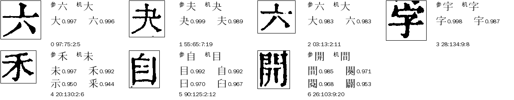
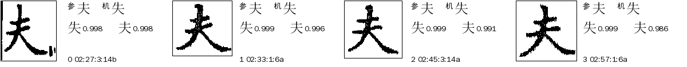
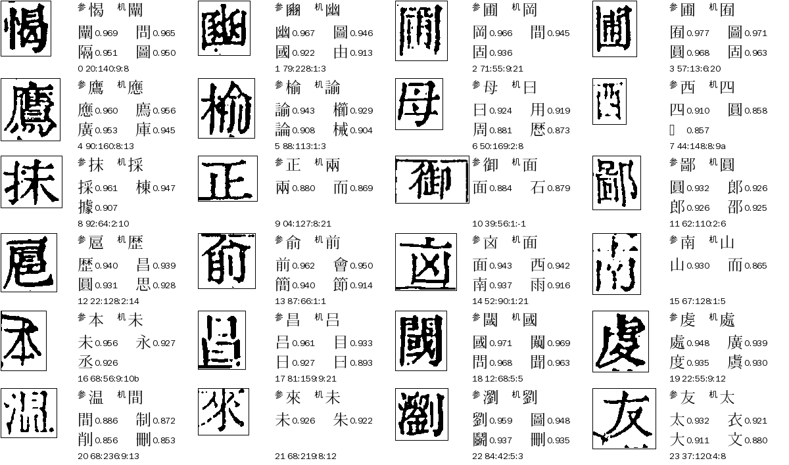
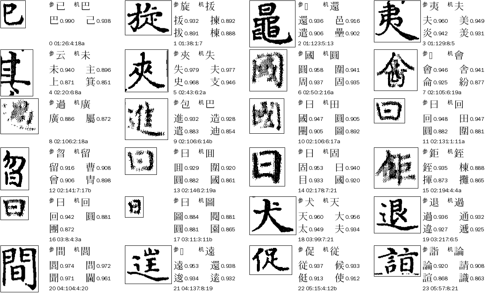
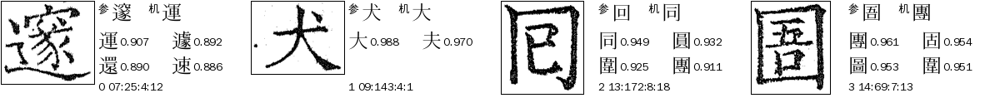
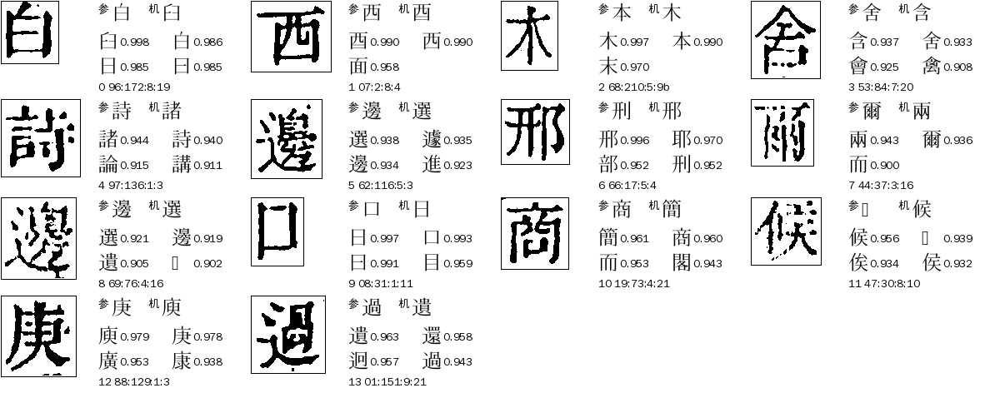
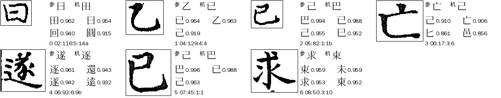
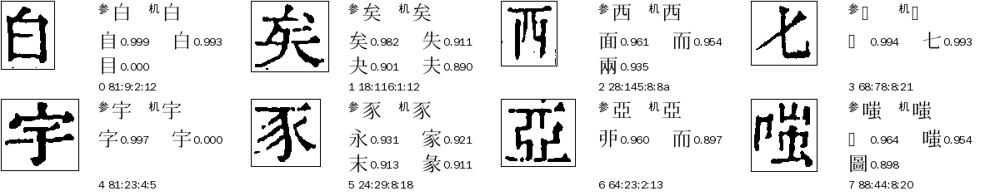

# N01 `near_form_guard`：形近字（形近护栏）

> [待审原因总览](../README.md) · 全流程见 [流程.md](流程.md) · 基准见 [benchmark.md](benchmark.md) · 2026-11-06 深挖底稿见 [深挖-2026-11-06.md](深挖-2026-11-06.md)

**一句话**：参校字和机器字（或库前几名）是手工形近表里的一对（六/大、禾/未、自/目、開/間…），或库匹配的护栏拦下（`conflict`／`never_match`），字形分不开，要结合前后文或看图。

## 定义与判定

- 大类：形近护栏（N）；判定顺序 priority 56；去向 `llm`（大模型只读文意，只收 high，其余回人）；网页卡片 `pick`；负责人 A24。
- 判定依据（2026-11-06 起，`reasons.py` `_near_form`，guji-manager#256）：格没有更靠前的原因，且满足下面任一：
  1. 库匹配的护栏 `guard` 是 `conflict`（同一格里有两个不同字都判 same）或 `never_match`（判 same 的字在形近表里有伙伴，被降成 unsure）；
  2. 参校字与（机器字、库候选前三）里的某个字，构成 cv 手工形近表 `NEVER_MATCH_FAMILIES` 里的一对（共 20 对，见[流程.md](流程.md)）。
- **以前不是这样**：只要疑问码里有 `near_form`（表里任一个字碰巧排进候选前三）就算。深挖发现这样 N01 里约九成其实是库认不出，家族字只是陪衬，现在这些格落到 `lib_sparse_dissent`／`ref_ocr_diff`／`ref_final_diff`。
- 排在 N01 前面的原因先判，所以进 N01 的格一定：不是人裁冲突／复审／切坏／遮挡／整页整列对不上／己已巳日曰（H01）／字组弃权类（Z01–Z06）／私用码（R01、R03）／库里没有（L01）／乱码闸（L05）／整理本无字（R02）／组外异体对（V01）。

## 什么样的字会进 N01

下面是 11-06 殿本、史記、全唐文 ★main 包里**还在 N01 的真形近格**，以及**旧口径下进来、现在改落别处的格**，各配图（左边原图字块，右边「参」整理本字、「机」机器字、库候选前 4 名和分）。

### 现行口径下的 N01（殿本约 24、史記约 9、全唐文 0）

| 例 | 图 |
|---|---|
| 参六 机大：图是「六」；参禾 机末；参自 机目；参開 机間；参夫 机失（史記，库护栏 conflict／never_match，cov 0.998、分差 0.002）|   |

要点：**这些才是真的形近之争**。看人裁金标（[benchmark.md](benchmark.md)），殿本这类格真字＝参校字只有 50%、＝库首位 23%、另外 27% 两个都不是，所以不能按参校字或库首位放。史記里整理本几乎总是对的（37/37）。

### 旧口径下进来、现在改落别处的格（殿本 249、史記 31、全唐文 6）

| 类 | 说明 | 图 |
|---|---|---|
| B 参校字不在库候选前 6 | 参校字≠机器字，库里没有这个字的像样刻例；圖面而間廣圓这些笔画密的字碰巧排进前三，触发 near_form。殿本 208、史記 28、全唐文 4 |    |
| C 参校字在候选里但不是首位 | 库首位错、参校字排第二（殿本 46、史記 7、全唐文 2） |   |
| E 参校字＝机器字 | 两边同字，被家族字（白→自）的疑问挡下（殿本 12、史記 1） |  |

放大看几个难例（本/木、舍/含、候/𠉀、白/自）：[放大图](images/放大-本木-舍-候-白-西.png)。

## 现状（2026-11-06，★main 包口径，正文页）

| 书 | 旧口径 N01 | 现行口径 N01 | 形近处境格（候选前三或机器字含手工表字）| 其中放行 | 其中还在待审 |
|---|---:|---:|---:|---:|---:|
| 四库总目（殿本） | 273 | 约 24 | 274,991 | 273,417（99.4%） | 1,574 |
| 史记 | 40 | 约 9 | 23,371 | 23,063（98.7%） | 308 |
| 全唐文 | 6 | 0 | 24,975 | 24,915（99.8%） | 60 |

「形近处境格」就是旧 `near_form` 疑问能碰到的格，占殿本全册约一成；绝大多数已经放行，N01 只是没放出去的一小撮。改判后 N01 数字以 manager 下次发版后出单为准。

## 第 7 轮复查（2026-11-08，殿本 cv v0.6.17）

N01 606 → **253**（#256 收窄生效）。按候选三元组（参校字／机器字／库候选前三）聚类，头部两类占四分之一，都是系统性问题而不是真形近之争：

| 类 | 格数 | 图上 | 根因 | 处理 |
|---|---:|---|---|---|
| 一/二/子 护栏 conflict | 35 | 单横「一」，库给 二1.000、一1.000、子0.97（二能盖住一横）| 子 落在 `delta` 内又不是 yr 组员，进不了字组流程 | cv#1247：yr 陪衬加 子；本地重放 vol48/52 目标 12 格全放成一、其余无变化 |
| 七/𠤎 护栏 conflict | 28 | 普通「七」| 库里 𠤎 只有 2 个人裁样本（v2:vol02:35:6:16、v2:vol03:8:2:13），图都是七，库里 七 𠤎 成 0.999 并列 | 请 A31 走体检 relabel 改标 七（未动中心库）|

其余约 190 格是长尾（官宫宮、木末本、日曰臼、十千士、論諭…），逐个字对才有判据，按 [benchmark.md](benchmark.md) 先看库、整理本哪边可靠。

**新书体检补一条**：先把 N01 格按 `(参校字, 机器字, 候选前三)` 聚类，头部几类先看图——多半是库样本标错或字组入口没接，一次修掉几十格；别一格一格录。

## 成因

1. `near_form` 疑问触发太宽（表里任一成员排进候选前三），圖面而間廣圓是库里的「万能陪衬」。
2. 库首位分数没有区分力：库认错的格 cov 也常在 0.93–0.97，和认对的同档。
3. 真形近对里，字形（整字 HOG、库 cov）分不开，参校字、文意是仅有的证据，两者在殿本上也只有一半可靠。

详见[深挖-2026-11-06.md](深挖-2026-11-06.md)和[流程.md](流程.md)。

## 怎么处理（现行）

1. 真形近格：走 L2 文意（大模型只读文意，只收 high）→ 余下人审。字对常见的补进字组（交 A24）。
2. 先试 `follow_ref_seen` 白名单（L0）：看图核实过的字对，同字对不再送审。
3. 改落别处的 B／C／E 格：按各自的原因处理（L02 归 A23，P01／P02 归 A24）。

## 怎么提高

1. **分类已改**（#256），N01 名实相符。
2. **按参校字放行**要看书：见[benchmark.md](benchmark.md)的基线成绩——史記整理本很可靠（B 类 38/38 对），殿本不行（B 类人裁 130 格 24% 错：31 格里 11 格参校字是〓缺字、17 格是㑹/會、説/說、巳/已 这类「同词异形」，真错只有 3 格）。所以这条通道只能按书开，开之前用金标打分，0 错才放。
3. 殿本 near_knn（本书刻形近邻）小库试验放行 0 格，不可行；全册能否到门槛未试。
4. 新书怎么做见[流程.md](流程.md)第六节。

## 回流与防再犯

高频字对进字组；看图核实过的字对进 `follow_ref_seen`；人裁格自动成为[基准金标](benchmark.md)。

## 不要做

- 不要凭库首位 cov 放行形近字（库首位对的格 cov 也常在 0.93–0.97，没区分力）；
- 不要把不同义形近字归一（真归一只限同义异体）；
- 不要因为只有一两格就往手工形近表里加字：每一对都要有实审案底，表一改，匹配层护栏、`near_form` 疑问、N01 判定三处同时变（见流程.md「三处同名」）。

## 数据与复现

- 取数、分类、拼图脚本：ai-team `domain/CV/质检/待审原因深挖/N01-scripts/`，逐格表 `N01-cells.tsv`；
- 基准：本目录 `benchmark/`（`funnel.py` 抽格、`gold_human.tsv` 金标、`score.py` 打分）。
