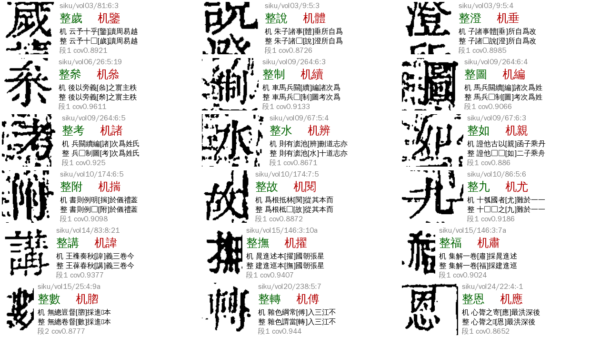
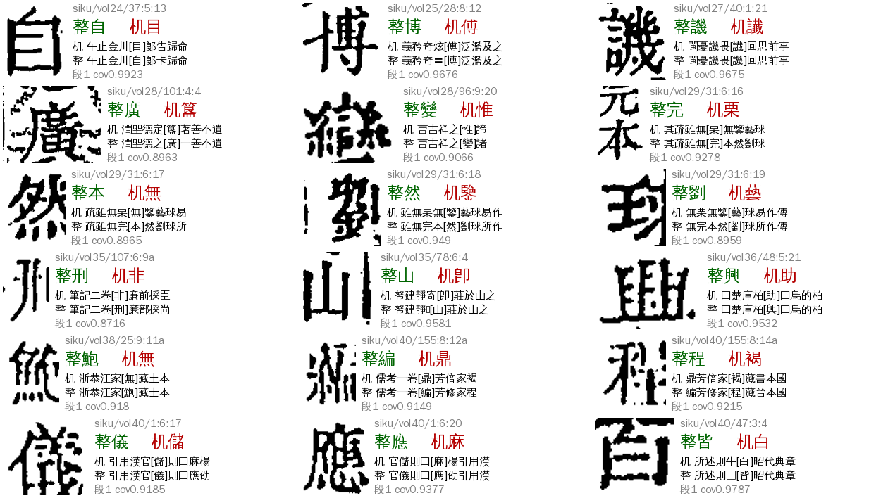
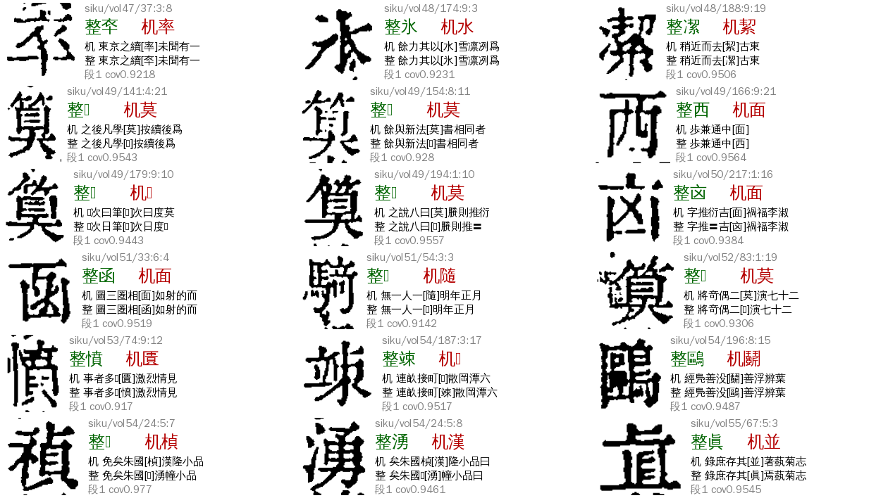
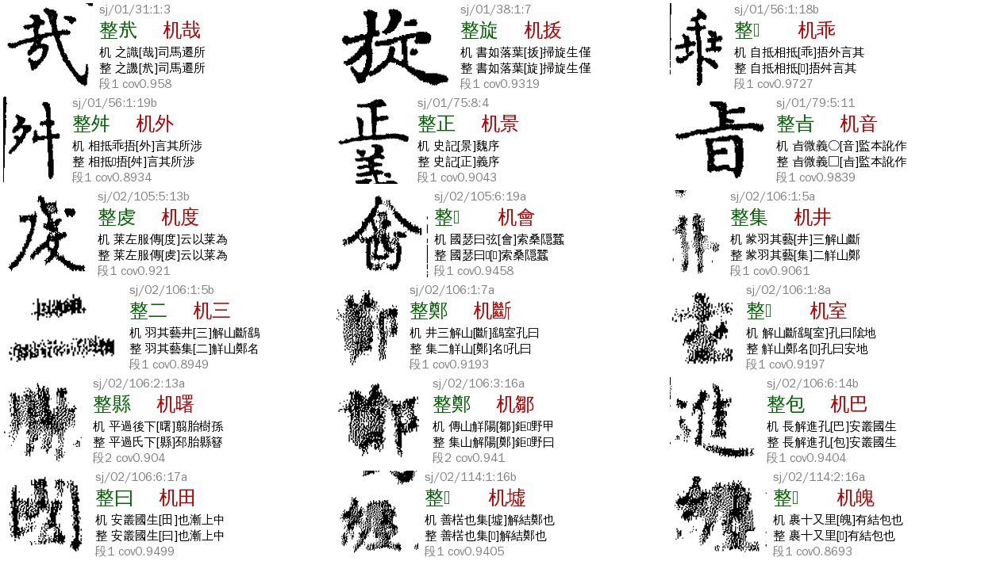
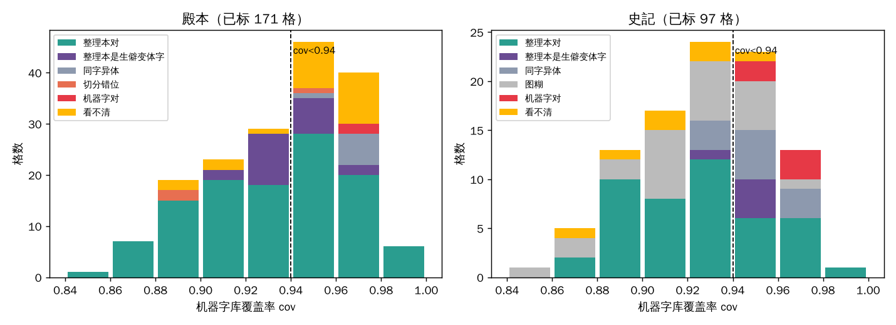

# P02 `ref_final_diff`：定字与参校本不同

> 2026-11-06 由 `ref_mismatch`（和参校本不一致）改名，旧名数据照认。
> [待审原因总览](../README.md) · 深挖：A24，2026-11-06（逐格表、脚本在 ai-team `domain/CV/质检/待审原因深挖/P02-*`；cv PR [#1208](https://github.com/open-guji/open-guji-cv/pull/1208)）
>
> **看图判对错都是 Claude 目视初判，不是金标**；规则上线前要 sheldon 抽 30 格确认（第六节）。

**一句话**：这格的整理本字**只从坐标对位来**（文本对位没给它标签），机器字（库首位）和它不同，又没被任何通道放行。实测它**几乎不是「真异文」**：殿本线上 61 格看图，整理本对 53 格（87%）、机器字对 1 格、切分错位 3 格、看不清 4 格。cov（机器字的库覆盖率）低的格，取整理本字基本是对的；错的集中在 cov ≥0.945。

## 一、判定条件

- `review/reasons.py`：`RULES[R.REF_FINAL_DIFF] = c.has_ref and c.char != c.ref`，priority 62。这是 P 类的**兜底**：前面 V01（55）、N01（56）、L03／L02（57／58）、P01（60）都没中，格没放行、有整理本字、机器字≠整理本字，才落到这里。
- 数据里它长这样：三书 ★main 包里的 715 格，`align_ref.chars`（文本对位）**一个都没有它们的标签**，整理本字全部来自 `align_ref.coord`（坐标对位）；所在页本身是锚定成功的（殿本 616 格里 560 格的页上还有别的 replace 标签）。和 P01 的分界就在这：P01 的格有文本对位标签（`replace` 段），P02 的格没有。
- 为什么没标签：`clustering/align_label.label_page` 只给「等长、被 equal 夹住、段长 ≤3（`replace_max_len`）」的 replace 段标 `align_char`；插入／删除、不等长 replace、过长或没被夹住的段整段丢弃（`replace_len_gate`、`lib_gate`）。丢掉的段里，整理本字只剩坐标对位还能给。（代码只读了一遍，`vol01:63:7:6` 一例只确认了「格在 coord 里、不在 chars 里」，没有整理本语料可在云端逐段回放，各格具体是哪条闸丢的没逐一核。）
- 线上单的原名：殿本线上 62 格里 57 格是旧名 `ref_mismatch`、5 格是 `ref_final_diff`；旧分类（`taxonomy`）57 格是 L3「ctx空」（上下文没给字）、4 格是 Z4（字组相关）。
- 去向：`llm`（大模型文意终审，只收 high，其余回人）；网页卡片 `pick`。负责改算法／数据：A24。
- 旧字段对应：`{"cause": ["E","I"], "cls": ["ref_conflict","other"], "taxonomy": ["R1"], "v2": "P 机器字≠整理本"}`。

## 二、现状（2026-11-06，★main 包现算，正文页）

| 书 | P02 格 | 其中线上单 | 夹注小字 | 段长 1／2／3+ | 已看图 |
|---|---:|---:|---:|---|---:|
| 殿本（96mid1ogzk，99 册） | 616 | 61（线上共 62，1 格没在 ★main 里） | 34（5%） | 608／8／0 | 171（线上全查＋随机 110） |
| 史記（988g3f0wsu，10 册有 ★main） | 97 | 无线上单 | 62（64%） | 81／14／2 | 97（全查） |
| 全唐文（995ejelvk0，11 册有 ★main） | 2 | 0 | 0 | 2／0／0 | 2 |

（总览页写的 374／68／0 是早一版 ★main 的数；本表是现算，殿本多出的格没逐一核来源，大概率是已有人裁或终审结果、不在线上单里。）

全部 715 格：机器字库 verdict 殿本 605／616 是 `unsure`（11 格是 `same` 但准入被拦）、史記全是 `unsure`；整理本字在库前五里的只有 14%（殿本）和 2%（史記）。

**看图结果**（R＝整理本对，M＝机器字对，S＝切分错位，V＝同字异体两可，Q＝整理本字是扩展区生僻变体字、字体里显示不出、但机器字明显不对，N＝图糊看不出字，?＝看不清）：

| 样本 | 格 | R | M | S | V | Q | N | ? |
|---|---:|---:|---:|---:|---:|---:|---:|---:|
| 殿本线上单（全查） | 61 | 53 | 1 | 3 | 0 | 0 | 0 | 4 |
| 殿本非线上单随机 | 110 | 61 | 1 | 0 | 7 | 21 | 0 | 20 |
| 史記（全查） | 97 | 45 | 5 | 0 | 11 | 5 | 24 | 7 |
| 全唐文 | 2 | 1 | 0 | 0 | 0 | 0 | 0 | 1 |

（左为格图，右为「整＝整理本字、机＝机器字」和前后文；图中「□」是字体里显示不出的扩展区字。）

## 三、成因

**A 机器字错、整理本对（殿本线上 87%，史記 46%）**：机器字都是形近字（歲→鑒、說→體、制→續、圖→編、考→諸、水→辨、故→閱、講→諱、撫→擢…），库认不准：cov 都落在 0.84–0.96，库首位与第二名的差很小。线上这 61 格几乎都是**成片或连续出现在同一页**的整页糊墨格，库样本少、文意也给不出字（所以旧分类是 L3「ctx空」）。

**B 机器字对、整理本不同（殿本 2／171，史記 5／97）**：区→匾、臣→姬、工→空、乖→(整理本生僻字)、哉→烖、會→𨠭。**共同点：cov 全在 0.9458–0.975**——库认得机器字。这是区分 A、B 的唯一可用信号（图 0）。

**C 切分错位 S（殿本线上 3 格，同一页）**：vol29 p31 第 6 列 17、18、19 格，格框和字错开了一格（6:16 的格框里装了「元」「本」两个字），机器字和整理本字都不是格图上的字。三格相邻、cov 0.896／0.8965／0.949。

**D 整理本字是扩展区生僻变体字 Q（殿本随机样本 21／110，≈30% 的 ★main 格；线上单里一个都没有）**：整理本字是 𮅕（U+2E155，奠的变体）、𭔃（U+2D503，寄的变体）、𡻕、嵗 之类，机器字是它的常见形近字（莫／奇／黍／敵／蘧…），图上是变体字、机器字明显不对。**线上单里没有这类，说明它们多半已被别的通道（rare_ref、V01 异体）或人裁处理了**，★main 里还剩着是版本差。这一类整理本多半对，但字体显示不出，看图时不能当「证实」，所以单列。

**E 图糊 N（史記 24／97）**：02 册 p50／p96／p106、03 册 p10 整页网点状噪点，格图看不出字，整理本字靠上下文可信，但不能当「看图证据」。

**F 同字异体 V（史記 11／97，殿本随机 7／110）**：隸、冢、謀、携、恭、識 一类，取哪个都可。

## 四、能放行多少（`p_ref_coord`，cv#1208，seed_admit 1.48，缺省关）

旧 `p_ref_admit` **碰不到 P02**：它的候选格要求文本对位 `amap` 里有整理本字，而 P02 的格恰恰没有。新旋钮 `p_ref_coord`（要同时开 `p_ref_admit`）让这类格退到坐标对位的整理本字（去掉 `coord_conflict_ids`、〓、空格位），cov 上限、相邻、夹注三个旋钮（P01 加的）同样管它们，放行通道仍是 `p_ref`，`evidence.p_ref.via = "coord"`。

离线回放（`P02-scripts/p02_bench.py`，用 ★main 抽出的字段近似：相邻用「同列两侧邻格机器字都等于整理本字」近似；正式回放要等下一轮 dev 包）：

| 书 | 口径 | 放出（全部／线上） | 已标放出 R | 错（M＋S） | 其它 |
|---|---|---|---:|---:|---|
| 殿本 | cov<0.94，不放相邻，开夹注 | 148／616，线上 13／61 | 27 | **0** | Q 11、? 3 |
| 殿本 | cov<0.95，不放相邻，开夹注 | 217／616，线上 15／61 | 34 | **0** | Q 14、? 9 |
| 殿本 | cov<0.97，不放相邻，开夹注 | 336／616，线上 25／61 | 52 | **1**（匾→區，cov 0.961） | V 4、Q 20、? 13 |
| 殿本 | cov<0.94，放开相邻，开夹注 | 266／616，线上 39／61 | 60 | **2**（S，vol29 p31 同一页） | Q 12、? 5 |
| 史記 | cov<0.94，不放相邻，开夹注 | 41／97 | 25 | **0** | N 11、V 1、Q 1、? 3 |
| 史記 | cov<0.95，不放相邻，开夹注 | 52／97 | 27 | **0** | N 16、V 4、Q 1、? 4 |
| 史記 | cov<1.01（不设上限） | 72／97 | 34 | 3（M，cov ≥0.9458） | N 17、V 9、Q 5、? 4 |
| 全唐文 | — | — | — | — | 只有 2 格，其中 1 格库判 `same`（cov 0.9966）被准入拦，不开 |

结论：
- **零错的上限是 cov<0.945**（整个已标集里 M 的最小 cov 是 0.9458，S 在 cov<0.95 里也只出现在相邻成片的页），建议殿本、史記都取 **`p_ref_max_cov: 0.94`**，**不放开相邻**，夹注开。预计殿本线上 61 → 约 48（−21%），★main 616 → 约 468；史記 97 → 约 56（−42%）。
- **sheldon 11-06 定：殿本、史記第 7 轮都开**（`p_ref_admit`＋`p_ref_coord`＋`p_ref_max_cov 0.94`＋`p_ref_jiazhu`，相邻不开）；上线后他抽 30 格金标核对。
- 放开相邻（`p_ref_adjacent`）线上能再多放 26 格（61 → 22），但会把 vol29 p31 那 3 格切分错位格也放进去（错 2）。**没有 S 的稳定信号前不要放开**（第七节）。
- 整理本是 Kanripo 另一底本的全唐文，P01 已定不开 `p_ref_admit`，P02 同样不开。

## 五、整条流程与参数（下一本书照做）

1. **取数**：`guji-manager pending-stats --ws <ws> --text <书> --out <目录>`，`cells.tsv` 里 `pending_reason ∈ {ref_mismatch, ref_final_diff}` 是线上单；再用 `P02-scripts/extract.py`（P01 的同款，只改 `want`）逐册拉 ★main 包，`reasons_for_pending` 取 `ref_final_diff` 格，附机器字、整理本字、库候选、cov、前后文、`align_op`（P02 一定是 `coord`）。
2. **体检**：看 `align_op` 是不是全是 `coord`（是＝文本对位丢段，本报告的情形）；再看 cov 分布。
3. **裁格图、看图**：`crops.py` 裁格（要先 `guji db pull -w <ws> --no-rebuild`，云端要 `.central.json`，见 P01 报告「云端坑」）、`sheet.py` 拼表，每张 18 格，逐格标 R／M／S／V／Q／N／?。
4. **定 cov 上限**：取已标 M 的最小 cov 之下（殿本、史記都是 0.94）。**书不同要各标各的**，不要继承。
5. **开旋钮**：册 yaml `seed_admit` params：`p_ref_admit: true`、`p_ref_coord: true`、`p_ref_max_cov: 0.94`、`p_ref_jiazhu: true`；`guji book show --effective` 核对。`p_ref_adjacent` 不开。
6. **回放**：`p02_bench.py` 比较放出数和看图精度；上线后用 benchmark 核。
7. **留审的格**：文意终审在 {整理本字, 机器字} 里选；回人审的在网页 `pick` 卡。

参数表：

| 参数 | 位置 | 殿本 | 史記 | 全唐文 |
|---|---|---|---|---|
| `p_ref_admit` | cv seed_admit | 建议开（P01 同开） | 建议开 | 关 |
| `p_ref_coord` | 同上（1.47） | 建议开 | 建议开 | 关 |
| `p_ref_max_cov` | 同上 | 0.94 | 0.94 | — |
| `p_ref_adjacent` | 同上 | 不开 | 不开 | — |
| `p_ref_jiazhu` | 同上 | 开 | 开 | — |
| 判定 priority 62 | manager `reasons.py` | 不改 | | |

## 六、Benchmark

数据：ai-team `P02-逐格-三书715格.tsv`（P02 全部格、看图标、cov、邻格是否齐、规则是否放）、`P02-scripts/labels.json`、`p02_bench.py`。

| 指标 | 定义 | 现状（规则 cov<0.94，不放相邻，开夹注） | 目标 |
|---|---|---|---|
| B1 错放 | 规则放出的已标格里「机器字对 M」＋「切分错位 S」 | 殿本 0／41；史記 0／41 | 0 |
| B2 放出数 | 放出的格（线上单口径／★main 全部） | 殿本 13／61、148／616；史記 41／97 | B1 为 0 前提下越多越好 |
| B3 召回 | 放出的 R／已标 R | 殿本 27／114；史記 25／45 | 提高 |
| B4 待确认 | 放出格里 ?／Q／N 的数（看图证实不了的） | 殿本 14／41；史記 15／41 | 上线前 sheldon 抽 30 格确认，降到 0 |

## 七、怎么提高（剩下的格）

1. **放开相邻要先有切分错位（S）信号**。S 的 3 格和相邻成片的 R（vol09 264:6:3–5「制圖考」，也是 3 连格、全对）在 cov、段长、邻格是否齐上都分不开。想放开相邻（线上再多放约 26 格），要有格框和字错开的专门判据：vol29 p31 的 6:16 格框装了两字、格宽高比 >1.1，可以试 `cell_shrink` 的单格宽高比＋同列整理本字个数核对；先请 A22 看这页的切分，修了这页 S 就是 0，相邻可以放开试。
2. **没被放行的格（殿本约 470 格、线上约 48 格；cov ≥0.94 或邻格也不齐）只能走文意或人审**：cov ≥0.94 这里 M 和 R 混在一起（线上 cov ≥0.96 有 R 8、M 1、? 3）。线上这些格旧分类是「上下文没给字」，文意终审（`final-review`）在 {整理本字, 机器字} 里选，整理本字对的占多数，所以终审的默认倾向可以偏整理本（但不能反过来一律取整理本）。
3. **Q（扩展区变体字，殿本约 30% 的 ★main 格）**：整理本字多半对，但字体显示不出，看图不能证实。这类归 V01／L05 的生僻字流程（rare_ref 坐标支，`rare_ref_coord_group_top`），不在 P02 里解决；要核对要用有扩展区字体的审阅页（缺字框标注页型）。
4. **史記图糊 N（24 格）**：靠不了看图，靠文本层或另一参校本；`p_ref_coord` 对 cov<0.94 的 N 放行 11 格是按文意可信、不是看图证实，记到 B4。
5. **文本对位为什么丢段**：P02 的根是 `label_page` 把「不等长／过长／没被夹住」的段整段丢了。如果这些段里很多其实是单格 replace，放宽 `replace_max_len` 或补一条「单格 replace 夹在 ≥3 个 equal 之间无条件标」可以把 P02 变成有文本标签的格、让 `lib_gate` 和 equal 位统一处理。这属于 A22／A23 的 `align_ref` 通用改动，要经协调者通知 A31–A34，本次不动。
6. **分类描述已改**（sheldon 11-06 定）：`pending_reasons.yaml` 的 P02 `hint`／`detect`、`pending_reason.py` 注释、P01 页的区别说明，旧写法是「对位时相同、最后 seed_admit 定字才不同」，改成「文本对位没给标签、只有坐标对位」。只改文字，码、判定规则、priority 都不变。

## 八、不要做

- 不要在 cov ≥0.945 的格上默认取整理本字（M 全在这里）。
- 不要放开相邻（成片）直到 S 有可靠判据。
- 不要把 Q 类当看图证实。
