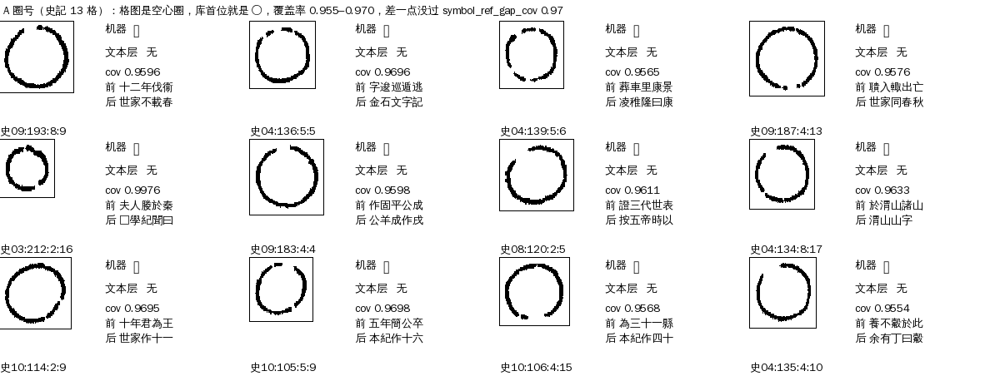
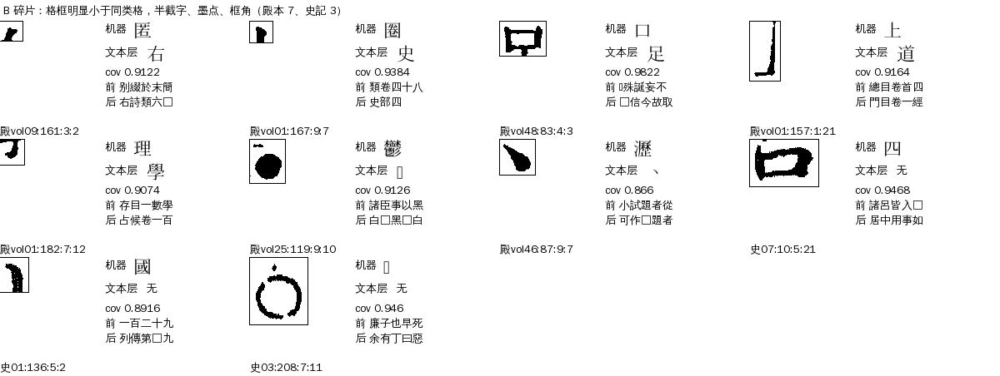
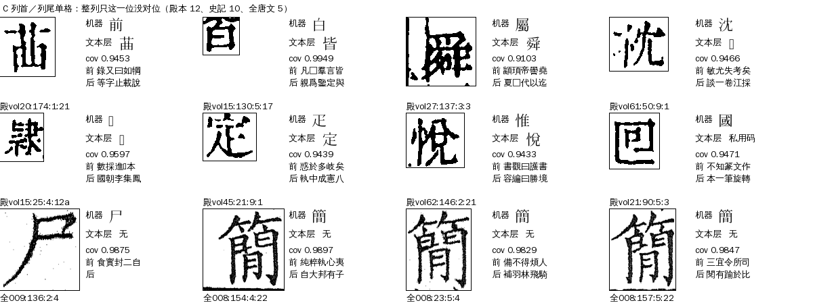
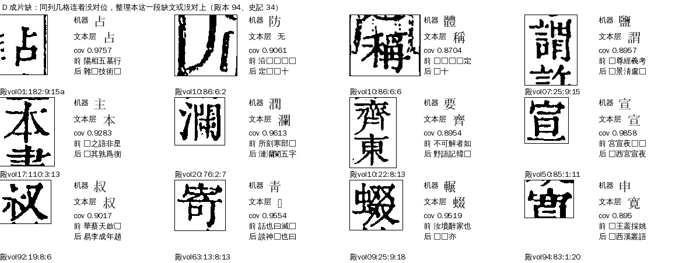
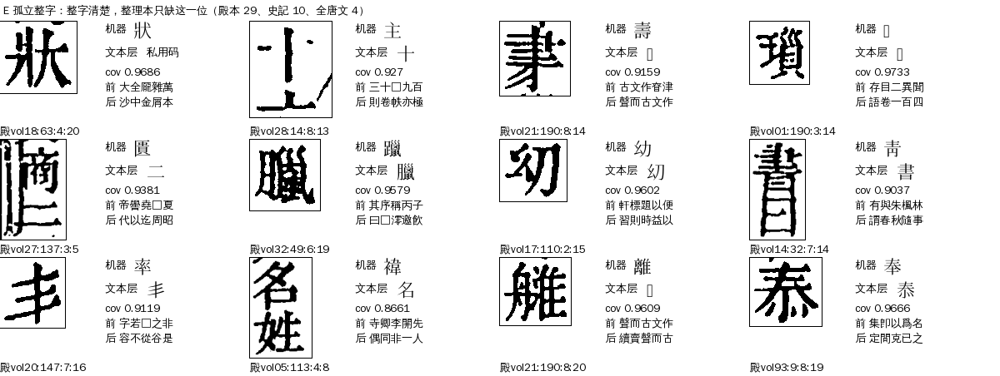
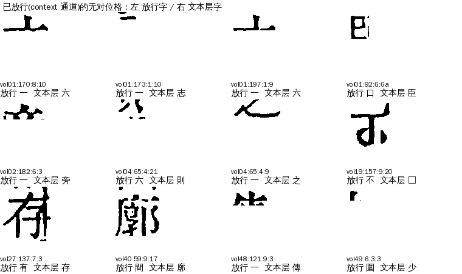

# R02 `ref_gap`：参校本这里没字

> [待审原因总览](../README.md)

**一句话**：这一格的字块有（库也认出了一个字），但整理本（对位用的参校本）在对应位置**没有字可对**，机器没法拿整理本去核，只能待审。名字叫「参校本没字」，看图实际是几种情况混在一起：整理本真漏字，只是少数；更多是整理本这一段跟刻本对不上（异文、脱文、小注顺序）、字块是切坏的碎片、史記的圈号 ○，以及已经放行的格里藏着的错放。

## 一、什么情况下判成 R02

判法在 `guji_manager/review/reasons.py`：`RULES[R.REF_GAP] = lambda c, x: not c.ref`（整理本对位字为空，包括坐标对位也没给），顺序 priority 53。前面已经被更早的原因拿走的不算：复审、切坏 S04、遮挡 D、整页／整列对不上 S01/S02、极难形近 H01、字组 Z、私用码待收 R03、整理本缺字 R01（整理本是〓）、少见的字 L01（库认不出，priority 51）、像框线墨点 L05（52）。后面的 V01/N01/L02/L03/P01/P02 都需要整理本有字，所以**凡是整理本这位没字、又没被前面拿走的格，都落到 R02**。

进来之前要过的几关（都是现有开关，没有 R02 专属参数）：

| 关 | 位置 | 参数（缺省） | 作用 |
|---|---|---|---|
| 对位 | cv `align_ref`（文本对位）＋坐标对位 `align_ref_coord` | 书级 `align_ref` 参数；cv#1192 起对位字流收扩展区字 | 这一位没拿到整理本字，才有 R02 |
| 放行 | cv `seed_admit`：库 same、字组、上下文 `context`、`match_solo`… | 各通道自己的分数门槛 | 放行了就不进待审；R02 的格是这些通道都没放的 |
| 空格护栏 | `context_guard_ref_blank` | 缺省开 | 坐标对位说此位是空格、库又不是 same → 字块不是字（`ctx_guard_ref_blank`，char=None） |
| 符号放行 | `symbol_ref_blank`＋`symbol_ref_gap`、`symbol_ref_gap_cov`、`symbol_ref_gap_min_col` | 殿本关；史記开（`"○"`、gap 开）；cov 0.97、同列≥3 个坐标对位 | 库首位是点名符号（○）且 cov 够，直接放行为该符号 |
| 整页／整列 | `reasons.py` 的 `PAGE_MIN=10`、`COL_MIN=5`、`COL_AGREE_MAX=0.5` | 常量 | 同页≥10 格或同列≥5 格没对位，归 S01/S02，不进 R02 |

出单时 `pending_reason_detail` 目前为空；去向 `route: llm`（大模型过一遍，只收 high），网页卡片 `pick`。

## 二、现在的情况（2026-11-06）

三书各册 ★main 包现算（出单同一套判法，只计正文页；殿本 99 册、史記有包的 10 册、全唐文有包的 11 册）：

| 书 | R02 格 | 占该书待审 |
|---|---:|---:|
| 四库总目（殿本） | 145 | 4,715 的 3.1% |
| 史記 | 70 | 845 的 8.3% |
| 全唐文 | 9 | 125 的 7.2% |
| 合计 | 224 | |

（派单里写的 125 是线上单的数，比 ★main 包旧；逐格明细按包现算走，见 ai-team `domain/CV/质检/待审原因深挖/R02-逐格-三书224格.tsv`。）

共同点：224 格库验证几乎都是 unsure（殿本 144、史記 69、全唐文 9），库覆盖率中位 0.94（殿本）、0.94（史記）、0.98（全唐文），没有一格低于 0.85；**机器字只是库首位，不是认出来的**：下面用人裁过的无对位格量过，库首位只对约一半，覆盖率 0.9–0.95 那段 27 格只对 5 格。

## 三、什么样的格会被归进来

按格图和前后文看了全部 224 格拼图，再用数据特征分类（脚本 `classify.py`）。每张图：左＝本书这一格，右＝机器字（库首位）、**文本层字**（见第五节）、库覆盖率、整理本前后文（□＝那一格也没对位）。

| 类 | 殿本 | 史記 | 全唐文 | 一句话 |
|---|---:|---:|---:|---|
| A 圈号 | 3 | 13 | 0 | 格图是空心圈 ○，库首位就是 ○ |
| B 碎片 | 7 | 3 | 0 | 格框比同类格小得多：半截字、墨点、框角 |
| C 列首列尾单格 | 12 | 10 | 5 | 整列只有这一位没对位，在列端 |
| D 成片缺 | 94 | 34 | 0 | 同列 ≥3 格没对位或连着 ≥2 格：整理本这一段缺文或没对上 |
| E 孤立整字 | 29 | 10 | 4 | 整字清楚，整理本只缺这一位 |

分类有先后（A→B→C→D→E，第一条命中为准）；D 的「本列无对位」是把已放行的格也算在内的，所以比待审格数多。圈号检测对带小点的圈会漏，归成 B。

### A 圈号（史記 13、殿本 3）

史記的圈点「○」（章节分隔）在整理本里不占字，所以对位没有这一位。库首位正是 ○，覆盖率 0.955–0.970，**差一点没过 `symbol_ref_gap_cov=0.97`**，所以没走 `symbol_ref_blank` 放行；又被 `ctx_guard_ref_blank` 拦下，落到 R02。13 格格图都是空心圈（脚本里用环形检测核过）。史記同条通道已经放行了 458 个 ○。



### B 碎片（殿本 7、史記 3）

格框只有同类格的一半大：半个字、一撮墨点、版框角。这是切分的毛病，应归 S04 切坏格，只是整理本没字就被 R02 拿走。



### C 列首列尾单格（殿本 12、史記 10、全唐文 5）

整列别的格都有对位，只有列首或列尾这一位没有。全唐文的 5 格里 4 格是「簡」（库覆盖率 0.98–0.99）出现在列首／列尾（另 1 格「尸」在短列），整字清楚，整理本没收；全唐文没有文本层，要人看一眼。



### D 成片缺（殿本 94、史記 34）

同一列里连着几格都没对位。看整理本前后文，这些位置整理本的文字和刻本不一样（异文、脱文、小注排序不同），对位在这一段脱了钩。格图多是清楚的整字，但**机器字常常不对**：下图「體→稱」「鹽→謂」「要→齊」「青→寄」库首位都错了，右边的文本层字是对的。



### E 孤立整字（殿本 29、史記 10、全唐文 4）

整字清楚，前后文都对得上，整理本只是少这一位（漏字或写法不同）。



## 四、已经知道的几件事

- **殆知阁当第二参校本不行**：殿本的整理本主证人就是殆知阁逐列本，把 R02 格的前后文拿去殆知阁全文里找，145 格只有 9 格有唯一命中，且常是 PUA 或异体（`dzg_test.py`）。不是出路。
- **库首位不能当答案**：全册 96 个殿本无对位格有人裁（人裁字是真值），库首位等于人裁字的只有 44 格；库 cov 0.90–0.95 的 27 格只有 5 格对，≥0.98 才 26/32（81%）。所以 R02 里「机器字」不能用来放行。
- **图源文本层是现成答案**：殿本现行图源 `siku-qiefen-v2` 的每页 `text.jsonl.gz` 带字框和字（对僻字做了字形识别）。按 pagemap 选页（±3 页内与本页 seed 字串 difflib 比、取最像的）、格框与字框重叠面积最大者取字，见第五节。
- **已放行的无对位格里有错放**（第六节）。
- **cv#1192（扩展区字对位）影响很小**：R02 格前后各 8 个整理本字里含扩展区字的，殿本 7 格、史記 4 格。第 7 轮重跑后再数。
- **史記、全唐文没有文本层**，第五节的方法对它们无效；史記的 ○ 另有出路（第七节 ③）。

## 五、文本层取字：怎么取、准不准

取法（`textlayer_eval.py`，修正版 tl.py）：这一页 seed 的字串（按列序）与 pagemap 给的页±3 页的文本层整页字比 difflib ratio，取最大那页（记 `ratio`）；然后在该页字框里找与本格框（`cell_shrink` 的 `bbox_page`，右上角原点，翻到左上）**重叠面积占本格框比例最大**的字（记 `area`）。`area<0.3` 算没取到。

殿本全册 1,721 个无对位格里 1,379 格取到字。拿 96 个**人裁过的无对位格**当真值（文本层字对人裁字，等价写法折叠：○〇、日曰、己已巳、×╳、會㑹；私用码当弃权）：

| 规则 | 放行格 | 错 |
|---|---:|---:|
| area≥0.8、ratio≥0.8、非私用码 | 44 | 1（目→自，形近对） |
| ＋形近护栏（文本层字与库前五里任一字是 `config/confusable_human.json` 的形近对就不放） | 40 | 0 |
| area≥0.6（放宽，无护栏） | 44 | 1 |
| 允许私用码当字（无护栏） | 46 | 6 |

只覆盖 9 册、40 格，是**方向，不是上线结论**（要 0 错，上线前还得按册留出再核）。复现：`R02-scripts/bench.py`。

用到 R02 的殿本 145 格：

| 结果 | 格数 |
|---|---:|
| 文本层字可放（规则全过） | 96 |
| 　其中＝库首位 | 15 |
| 　其中在库前五（非首位） | 12 |
| 　其中**不在库前五** | 69 |
| 形近护栏拦下 | 1 |
| 重叠或页相似不足 | 33 |
| 文本层是私用码 | 5 |
| 没有文本层字 | 10 |

96 格里 6 格是 B 碎片（字框把整个碎片格框住，重叠够，但格本身是切坏的），要先挪出；剩 **约 90 格（殿本 R02 的 62%）能放行**。69 格文本层字不在库前五，说明库认不出来，这些格进库样本前要小心（糊图不宜入库）。

## 六、已放行的无对位格里有错放（要告诉 A31）

用同一套文本层核全册已放行的无对位格：

| 放行通道 | 取到文本层字（≥0.8/0.8，非私用码） | 与文本层不同 |
|---|---:|---:|
| context（上下文） | 269 | 38（14%） |
| match_solo | 229 | 7（3%） |
| group_flow | 57 | 10 |
| vis_ruling | 29 | 5 |

context 38 格抽看了 12 格的格图：**2 格明确放错**（vol27:137:7:3 图是「存」放成「有」，vol40:59:9:17 图是「廓」放成「間」），**约 8 格是切坏的碎片被放成「一」「六」**（只剩字的上半截；库里该格唯一候选是「一」，cov 0.91–0.97），1 格放对（不），1 格看不清。这些格本来该归 S04 或待审，不该放行。图见下。



## 七、怎么提高（建议，都等 sheldon 定，没动代码）

| # | 做法 | 影响 | 风险与依据 |
|---|---|---|---|
| ① | 碎片（B 类）从 R02 挪出，归 S04：格框面积比本册同类格 <0.6，或长宽比 <0.35 | 殿本 7、史記 3 | 要先通知 A31–A34 改原因码；判据在 `classify.py` |
| ② | 新增「文本层取字」放行通道（缺省关，殿本开）：area≥0.8、ratio≥0.8、非私用码、不与库前五成形近对、非碎片 | 殿本约 90 格（R02 的 62%）；全册无对位待审格（含别的原因）约 437 | 人裁 40/40，但样本小；上线前殿本抽 30 格金标；文本层字是库没见过的，不要自动入库样本 |
| ③ | 史記 `symbol_ref_gap_cov` 0.97 → 0.95，保留环形格图核验 | 史記 12–13 格 | 13 格全是空心圈，库对这 13 格的 cov 实测 0.955–0.970 |
| ④ | context 通道对无对位格加护栏：库候选只剩 1 个且字是「一」「六」类笔画少的字、或同页文本层不同意，就不放 | 减错放，约 38 格先回查 | 交 A31 排查已放行（第 7 轮重跑时），先抽检再定护栏 |
| ⑤ | D 类成片缺：整理本这一段没对上，对位重做（缩小窗口再对一次，或把文本层字串当第二参校本做 `align_ref`） | 殿本 94 格里的大头已被 ② 覆盖；无文本层的册要另找 | 属于 A23 对位，另议 |
| ⑥ | 史記、全唐文问 SJ、QTW 有没有图源文本层 | 史記 70、全唐文 9 | 殿本这条路对它们无效；没有就只能人审或看图判 |
| ⑦ | 剩下的人审：殿本约 55、史記约 57、全唐文 9，约 120 格 | | 看图点选（`pick`），同字头合并 |

做完 ①②③，R02 从 224 降到约 120，其中殿本约 55。

## 八、整条流程与参数（方便下一本书做）

下一本书要做 R02 的体检，按这个顺序：

1. **取数**（`R02-scripts/extract.py`）：逐册拉 ★main 包，`reasons_for_pending` 取 `ref_gap` 格；再 `extract2.py` 补列上下文、整页统计、整理本字流前后文、`cell_shrink` 尺寸；`crops.py` 裁格图。
2. **分类**（`classify.py`）：A 圈号、B 碎片、C 列端、D 成片缺、E 孤立整字。书级可调：碎片面积比 `0.6`、碎片长宽比 `0.35`、成片缺的列内无对位数 `3`、连续数 `2`、列端判定的页内无对位数 `6`。
3. **有没有第二证人**：图源有没有文本层（殿本有；史記、全唐文没有）。有就跑 `fetch_qtext.py`（只取文本层，不下整包）和 `textlayer_eval.py`，看文本层字与人裁字的一致率。取字参数：`area_min 0.8`、`page_ratio_min 0.8`、`near_form_guard`（形近对表用 `confusable_human.json`，各书可加本书形近对）、`allow_pua`（缺省 False，要私用码表映射再开）。
4. **benchmark**（`bench.py`）：见下。每本书自己跑，自己调上面这几个值。
5. **符号**：本书有没有「整理本不收的符号」（○ 圈、□、╳）？有就开 `symbol_ref_blank` 和 `symbol_ref_gap`，cov 门槛按本书这个符号的实测分布定（史記 ○ 在 0.955–0.999）。

### Benchmark（建议定的）

| 名 | 内容 | 指标 | 现状 |
|---|---|---|---|
| B1 人裁无对位格 | 全册 ★main 包里整理本这位没字、provenance=human 的格（殿本 96、全唐文 139、史記 8） | 规则放行精确率（目标 0 错）、召回 | 殿本 40 放、0 错、覆盖 42%（9 册）；`bench.py` |
| B2 放行抽检金标 | 新通道放行的格，殿本抽 30 格看图，sheldon 判对错 | 0 错 | 待做 |
| B3 R02 流入 | `guji-manager pending-stats` 里 R02 格数、占比，按书按轮 | 下降 | 殿本 145／史記 70／全唐文 9 |
| B4 已放行无对位格哨兵 | context 等通道放行的无对位格与文本层字不一致的比例 | 下降 | context 14%、match_solo 3% |

## 九、回流与防再犯

确认是整理本漏字的，记进交接单，由书项目补整理本；文本层放行的格不入字形库样本，除非人裁过。

## 十、不要做

- 不要把 R02 格的库首位当答案：库首位对的只有约一半。
- 不要把文本层的私用码当字放行（允许后 46 格里错 6）。
- 不要拿殆知阁当殿本的第二参校本，它就是主证人。
- 不要把碎片格放成笔画少的字（「一」「六」）。

数据、逐格表、脚本见 ai-team `domain/CV/质检/待审原因深挖/R02-参校本没字.md`、`R02-逐格-三书224格.tsv`、`R02-scripts/`。

---
## 附：文本层取字通道已进框架（cv#1332，2026-11-09，缺省关）
sheldon 11-09 同意做；口径：**非异体字按文意录字**（文本层字就是文意读法，刻形「雨」、文意「兩」录「兩」）。
册配置（殿本示例；放行前须 ZM 抽 30 格金标 0 错，第9轮才在殿本打开）：
```yaml
params:
  seed_admit:
    textlayer_ref_gap: siku-qiefen-v2        # 数据目录：$GUJI_DATA_HOME/config/textlayer/ 下，或绝对路径
    # 以下为缺省值，各书可自己试：
    textlayer_ref_area_min: 0.8              # 格框变到文本层坐标后与字框重叠面积占比
    textlayer_ref_page_min: 0.8              # 文本层页与本页字串相似度
    textlayer_ref_min_pairs: 20              # 仿射拟合最少配对字数
    textlayer_ref_near_guard: true           # 库候选里有与文本层字成人裁形近对的字 → 留审
    textlayer_ref_allow_pua: false           # 私用码弃权（放了 r6 错 6 格）
```
数据目录：`pagemap.json[.gz]`（`{册号: [{our, their:[章,页]}]}`）＋`<章>/text.jsonl.gz`（`{p,c,x,y,w,hgt}`）。取数脚本见 ai-team `domain/CV/质检/待审原因深挖/R02-scripts/fetch_qtext.py`。
通道 `textlayer_ref`、provenance `align`、doubt `lane_textlayer_ref`，evidence.lane 记字／面积／页相似／配对数／残差。r7 殿本 vol20–99 预计放行 81/140（清单同目录 `R02-第7轮-文本层预计放行-殿本vol20-99.tsv`，未逐格核字）。
