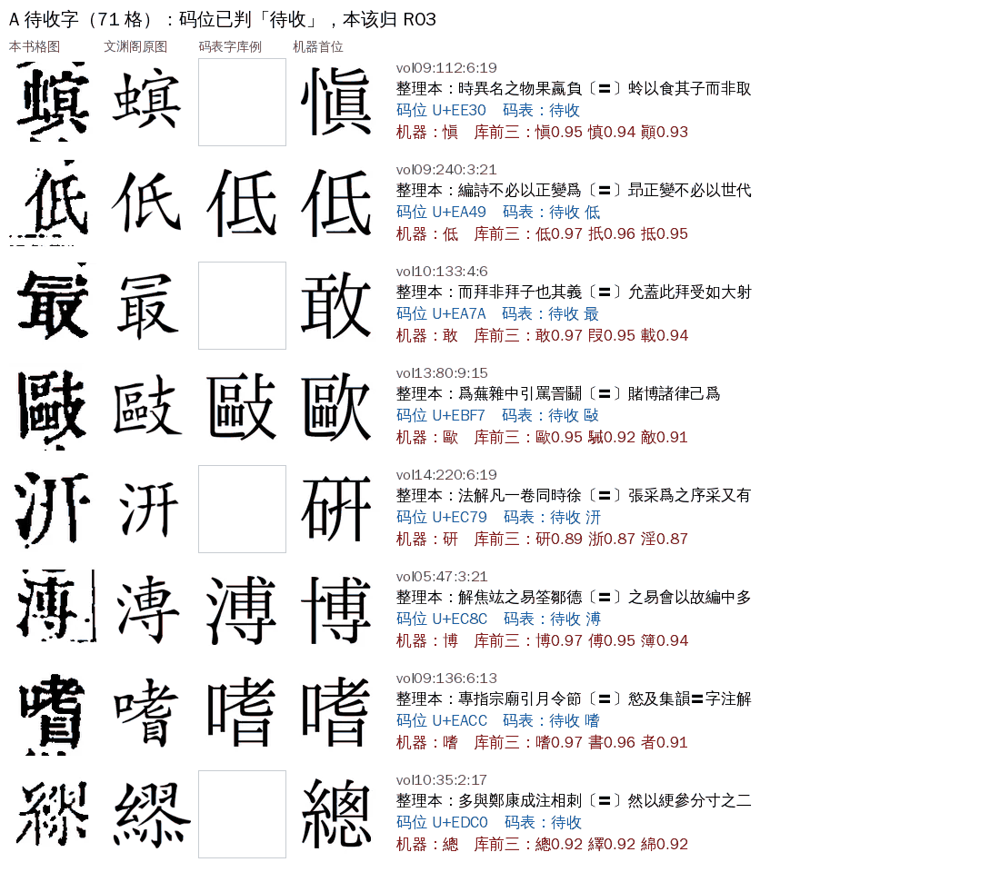
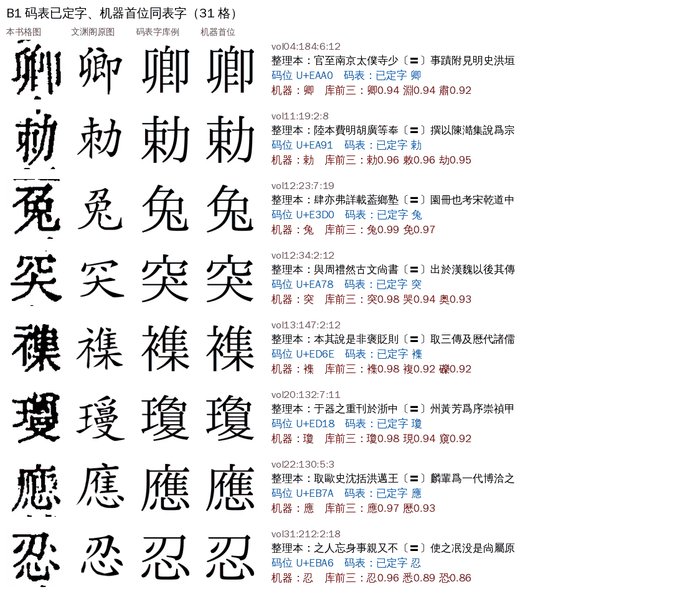
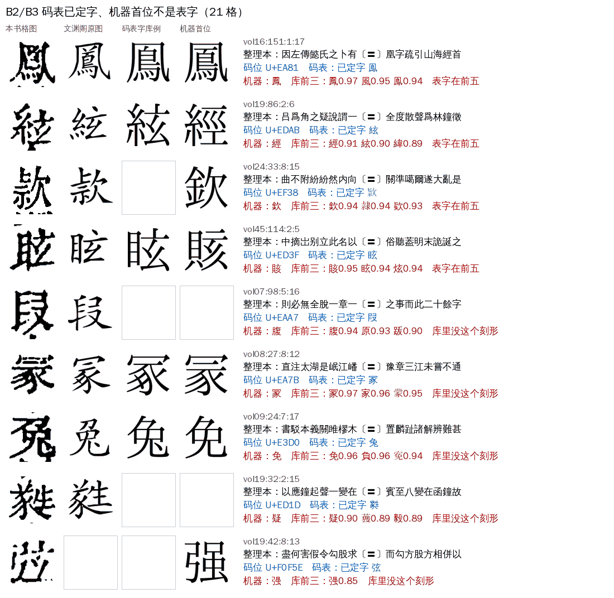
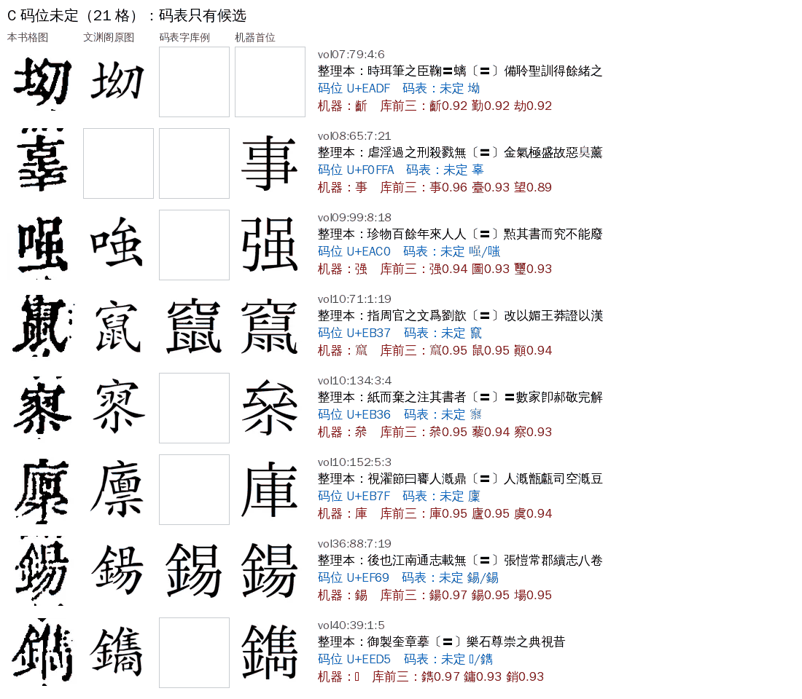
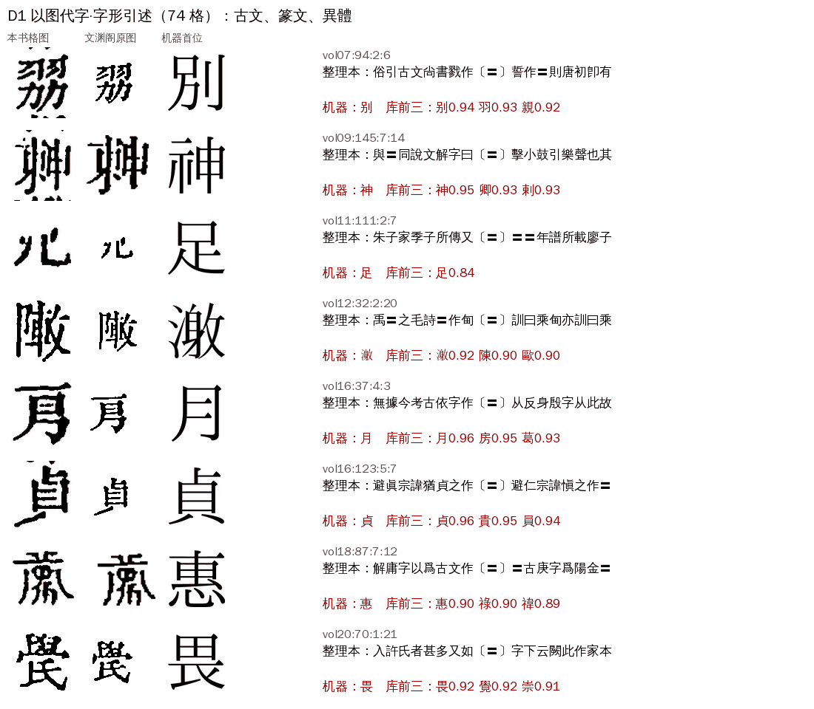
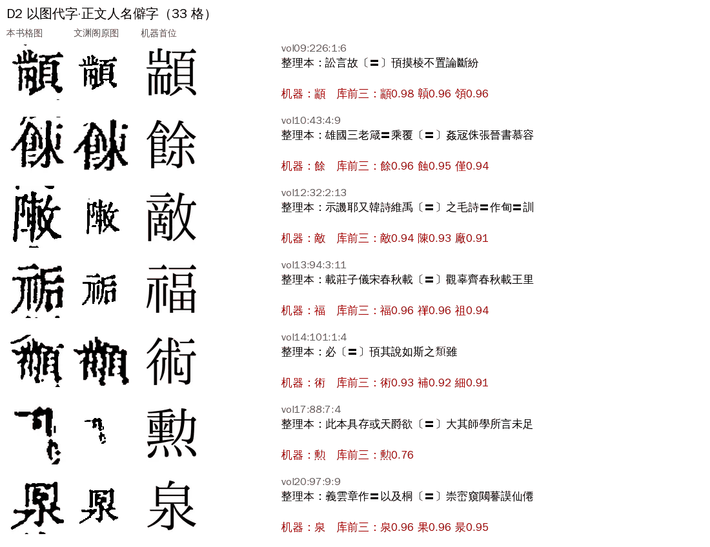
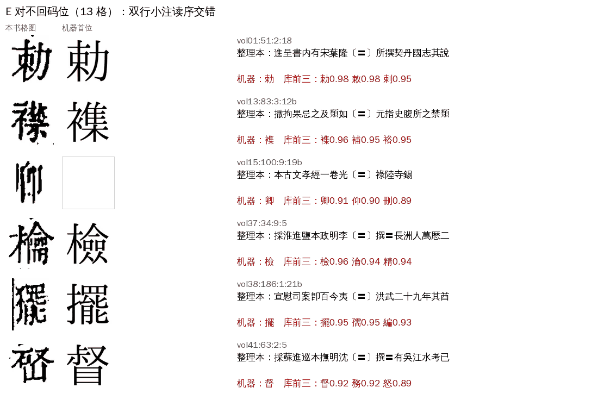

# R01 `ref_lacuna`：参校本缺字

> [待审原因总览](../README.md)

**一句话**：参校本这里写的是〓（没码位的生僻字），请从图上读

## 这是什么

参校本（殿本、四库总目用的是殆知阁逐列本，即维基文库文渊阁四库的校对结果）遇到电脑里打不出的字，不写字，而是留一个占位。我们导入时把占位一律写成〓。于是这一格没有现成的字可以对：机器只能靠字形库自己认，认得没把握就停在这里，等人看图录字。

参校本里的占位有两种，后面的分类都从这里来：

| 占位 | 参校本里怎么记 | 有没有原图 | 总目里有多少处 |
|---|---|---|---:|
| 私用码（僻字码） | 一个固定码位，如 U+EA96。一个码就是一个字形，同码处处同字 | 维基共享资源 `SKQS_<n>.svg`（n＝码位−0xE000+1） | 3,788 处，142 个码 |
| 以图代字 | 缅甸字母 U+1001… 占位，旁边附一张字图 | 殆知阁站内拼图 `img/glyphs/000N-1.png` | 233 处，一处一图 |

导入（cv `utils/daizhige.fix_pua`）时码位没有带进 align_ref，所以格上只看得到〓。出单时用这格前后的参校本文字回到殆知阁源里查，能找回原码位（cv `utils/pua_lookup`）。

## 什么情况下判成 R01

- 判定代码：`review/reasons.py`，规则 `R.REF_LACUNA: ref_missing(c.ref)`。`ref_missing` 认两种：参校本这一位是〓，或者是缅甸字母占位（史記的参校本直接留着缅甸字母）。
- 判定顺序 priority 50。它前面紧挨着 R03 `glyph_pending`（priority 49）：码位查得到、而且在待收字登记表里的，先归 R03，不到这里。所以**R01 ＝ 参校本缺字，且不是已登记的待收字**。
- 只有没放行的格才有原因。参校本缺字的格大多数已经被放行了（pua_rule 按刻形规则录字、文意、单独匹配、人裁等），留下来的是这些通道都没把握的。
- 去向 `algo`（先改算法），最后谁看：大模型先过、只收 high，其余人审；网页卡片 `free`（人直接写字）。

## 现在大概什么情况（2026-11-07 更新）

manager#304 起，原 Z04 里「唯一的反证是参校本〓」的格改落 R01；私用码表 142 个码 11-06 已全部审定（137 定字、5 多字，没有待收），所以殆知阁码不再落 R03。按新判法对各册 ★main 包现算（ai-team `domain/CV/质检/三书待审原因统计/按码现算.py`）：

| 书 | 格数 |
|---|---:|
| 四库总目（殿本） | 668（其中卿 U+EAA0 269 格，多是原 Z04） |
| 史記 | 19（缅甸字母占位 11、〓 8） |
| 全唐文 | 2 |

殿本 668 格：机器首位＝码表字 415、码表字在前五 15、库里没码表字刻形 53（27 格 sheldon 已逐格点字）、码表多字 4、以图代字 138、对不回码位 43。cv#1222 `pua_code_admit`（缺省关）打开后预计放 408 格，加上已点字的格，剩约 230 格，主要是以图代字。下面的七类图仍是 11-06 线上单 264 格的样例，各类的形态没变。

### 11-06 的数字（线上单口径）

| 书 | 口径 | 格数 |
|---|---|---:|
| 四库总目（殿本） | 线上单（`guji-manager pending-stats`） | 264（79 册，vol20 最多 42 格） |
| 四库总目（殿本） | ★main 包现算（A31 三书统计） | 287 |
| 史記 | ★main 包，01–10 册 | 12 |
| 全唐文 | ★main 包，005–015 册 | 2 |

殿本 264 格逐格回查码位后，分成下面七类。每类给图：**本书格图**（我们这本书刻的样子）、**文渊阁原图**（参校本占位背后的那个字形）、**码表字库例**（码表定的字在我们字形库里的样子）、**机器首位**（字形库认出的第一个字），右边是参校本前后文和机器给的前三名。

| 类 | 格数 | 一句话 |
|---|---:|---|
| A 待收字 | 71 | 码位已判「待收」，本该归 R03，不派人审 |
| B1 码表已定字，机器首位同表字 | 31 | 码表和机器说的是同一个字，只是分数不够高 |
| B2/B3 码表已定字，机器首位不是 | 21 | 表字在前五 9 格；字形库里没这个刻形 12 格 |
| C 码位未定 | 21 | 码表里这个码还只有候选，14 个码 |
| D1 以图代字·字形引述 | 74 | 「古文作〓」「說文作〓」，引的是古文、篆文、异体、缺笔 |
| D2 以图代字·正文僻字 | 33 | 人名、地名里的僻字 |
| E 对不回码位 | 13 | 双行小注读序和源不一样，前后文对不上 |

史記 12 格全是以图代字（缅甸字母占位，10 格是「即〓字」「亦作〓」这类字形引述），全唐文 2 格是零散的〓，这两本书没有私用码可查。

### A 待收字（71 格）

码位在码表里判成「待收」：没进 Unicode、也没合适的异体字，页面只留字图。64 格的码位已经在登记表里，只是统计环境没接上殆知阁源和登记表，算不出 R03（A31 三书统计 R03 为 0 就是这个原因）。另外 7 格（U+EC8C、U+EACC、U+EDC0、U+EBE4）码表写着待收，登记表却漏导了。

图上看得出：这些字和常用字往往只差一两笔（下图的低、歐、嗜、博），所以机器首位分数并不低（0.95 上下），但录成常用字就丢了刻形。

### B1 码表已定字，机器首位同表字（31 格）

码表已经给这个码定了字（如 U+EAA0＝卿、U+EA91＝勅、U+E3D0＝兔），机器也认成这个字，只是字形库分数在 0.94–0.99、上下文 margin 不够，没有一条通道敢放。这一类按码就能定。

### B2/B3 码表已定字，机器首位不是表字（21 格）

- B2（9 格）：表字在库前五里，但不是第一。鳳和鳯、絃和經、眩和賅，字形本来就近。
- B3（12 格）：表字连前五都不在，说明本书字形库还没有这个刻形。例如 U+E3D0 兔，本书刻得和「免」很像，机器 3 格都认成免、𡨚、見；U+ED1D 㽔、U+EAA7 叚 库里没有。

### C 码位未定（21 格）

码表里这个码还没定字，只有候选（v2 文本层、维基描述字、拆字查到的字），有的候选互相冲突（U+EAC0：𠷣还是嗤）。码一定，同码的格就能一起落到 A 或 B。

### D1 以图代字·字形引述（74 格）

文渊阁连私用码都没有，直接贴了一张字图。总目里这种地方多半在讲字形：「古文尚書戮作〓」「說文解字曰〓」「避仁宗諱愼之作〓」。本书刻的是古文、篆文隶定、异体或缺笔字，和图上一致（见第二列），机器只能硬套一个常用字（别、神、月、貞……），这个字是错的。vol20、vol21 两册讲字书的提要最集中。

### D2 以图代字·正文僻字（33 格）

也是以图代字，但出现在正文的人名、书名或普通叙述里（「顢頇」「宋春秋」中的僻字、「明李〓撰」）。这些是真实的字，刻得往往就是一个少见的异体，只能看图找最接近的字。

### E 对不回码位（13 格）

12 格在双行小注里（格号带 a/b，或「两淮盐政采进本」这类小注行）。本书产物把两行小注交错着读，殆知阁源是一行读完再读下一行，前后文窗口对不上，所以查不出码位，也看不出是私用码还是以图代字。机器首位多半是对的（勅、檢、擺、督），但没有码位作旁证。

## 已经知道的几件事

- 码表本身可靠：殿本 79 册里，参校本是〓、查得到码位、码表已定字、而且已经放行的 2,259 格，放行字和表字一致 2,188 格（96.9%）。不一致的主要是录法不统一（垂和埀 60 格、瓠和𤬄 7 格、敕和勅 1 格），真错 4 格（弦放成炫 2 格、鉉放成絃 1 格、纏放成經 1 格）。
- 已有的 `pua_rule` 通道按「库首位字→录入字」查表，不看码位，所以码表定了字也帮不上 B1 这类格。
- 史記有 3 格（03:114:2:20、08:122:2:16、10:3:6:7b）机器字本身就是占位符 ခ，没放行，但出单和导出会露出来。

## 怎么处理（现行）

1. L1：先走新图源文本层与私用码表（cv#932）取字；书没有文本层则 L4。
2. 读不准的人看书影录字。

怎么提高另行讨论，逐格数据与初步方向见 ai-team `domain/CV/质检/待审原因深挖/R01-参校本缺字.md` 和 `R01-逐格-殿本264格.tsv`。

## 回流与防再犯

私用码定字后写进码表，下一轮自动。

## 不要做

- 不要用机器首位直接替〓定字：以图代字处多是古文、篆文，常用字是错的（见 D1）。
- 不要把同一个码位录成不同的字：同码一个字形，先在码表里定，再按码录。
