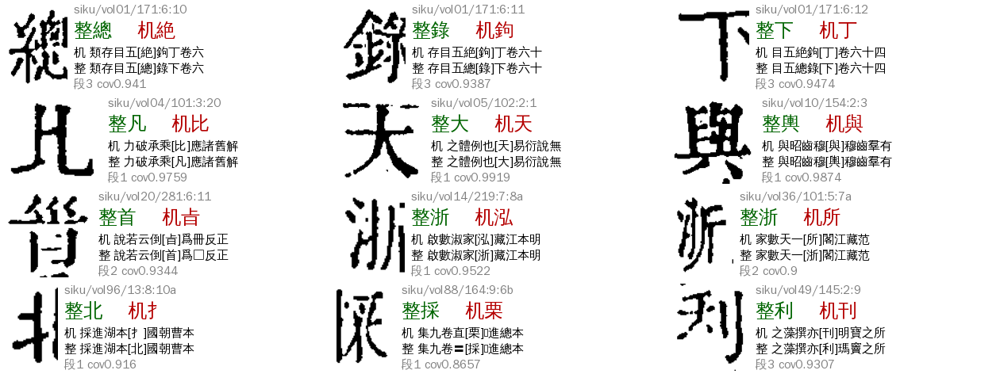
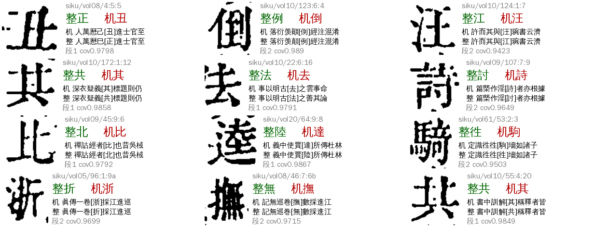
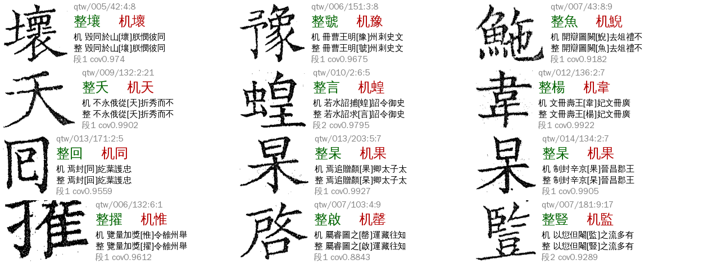
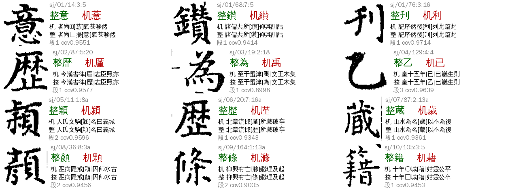
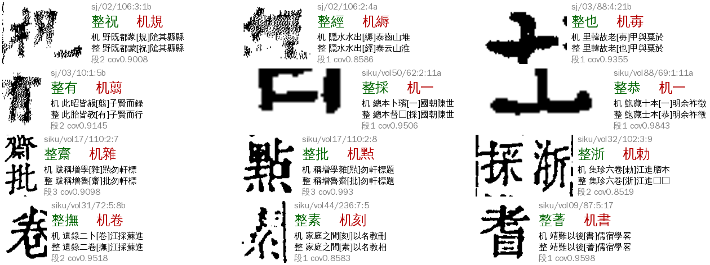
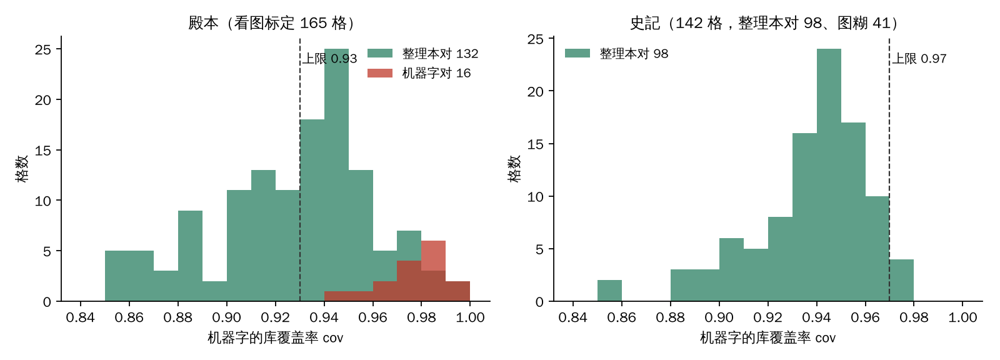

# P01 `ref_ocr_diff`：识别字与参校本不同

> 2026-11-06 由 `ref_replaced`（参校本改过字）改名，旧名数据照认。
> [待审原因总览](../README.md) · 深挖：A24，2026-11-06（逐格表、脚本在 ai-team `domain/CV/质检/待审原因深挖/P01-*`）
>
> **看图判对错都是 Claude 目视初判，不是金标**；放行规则上线前要 sheldon 抽 30 格确认（见第六节）。

**一句话**：机器识别的字和整理本（参校本）对位时就不同。这一类**谁对要分书看**：殿本、史記多半是整理本对（机器字是库里认不准的形近字），全唐文反过来、机器字对的占多数（整理本是另一个底本）。所以「一律取整理本字」在殿本会错放，要加条件；在全唐文不能开。

## 一、判定条件

- `review/reasons.py`：`RULES[R.REF_OCR_DIFF] = c.ref_op == "replace" or "replace_align" in c.codes`，priority 60，前面 V01（55）、N01（56）、L03/L02（57/58）都没中才落到这里；去向 `llm`（大模型文意终审，只收 high，其余回人）。
- 来源：cv Step6 `align_ref`。每格的识别字（库判 same 的字，没有取库首位）连成串，和整理本按 8 字锚定页、difflib 逐字对位；落在 `replace` 段的格就是 P01。
- 和 P02 的区别：P01 是识别字在对位时就不同；P02 是文本对位没给这格标签（所在段被丢），整理本字只来自坐标对位。两条都中记 P01（见 [P02](../ref_final_diff/README.md)）。
- 一个格进 P01 的前提：它**没被放行**。现役放行里能碰它的只有 `p_ref_admit`（缺省关）、`match_ref`/`follow_ref*`（要库认得）、`rare_ref*`（要整理本字是 5-b 首位）。

## 二、现状（2026-11-06，★main 包现算，正文页）

| 书 | P01 格 | 其中线上单（还待审） | 夹注小字 | replace 段长 1／2／3+ |
|---|---:|---:|---:|---|
| 殿本（96mid1ogzk） | 292 | 75 | 63（22%） | 208／62／22 |
| 史記（988g3f0wsu，10 册有 ★main） | 142 | 无线上单 | 95（67%） | 103／32／7 |
| 全唐文（995ejelvk0，11 册有 ★main） | 35 | 29 | 1 | 28／7／0 |

（总览页写的 174／77／30 是早一版 ★main 的数。★main 现算里有 217 个殿本 P01 格不在线上单，原因没逐一核，大概率是已有人裁或终审结果。）

**看图结果**（Claude 初判，R＝整理本对，M＝机器字对，V＝同字异体两可，N＝图糊／墨块看文意，S＝切分错位，B＝都不对，?＝看不清）：

| 样本 | 格 | R | M | 其它 |
|---|---:|---:|---:|---|
| 殿本线上单（全查） | 74 | 49（66%） | 15（20%） | ? 4、S 3、N 2、B 1 |
| 殿本非线上单随机 36 | 36 | 30 | 1 | V 4、? 1 |
| 殿本 cov<0.95 规则命中、没标过的 55 | 55 | 53 | 0 | V 1、? 1 |
| 史記（全查） | 142 | 98 | 0 | 图糊 N 41、? 3 |
| 全唐文线上单（全查） | 29 | 7（24%） | 20（69%） | ? 2 |

图 1–5 是各类样例（左为格图，右为「整＝整理本字、机＝机器字」和前后文）：

## 三、成因（殿本为主）

**A 机器字错、整理本对（殿本约 80%，史記几乎全部）**。机器字都是形近字（任→存、周→庫、十→士／土、總→絶、凡→比、大→天、浙→泓／協／所／勅…）。共同点：库认不准——机器字的库覆盖率 cov 偏低（中位数 0.938，59/132 低于 0.93），整理本字在库前五名里的只有 19/132。细分：
1. **夹注小字**：殿本线上单 74 格里 33 格是夹注（`step3_kind=jiazhu`），史記 142 格里 95 格；夹注笔画细、格小，库样本少。`p_ref_admit` 旧口径把夹注半格（id 以 a/b 结尾）整个排除，这是它放得少的一半原因。
2. **套语**：「浙江／湖北／採進本／某某案」一类。殿本整理本字里 浙5 採4 北3 案2 十2 柱2 者2；这些格整理本字靠套语一眼可定（图 1 中 vol96 13:8:10a 北、vol88 164:9:6b 採，格图只剩半个字）。
3. **成片**：replace 段长 ≥2 占殿本 29%（62＋22／292），多是一行夹注连续认错（vol01 171:6:10–12「總錄下」全对）。不是切分错位——图上字是完整的。
4. **库里该字刻例少**：整理本字在库前五名外 86%，机器字是库里最像的另一个字。

**B 机器字对、整理本不同（殿本约 10%，全唐文约 69%）**。殿本 16 格：共→其×3（vol10）、正→丑、討→詩、莫→其、北→比、與→興、例→倒、江→汪…，整理本字与图上不同，是整理本自己的文字问题（版本差异或整理本录入错）。**它们的 cov 全部 ≥0.94**（库认得机器字），这就是区分 A、B 的关键。全唐文的整理本是 Kanripo 另一个底本，异文多，机器字对的 20/29，cov 中位 0.987。

**C 切分／对位／图糊（殿本约 8%，史記 29%）**：
- 对位偏移（S）：vol17 110:2:7–8，整理本「魯齋批點」与格序错一位，格图是「點」而整理本给「批」；vol32 102:3:9 格框里装了两个字。
- 图糊墨块（N）：史記 02 册 p50／p96／p106、03 册 p10 整页是网点状噪点，41 格；殿本 vol50 62:2:11a、vol88 69:1:11a 是黑条。图上看不出字，整理本字靠套语（「總督採進本」「鮑士恭」）可信，但不能当「看图证据」。

**D 同字异体、看不清（殿本约 6%）**：舜／𠔥、夔／夒、杳 等，取哪个都可。

## 四、能放行多少（新旋钮，cv#1206，seed_admit 1.46，缺省全关）

`p_ref_admit` 旧口径在殿本 ★main 全部 292 格放 126 格——看图其中 **13 格是机器字本来对**（B 类里孤立的单格，正好满足「同列无相邻同类」），线上单 29 放格里 13 对 13 错，**不能直接开**（A31 建议第 6 轮殿本开 `p_ref_admit`，应改成下面的口径）。加三个书级旋钮：

| 旋钮 | 意思 | 缺省 |
|---|---|---|
| `p_ref_max_cov` | 机器字库覆盖率须**低于**它才取整理本字；缺 cov 不放 | `None`（不核） |
| `p_ref_adjacent` | 放开「同列相邻格也是这类就不放」 | 关 |
| `p_ref_jiazhu` | 放开夹注 a/b 半格 | 关 |
| `p_ref_skip_variant` | 机器字与整理本字有直接异体边的格不取整理本字（保刻形；cv#1210，seed_admit 1.49） | 关 |

离线回放（`P01-scripts/rule_eval.py`，用 ★main 包同口径复算 `_p_ref_pass`）：

| 书 | 口径 | 放出 | 已看图 | 估计线上降幅 |
|---|---|---:|---|---|
| 殿本 | 旧口径 `p_ref_admit` | 126 | 对 68、**错 13**、V3、?3、未看 38 | 不开 |
| 殿本 | ＋`max_cov 0.93` | 31 | 对 28、错 0、?3 | 线上 75 → 约 69 |
| 殿本 | ＋`max_cov 0.93`＋相邻＋夹注 | 52 | 对 48、错 0、?4 | 线上 75 → 57（−18，−24%） |
| 殿本 | ＋`max_cov 0.95`＋相邻＋夹注 | 90 | 对 84、**错 1**、V1、?4 | 线上 75 → 50（−25，−33%） |
| 史記 | 旧口径 | 29 | 对 27、错 0 | — |
| 史記 | ＋`max_cov 0.97`＋相邻＋夹注 | 87 | 对 62、错 0、图糊按文意 24、?1 | 142 → 55（−61%） |
| 全唐文 | 任何口径 | — | 机器字对 20／整理本对 7 | **不开** |

殿本 cov 的分布见图 0：整理本对的格 cov 延伸到 0.85–0.99，机器字对的格全部 ≥0.94，所以 0.93 是零错的上限，0.95 开始出错。史記没有机器字对的格，上限取 0.97（整理本对格的最大值 0.976）。

**剩下的怎么办**：
- 殿本约 240 格（★main）：A 类里 cov≥0.93 的整理本对格、和全部 B 类，cov 分不开（殿本 R cov≥0.93 有 73 格，M 全在 0.94–0.99）。只能走文意终审（P01 本来就是 `llm` 路）或人审。殿本已标格里 cov≥0.95 的有 R 30、M 15，cov≥0.97 是 R 12、M 12，**不能**反过来按 cov 高取机器字。
- 全唐文 35 格：cov≥0.98 的 15 格里机器字对 13（87%），但仍有 2 个整理本对，达不到零错，**不放**；建议 QTW 的整理本字 vs 机器字走文意终审，并把底本异文记入交接单。
- 图糊 N、对位偏移 S：不是 P01 本来的活，S 要报 A22/A23 看对位（vol17 110:2:7–8），N 靠文本层或另一参校本（史記、全唐文没有图源文本层）。

**抽检与外溢（11-06 夜，sheldon 定殿本取 0.95）**：
- sheldon 看 30 格（殿本 0.95＋相邻＋夹注放出 90 格里随机抽，15 格在 cov 0.93–0.95）：整理本字 **0 错**；其中 6 格格框切分有问题（切掉一截或带了邻字笔画），整理本字都对，cov 0.909–0.939，没有单独的信号能挡，属切分环节（S 类）的活。
- 外溢：`p_ref` 不分原因码，放开相邻／夹注后会碰 L01（库认不出）格——殿本 ★main 里 L01 格中 cov<0.95 的有 196 格会被放。抽 30 格（Claude 初判）：14 格机器字与整理本字是直接异体对（羨羡、諫諌、緣縁、奥奧、舟丹、鉞鋮…），整理本字都对但会盖掉刻形，殿本不按参校本取异体；其余 16 格整理本对 15、1 格黑条。所以加 `p_ref_skip_variant`，殿本必开。

## 五、整条流程与参数（下一本书照做）

1. **取数**：`guji-manager pending-stats --ws <ws> --text <书> --out <目录>`（线上单，P01 在 `cells.tsv` 里 `pending_reason=ref_replaced`，旧名；新单叫 `ref_ocr_diff`）；再 `P01-scripts/extract.py` 逐册拉 ★main 包，`reasons_for_pending` 取 `ref_ocr_diff` 格，附机器字、整理本字、库候选、cov、前后文、replace 段长、cell_shrink 框。
2. **裁格图、看图**：`crops.py` 裁格、`sheet.py` 拼表（每张 18 格，左图右字），逐格标 R/M/V/N/S/B/?。
3. **判书的类型**：看 M 比例。M 很少（殿本、史記）→ 整理本与图源同一底本，可以取整理本字；M 占多数（全唐文）→ 整理本是另一底本，不要取。
4. **标 cov 上限**：把标过的格画 cov 分布（图 0），取「M 的最小 cov 之下」作 `p_ref_max_cov`（殿本 0.93、史記 0.97）。书的库覆盖率口径不同，每本自己标。
5. **开旋钮**：册 yaml `seed_admit` params 写 `p_ref_admit: true`、`p_ref_max_cov: x`、`p_ref_adjacent: true`、`p_ref_jiazhu: true`、`p_ref_skip_variant: true`；`guji book show --effective` 核对。
6. **回放**：`p_ref_sim.py` 模拟、`rule_eval.py` 比较放出数和看图精度；上线后用 benchmark 核。
7. **留审的格**：文意终审（`guji-manager final-review`）在 {整理本字, 机器字} 里选；回人审的在网页 `pick` 卡。

参数表：

| 参数 | 位置 | 殿本 | 史記 | 全唐文 |
|---|---|---|---|---|
| `p_ref_admit` | cv seed_admit | 建议开 | 建议开 | 关 |
| `p_ref_max_cov` | 同上 | 0.93（保守）／0.95 | 0.97 | — |
| `p_ref_adjacent` | 同上 | 开 | 开 | — |
| `p_ref_jiazhu` | 同上 | 开 | 开 | — |
| `p_ref_skip_variant` | 同上 | 开 | 开（按史記刻形原则由 SJ 定） | — |
| 判定 priority 60 | manager `reasons.py` | 不改 | | |

## 六、Benchmark

数据：ai-team `P01-逐格-三书469格.tsv`（P01 全部格、看图标、cov、各规则是否放）、`P01-scripts/labels.json`（336 格标）。

| 指标 | 定义 | 现状 | 目标 |
|---|---|---|---|
| B1 错放 | 规则放出的格里「机器字对」的数 | 殿本旧口径 13；新口径 0 | 0 |
| B2 放出数 | 规则放出的 P01 格（线上单口径） | 殿本 18（0.93＋相邻＋夹注）；史記 87 | 越多越好，B1 为 0 前提 |
| B3 召回 | 放出的「整理本对」／「整理本对」总数 | 殿本 48／约 132；史記 62／98 | 提高 |
| B4 P01 流入 | `pending-stats` 里 P01 格数，按书按轮 | 殿本 75、全唐文 29 | 下降 |
| B5 sheldon 抽检 | 新规则放出的格，抽 30 格看图金标 | 殿本 0.95＋相邻＋夹注：30 格 0 错（6 格切分有问题，字对） | 0 错 |
| B6 外溢抽检 | 同规则放出的非 P01 格（L01），抽 30 格 | 14 格异体对（加 `p_ref_skip_variant` 挡）、其余 15 对 1 黑条 | 0 错 |

跑法：`python P01-scripts/rule_eval.py`（需 `all.json`＝`build_all.py` 的输出、`p_ref_sim.py` 的 `sim/`）。

## 七、回流与防再犯

- 整理本字不对而机器字对的格（B 类）记进交接单，由书项目补整理本勘误。
- p_ref 放行的格不入字形库样本（除非人裁过），证据 `evidence.p_ref = {ref, machine, cov}`。

## 八、不要做

- 不要在殿本、史記不加 cov 上限就开 `p_ref_admit`（殿本线上 13 格机器字对被改错）。
- 不要在全唐文开 `p_ref_admit`，也不要按 cov 高反取机器字（有整理本对的格混着）。
- 不要把图糊／墨块格的「整理本字」当看图证据。

## 九、待 sheldon 定

已定（11-06 夜）：1. 殿本 `p_ref_max_cov` 取 0.95＋相邻＋夹注（加 `p_ref_skip_variant`）；2. 史記由 SJ 开 0.97＋相邻＋夹注；3. 抽检 30 格 0 错。待办：史記 24 格图糊由 SJ 抽看；A31 写殿本册 yaml。

## 十、第 8 轮：整理本字是异体写法，机器字落到形近常见字（2026-11-08，cv#1251，seed_admit 1.71）

**现状**（殿本第 7 轮 ★main，v0.6.17，正文页）：P01 275 格，最集中的是 7 对（共 83 格）。看图（Claude 初判，非金标）：**整理本字对，机器字错**，图上就是那个冷僻异体。

| 机器字 > 整理本字 | 格 | 库里样本（殿本人裁数） | 图 |
|---|---:|---|---|
| 慨 > 槪（概的异体） | 50 | 槪 6 例、慨 62 例 | 图 6 |
| 傅 > 𫝊（傳的异体） | 10 | 𫝊 不在库；傅 16 例 | 图 7（末行） |
| 實 > 寳 | 6 | 寳 1 例、寶 14 例 | 图 7 |
| 總 > 厯 | 6 | 厯 93 例，但總 0.989 对厯 0.985 | 图 7 |
| 奇 > 𭔃（寄） | 5 | 𭔃 不在库 | 图 7 |
| 苛 > 竒（奇） | 3 | 竒 不在库 | 图 7 |
| 同 > 囘（回） | 3 | 囘 3 例 | 图 7 |

**成因**：整理本誊抄者不会凭空造冷僻异体，而机器字把冷僻异体判成常见形近字是库样本少的必然——ref 字库里只有一两例甚至没有，常见形近字有几十例，kNN 把前者压在后面（差距多在 0.03 以内）。机器字 cov 多 ≥0.97，被 `p_ref_max_cov` 0.95 挡住；不是「异体样本挂在正字名下」。整理本字在库候选里时分数只差一点点；不在库里时，它的正字（寶、奇、寄、回）在候选里与机器字也只差一点。

**修法**（cv#1251，书级旋钮 `p_ref_irregular_gap`，缺省关）：整理本字在 twedu／local:keben 里被指认为某正字的异体、机器字与它无直接异体边、「整理本字及其正字」的库候选最高 cov 与机器字 cov 相差 ≤ 旋钮值 → 取整理本字，不受 `p_ref_max_cov` 约束，整理本字在字组里也放。相邻／夹注旋钮照旧。没改库匹配（改了各书产物全部过期、代价大），只在放行口径加一条。

**数字**（gap 0.03，机器字不在组内）：

| 书 | 口径 | 放 | 看图 |
|---|---|---:|---|
| 殿本 r7 P01 275 格 | 其中 cov≥0.95 的 99 格是原来放不了的；整理本字在组内 46；相邻 18；夹注 1 | 113 | 放行格及近邻共 156 格整理本字对为主 |
| 史記 r6 142 格 | | 23 | 全对（标注 R） |
| 全唐文 r6 35 格 | | 0 | — |

**Benchmark 增补**：B7 异体吸附放出数（殿本 r7 113／275，目标越多越好、B1 为 0）；B8 sheldon 抽检（30 格，清单 `P01-scripts/audit30_r8.json`）：**11-08 整理本全对，0 错**。

**待定与风险**：
- **傅／𫝊 10 格**（sheldon 11-08 看图定）：𫝊 确是傳的异体字、整理本对，机器字傅错；旋钮放出 𫝊 正是要的，不用登记 傅~𫝊 边（上表「傅 > 𫝊」一行的「文意是傅」是我看错了）。
- 整理本字在字组里的 46 格（寳／𭔃／竒／囘／厯）直接取整理本字，不经组流程；组的暂归一口径若不同要看下游。
- 整理本是另一底本的书（全唐文）不要开。
- 下一本书做法：先 `pending-stats` 取 P01 格，按 `P01-scripts/` 的 `extract.py` 拉 ★main，用 `open_guji_cv.steps.seed_admit._irregular_ref_gap` 在 P01 格上量放出数，抽 30 格看图，没错再开。
