# S02 `seg_col_unaligned`：整列对不上

> [待审原因总览](../README.md)

**一句话**：同一列里有好几格都没配上参校本的字，多半是这一列切错了位，或者这一列有整理本不收的东西。

## 一、什么情况下判成 S02

判法在 `guji_manager/review/reasons.py`（`RULES[R.SEG_COL_UNALIGNED]`），出单时对每个**没放行**的格依次试，第一条命中的就是主原因。S02 的判定顺序是 priority 21：排在复审（X）、切坏格 S04、遮挡 D01/D02、整页对不上 S01 后面，在所有认字类原因前面。

一格判成 S02 要同时满足两条：

1. **本格没有参校字**：align_ref 的序列对位（`chars`）和坐标对位（`coord`）都没给这一格配上字。整理本这一位是〓（有字、没码位）的不算，那种归 R01 `ref_lacuna`。
2. **同一列这样的待审格 ≥ 5**（`COL_MIN = 5`）。只数没放行的格。已放行的格不算，所以一列 21 格里 16 格对上、5 格没对上也会中。

同一页这样的格 ≥ 10 就先判成 S01 整页对不上，不会到 S02。只有一两格没配上的，落到后面的 R02 `ref_gap`（参校本这里没字）或别的原因。

> 注：`pending_reasons.yaml` 的 detect 写「整理本有字」，代码其实只看「本格没配上参校字」。整理本这一位是空（缩进、空格）的格也会算进去，下面第 1、6 类就是这种情况。

**机器只知道「这一列有一串格配不上整理本」，不知道为什么。** 可能是切错了位，也可能切得对、只是整理本没收这些字（满文、生僻部首），也可能是对位那一步失败了。所以 S02 一定要逐列看图再定。

## 二、现在的情况

2026-11-06 用三书各册 ★main 包现算（出单同一套判法，只计正文页；殿本 99 册、史記有包的 10 册、全唐文 11 册）：

| 书 | S02 格 | 列 | 占全书待审 |
|---|---:|---:|---|
| 四库总目（殿本） | 60 | 10 | 4,715 格的 1.3% |
| 史記 | 8 | 2 | 845 格的 0.9% |
| 全唐文 | 0 | 0 | 125 格 |

线上待审单口径（`guji-manager pending-stats`）殿本是 35 格、7 列，比 ★main 少，因为 vol05、vol10 的线上单还是 10-27 的旧单。

**68 格、12 列，几乎一列一种原因**，按图上是什么分成七类：

| 类 | 格 | 列 | 是不是切分错 | 例 |
|---|---:|---:|---|---|
| 1 印章没认出，印文被切成假格 | 6 | 1 | 是（印章检测） | 殿本 vol10:86:5 |
| 2 书名列切错（题名＋双行小注「××採進本」） | 15 | 3 | 是 | 殿本 vol32:102:3、vol67:136:9、vol93:18:3 |
| 3 列网错位，一列跨两列 | 9 | 1 | 是（界行） | 殿本 vol67:128:9 |
| 4 正文列漏切，两字并一格，后面全错一格 | 5 | 1 | 是 | 殿本 vol05:66:9 |
| 5 碎格＋整页对位失败 | 5 | 1 | 一半是 | 殿本 vol95:66:4 |
| 6 整理本不收的字：满文、说文部首 | 20 | 3 | **否**，切得对 | 殿本 vol19:156:1、vol19:157:9、vol20:133:5 |
| 7 史記：列末大字切两格；满列小注备选切法漏配参校字 | 8 | 2 | 一部分是 | 史記 03:90:3、04:119:1 |

每类的图在下面。图例：整列图里绿框是已放行，橙框是有参校字的待审，红框是**没参校字的待审**（S02 就在红框里），框旁标「格号 机器字/参校字」（∅＝没有）。字块图是这一列 S02 格的原图切块，上面标格号和机器认的字。

## 三、什么样的格会落进 S02（逐类举例）

### 1. 印章没认出：印文被切成一串假格

殿本 vol10 p86 第 5 列。页顶一方大藏书印压在第 4–6 列上。整理本这一列前 4 格是缩进（空），图上是印文。印章检测这页一方印都没找到（`seal_detect` `seals: []`），印文的笔画就被当成字切成了 6 格（1、2a/2b、3a/3b、4）。机器认成「瓠、跋、宙、將、事、國」，都是瞎认。

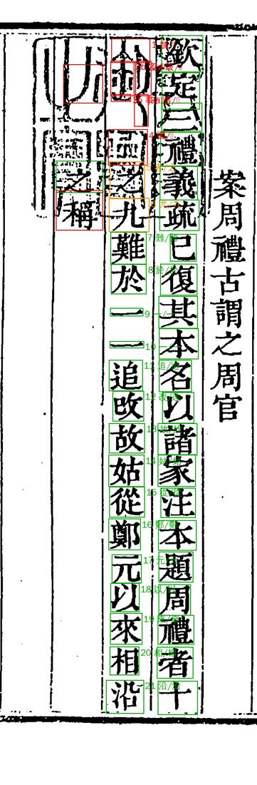

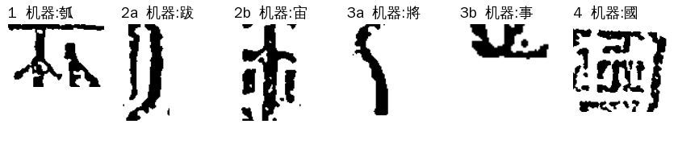

**特点**：字块是残笔、印框线、半个篆字；整理本这一位本来是空。

### 2. 书名列切错：题名＋双行小注

殿本每篇提要的第一列是书名，后面跟双行小注写版本来源（「浙江巡撫採進本」「内府藏本」）。这种列字数少、题名往往顶格，小注又是两行，最容易切错位。三列都是这个版式，是 S02 里**唯一成批的一种**：

- **vol32 p102 第 3 列**「兩晉南北集珍六巻／浙江廵撫 採進本」：印章检测把这页一块破版框认成了印（模板 `vol04_127`，分数 0.28，图上没有印），吃掉了题名头两字。小注第一行（浙/採）又没拆成两格，后面小注整体错一格。
- **vol67 p136 第 9 列**「獪園十六卷／浙江巡撫 採進本」：题名头一个字「獪」被切成两格，后面整体错一格，「卷」被当成小注拆成 a/b，小注两字并一格。
- **vol93 p18 第 3 列**「梅花百詠一卷／浙江巡撫 採進本」：「梅花」两字顶格高出版框，没切进来，格号从「百」起算，全列错两格。小注第一行也没拆开。

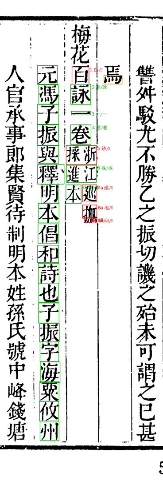

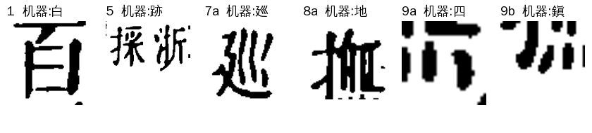

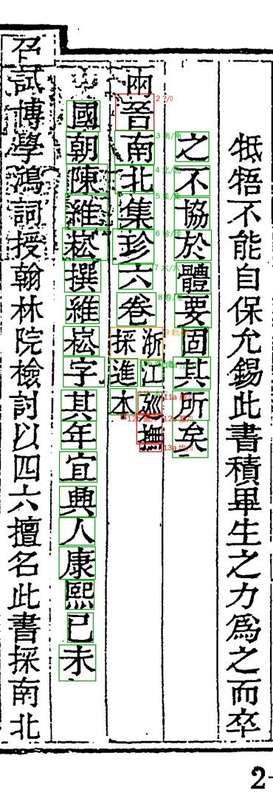

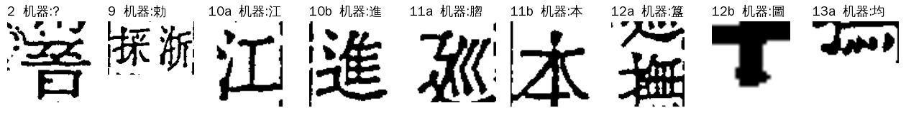

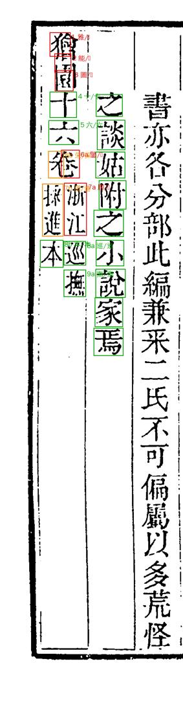

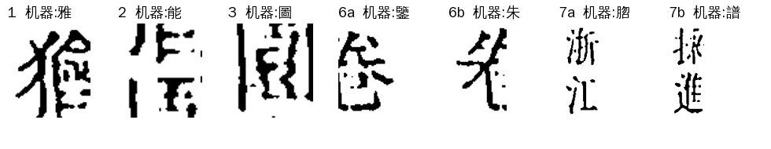

**特点**：字块常是两个字并在一格（「採浙」「浙江」）、半个字、或顶格字被切掉。机器认的字和图对不上，也配不上整理本。

### 3. 列网错位：一列跨两列

殿本 vol67 p128 第 9 列（卷末页，字迹淡）。界行没找准，第 9 列的列框跨在两列字上，切出来每格都是半边字（「厯、支、詔、香、切、描、卜、鼎、且」都是瞎认）。同页还有 S01。

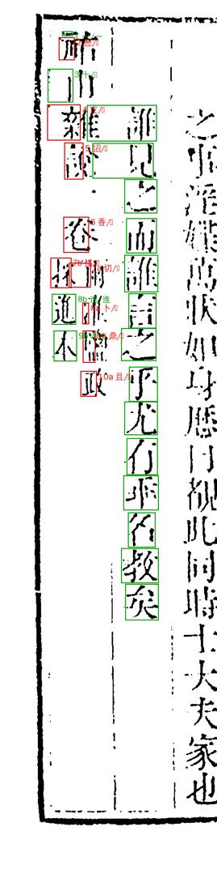

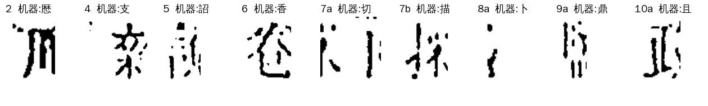

**特点**：字块是竖着切开的半边字，左右各缺一块。

### 4. 正文列漏切：两字并一格，后面全错一格

殿本 vol05 p66 第 9 列「而非迂也發揮文王周公心事不知者以爲鑿而」19 字，字距略密。row_segment 只切了 18 格，16 号格把「知者」两字并成一格，后面「以、爲、鑿、而」全错一格。

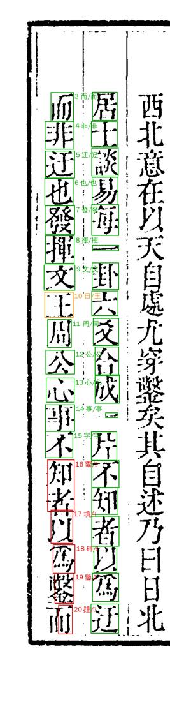

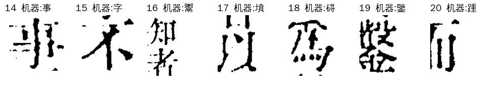

**特点**：前半列都对，从某一格起格里是两个字或半个字。

> 顺带发现：★main 包里同列 15 号格（图上是「不」）已经放行成了「字」。对位给出了一个三份整理本都没有的「字」，已报 A31 转 A24 查。线上单这格还在待审，网站上还没错。

### 5. 碎格＋整页对位失败

殿本 vol95 p66 第 4 列「盛行鄉塾間亦可異也」。这页坐标对位整页失败（每列都是「列行对应不成立」，靠邻页定位）。切分大体是对的，但「盛」的顶笔被切成一个碎格（2 号），「也」的底笔被切成两个碎格（12a/12b）。碎格在整理本里本来是空的。

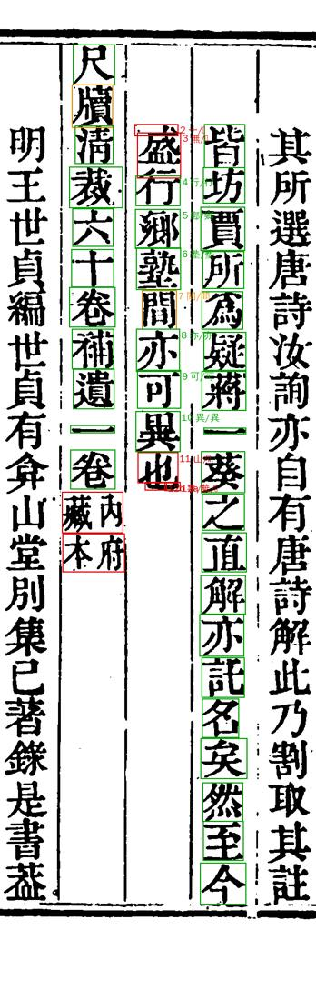

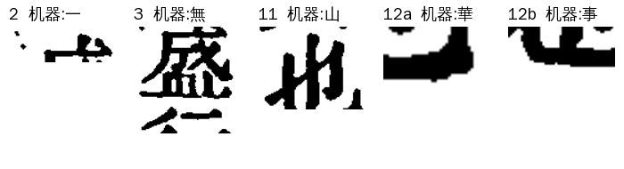

**特点**：字块只有一两笔，或者一大块墨。

### 6. 整理本不收的字：切得对，就是没有参校字

- **满文**：殿本 vol19 p155–158 是《御製律呂正義》一类的提要，正文夹國書十二字头的满文字母，后附汉字对音小注。整理本只录汉字，满文没码位也不占位。满文格就没有参校字，还打乱了坐标对位，连同列的汉字小注（額、依、鄂、烏）也配不上。

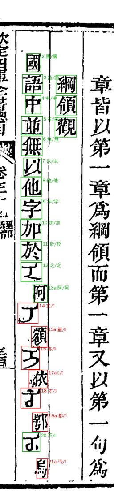

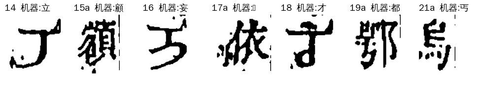

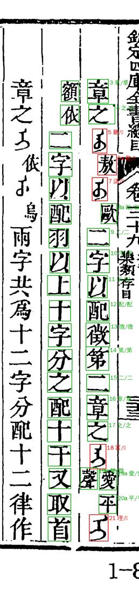

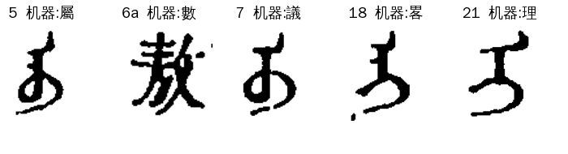

- **说文部首**：殿本 vol20 p133 第 5 列列的是《說文》部首的楷化字形，整理本这几位是〓，坐标对位又跟现役对位冲突（`与现役对位冲突`），整列没配上。字切得很干净。

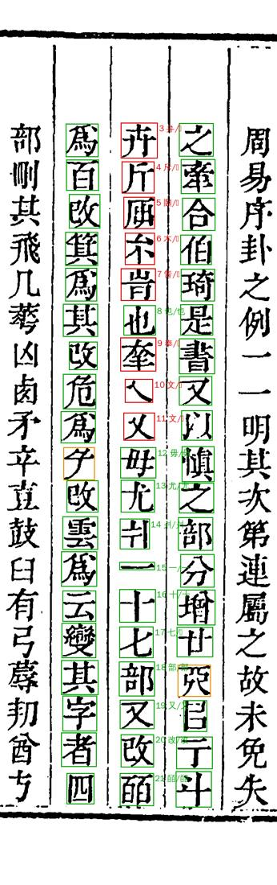

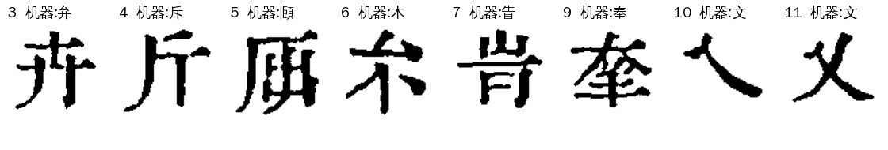

**特点**：字块干净、一格一字，但不是常用汉字，机器认成形近的常用字。**这类人审也很难填**：满文没有可填的字，部首字要查码位。满文页 A31 已定标非正文页型、整页人审（见第四节）。

### 7. 史記两列

- **03:90 第 3 列**：双行小注后接大字「皆白起也是善」，列末的「善」被切成 20、21 两格。同列另有 7 格是 S04 小注分法不均。

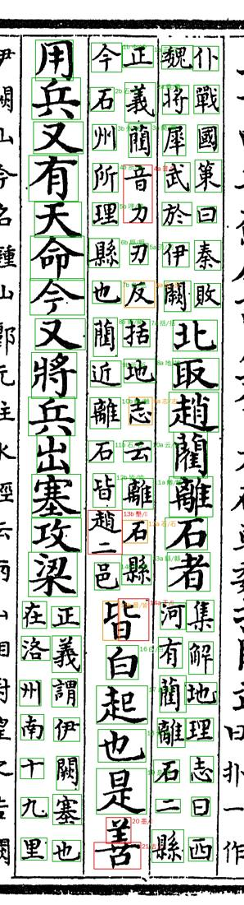

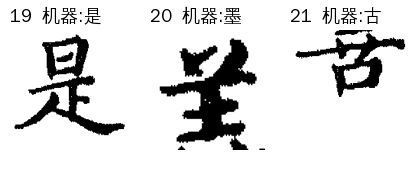

- **04:119 第 1 列**：整列双行小注，右行 21 字、左行 22 字，走的是史記的备选切法（alt_cut）。6 格里 5 格切得对（也、言、值、閏、而），是机器认错（认成舟、未、伍、閭、舟），备选切法的坐标对位（`alt_draft`）又恰好没给这几格配参校字。manager 对备选列丢掉了现役对位字（`align_for_seed`），其实现役对位这几格的参校字是对的。只有末格 22b「木火」两字并一格是真切分错。

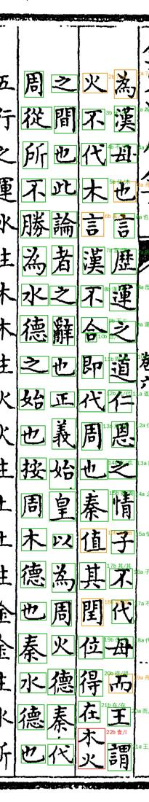

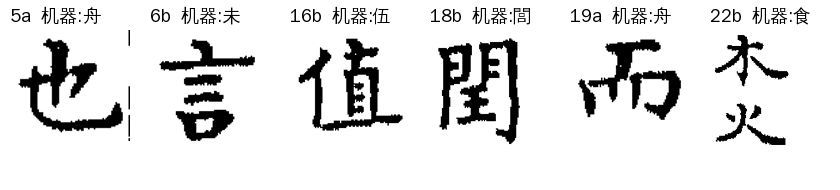

## 四、怎么提高

S02 总量小，68 格只占三书待审的 1.2%，又是一列一种原因，**不值得为它单写通用修法**。按类分（满文页、印章两页已由 A31 在 ai-team `domain/CV/质检/重跑轮次/第5轮修复清单.md` 末节裁定）：

| 类 | 格 | 可以怎么做 | 谁 |
|---|---:|---|---|
| 1 印章漏认、2 里 vol32 的假印 | 6＋4 | **A31 已定（11-06）**：册 yaml `seal_detect.overrides` 两页（补印框／置空），放到第 7 轮新图源（r003/r004）上核过再做，旧图坐标作废 | A22 第 7 轮新图上做 |
| 2 书名列 | 15 | **唯一有共性的一类**：题名顶格、小注第一行没拆，三列都是。要先看全书书名列的切对率，值得的话在殿本套书里专门处理书名列（题名顶格识别、小注起点） | A22 先量全书书名列，再定做不做 |
| 6 满文 | 12 | **A31 已定（11-06）**：vol19 p155–158 满文／字母表页在册 yaml 标非正文页型，整页人审，不修算法。标了以后不进正文待审，连带同页 S01 31 格一起出去 | A31 |
| 6 说文部首 | 8 | vol20 p133 的部首古字形：要不要比照满文页处理（标非正文页型、整页人审），还是照常逐格人审走码位，**待 Sheldon 定** | Sheldon |
| 3、4、5 | 19 | 一处一种毛病，按「只剩一两处不专门修」留人审 | 人审 |
| 7 史記 | 8 | 备选列对位漏配参校字（5 格）是 manager／对位侧，可让 `align_for_seed` 在 alt_draft 缺格时回退现役对位字；列末并格归 SJ | SJ／A20 |

判法本身可以考虑两点（只是建议，判法归 A31）：

- 整理本这一位**明确是空**（缩进、空格）、图上却有墨的格（第 1、5 类），多半是假格（印、碎笔），和「整理本有字但没配上」不是一回事。现在混在 S02 里。可以在 `seg_causes` 里单列一个成因旗，不新增 pending_reason。
- yaml 的 detect 说明写「整理本有字」，和代码不一致，改成「本格没配上参校字（〓除外）」。

## 五、怎么查一列 S02

1. `python -m guji_manager.review.seg_causes <册> --products <产物根> --out <目录>`：出逐格成因旗（seal、slot_short、slot_shift、coord_other、none…），先看方向。
2. 看整列图，对整理本原文（daizhige `corpus/daizhige/*.jsonl` 的 `cols[].runs`，带起始格位和小注）。
3. 照上面七类归：切分错报 A22（书项目自己的套书先自查），整理本不收的字报 A31 定口径，对位失败报对位负责人。

## 不要做

- 不要逐格裁：一列错位是一处毛病，修好切分整列就对了。
- 不要把满文、部首格交大模型猜字。

---

完整分析（含线上单口径、复现命令）：ai-team `domain/CV/质检/待审原因深挖/S02-整列对不上.md`。
