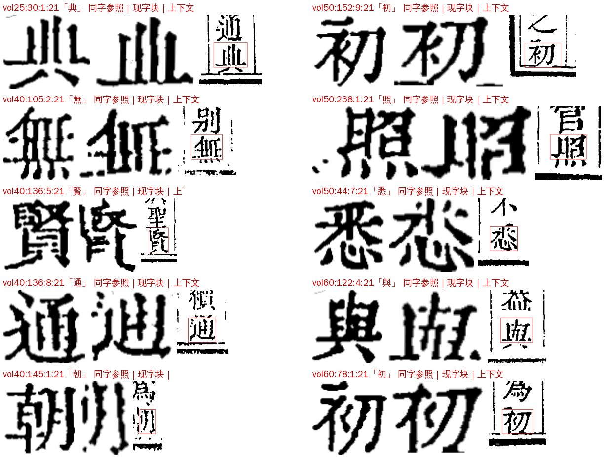
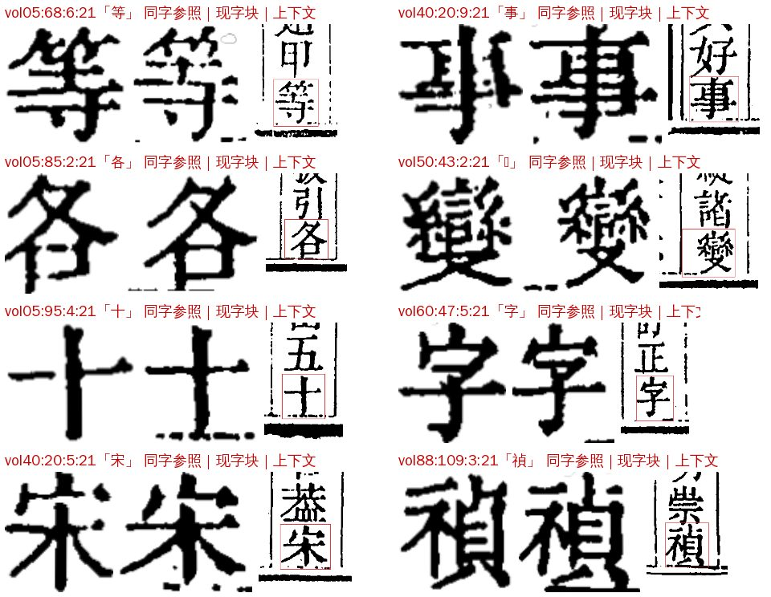
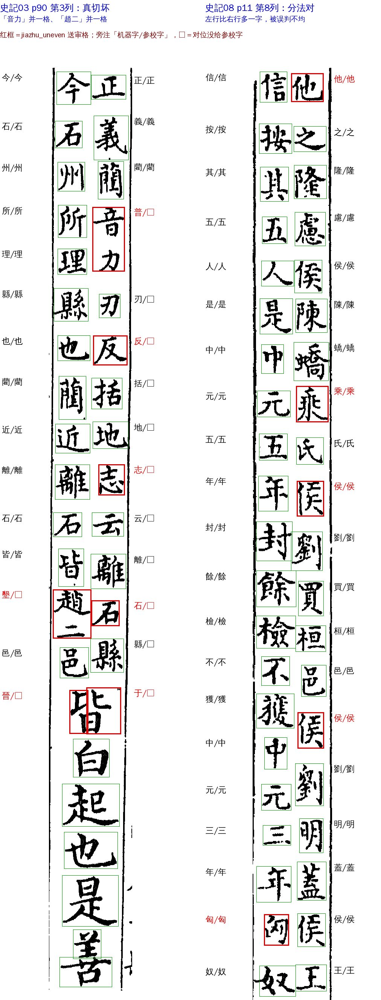

# S04 `seg_defect`：切坏格

> [待审原因总览](../README.md)

**一句话**：这一格切得不完整，机器认不出字；请看书影，把字直接写进框里

## 定义与判定

- 大类：切分位置（S）；判定顺序 priority 10（小的先判，第一条命中即主原因）。只排在 X01–X04（裁定冲突、复审）后面，S01/S02、D、Z、L 等都吃不掉它。
- 去向：一定人审（route `human`）；最终谁看：人；网页卡片 `free`（看书影自由录字）。
- 负责改算法／数据：A22（多书公用的切分原语）；套书专用切分（如史記 `books/shiji_wyg`）由书项目自己改。
- 旧字段对应：{"cls": ["seg_defect"]}

`review/reasons.py` 里一格判成 S04，只认下面三个来源，中一个就算：

| 来源 | 怎么来的 | 现在开没开 |
|---|---|---|
| 单上 `cls=seg_defect` | 11-04 以前的旧卡片类别 | 已停（11-04 起不出单），只剩老单回填 |
| 单上 `src=seg_selfcheck` | 出单同字对照自检（`review/seg_defect.py --gate`，B1③）：列端字块比同册同字列中格的墨高矮一截，判「切笔」（clipped），把已放行格改送人审 | **两部书都关**：`SELFCHECK_BOOKS` 里殿本、史記 `enabled: False`，A31 定第 6 轮起开殿本 |
| doubt 码 `seg_defect`／`jiazhu_uneven` | 史記雙行小注逐步切（`books/shiji_wyg/jiazhu_step`）按整理本分两行、分法不是右 ⌈N/2⌉／左 ⌊N/2⌋ 的段，段内格降级送审（cv#1011；放行字＝库首选＝整理本字的格不降） | 只有史記走这条路 |

细分写在 `pending_reason_detail`（`seg_kind`）：`merged` 两字并一格／`clipped` 字被切掉一截／`bleed` 邻格笔画溢入／`frame_residue` 框线残笔／`jiazhu_uneven` 夹注两行分法不均；自检送来的前缀「同字对照自检：」。

## 什么样的字会到这里（例子）

### 例 1：列端切笔（自检 clipped，殿本）

切线或剥框线时连笔画一起剥掉，列首／列尾那个字少了一截。每格三张：左＝本册同字的列中参照，中＝现在的字块，右＝上下文（红框是字块）。

「典」「無」「賢」「通」「朝」「與」的字脚被框线一起剥掉。机器多半照样读对、直接放行，所以平时不在单上；自检开了才会把它们送来。人审时照书影写字，这块字图不进字形库。

### 例 2：列端带框线（自检 frame_residue，只记旗不送审）

字身完整，但字脚挂着一截版框线。OCR 多半读对，送审只加活，所以 `review_kinds` 缺省只送 clipped，这类只记旗（字形库那边按旗不收「重」档）。

### 例 3：史記雙行小注分法不均（jiazhu_uneven）

红框是送审格，旁注「机器字/参校字」，□＝对位没给参校字。

- **左（03 p90 第 3 列）是真切坏**：右行实为「正義藺音力刃反括地志云離石縣」，「音力」两字被切进一格读成「普」；左行「趙二」挤成一格读成「墾」，对位从这里起就丢了参校字。这类只能人审。
- **右（08 p11 第 8 列）其实切对了**：右行 20 字、左行 21 字，整列 224 格都对上整理本，5 格机器字＝参校字。只因判法只认「右多一字」，左多一字就判不均；又因字形库首选不同，过不了「三者一致」豁免。

## 现状（2026-11-06）

| 书 | 口径 | S04 | 说明 |
|---|---|---:|---|
| 四库总目 | 线上单 13,641 格／★main 99 册 | 0 | 三个来源都没开；线上单 why 码里没有 seg_defect／jiazhu_uneven |
| 史记 | ★main 01–10（job918–927） | 12 | 都是 jiazhu_uneven：03 p90 7 格真切坏、08 p11 5 格分法对（A31 11-06 三书统计记 20 格，口径或包版本不同） |
| 全唐文 | ★main 005–015 | 0 | 不走 jiazhu_step，也没登记自检 |

藏在别的原因下面的切坏格很少：自检在殿本 10 册试跑，命中的格里已经在单上的只有约 6 条（命中已在单上的格只加证据、不改原因）。

## 怎么提高（待讨论）

| 项 | 做法 | 谁 | 预计 |
|---|---|---|---|
| 夹注分法误判 | jiazhu_step 的「均匀」放宽成两行差 ≤1 字（左多一字也算） | SJ | 史記 −5 格，其余册同形的一并放 |
| 夹注真切坏 | 夹注两行字数按整理本分（cv #947／#966 那条线），切准了自然消失 | SJ | 03 p90 这类 7 格 |
| 殿本开自检 | 开 `SELFCHECK_BOOKS['96mid1ogzk'].enabled` | A31 | **S04 约 +400 格**（10 册试跑 clipped 46、已放行 41，每册约 4 格；查准约 0.87），人审率约 +0.015 个百分点。这是放行里漏掉的真切笔字，数字升是好事 |
| 根治切笔 | 列端剥框线别剥到字（cell_shrink 列端开关 `inner_frame_*` 已在调），自检数应随之下降 | A22 | 看第 6 轮自检数 |
| 全唐文 | 要开自检先登记 995ejelvk0、在它的尺子上量阈值 | QTW／A31 | — |

## 怎么处理

1. 人审页直接看书影录字（卡片可自由录字）。
2. 同类成片出现时报切分负责人修（公用原语找 A22，套书专用找书项目），而不是一格一格录。
3. 细分看 `seg_kind`。

## 回流与防再犯

切分修了要回看这些格是否自然消失；带框格清框、不进字库只管重档。

## 不要做

切坏的字块不要进字形库。

深挖原文：ai-team `domain/CV/质检/待审原因深挖/S04-切坏格.md`。
