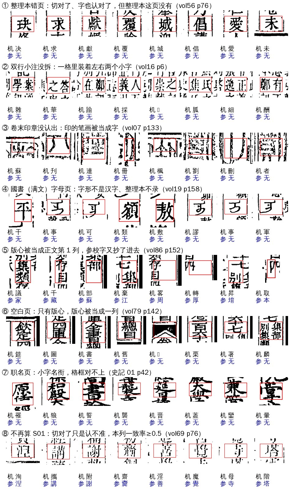

# S01 `seg_page_unaligned`：整页对不上

> [待审原因总览](../README.md)

**一句话**：这一页很多格都对不上参校本，多半是切分或对位错了，请看整页

## 一、这个原因说的是什么

古籍一页是 9 列 × 21 格。正常情况下，切出来的每一格都能和整理本（参校本）的某个字对上，机器认的字也大多等于整理本的字。如果**一页里有一大片格同时对不上**，问题通常不在某一个字上，而是整页出了事：切分格框整片切偏了，或者整理本这一页本身就是错的、缺的。这时候逐格去审没有意义，要整页看。S01 就是把这种页挑出来，整页交给人看，同时提醒切分、对位负责人去查原因。

所以 S01 **不是一类字，而是一类页**。被归进来的字本身五花八门：可能字切对了、认对了，只是整理本没有这一页（例图①）；也可能格框切在两个字中间，机器认出来的是乱码（例图②③）。

## 二、什么情况下判成 S01

判定顺序 priority 20（排在复审、切坏、遮挡之后，排在整列对不上 S02 和所有字形类原因之前）。一格满足下面**任意一支**就判 S01（代码 `guji_manager/review/reasons.py` 的 `RULES[SEG_PAGE_UNALIGNED]`）：

| 支 | 条件（本格） | 条件（同页） | 意思 |
|---|---|---|---|
| **无参校支** | 本格没有整理本对位字（对位为空，或整理本是 〓） | 同页这样的待审格 ≥ 10（`PAGE_MIN`） | 整理本这一页大片缺字、对不上 |
| **弱证据支** | 有整理本字，但机器字 ≠ 整理本字，不在字组里，没有遮挡，且**本列一致率 < 0.5**（`COL_AGREE_MAX`） | 同页这样的格 ≥ 10 | 这一页好几列机器字和整理本大多不一样，像是格框错位 |

几点说明：

- 「同页 ≥10」数的是**同一张待审单上、同一页的待审格**，已放行的格不算。所以一页上 S01 的格可能不到 10 个：其余格先命中了更靠前的原因（如复审），但计数时都算进去了。
- 本列一致率：这一列（含已放行格）有整理本字的格里，机器字＝整理本字的比例。真错位的列几乎全对不上；半色调、褪色页对位是对的，只是认不准，一致率多在 0.6 以上。这个条件是 2026-11-05 加的（manager #206），以前没有，半色调页会被误判进来。
- 钉了页、标明「整理本无此页」（`page_pins` dzg:null）的页，所有格都没有对位字，自然落到无参校支。
- 两支都不看页型。目录、职名、空白页只要凑够 10 格，一样判 S01（见第五节建议）。

## 三、现在大概是什么情况（2026-11-06）

| 书 | 线上待审单 | ★main 包现算（正文页） | 说明 |
|---|---:|---:|---|
| 四库总目（殿本） | **400 格 / 28 页** | 341 | 线上单里 45 格是 #206 之前出的单，按现行判法已不算 S01；按现行判法重算线上单是 355 格 / 17 页 |
| 史記 | 无线上单 | 0（正文页）；含非正文 64 | 64 格全在 01 册 p40、p42 两页职名页 |
| 全唐文 | 0 | 0 | 一页待审格本来就少，凑不够 10 格 |

**最大的一块是一处已知的数据问题**：殿本 vol56 p75–78 共 204 格，占线上 S01 的一半。这 4 页 09-28 抓整理本时，维基把 djvu/580 录成了 980 的内容，整理本错页，只好钉成「整理本无此页」直接人审。维基 10-02 已改正。

殿本线上 400 格按成因分（逐页看图）：

| # | 成因 | 格 | 页 | 是不是切分 |
|---|---|---:|---|---|
| ① | 整理本错页（vol56 p75–78，钉页 dzg:null） | 204 | 4 | 否，数据 |
| ⑧ | 弱证据支，单是 #206 之前出的，现在已不算 | 45 | 11 | 否，认不准 |
| ② | 双行小注没拆：整列夹注被当成大字，一格里装着左右两个小字 | 42 | vol16 p6 | **是**（row_segment 夹注） |
| ④ | 國書（满文）字母页：十二字头，字形不是汉字，整理本不录 | 31 | vol19 p155、p158 | 否，特殊页型 |
| ⑤⑥ | 版心被当成正文第 1 列（半叶图把版心条包进来了） | 24 | vol86 p152（14）、vol79 p142（10，空白页） | **是**（border_detect） |
| ③ | 卷末大印没认出，印的笔画被切成字 | 16 | vol07 p133 | **是**（seal_detect） |
| — | 說文部首古字形，整理本用 〓 或别的字，对位冲突 | 12 | vol20 p133 | 否 |
| ⑦ | 职名页 | 10 | vol01 p87、p88 | 否，特殊页型 |
| — | 末列网格斜、列宽出带，末列夹注切坏 | 7 | vol67 p128 | **是**（border_detect） |
| — | 零星：对位冲突、墨污 | 9 | vol95 p65、vol40 p1、vol93 p18 | 否 |

真切分错只有 **6 页 89 格**，其余都是数据、页型或认字的问题。

**从字上看**：S01 格的机器字分布是散的，最多的「刪」也只有 7 格（乱码切片常被认成「刪」），然后是同 5、制 4、王 4……没有集中的字或字对。按字去改字形库降不了 S01，只能按页处理。

## 四、例子：什么样的格会被归到 S01

每格是原图切片，红框是切分格框；下面「机」是机器认的字，「参」是整理本对位字（「无」＝没有对位字）。

- **①整理本错页**：格框切得很准，机器字也基本对（「玦」认成「决」这类小错），只是整理本这页没有。这类格如果整理本补对了，大部分能直接放行。
- **②双行小注没拆**：同一页其他夹注列都拆成了左右两半，只有这两列整列都是小注，被当成一列大字切，每格里有两个小字。
- **③卷末印章**：卷末页的大印没认出来，印文笔画落进正文格。
- **④满文字母页**：字形本身不是汉字，格框没错。
- **⑤⑥版心当成列**：半叶图右边缘带着版心（「欽定四庫全書總目 卷… 集部」），列网把它当成正文第 1 列。⑤那页的坐标对位又把第 2 列的整理本字抄进了这一列，所以走的是弱证据支。
- **⑦职名页**：名衔是小字双行，主切法格框对不上（史記 01 p42）。
- **⑧现在已不算 S01**：切对了，只是认不准；本列一致率 ≥0.5，#206 之后改判成字形类原因。

整页图（绿框＝已放行，橙框＝待审其他原因，红框＝S01；格上小字是 机器字＋整理本字）：

| 页 | 图 |
|---|---|
| ① vol56 p76 整理本错页：整页切得很齐，没有一格有对位 | [页-整理本错页-vol56p76.jpg](img/页-整理本错页-vol56p76.jpg) |
| ② vol16 p6 双行小注没拆：左边两列和中间一列的下半截 | [页-夹注没拆-vol16p6.jpg](img/页-夹注没拆-vol16p6.jpg) |
| ③ vol07 p133 卷末印章 | [页-卷末印章-vol07p133.jpg](img/页-卷末印章-vol07p133.jpg) |
| ④ vol19 p158 满文字母页 | [页-满文字母-vol19p158.jpg](img/页-满文字母-vol19p158.jpg) |
| ⑤ vol86 p152 版心当列（右边缘那一列） | [页-版心当列-vol86p152.jpg](img/页-版心当列-vol86p152.jpg) |
| ⑦ 史記 01 p42 职名页 | [页-职名页-史記01p42.jpg](img/页-职名页-史記01p42.jpg) |
| ⑧ vol69 p76 已不算 S01 的弱证据页 | [页-弱证据已不算-vol69p76.jpg](img/页-弱证据已不算-vol69p76.jpg) |

注意：产物里的 x 坐标是**右原点**（第 1 列在图的最右边）。往原图上叠格框要先换算成 `图宽 − x`，否则框会左右镜像、看起来像列网错位。

## 五、怎么降（待讨论）

| 做法 | 降多少 | 谁 | 状态 |
|---|---:|---|---|
| 下一轮出单用现行判法（#206 已在 dev） | −45（还是人审，只是不再算 S01） | 出单 | 不用另做 |
| 重取 vol56 p75–78 整理本，去掉钉页再出单 | −204，大部分能放行 | 数据（待 Sheldon 定是否整批重取 09-28 后改过的整理本） | 待定 |
| 修真切分错：夹注整列没拆、版心当成列、卷末大印、末列网斜 | −89 | A22，攒进 S 轮 | 只有 6 页，按「只剩一两处不专门修」先人审 |
| 非正文页（职名、满文字母页）不判 S01，改按页型派单 | 0（只改去向，不再误派给切分） | 判法（A31） | 建议 |
| 无参校支不数 〓 格（整列那支已经不数），让 〓 格落到 R03 | 本批 5 格 | 判法（A31） | 建议 |

三项都做完，殿本 S01 预计从 400 降到约 60 格，剩下的是特殊页型和零星页，只能整页人审。

## 怎么处理（流程）

1. 先跑切分归因（`python -m guji_manager.review.seg_causes <册…> --products <产物根>`，或 `seg_cause` 页），定是切错、对位错、参校本缺段，还是特殊页型。
2. 切错：报 A22，按页修切分（版式钉、`vline_overrides`、格位表 `cuts`），从 border_detect／row_segment 起重跑这几页。
3. 对位错、整理本错：查参校本对应段（缺段、错段、换源后页号），修 align_ref 或钉页（`page_map`／`page_pins`）。
4. 特殊页型（职名、目录、满文字母、空白页）：册 yaml 标 `page_kinds`，整页人审。
5. 修不了的页整页人审（`ui: page`），不要逐格派。

## 回流与防再犯

修完把页型或钉位写进册 yaml／书级配置，下一本同类版式开书时先查。

## 不要做

- 不要把整页格逐格塞给大模型或人审点选。
- 不要按字去补字形库：S01 的字是乱的，不是缺刻例。

## 参考

- 深挖报告：ai-team `domain/CV/质检/待审原因深挖/S01-整页对不上.md`（逐格表、取数法）。
- 相关原因：S02 [`seg_col_unaligned`](../seg_col_unaligned/README.md)（整列对不上，阈值 5 格／列）。
