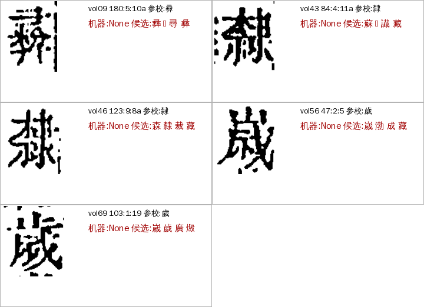

# V02 `variant_form_open`（原 Z06 `group_form_open`）写法待定：字符级深挖（A24，2026-11-06）

> **11-07 改名（manager#304）**：本原因已改名 `variant_form_open`、码 **V02**、归异体类（不是形近字组流程产生的，来自用字账写法判定）；旧名 `group_form_open` 照读，Z06 不再用。判定只看疑问码 `form_open`。下文写于改名前。

> [待审原因总览](../README.md)

派单见 ai-team `domain/CV/质检/待审原因深挖/派单-2026-11-06.md`。不调 API、不重跑整册；改动等下一轮统一重跑。底稿、逐格表、脚本在 ai-team `domain/CV/质检/待审原因深挖/Z06-*`。

## 一句话

三本书 ★main 包现算只有 **殿本 5 格**（史記 0、全唐文 0），线上单也是这 5 格。成因只有一个：**字组统一流程（group_flow）把 `form_open` 当硬护栏，这 5 格的字组（彛彞、隸𨽾、歲嵗）明明有按刻形拆判的解法，却从来没轮到它判**。用解法离线试判，5 格全给字，其中 4 格与整理本同字（开新开关后会放行）、1 格给出与整理本不同的写法（仍留审）。已开 cv 小 PR：书级开关 `group_flow_form_open`，缺省关，等 sheldon 点头再开。

## 判定条件和现状

**什么格会进 Z06**：seed_admit 准入时，整理本通道本来能放，但整理本字属于「用字账里有 ≥2 个写法」的同义组（cv `variant_form.group_forms`），而写法定不了（`decide_form` 得 `open`：库候选没有组内形压得住对手、该形本书人确认过的次数不够、整字三源也不一致），于是 `ok=False`、`doubts += form_open`，原因码 Z06（priority 45）。卡片只列组内写法。

**现状（★main 包现算，各册 cv 版本不同）**：

| 书 | ★main 册数 | Z06 格数 |
|---|---:|---:|
| 殿本（96mid1ogzk） | 99 | **5** |
| 史記（988g3f0wsu） | 10（共 42 册） | 0 |
| 全唐文（995ejelvk0） | 11（共 248 册） | 0 |

带 `form_open` 疑问的格在殿本 99 册里**一共就 5 格**，没有别的原因码把它们吃掉。旧文档（`variant_strategy.md`）记过 form_open 244／170 条，后来用字账长壮、人裁累积，多数位走了 `fixed_lib`／`fixed_form`，只剩这 5 格。

| 册:格 | 参校字 | 库前四 | 目视 | 字组 | 组解法试判 |
|---|---|---|---|---|---|
| vol09 180:5:10a | 彛 | 彞 .945、𢑴 .938、尋 .925、彝 .916 | 看不准 | yi_560 彝彛彜彞𢑱𢑴 | 彛（三段 margin .36） |
| vol43 84:4:11a | 隸 | 蘇 .942、𨽾 .930、䜟、藏 | 隸（夹注 a 半格，左缘有邻字碎墨） | li 隸𨽾 | 隸（1.05） |
| vol46 123:9:8a | 隸 | 森 .949、隸 .946、裁、藏 | 隸（夹注 a 半格） | li | 隸（1.02） |
| vol56 47:2:5 | 歲 | 嵗 .965、渤 .915、成、藏 | **嵗**（上部像山） | sui 歲嵗 | **嵗**（0.92，与整理本不同） |
| vol69 103:1:19 | 歲 | 嵗 .955、歲 .954、廣、燬 | 歲（上部止；格框偏下，上缘被截） | sui | 歲（1.57） |

目视是我（Claude）看图，不是金标。五格有三个共同点：库首位不是组内写法（蘇、森、渤是陪衬字）或两写法只差 .001，`decide_form` 定不了形；夹注半格占 2 格；整理本字在组内。

## 完整流程和参数

1. **准入**（`seed_admit`，整理本通道放行位）：整理本字在用字账（`variant_ledger`）的组里、组内写法 ≥2、库判不是 same → `decide_form` 三档：`fixed_lib`（库候选组内 top1 cov ≥ 0.95、对手不贴 0.01 内、该形本书人确认过）、`fixed_form`（三源一致、embedding 余弦差 ≥ 0.03、人确认过）、`open`。`open` → `form_open`（Z06）。例外：`relax_ref_agree` 时库 top1 就是组内一形则当 `guess` 放。
2. **字组流程 `group_flow`**（补放没放行的格）：`blocked()` 用 `_GROUP_FLOW_HARD`，里面含 `form_open`。→ **form_open 格永远进不了字组流程**，li、sui、yi_560 的 SHAPE 解法（整字 HOG＋岭回归；彝三段 IDS）对它们不起作用。
3. **本次改动**：新书级参数 `seed_admit.group_flow_form_open`（cv seed_admit 1.47，缺省关、关时不进参数 dump）。开：`blocked()` 不再把 `form_open` 当硬护栏，交字组解法定形；解法给字且与整理本字互证（`lift_ref_agree`，归一后同字）才补放，放行时 `doubts` 清空；弃权或与整理本不一致的格仍带 `form_open`、仍是 Z06，不会换成别的原因。
4. **码位结局**：同义组写哪个码位由书级 `codepoints.yaml` 定（`li.md` 里 𨽾𨽻→隷 待 sheldon 定的老问题）；这 5 格不涉及，隸 格放行后字取整理本形 隸。

相关参数：`group_flow`（点名哪些组，缺省开通用字组）、`group_flow_delta` 0.03／`min_cov` 0.85／`top1_cov` 0.97、`group_flow_lift_ref_guard`（缺省开）、各组解法的门槛在 `groups/ids_online.py SPECS`（sui、li `min_margin` 0.5、`min_class` 8；yi_560 三段 `min_margin` 0.04）。

## benchmark

定义：**Z06 基准集 ＝ ★main 包里带 `form_open` 的全部格（现在 5 格）＋目视标注**。三个数：

| 指标 | 目标 | 现在（开 `group_flow_form_open`，离线用组解法试判） |
|---|---|---|
| 剩余 Z06 格数 | 降 | 5 → 1 |
| 解法给字且与整理本一致（会放行）| 越多越好 | 4（彛 1、隸 2、歲 1） |
| 放行错（与目视不符）| **0** | 0（目视可判 3 格全对；彛 1 格目视看不准，没算） |

复现：`Z06-scripts/run.py <书>`（取数，要 `GUJI_WORKSPACE` 指向工作区才读得到数据目录）→ `crops.py`（裁图）→ `z06_bench.py cells_crops.json crops/`（结果存 `z06_bench-result.txt`）。样本太少，这个 benchmark 只能证明「没有明显错放」，不能证明精度；字组解法本身的按册留出精度在各组文档里（li 220 格 0 错、sui 858 格门槛 0.5 起 0 错）。

## 怎么提高

- **能降（5 → 1）**：开 `group_flow_form_open`，预计殿本 −4（下一轮才生效）。开关在殿本打开对其它格无影响（现役只有这 5 格带 `form_open`），所以风险只在这 4 格，我已看过图；史記、全唐文没有这类格，开不开都不变，按「确定该做的 feature 默认全部册打开」的规矩建议三书都开。
- **只能人审（1）**：vol56 47:2:5 解法判嵗、整理本印歲、目视也像嵗。这种「整理本只用一个写法、刻本刻另一个」的格正是 Z06 该由人点一次的类型；点一次本书用字账就记住，下次同形不再进来。
- **不改的**：不放宽 `decide_form` 阈值（`variant_form.py` 里写明了零错点随 checkpoint 移动）；不把 Z06 并入别的原因。
- **长期**：Z06 现在只有 0.04%，不值得再做模型。若新书进来 form_open 变多，先看是不是字组缺解法（`registry.SHAPE_GROUPS`、`ids_online.SPECS` 里没登记），登记解法比逐格裁便宜。

## 要谁做

| 事 | 谁 | 备注 |
|---|---|---|
| cv PR：`group_flow_form_open`（1.47，缺省关） | A24 已开，合 dev | 见 PR |
| 殿本（及三书）开 `group_flow_form_open` | **sheldon 点头**后 A31 在第 N 轮册配置里开 | 殿本 −4 |
| vol56 47:2:5 人点 嵗 | 人审 | 1 格 |

## 改名与第 6 轮现状（2026-11-07）

manager#304 把本原因改名 `variant_form_open`、码 **V02**、归异体类（A24 Z 类梳理），并入 V01 线程一起看。第 6 轮 ★main（cv 0.6.16，已含 1.51 `group_flow_form_open`）现算殿本 **4 格**、史記全唐文 0：

| 册:格 | 参校字 | 库前三 |
|---|---|---|
| vol09 180:5:10a | 彛 | 彞 .945、𢑴 .938、尋 .925 |
| vol46 123:9:8a | 隸 | 森 .949、隸 .946、裁 .933 |
| vol46 175:2:8a | 隸 | 雜 .956、𨽾 .943、蘇 .919 |
| vol43 84:4:11a | 隸 | 蘇 .942、𨽾 .930、䜟 .918 |

开关开了这 4 格仍留：全是**夹注半格**，库首位是陪衬字（森雜蘇）或不在分差内，字组入口不接，组的刻形解法轮不到。11-06 那批的 vol56、vol69 两格第 6 轮已放行；vol46 175:2:8a 是新进的。4 格量太小，不再加规则，人审。图见 [variant_pair/图/V01-r6-sui-yi-V02.png](../variant_pair/图/V01-r6-sui-yi-V02.png)（其中 vol09、vol46 两格、vol43 四张）。
