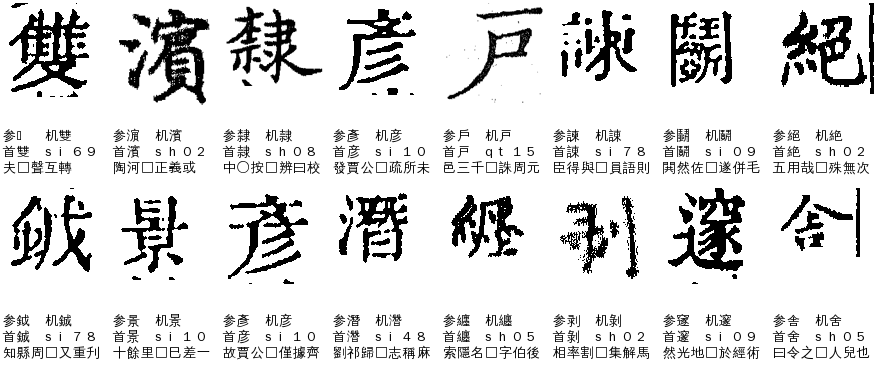
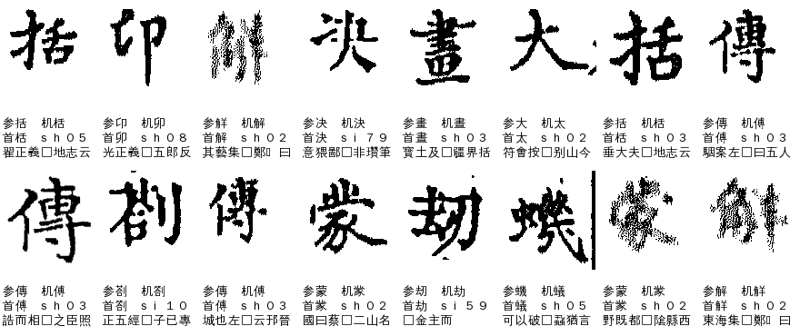
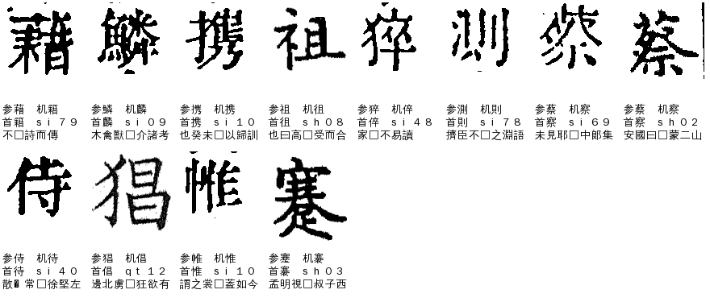
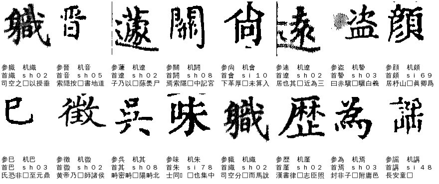
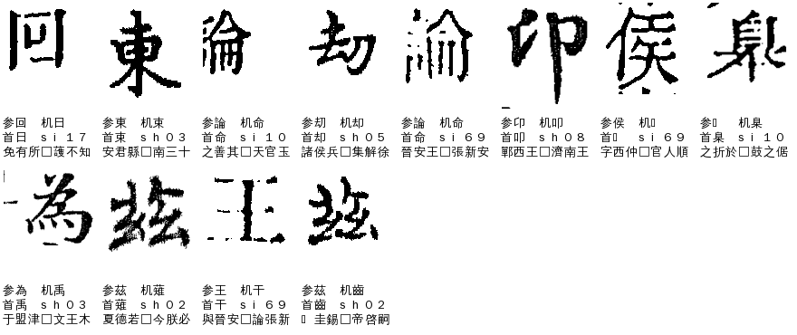
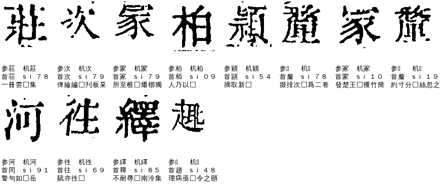

# V01 `variant_pair` 异体字：字符级深挖（A24，2026-11-06）

> [V01 总述](README.md) · 派单见 ai-team `domain/CV/质检/待审原因深挖/派单-2026-11-06.md`（第 2 批）· 逐格明细 [`V01-cells.tsv`](V01-cells.tsv) · 取数／拼图脚本 [`分析脚本/`](分析脚本/)

## 一、这个待审原因是什么

**一句话**：机器给的字和整理本（参校本）的字，被判成「是一对异体」，但这对异体不在任何字组里，要人确认本书刻的是哪一个。

**什么情况下才会被判成 V01**（`review/reasons.py` `_variant_with_ref`，priority 55）。前面的原因（切分、遮挡、H01、Z01–Z06、R01–R03、L01、L05）都没命中，且下面两条之一成立：

1. 这一格带 `ref_lib_variant`／`variant_indirect`／`replace_form`／`channel_off` 任一码；
2. 这一格有整理本字，库首选不等于整理本字，**并且库前五名里任何一个字**（不一定是首选）与整理本字在异体表里有边（`variants.are_variants`，**任一来源收录就算**）。

放行的现状是：这类格要靠 `seed_admit` 里的两条通道放，条件见 cv 方法论 4.5、4.7：

- `edge_pair`（缺省开）：整理本字与库首位是「自动对」＝边表 `edge_tier==T1` 纯异体、≥2 个异体来源、两个字都不在字组里、不在 `edge_pair_exclude.tsv`；库首位 cov≥0.92、领先对外最好候选≥0.005、没有护栏（`near_form` 也算护栏）。放两形里全书已放行频次高的一形（暂归一，只限同义异体）。
- `follow_ref_variants`（只有史記开）：同义异体照录整理本形，判据同上（也要 cov≥0.92、gap≥0.005、不碰 `near_form`）。

没放出去的才进 V01。

## 二、现状（2026-11-06，三书 ★main 包逐册现算，正文页）

| 书 | V01 格 | 该书待审总格 |
|---|---:|---:|
| 殿本（siku-zongmu） | 265 | 4,774 |
| 史記（988g3f0wsu，有 ★main 的册） | 121 | 933 |
| 全唐文（995ejelvk0） | 2 | 125 |
| 合计 | **388** | |

（线上单 `pending-stats` 数是 260／122／2，差几格是线上单与 ★main 包的版本差。）
388 格是 334 种「整理本字>库首选>机器字」组合，最多的也只有 4 格（兩>雨），**纯长尾**，不可能逐对建组。

各格的疑问码几乎一致：`库 unsure`（cov 不到放行线）384 格、`上下文 margin 不足` 340 格，其中 219 格还带 `replace_align`。**没有一格是「字形判法给了字被否决」**，都是库没把握＋上下文也没拿定。

### 2.1 先说最大的发现：V01 的判法过宽，真异体只占约四分之一

把每格的「整理本字—库首选／机器字」拿去查异体表的边（来源标签、`edge_tier`），分成 A–F 六类：

| 类 | 说明 | 殿本 | 史記 | 全唐文 | 合计 |
|---|---|---:|---:|---:|---:|
| A | 库首选＝机器字，与整理本字是**纯异体边**（T1） | 59 | 20 | 1 | **80** |
| B | 同上，但边是**互通／一对多**（T2，多为 twedu 收的） | 47 | 25 | 0 | **72** |
| C | 同上，但边只有 `hydzd-borrowed`（通假）或简繁（T3）：**这不是异体** | 24 | 12 | 1 | **37** |
| D | 异体边**不在首选上**，是库前五里排第 2～4 的陪衬字碰巧与整理本字有边 | 104 | 64 | 0 | **168** |
| E | 机器字＝整理本字（被上下文护栏拦着），库首选是它的异体／形近 | 27 | 0 | 0 | **27** |
| F | 只有 `ref_lib_variant` 码，边表里查不到边 | 4 | 0 | 0 | **4** |

- **C 类 37 格＋D 类 168 格＝205 格（53%）根本不是「首选与整理本互为异体」**。C 是通假／形近被当异体，D 是前五里随便一个候选跟整理本字有边就触发。
- 再看 A、B、E（172 格）里，两个字真是同词异体的有多少？我凭字书知识对 A、B、E 里 144 种「整理本字>库首选」字对逐对初判（只是初判，列在 tsv「初判」列，**逐对请 sheldon 定**）：其中 53 种共 **66 格不是异体**（兩>雨、傳>傅、晝>畫、舟>丹、大>太、卬>卯、鉞>鋮、遽>蘧、壕>濠、練>楝、味>未、住>往…，twedu／hydzd 的边里混着古文、通假、形近），**约 106 格是真同词异体**（殿本 77、史記 28、全唐文 1）。
- 所以 388 格里，真正的「同义异体、要定本书用哪一形」只有约 **106 格（27%）**。这和 cv 方法论 4.5 里 r5 的结论（360 对里约 69 对真异体）是同一个现象：**V 类口径过宽**。

### 2.2 D 类 168 格：其实是「机器字≠整理本字」，多数是机器错、整理本对

D 类里，库首选（＝机器字）和整理本字是**不同的两个字**（巳>巴、吳>其、歷>厪、為>焉、論>命、職>織、味>朱…），库首选与整理本字之间没有异体边。看图抽 28 格（见下图 D1、D2），**整理本看着对的约 22 格**，机器字对的约 4 格，其余两可。这批格的本质是 P01／P02（机器字≠整理本字），V01 是误归。

### 2.3 真异体 106 格为什么没放出去

对这 106 格逐条查 `edge_pair`／`follow_ref_variants` 的放行条件，**第一个挡路的原因**：

| 挡路原因 | 格数 | 说明 |
|---|---:|---|
| 边是 T2（互通／一对多），不是 T1 | 36 | 錬鍊、决決、諡謚、刼劫、剳劄、幷并、鈎鉤、没沒、産產、茲兹、吴吳、解觧、從従、褒襃、迺廼…看着都是常见的同词异体，但 `edge_tier` 把「两头都是教育部正字」「一形多正」归 T2，通则不收 |
| 两字在同一个字组里，但组没接手 | 30 | 徃往（xjz）、既旣（jiw）、蒙䝉（mn）、𫝊傳（fc）、鬭鬬、衞衛、隸隷…（见下）。`edge_pair` 说「字组自己判」不收，可组入口又因分差内有组外字（25 格）或其他条件没接，掉在中间 |
| 库首选领先第二名不到 0.005（只剩这一条） | 14 | 䖍虔、来來、薫薰、鶮鶴、乆久…，史記占一半；挡路的是排第二的**组外近形字**，不是异体对 |
| 库首选 cov 不到 0.92 | 7 | 剥剝（0.919）、悦悅（0.896）、纒纏（0.916）、彗篲（0.889）等 |
| 旧包（cv 0.5.x／freeze，没有 `edge_pair`） | 6 | vol06、vol09、vol10；下一轮重跑就放 |
| 只有 1 个异体来源 | 6 | 緣縁、慍愠… |
| 带 `near_form` 硬护栏 | 4 | 迺廼、乆久… |
| 机器字＝整理本字，被 `ctx_guard_ref` 拦 | 2 | |
| `human_unbound` | 1 | 注註 |

「在字组里但组没接手」的 30 格是一个**结构缺口**：25 格是库分差内有组外字（比如首选 0.963、第二名 0.959、都是组员，但排第三的组外字在 0.03 以内）→ `flow.entry` 不让进；`edge_pair` 又因为字在组里不认。结果这些格既没被组判、也没被通则放。

## 三、什么样的字会被归进来（看图）

下面每张图 8～16 格，上方是原书字块，下面三行是：参＝整理本字、机＝机器字、首＝库首选（＝机器字）、册号、整理本上下文。

**A 类：库首选与整理本是纯异体（真 V01）**。字形都认得出，是「刻的是异体、整理本用正字」，如雙、濱、隸/隷、彥/彦、戶/戸、諫/諌、關、絕、鉞/銊、繼/繼、剝、遼/邃。图上刻形都清楚，机器字都是对的；只是库没把握放不出（cov 或 gap 不够）：

**B 类：互通／一对多边（T2）**。里面混着真异体（錬鍊、决決、諡謚、刼劫、剳劄）和不是异体的（兩/雨、晝/畫、傳/傅、大/太、括/栝、舟/丹、卬/卯、亨/享）。后一半如图上的「畫≠晝」「大≠太」「兩≠雨」，要看文意，不能当异体归一：

**C 类：只有通假或形近边**。籍/藉、鱗/麟、携/攜、祖/徂、猝/倅、測/則、蔡/察、侍/待、猖/倡、帷/惟、搴/褰：意思不同，不能当异体，应归 N01（形近护栏）或 P02：

**D 类：异体边在非首位候选**。图是 D1（陪衬字与整理本有 T1 边）。机器字与整理本字是完全不同的字，看图多数是整理本对（職、盜、顏、巳、吳、味、歷、為、遠、尚）：

D2（陪衬字边是 T2／T3）同理，論/命、茲/茲、為/禹、回/日 都是整理本对：

**E 类：机器字＝整理本字，库首选却是它的异体／形近**。图上整理本字就是刻的字（莊、柏、冢、穎、河、徃、繹…），因为上下文护栏（`ctx_guard_ref`）没放，其中柏栢、冡冢、莊荘、穎頴、踈疎 是真异体，河/同、繹/釋、頽/類 不是：

## 四、怎么提高（建议，待讨论）

按「改分类 → 补通则 → 补数据」排。数字是对这 388 格的静态估计，**没有重跑**，真值以回放为准。

| # | 措施 | 改哪 | 影响 | 放行？ |
|---|---|---|---:|---|
| 1 | **V01 只认「库首选或机器字」与整理本字的边**，不再看前五里其它候选；边的档只认 T1／T2，T3（通假、简繁）不算异体 | manager `reasons.py`（要先通知 A31–A34） | V01 388→约 172；C 37 与 D 168 分到 P01（118）、P02（58）、N01（33）、L04（7） | 否，只改分类 |
| 2 | D 类并入 P 类后，交 **p_ref_admit（机器字不在字组、不是半格 → 取整理本字）** 回放：抽样 28 格整理本约八成对。cv#1105 已有，缺省关，A31 建议第 6 轮殿本开 | cv 参数 | D 168 格里最多可放一大半（待回放留出 0 错） | 是（回放后） |
| 3 | **字组成员对但组没接手的 30 格**：`edge_pair` 对「两字同在一个异体组、且组入口因组外字没接」放开，或让组入口在「首选与整理本同组、对外只差组外陪衬」时按 `ref_top_enter` 进 | cv `edge_pairs.is_auto_pair`／`flow.entry` | 约 30（含 5 格入口本可过的，应先查为什么没进） | 是（留出 0 错后） |
| 4 | **T2 异体对按对白名单放**：25 格里没有硬护栏、cov／gap 都够的，是 諡謚、刼劫、剳劄、幷并、鈎鉤、没沒、産產、茲兹、吴吳、解觧、從従、褒襃、迺廼 等，≥3 个来源。其中 注註（义项不同）、兩雨之类不能放。做 pair_whitelist 看图页，逐对请 sheldon 定 | cv `edge_pair` 加 T2 白名单；review_pages `pair_whitelist` | 约 16–20 | 是 |
| 5 | 与「放行 X03 三者一致格并补异体表」线程对接：该线程补 ~530 对漏收异体，**补边时请按「首选—整理本」成对加，不要再加通假、形近边**；V01 里已确认不是异体的 66 格字对给它当排除表（`edge_pair_exclude.tsv`）候选 | 异体表 | 防止 V01 再涨 | 否 |
| 6 | 库分差<0.005 的 14 格（史記为主）：挡路的是排第二的组外近形字（皮、卬…）而不是异体对。有可信参校本的书，可对「整理本字与首选同词异体、且首选 cov≥0.93」的格把 gap 门槛放到 0.002，**先在史記留出册回放**，过了再说 | cv `follow_ref_decide` 参数 | 约 14 | 是（回放后） |
| 7 | 旧包 6 格 | 无需改，下一轮统一重跑 | 6 | — |
| 8 | 真异体剩下的（cov 不够、单来源、near_form、ctx_guard_ref，约 15 格） | 人审，一次裁一对，结论写异体表／码位表 | 约 15 | 人审 |

**预计**：1 做完 V01 从 388 降到约 172（只改分类）；2–6 都过回放的话，172 里真异体的约 106 格大部分能自动放，**V01 最终剩约 20～40 格**；同时 D 类 168 格由 P 类通则承接，不再占 V01。

**不会做的**：不把 B 类里不是异体的（兩雨、大太、晝畫…）按异体归一（暂归一只限同义异体）；不靠文意定异体（README「不要做」）。

## 五、要 sheldon 定的

1. 第 1 条（V01 只认首选／机器字的边）是改原因码分法，同意的话我先 `send.py` 通知 A31–A34，再提 manager PR。
2. 第 4 条 T2 白名单：要不要做 pair_whitelist 页，逐对看（注註、兩雨这类先排除）。
3. 初判里有拿不准的字对（鉞>鋮、杪>秒、𡘜>哭、𡚶>妄、砂>沙、窿>隆）是凭印象判的，请看图定；tsv「初判」列可直接改。
