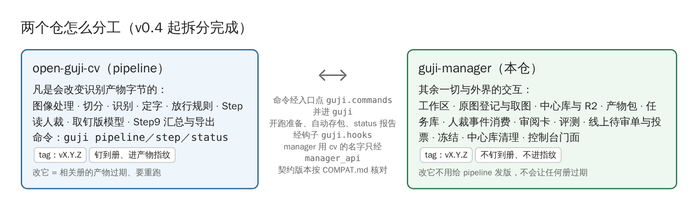

# guji-manager Wiki

> **本 Wiki 对应 guji-manager v0.4**（2026-11-05 按 0.4.0 重改；之前 0.3、首版 0.2.0）。
> 版本号差了一个 MINOR（比如代码到了 0.5.x），说明这里可能过时，以仓里 [doc/](https://github.com/open-guji/guji-manager/blob/dev/doc/README.md) 为准，并按[维护规矩](版本与Wiki维护)重改。

**guji-manager** 是开源古籍整理流水线的「管家」：新建工作区、登记和取原图、跑批派单、推拉中心库、出线上待审单、收读者投票、冻结发布——一切和外界打交道的事。
识别算法本身（切分、识别、定字）在 [open-guji-cv](https://github.com/open-guji/open-guji-cv)。

一句话分界：**会改变识别产物字节的在 cv，其余在 manager**。所以改 manager 不用给 cv 发版，也不会让任何一册的产物过期。0.4 起拆分完成：cv 里已没有 manager 一侧的代码，`guji` 里整理流程的命令都由 manager 提供，cv 只留识别本身的（`pipeline`／`step`／`status` 等）。

## 先看哪页

| 我是… | 想知道… | 去看 |
|---|---|---|
| 新来的 | 整个系统有哪些东西、住在哪 | [系统全景](系统全景) |
| 新来的 | 一部书从扫描图走到网站要经过什么 | [一部书怎么走完](一部书怎么走完) |
| 开新书的 | 原图怎么登记、怎么拆页 | [原图登记与取图](原图登记与取图) |
| 跑批的 | 产物包、标 main、钉版本 | [中心库与产物包](中心库与产物包) |
| 跑批的 | 怎么交重跑单、看谁在跑 | [任务库与重跑](任务库与重跑) |
| 做人审的 | 怎么少审几格 | [快审分流](快审分流)、[按组看图定夺](按组看图定夺) |
| 做精校的 | 线上单、网站投票怎么回到产物 | [线上待审单与投票](线上待审单与投票) |
| 分析待审的 | 每格为什么待审、新书该往哪努力 | [待审原因与新书体检](待审原因与新书体检) |
| 维护的 | 冻结、清理中心库 | [冻结与中心库清理](冻结与中心库清理) |
| 装环境的 | 装法、令牌 | [安装与环境](安装与环境) |
| 想看例子 | 五部书各有什么难处 | [案例画廊](案例画廊) |

## Wiki 和 doc/ 的分工

- **Wiki（这里）**：看图懂系统。每页先图后文，讲「是什么、长什么样、为什么」，末尾链到 doc/ 细篇。
- **仓里 [doc/](https://github.com/open-guji/guji-manager/blob/dev/doc/README.md)**：干活时查的操作手册——每步命令、验收标准、常见坑。命令细节以 doc/ 为准。

## 维护规矩（重要）

1. 平时出 PATCH 版不要求改 Wiki。
2. **每升一次 MINOR 版，必须整体重改一遍 Wiki**：列出上个 MINOR 以来的全部 PATCH，归纳涉及了哪些功能，逐页对照改、该补的补页、截图该重截的重截，再把本页顶上的「对应 vX.Y」改掉。
3. MINOR 发版的 PR 里写一行「Wiki 已按 vX.Y 重改」才算发完。

细则见 [版本与 Wiki 维护](版本与Wiki维护)。

## 怎么改这个 Wiki

Wiki 源文件在主仓 [`wiki/`](https://github.com/open-guji/guji-manager/blob/dev/wiki) 目录（图在 `wiki/images/`），改它走 PR；合进 main 后由 Action `wiki-sync` 自动同步到这里。**不要直接在网页上改 Wiki**，下次同步会被覆盖。
