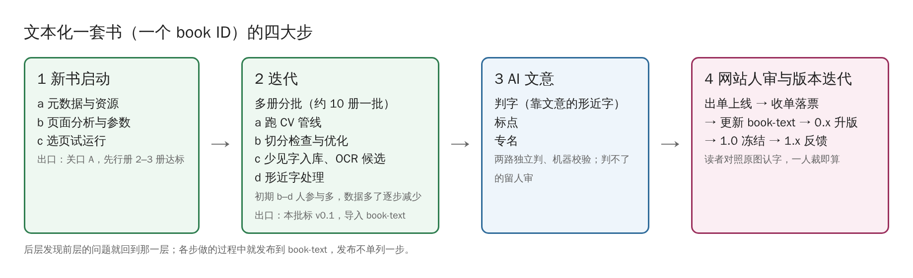

# 一部书怎么走完：四大步

文本化一套书（一个 book ID）分四大步。每一步在仓里 `doc/` 下有一个目录，干活时的命令、验收、坑都在那里；这里只讲「是什么、长什么样」。

| 步 | 一句话 | Wiki | 操作手册 |
|---|---|---|---|
| [第一步 新书启动](第一步-新书启动) | 书目、原图、整理本、工作区齐了，量版式定参数，先行册 2–3 册选页试跑、首批字形入库 | [第一步](第一步-新书启动) | [doc/1-新书启动](https://github.com/open-guji/guji-manager/blob/dev/doc/1-新书启动/README.md) |
| [第二步 迭代](第二步-迭代) | 约 10 册一批，一轮一轮跑管线、修切分、补少见字、处理形近字；一批做完标 v0.1、导入 book-text | [第二步](第二步-迭代) | [doc/2-迭代](https://github.com/open-guji/guji-manager/blob/dev/doc/2-迭代/README.md) |
| [第三步 AI 文意判字、标点、专名](第三步-AI文意判字标点专名) | AI 读整段文意，一遍判靠文意的形近字、加标点、认专名 | [第三步](第三步-AI文意判字标点专名) | [doc/3-AI文意判字标点专名](https://github.com/open-guji/guji-manager/blob/dev/doc/3-AI文意判字标点专名/README.md) |
| [第四步 网站人审与版本迭代](第四步-网站人审与版本迭代) | 判不了的上网站请读者认字，票落回 book-text，0.x 一版版升到 1.0 冻结，之后收反馈发 1.x | [第四步](第四步-网站人审与版本迭代) | [doc/4-网站人审与版本迭代](https://github.com/open-guji/guji-manager/blob/dev/doc/4-网站人审与版本迭代/README.md) |

三条贯穿全程的规矩：
1. **前层没稳不进后层**：切分一动，格号、刻例、人裁锚都要迁，所以切分最先清。
2. **一批一批做**：先行批把配置、书级代码、字形库磨好，后面的批沿用。
3. **绝大部分是自动的**：用户只在几处出现（定目标人审率、第一次进库的字、金标与码位口径、判停出 v0.1、打 1.0），其余会话直接做、做完记一笔。
