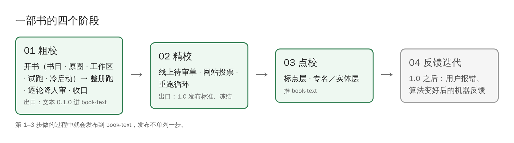
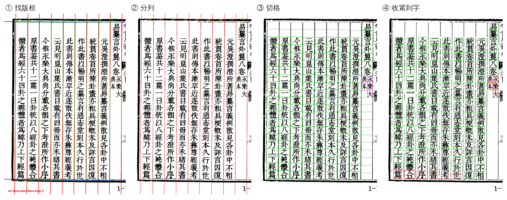
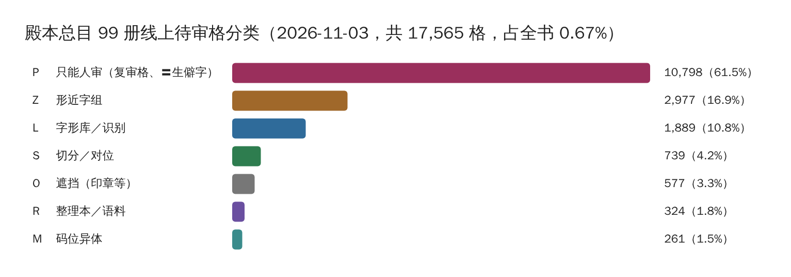

# 一部书怎么走完

## 01 粗校①开书：从扫描图到能试跑

登记原图、建工作区、写册配置，然后在几十页上试跑切分。下面是殿本总目 vol03 第 10 页在 pipeline 里的四步（叠图由 `guji product overlay` 画出）：

① 找版框和界行 → ② 按界行把页拆成列 → ③ 每列切成格（绿＝字，灰＝空格）→ ④ 把格收紧到字的墨迹（红框＝有疑点，要人看）。
切分的算法细节归 [open-guji-cv](https://github.com/open-guji/open-guji-cv) 的 Wiki，这里只说 manager 关心的：**试跑结果要人看过、切得对，才往下走**。

## 01 粗校②整册跑到 v0.1

整册交任务库跑完，得到一份产物包；分析剩下的待审格是什么原因，能用算法和配置解决的先解决（受控重跑），再把文本 0.1.0 推进 book-text。

## 02 精校：人投票、机器重跑

待审格上网站，读者对照原图认字，票再回到产物里——见 [线上待审单与投票](线上待审单与投票)。下图是殿本总目 99 册目前线上待审格按待审原因的分类（`guji-manager pending-stats` 出的数，见[待审原因与新书体检](待审原因与新书体检)）：

四分之三是「机器改了字」和复审，只能人审；形近字组、字形库、切分几类是算法和大模型还能再降的部分。

## 03 点校

在 book-text 上加标点层、专名和实体层。

## 04 反馈迭代

1.0 之后：网站用户报错、算法变好以后机器给出的新反馈，都走这一步，跟 02–04 相互独立。

**详细**：[开书全流程](https://github.com/open-guji/guji-manager/blob/dev/doc/01-粗校/开书/开书全流程.md)、[01–05 各步文档](https://github.com/open-guji/guji-manager/blob/dev/doc/README.md)
