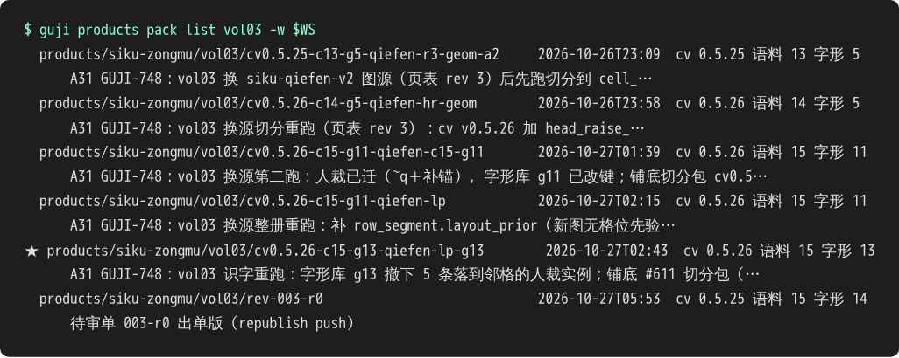

# 中心库与产物包

## 一册书的结果由四样东西决定

**cv 代码版本、语料号（c）、字形库号（g）、中心库里的人裁与册配置**。前三样写在册配置里钉住；跑出来的产物打成**产物包**存 R2，包的标签就写着这三个号。

下面是殿本总目 vol03 的产物包列表，★ 是现行 main（网站、导出、线上单都认它）：

读标签：`cv0.5.26-c15-g13-qiefen-lp-g13` ＝ cv 0.5.26、语料 15、字形库 13，后面是这次跑批的说明。`rev-003-r0` 是出线上待审单时存的那一版。

## 常用命令

| 要做什么 | 命令 |
|---|---|
| 拉工作区数据到本地 | `guji db pull -w <工作区>` |
| 推册配置、人裁等 | `guji db push -w <工作区> [--dry-run]`（写 main 要正式令牌，先报条数、等用户点头） |
| 看本地落后／未推 | `guji db status -w <工作区>` |
| 列、取产物包 | `guji products pack list <册> -w <工作区>`、`… pack fetch …` |
| 标 main | `guji products pack promote <册> -w <工作区> --label <标签>` |

标 main 之后，manager 会自动重出这册的线上待审单，见 [线上待审单与投票](线上待审单与投票)。

**详细**：[中心库](https://github.com/open-guji/guji-manager/blob/dev/doc/参考/中心库.md)、[册配置](https://github.com/open-guji/guji-manager/blob/dev/doc/参考/册配置.md)、[产物包与版本钉](https://github.com/open-guji/guji-manager/blob/dev/doc/参考/产物包与版本钉.md)
