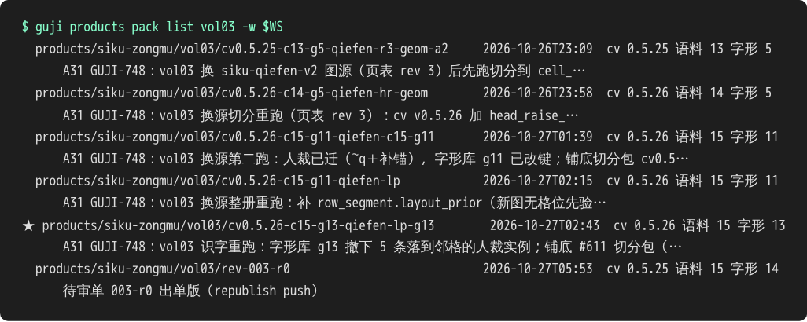

# 中心库与产物包

## 一册书的结果由四样东西决定

**cv 代码版本、语料号（c）、字形库号（g）、中心库里的人裁与册配置**。前三样写在册配置里钉住；跑出来的产物打成**产物包**存 R2，包的标签就写着这三个号。

下面是殿本总目 vol03 的产物包列表，★ 是现行 main（网站、导出、线上单都认它）：

读标签：`cv0.5.26-c15-g13-qiefen-lp-g13` ＝ cv 0.5.26、语料 15、字形库 13，后面是这次跑批的说明。`rev-003-r0` 这类老标签是整张换单时代出单时存的包，现在不再产生，现行包看 ★main 标签。

## 常用命令

| 要做什么 | 命令 |
|---|---|
| 拉工作区数据到本地 | `guji db pull -w <工作区>` |
| 推册配置、人裁等 | `guji db push -w <工作区> [--dry-run]`（写 main 要正式令牌，推前 dry-run 看条数，常规推库不用问用户） |
| 看本地落后／未推 | `guji db status -w <工作区>` |
| 只拉、只推几个文件 | `guji db pull|push|sync -w <工作区> --only <路径> …`（可多次，目录以 / 结尾；不扫整个数据目录、不碰字形库，换包、迁移这类小改动用） |
| 列、取产物包 | `guji pipeline products pack list <册> -w <工作区>`、`… pack fetch …` |
| 标 main | `guji pipeline products pack promote <册> -w <工作区> --label <标签>` |

推库要设 `GUJI_ACTOR`（操作人，出事查得到是谁推的）。字格身份账 `feedback/uid/<册>.jsonl` 也进中心库（events 表 `stream=uid`），见 [字格永久编号 u 与身份账](字格永久编号u与身份账)。

`guji pipeline` 整册跑完、没有失败页时，manager 的钩子会自动把产物存成包（还没存包的产物 `guji pipeline status` 会提醒）。标 main 之后，manager 会自动重出这册的线上待审单，见 [线上待审单与投票](线上待审单与投票)。

模型、字体、底库语料文件按 sha 存 R2：跑批起跑前 cv 按册钉的号自己取回（取件在 cv），往 R2 上传走 `guji pipeline model upload`／`guji pipeline font upload`／`guji start corpus upload`（上传在本包）。

**详细**：[中心库](https://github.com/open-guji/guji-manager/blob/dev/doc/数据库/中心库.md)、[册配置](https://github.com/open-guji/guji-manager/blob/dev/doc/参考/册配置.md)、[产物包与版本钉](https://github.com/open-guji/guji-manager/blob/dev/doc/参考/产物包与版本钉.md)
