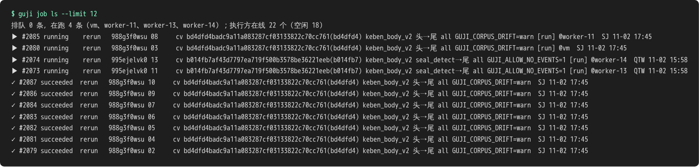

# 任务库与重跑

跑批不在自己会话里跑，而是**交单给任务库**，由执行机（vm、worker-NN）领单去跑，跑完把产物包推回 R2。任务库整个在本包（`guji_manager.jobs`）：执行方是 `python -m guji_manager.jobs work`，空闲时自己把 cv 和 manager 的检出跟到 main。



每行一张单：编号、状态、书 ID 与册、用哪个 cv 提交、跑哪条管线、从哪步跑到哪步、谁交的。失败的单会写原因（上图最后一类）。

## 交单前先想清楚

- **先查**：`guji job ls` 看有没有人已经在跑同一册。
- **重跑分级 L0–L3**：改动影响多少册、多少步，决定是只重跑一步、几页，还是整册重来。分级规则见 [冻结基线与重跑分级](https://github.com/open-guji/guji-manager/blob/dev/doc/02-精校/冻结基线与重跑分级.md)。
- **只跑受影响的部分**：`--from <步>`、`--pages`，或 `guji rerun --stale` 只重跑被人裁标了失效的页（`rerun`、`cache`、`product` 0.3.3 起由本包提供）。

## 常用命令

```bash
export GUJI_JOBS_WHO=<你>
guji job ls                     # 排队、在跑、最近结束
guji job submit …               # 交单；新书 spec 带 ws_repo: <owner>/<repo>
guji job show <号>              # 跑完不通知，自己查结果
guji job retry <号>             # 失败、拦下的重新排队
guji job workers                # 谁在线、空闲还是在跑
```

**详细**：[重跑需求与执行规范](https://github.com/open-guji/guji-manager/blob/dev/doc/01-粗校/重跑需求与执行规范.md)、[受控重跑方法论](https://github.com/open-guji/guji-manager/blob/dev/doc/01-粗校/受控重跑方法论.md)
