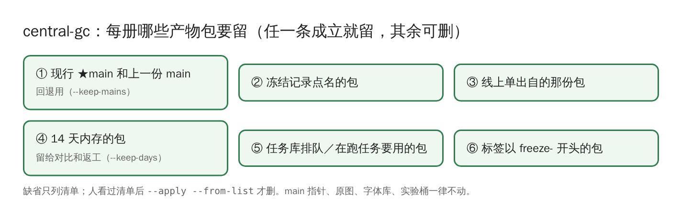

# 冻结与中心库清理

## 冻结登记：`guji freeze`

一册过了 [1.0 发布标准](https://github.com/open-guji/guji-manager/blob/dev/doc/03-精校/1.0发布标准.md)，就做冻结登记：把那一版产物存成包、写冻结记录、改册配置、打文本 1.0 标签。

- 缺省**只出计划**（不存包、不写库、不改 yaml、不打 tag），看过再加 `--execute`。
- 打 1.0 与冻结要用户明说。
- 冻结后的册如果要再动，按 [冻结基线与重跑分级](https://github.com/open-guji/guji-manager/blob/dev/doc/03-精校/冻结基线与重跑分级.md) 判级。

## 中心库清理：`guji-manager central-gc`

产物包只增不改，每跑一次存一份。殿本 99 册已有 1,800 多份、14 GB，九成以上没人再取。central-gc 按保留规则列出可删的包：



```bash
guji-manager central-gc --ws siku-zongmu --out 清单.tsv      # 只列清单
guji-manager central-gc --apply --from-list 清单.tsv          # 人看过清单后才删（要正式令牌）
```

**详细**：ai-team《中心库维护方案》
