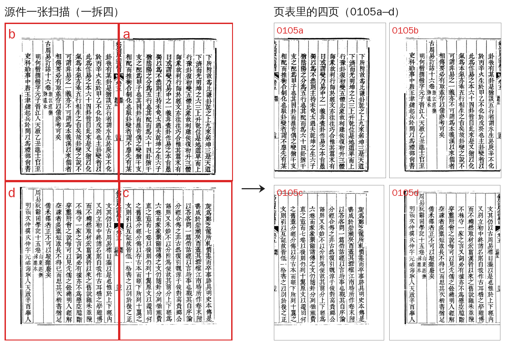

# 原图登记与取图

命令：`guji source`（2026-11-02 从 cv 搬来）。

## 原图的来处与去处

- **根是 Wikimedia Commons**：DjVu／PDF 源件。IA、CADAL、维基共享的扫描都先落成 Commons 文件或原样存进 R2。
- **R2 存三样**：源件原样（`source/orig/…`）、每页一张 PNG（按 sha256 存）、页表（`pages/<书id>/<册>/rNNN.json`）。
- **页表**是一册原图的清单：第几页、来自源件哪一张、做过什么处理（裁切、拆页、手工修）。改图就出新版页表（r001 → r002 …），老版本留着，册配置写 `source_rev` 钉住用哪版。

## 拆页：一张扫描变几页

扫描常常一张里装着整个对开，甚至上下两个对开。下图是殿本总目 vol03 的第 105 张 IA 扫描，页表把它登记成四页 0105a–d，每页只记一条裁切坐标，不重新编码图片：

对开拆页用 `guji source spreads`：先找版心、出核对图，人看过核对图再登记。

## 常用命令

| 要做什么 | 命令 |
|---|---|
| 看一部书登记了哪些册、几版页表 | `guji source list <书id>` |
| 看一册页表（来源、处理过哪几页） | `guji source show <书id> <册> [--rev N]` |
| 对开拆页，出核对图 | `guji source spreads <源件> --vol 01 --out splits.json --sheet 核对图.png` |
| 登记 Commons 来源 | `guji source commons <书id> <册> --djvu <源件> --splits auto --dry-run` |
| 按页表取图到本地 | `guji source pull <册> -w <工作区>`（或 `--book-id --vol --to <目录>`） |
| 换掉一页（修过的图） | `guji source replace <书id> <册> <页序> <png>` |

**详细**：[开新书·步骤](https://github.com/open-guji/guji-manager/blob/dev/doc/02-粗校/开书/步骤.md)、cv 设计稿《古籍图片全流程》
