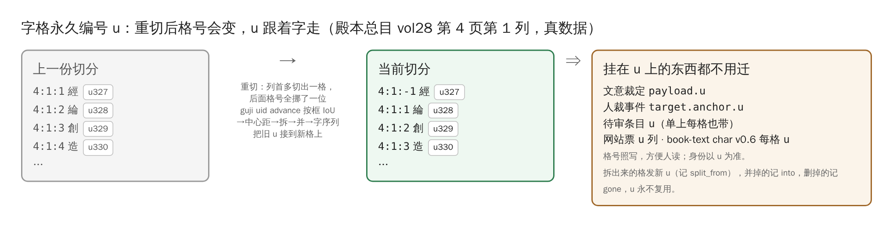
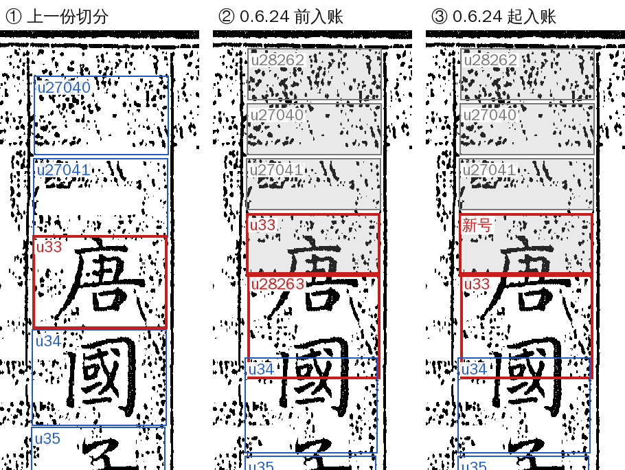

# 字格永久编号 u 与身份账

> 按 guji-manager **v0.6.24**（2026-11-26）写。细节和全部命令见仓里的 [doc/参考/字格身份账.md](https://github.com/open-guji/guji-manager/blob/dev/doc/参考/字格身份账.md)，改挂清单见 [doc/4-反馈迭代/设计-字格u改挂.md](https://github.com/open-guji/guji-manager/blob/dev/doc/4-反馈迭代/设计-字格u改挂.md)。

## 一句话

**格号是位置，u 是身份。** 格号（`册:页:列:格`，如 `vol28:4:1:3`）是切分的编号：补一个字、重切一次、换一次图源，后面的格号就全挪了。
**u** 是册内唯一的正整数，发给一格以后就跟着这格的字走，永不改、永不复用。裁定、人裁、待审条目、网站票、标点、专名都挂在 u 上，重切以后不用再「旧格→新格」去迁。



## 我要做什么（按角色）

| 你在做 | 照常做 | 要注意 |
|---|---|---|
| 跑管线、标 main | `guji pipeline products pack promote`（或 `push --main`） | 标 main 的机器 manager **≥0.6.16**，钩子会自动入账、推库 |
| 交任务库单 | 照常交 | 执行机铺 main 底后自动 `uid sync`，不用管 |
| 写人裁、裁定、待审条目 | 照常写 | 追加前自动盖 u；盖不上**整批报错不写**（见文末「常见问题」） |
| 换单、落 book-text | `guji feedback swap run`、`swap book-text` | cv 要 **v0.7.110／111／112 或 dev**，manager **≥0.6.23**，否则导出不带 u 或不连续 |
| 收网站票 | `guji feedback collect`、`cellvotes draft/write` | 票按 u 合到现格；u 已作废的票挂起（`moved`），进复审 |
| 发链接给人看某个字 | 用 `?u=`（如 `/read/<书>/<章>?u=1234`） | 别再拼格号 |
| 执行方 | 一台开 `GUJI_UID_AUDIT_S=14400`（补漏入账）；**只一台**开 `GUJI_UID_CHECKU_S=14400`（人裁自检报告） | — |

没有身份账的册（`feedback/uid/<册>.jsonl` 不存在）一切照旧按格号。现在中心库 263 册有账，book-text 174 册已全上 u。

## 身份账

每册一份 `feedback/uid/<册>.jsonl`，**只追加**，推进中心库 events 表（`stream=uid`）。一页每份切分一行，记这一页当时的「格号→u」、字、框和变化来历：

```json
{"kind": "uid_ledger", "src": "promote", "by": "worker-46", "label": "cv0.7.105-c24-g24-m3-u-on",
 "book": "vol28", "page": 4, "cells_sha": "fc122fc65a74…", "via": {"iou": 112, "new": 84},
 "map":   {"vol28:4:1:-1": 327, "vol28:4:1:1": 328, "vol28:4:1:2": 329, "…": "…"},
 "chars": {"vol28:4:1:-1": "經", "vol28:4:1:1": "綸", "vol28:4:1:2": "創"},
 "boxes": {"vol28:4:1:-1": [1574, 94, 116, 92], "…": "…"},
 "lineage": [{"u": 29064, "new": true}, {"u": 795, "into": 796}, {"u": 499, "gone": true}]}
```

（殿本总目 vol28 第 4 页真数据，有删节。）一页的最后一行就是现行切分。`lineage` 记拆出来的新格（`split_from`）、并掉的（`into`）、删掉的（`gone`），作废的号永不复用。

### 什么时候入账

**切字以后、标 main 时**。cv 认的是 main 包的切分，所以「哪份切分成了 main」才入账；试跑包不入。

```
标 main（products pack promote / push --main）
  └─ 钩子：拉这册的账 → 取 main 包 → 对照入账 → 推回中心库
执行机铺 main 底（rerun / ab）── 兜底：guji uid sync --local
执行方定时 guji uid audit --submit ── 再兜底：账比 main 指针旧就交 uidsync 单
```

想手补就跑 `guji uid sync <册> -w <工作区>`（拉账 → main 包入账 → 推库），这是最常用的一条。

### 怎么接上旧 u（对照规则）

新切分和上一份比，按顺序配：**空格不接有字旧格**（0.6.24）→ 框 IoU ≥ 0.5 → 中心距（细字，两边有字要同字）→ 拆（读序在前的、或恰好同字的沿用）→ 并（留较小的 u）→ 字序列兜底 → 剩下的发新号或记 gone。
book-text 改字工具自己发过的号，入账时会被认领，不会撞号。

**例：史記 18 第 2 页第 5 列。** 现行 main 包在列首多切出 4 个空格，「唐」从 `18:2:5:3` 挪到 `18:2:5:4`：



- ① 上一份切分：「唐」是 u33。
- ② 0.6.24 以前：旧「唐」的框和新空格 `2:5:3` 的 IoU 只有 0.378，和新「唐」也只有 0.41，都不够；中心距那一档「有一边没字就要同格号」，于是 u33 配给了空格，「唐」反而发了新号 u28263。挂在 u33 上的人裁、票就会跟到空格上。
- ③ 0.6.24 起：空格（字块里没墨的格）不接有字的旧格，「唐」按同字、中心距配回 u33，空格发新号。

有墨但还没认出字的待审格不算空格，照旧按框配，因为它们就是同一个字格。11-26 全库扫过：这种「有字旧格 → 空格」真出现过的只有 5 处，上面都没挂人裁、条目或票。

## 常用命令

| 命令 | 做什么 |
|---|---|
| `guji uid sync <册> -w <工作区> [--label 包] [--local]` | **补入账**：拉账 → main 包（或指定包、本机产物）入账 → 推库 |
| `guji uid show <册> --cell 格号` ／ `--u N` ／ 不带 | 查一格的 u；一个 u 现在在哪、来历；全册概况 |
| `guji uid table <册> [--pages …]` | 「旧切分 → 新切分」格级对照表，和 old_new_cells 同格式，`cell_migrate`／`cell_rekey`／swap 直接读 |
| `guji uid verify <册> [--check-products]` | 核账：u 不重、作废的不再出现、相邻两份之间不静默丢 u、现行切分都入了账 |
| `guji uid audit [--submit]` | 哪些册缺账；`--submit` 交补账单 |
| `guji uid check-u` | 人裁自检：每格最新人裁要有 u（或记过作废／转待审），`~u` 抄件要有锚档。应为 0 |
| `guji uid anchor-fill --write` | 给 `~u` 抄件补锚档（`check-u` 报缺锚档、seed_admit `human_unbound` 突增时） |
| `guji uid advance <册>` | 拿本机现行产物入账（只写本地，调试用） |
| `guji uid init`、`migrate-plan`、`tidy-recheck`、`web-backfill` | 建账、存量迁移、收口、网站旧票补 u（11-25 已对全库做完） |

`guji uid show 18 --u 33` 的输出（截取）：

```json
{"u": 33, "cell": "18:2:5:3", "retired": null,
 "history": [{"ts": "2026-11-25T03:18:57Z", "cell": "18:2:5:3", "lineage": [{"u": 33, "new": true}]},
             {"ts": "2026-11-25T03:19:01Z", "cell": "18:2:5:3", "lineage": []},
             {"ts": "2026-11-25T10:49:22Z", "cell": "18:2:5:3", "lineage": []}]}
```

`guji uid table 18 --pages 2` 的第 5 列（截取，可以看出 u33 被配给了空格）：

```
旧格      新格      旧字 新字 类别 IoU    说明
18:2:5:3  18:2:5:3  唐        同格 0.378  u33
18:2:5:4  18:2:5:5  國   國   改号 0.558  u34
18:2:5:5  18:2:5:6  子   子   改号 0.681  u35
```

## u 写在哪里

| 东西 | 字段 | 谁读 |
|---|---|---|
| 文意裁定（`ctx_ruling`） | `payload.u` | cv `RulingStore` 按 (组, 册, u) 建索引（书级开关 `ruling_by_u`，三条 patch 线和 dev 都已开） |
| 人裁事件（格级 confirm 等） | `target.anchor.u` | seed_admit、`rulings-hits`、网站票去重 |
| 待审条目 | `u`；线上单 `cells[]` 每格也带 | 出单、落票按 u 先认（再按指纹、再按格号） |
| 网站票 | D1 票表的 `u` 列 | `cellvotes` 按 u 分组；u 已作废的票挂起（`moved`） |
| book-text | char v0.6 每格 `u`，顶层 `u_max`、`u_retired`；norm v0.3 条目带 `u` | 网站 `?u=`、标点专名按 u 挂 |
| 字形库刻例 | **不带 u**（键仍是 `v2:册:页:列:格`） | 重切后**不 rekey**，读时按裁决事件顺移到现格；`rekey-cells` 只用于换图源 |

**写入一律以 u 为准**：manager 里所有写人裁事件、裁定的地方，追加前都会自动盖 u。册有身份账而盖不上的，**整批报错不写**。格号照写，方便人读。读的时候，册有账而没带 u 的旧记录不再按格号作数。

## 导出与换单：book-text 的 u 怎么来

导出 char 时按账给每格写 u；顶层 `u_max`、`u_retired` 取账上的。0.6.23 起导出还**保 u 连续**：会对照 book-text 现行的同章 char，旧版有、这次没导出、作废表里也没有的 u，一律记进 `u_retired`（`gone`），不复用。导出时会打出这样一行：

```
   保 u 连续：参考 book-text 现行 https://raw.githubusercontent.com/open-guji/book-text/main/Book/…/018.char.json
   旧版有、本次没导出的 u 1 个，记进 u_retired（gone，不复用）：33
```

换单时新旧 char 都带 u，对照表就按 u 出（说明一栏写「按u」）：同一个 u 就是同一格；旧 u 不在新版就是删（新版 `u_retired` 里写明了并进哪个 u）；新 u 不在旧版就是新增。book-text 的 local_check 会核 u 连续。详见 [换包落book-text-增删格](换包落book-text-增删格)。

## 常见问题

| 看到 | 怎么办 |
|---|---|
| `UidMissing …现行账里没有这一格（切字后没入账？）` 或 `UidRequired …整批不写` | `guji uid sync <册> -w <工作区>` 补入账再写 |
| 导出报「在字格身份账里没有 u——先 guji uid advance」 | 用 main 包导出；本机试跑产物先 `guji uid advance <册>`（只本地） |
| book-text local_check 报「u 全丢」 | cv 换成 v0.7.110／111／112 或 dev，重新导出 |
| local_check 报某个 u 既不在格里也不在 `u_retired` | manager 升到 ≥0.6.23，重新导出 |
| swap R1 闸报 orphan 刻例 | manager ≥0.6.22 |
| 「找不到这册的 char.json」 | 设 `GUJI_BOOK_TEXT` 或让本机能连 GitHub；确知没有就加 `--no-book-text` |
| `check-u` 非 0、seed_admit `human_unbound` 突增 | `guji uid anchor-fill --write` 后推库，重放 seed_admit；「没u没记档」的看清单，由人定作废还是转待审 |
| 推库报「新事件的册有字格身份账却没带 u…拒收」 | 事件没经 manager 写（脚本直接用 cv 的 `EventLog`、手拼 jsonl）。`guji uid stamp <文件> --write` 补上再推（0.6.26） |
| `uid sync` 返回 `push_failed` | 推库时别人写过，重跑即可 |

## 存量迁移（2026-11-25 已对全库做完）

`guji uid migrate-plan` 给已有的东西配 u，只追加：裁定、人裁各抄一条带 u 的（id、批次名加 `~u`，时间和序号不变，原事件不动），待审条目追加一版补 `u`。认格的依据：

- **裁定**：记了格锚 `cells_sha` 且等于账上某行 → 直接取那行的 u；否则比窗口（格号前后各 2 字，按本书异体归一表比）：两侧都同，或一侧同且裁定字＝账上字；没记窗口的（私用码记录）裁定字＝账上字，或账上各版这格都是同一个 u。
- **人裁**：锚里的 `cells_sha` 主段＝账上某行 → 取那行的 u；否则人裁字（字形或读作）＝账上字；没字可比时账上各版这格同一个 u。
- **待审条目**：格号在现行账里就补。

**收口**（`--close`，同日做完）：清单上的人裁再按「高置信异体同字」「同页同列前后 3 格内唯一同字」救一批；其余裁定、没字或格已不在的人裁**作废**（不删原事件，记进 `feedback/lists/u_void/<册>.jsonl`），字和现行文本不同的人裁转成待审条目（`pending_reason=recheck`）让人对着现行切分重看，格号不在账的待审条目撤下。

11-26 补：收口时有 61 格人裁其实只是整列平移（cv 按锚框把它顺移绑到了新格号，字也对），却被记了作废或转待审。现在 `--close` 第一步先看 cv 绑定：绑到的格在账上、字相同、u 没被占，就认那格的 u。已经记错的用 u_void 里的 `u_unvoid` 记档撤销（原记档不删），同时抄 `~u` 件、撤下转出的待审条目。

结果：裁定 8,220、人裁 34,035（另救回 3,967）、条目 3,910 配上 u；作废裁定 834、人裁 341；转待审 303。网站票 2,411 张中 1,883 张有 u，剩下的是换图源前的旧票或已作废格，不追溯。
