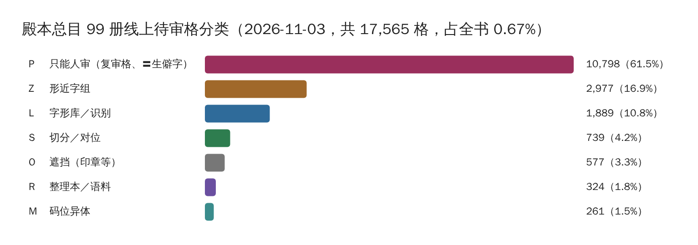

# 待审原因与新书体检

每个待审格都带一个**待审原因** `pending_reason`：机器为什么不敢放行这一格。2026-11-03 起，统计、派单、人审表、网站投票都按它来分，不再各自造小类。码表的真源在本仓 `guji_manager/review/pending_reasons.yaml`（0.3.1 起随审阅代码搬来），规范见 cv `doc/design/待审原因PendingReason.md`。



## 原因长什么样

每条原因有英文名、码、中文名，还有一个**去向**：

| 去向 | 意思 | 例子 |
|---|---|---|
| human | 只能人审 | `machine_changed`（X03 机器改了字）、`recheck`（X04 复审）、`lib_missing`（L01 少见的字） |
| llm | 交给大模型按文意判 | `group_abstain`（Z01 形近字·没把握）、`ref_gap`（R02 参校本这里没字） |
| algo | 算法还能再降 | `seg_page_unaligned`（S01 整页对不上）、`garble_gate`（L05 像框线或墨点） |
| deferred | 先放着，以后一起做 | `hard_pair`（H01 日曰、己已巳） |

拿不准的格写 `unknown`。原因只是分类，判定依据仍在格的 `why[]` 里。

## 原因跟着格走

- **线上待审单**：每格写 `pending_reason`。细项写在 `pending_reason_cause`／`pending_reason_cause_detail`（0.2.1 起由 `cause`／`cause_detail` 改名而来）。
- **网站投票落事件**：`guji cellvotes draft` 出的草稿行带投票时那张单上该格的原因；单子对不上，或者格不在单上，就写 `unknown`。
- **统计**：`guji-manager pending-stats` 报告的第一节「零、按待审原因」按码、名、去向列出格数；旧的大类小类表还留着，过渡期对照用。

## 新书体检（0.3 新增）

`pending-stats` 报告里的「零·二、诊断信号」按原因的分布给出**往哪努力**：每条信号写依据（哪几个原因、占多少）、建议、难度档、谁来做。

| 档 | 意思 | 谁做 |
|---|---|---|
| A 易 | 开开关、看图核字对就能降 | 书项目自己做 |
| B 中期 | 要新算法或本书标注 | 报 A24 排期 |
| C 暂不看 | 定为人审，或者留到以后 | — |

几种典型信号：切分类过多，先当版式问题看；「库里没有」里常用字太多，说明借来的字形不像本书；整理本缺字多，就去新图源的文本层取字。阈值是殿本 r4、史記、全唐文三份单子定的经验值，信号只指方向，动手前仍要抽样看图。逻辑在 `guji_manager/diagnose.py`，结果也写进 `summary.json` 的 `signals`。

```bash
guji-manager pending-stats --out /tmp/ps --prev 上一份/summary.json   # 连中心库；--from-dir 可离线
```

**详细**：[逐轮降人审节奏](https://github.com/open-guji/guji-manager/blob/dev/doc/01-粗校/逐轮降人审节奏.md)、[待审分类规范](https://github.com/open-guji/guji-manager/blob/dev/doc/01-粗校/待审分类规范.md)
