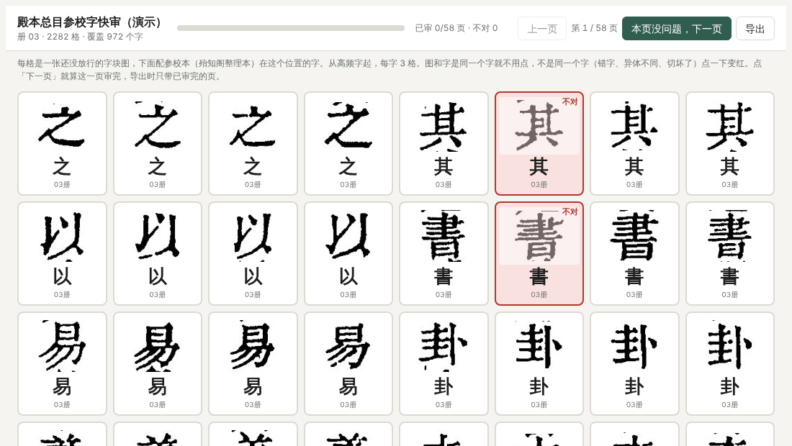

# 快审分流（review_triage）

开新书时，字形库还小，很多格「参校本对上了字、但机器还不敢放行」。全交给人看太多，快审分流先把它们分成四路，**只把真拿不准的交给人**。

## 人看到的页面



（演示：用殿本总目 vol03 的格出的页。）一格一张字块图，下面是参校本在这个位置的字；同字排在一起，人眼一路扫过去最快。默认全对，**点一下变红＝不对**（上图第 6、14 格），翻页就存。存下的结果就是下一轮训练用的标注。

## 四路去向

| 顺序 | 去向 | 条件 |
|---|---|---|
| 1–4 | **skip** 不进快审 | 列首列尾格、双行小注、参校字不是汉字、己已巳／日曰这类靠文意判的 |
| 5 | **pass** 直接放行 | 模型（OCR＋裁图几何特征的 GBDT）有把握 |
| 6 | **withdraw** 撤下 | OCR 认成别的字——多半是切坏了，这轮不进字形库 |
| 7 | **review** 上页 | 其余：OCR 认对了，模型没把握 |

人拦下的格大多**字没错、错在裁图**（框线、邻格笔画、碎点），所以光靠 OCR 不够，要加几何特征。

**实测（史记第 2 轮）**：候选 5,372 格 → 跳过、放行、撤下之后人审约 570 格；第 1 轮同类工作人审了 3,120 格。

## 命令

```bash
pip install -e ".[triage]"
guji-manager triage prepare cells.jsonl <ws>/cache feats.jsonl     # 每格特征
guji-manager triage train   feats.jsonl <上轮标注>… model.pkl --recall 0.9
guji-manager triage route   feats.jsonl model.pkl route.json
guji-manager triage sheet   …                                     # 出快审页，用 Artifact 发布
```

**详细**：[快审减量](https://github.com/open-guji/guji-manager/blob/dev/doc/01-粗校/开书/快审减量.md)、[冷启动快审流程](https://github.com/open-guji/guji-manager/blob/dev/doc/01-粗校/开书/冷启动快审流程.md)
