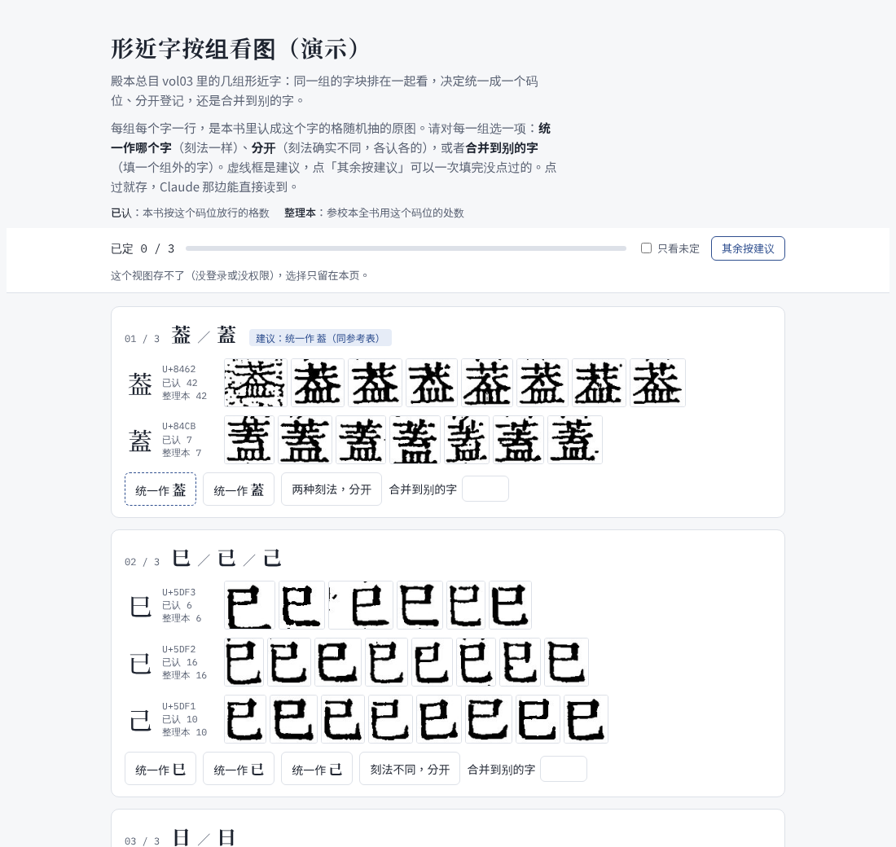

# 按组看图定夺

形近字、异体字的问题不在单个格子，而在**一整组字在这部书里到底算一个字还是两个字**。比如「葢」和「蓋」：如果刻工刻的是同一个字形，却被认成了两个码位，那就该统一；如果两种刻法确实不同，就各认各的。

这种事一格一格审没有意义，要**把一组字的字块并排摆出来，一眼定夺**：

（演示：殿本总目 vol03 里的三组。）每组每个字一行：码位、已放行格数、整理本里的出现次数，后面是随机抽的原图字块。人选一项：**统一作哪个字 ／ 两种刻法分开 ／ 合并到别的字**。虚线框是建议，「其余按建议」可一次填完。

从这张图就能看出「葢」和「蓋」下半部确实不同（皿 与 一横加皿），所以这组该选「分开」，而不是盲目统一。

## 流程

1. `find_groups.py`：找出两边都有放行格的候选组，每字抽样；
2. `render.py`：抽中的格渲成字块；
3. `build_page.py`：出自包含页，用 Artifact 发布（存选择要 db 能力）；
4. 人点完后，`to_codepoints.py` 把选择变成码位配置片段，推中心库 `config/`。

脚本在仓里 [`tools/开书/按组看图/`](https://github.com/open-guji/guji-manager/tree/dev/tools/开书/按组看图)。全唐文 2026-11-01 用这套定了 33 组码位。

**详细**：[按组看图定夺](https://github.com/open-guji/guji-manager/blob/dev/doc/01-粗校/开书/按组看图定夺.md)、[形近字迁移框架](https://github.com/open-guji/guji-manager/blob/dev/doc/01-粗校/开书/形近字迁移框架.md)
