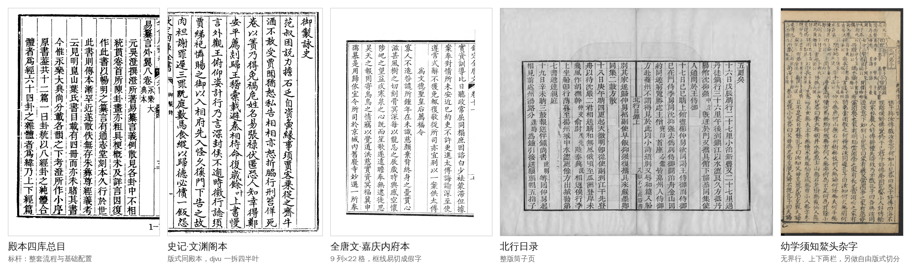

# 案例画廊

| 书 | 难在哪 | 现状（2026-11） |
|---|---|---|
| **殿本四库总目**（`96mid1ogzk`，99 册） | 标杆：整套流程和基础配置都是在它上面磨出来的；10-26 换用干净图源 siku-qiefen-v2，重编页号、迁坐标 | 99 册全部上线校对，人审率约 0.6% |
| **史记·文渊阁本**（`988g3f0wsu`，42 册） | 版式同殿本、沿用基础配置；DjVu 按版框一拆四；年表页整页跳过；职名页要分叉 | 01–10 册已跑通，快审三轮做完，转形近字迁移降人审率 |
| **全唐文·嘉庆内府本**（`995ejelvk0`） | 9 列×22 格，格距自相关会估错要写死；版框横线常被切成假字；参校本 Kanripo 缺半叶 | 册 04 两轮快审进了 4,432 条人裁；按组看图定了 33 组码位 |
| **北行日录**（`988g7gsqhd`） | 整版筒子页、非 volNN 册名，导出与出单都要显式给章号 | 10-28 首跑并上线校对 |
| **幼学须知鰲头杂字**（`998a1ukohs`） | 无界行、上下两栏、大小字混排，现有切分管线跑不了 | 另做自由版式切分（cv `keben_free`），研究中 |

每部书的做法、特殊处理和坑：[案例](https://github.com/open-guji/guji-manager/blob/dev/doc/案例/README.md)。
