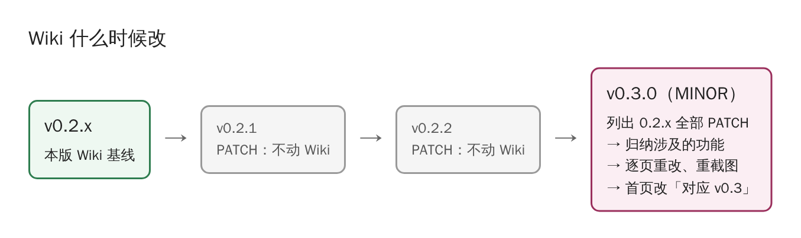

# 版本与 Wiki 维护

## 版本号

规矩全文见仓里 [doc/版本号规矩.md](https://github.com/open-guji/guji-manager/blob/dev/doc/版本号规矩.md)（2026-11-03 起，全部仿照 open-guji-cv）。要点：

- guji-manager 用自己的 `vX.Y.Z` tag（和 cv 同名不同仓，说的时候写「manager v0.2.0」），**不钉到册、不进产物指纹**，所以发版不会让任何册过期。基线 `v0.2.0`。
- 分支：PR 一律投 **dev**；准备发版时从 dev 切 `rc/vX.Y.Z` 测；测完用 merge commit 合进 **main**，在合并提交上打 tag。main 只接发版，Wiki 也随 main 同步。
- PATCH（Z）：修 bug、新命令、从 cv 搬来单个命令、文档。不用问用户。
- MINOR（Y）：用法要跟着变（已有命令不兼容、契约范围变、拆分一个阶段做完）。MINOR 升版要用户点头，还要整体重改 Wiki（下一节）。
- 合 PR 前跑 `python scripts/check_rc_target.py <目标分支>`，发版后跑 `python scripts/check_release_tags.py`。
- 推 tag 自动建 GitHub Release，挂 wheel。每版改了什么写在 [CHANGELOG.md](https://github.com/open-guji/guji-manager/blob/dev/CHANGELOG.md)。

## Wiki 什么时候改

**平时不追着改。** 每个 PATCH 都改 Wiki 太累，也容易忘；Wiki 写的是「看图懂系统」，PATCH 一般动不到这一层。

**每升一次 MINOR，必须整体重改一遍：**

1. 列出上一个 MINOR 以来的全部 PATCH：看 CHANGELOG，和 `git log vX.(Y-1).0..HEAD --oneline`；
2. 归纳这些 PATCH 涉及了哪些功能（新命令、搬来的模块、改了的流程）；
3. 逐页对照：过时的改，新功能补页或补段，截图该重截的重截（截图里有令牌、内部地址的要打码）；
4. 首页顶上的「本 Wiki 对应 vX.Y」改成新版本；
5. 在本页下面「改版记录」加一段；
6. MINOR 发版的 PR 里写一行「Wiki 已按 vX.Y 重改」，才算发完。

## 怎么改

- 源文件在主仓 `wiki/`，图在 `wiki/images/`，走 PR、和代码一起审。
- 合进 main 后 Action `wiki-sync` 自动把 `wiki/` 整个同步到 GitHub Wiki。**别在 Wiki 网页上直接改**，会被下次同步覆盖。
- 截图尽量用真数据（殿本总目 vol03 是现成的演示册）；示意图的源 HTML 在 `wiki/images/src/`，改完用 Playwright 重新截。

## 改版记录

| 日期 | 对应版本 | 改了什么 |
|---|---|---|
| 2026-11-05 | v0.4（0.4.3 补页，PATCH 不要求重改） | 新增「降人审迭代与人审页」页（后台迭代轮次与自动填、十种人审页型与版本、点即存通用件、同字对照自检）；首页导航、侧栏加入口。0.4.1 的 iterate 子命令、suggest／final-review、eval 登记和 0.4.2 执行方不碰 Neon 都是命令级改动，细节在 doc/，Wiki 不另画。 |
| 2026-11-05 | v0.4（0.4.0） | 对照 0.3.1–0.3.4、0.4.0（拆分 P2 第四批到 P6，全部搬完）：重画「两个仓怎么分工」图（入口点、钩子、manager_api）；系统全景改写 manager 出手处与两边怎么接上；安装页补全部命令清单、钉版册要装 manager、控制台门面；任务库页补执行方与 rerun；产物包页补自动存包与模型上传；待审原因页改码表位置；首页、页脚改 v0.4。 |
| 2026-11-04 | v0.3（0.3.0） | 对照 0.2.1、0.3.0：新增「待审原因与新书体检」页（pending_reason 口径、诊断信号）；重截待审分类图（按待审原因，18,563 格）；安装、全景页补 0.3 搬来的 15 条命令；精校页补投票草稿带待审原因；案例画廊补全唐文勘误层；首页、页脚改 v0.3。 |
| 2026-11-03 | v0.2（0.2.0） | 首版：13 页。基线功能：pipeline 调用与契约检查、opinions、source、cellvotes、freeze、online_lists、review_triage、pending-stats、central-gc；拆分进行到 P2 第二批。 |
