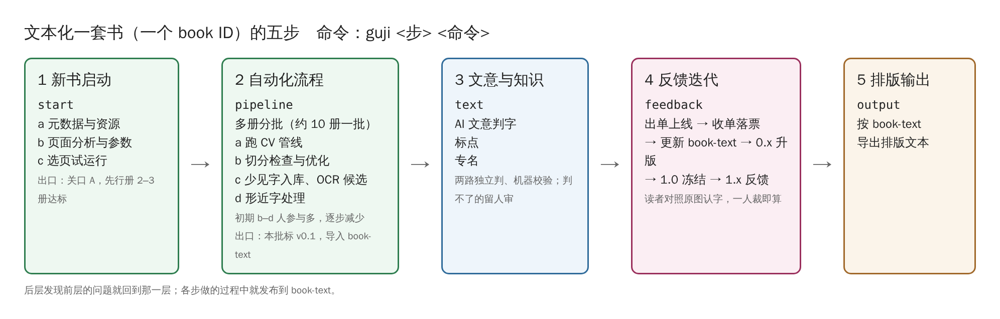
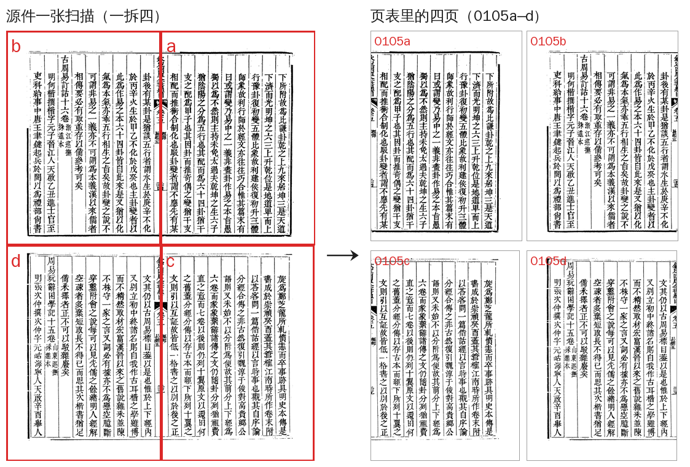
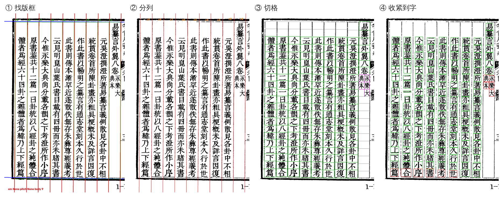

# 第一步　新书启动（start）

从一个 book ID 开始，把先行册（2–3 册）准备到能分批迭代。三个小步：

## a 元数据与资源

book-index 有 Work／Book；原图一律以 Wikimedia Commons 为根，登记进 R2（对开的先拆半叶）；找逐列整理本做成语料；在 `guji-workspace` 组织下一书一仓建工作区，册进中心库。

`guji start source spreads` 在天头、地脚找书脊折痕拆半叶，登记前逐张看核对图。详见 [原图登记与取图](原图登记与取图)。

## b 页面分析与参数

量版式（是否等距、落缝范围、夹注、题署列、列端框线），页型普查（正文、目录、职名、表、书衣），选套书 `seg_set`，写册配置与书级开关，默认二值化。出一页体检单（参校本错率、页型占比、借库、码位策略、建议目标人审率），**用户定目标人审率**。每个待审格的原因码见 [待审原因与新书体检](待审原因与新书体检)。

## c 选页试运行

`dev_set` 或 10–30 页试跑看叠图，整页、整列成片的切分问题在这里拦下：

然后整理本钉页位、借别家字形库跑匹配、首批字形快审入库（第一次进库的字必须人裁），见 [快审分流](快审分流)。

**出口（关口 A）**：先行册无整页／整列成片切分错；放行 ≥90%、正文 ≥95%；常用字有 15–20 个本书刻例。

## 本步教程

- [元数据与资源](元数据与资源)、[原图登记与取图](原图登记与取图)
- [页面分析与参数](页面分析与参数)：[开书体检](开书体检)、[书级开关与跑批分支](书级开关与跑批分支)、[终审判读与开关建议](终审判读与开关建议)、[借库写法](借库写法)、[待审原因与新书体检](待审原因与新书体检)
- [选页试运行](选页试运行)：[冷启动](冷启动)、[冷启动快审流程](冷启动快审流程)、[冷启动快审入库](冷启动快审入库)
- [开书全流程（详细版）](开书全流程-详细版)、[常见坑](新书启动-常见坑)

命令：`guji start commands` 列出本步命令。规格（输入、输出、出口）见 [doc/1-新书启动](https://github.com/open-guji/guji-manager/blob/dev/doc/1-新书启动/README.md)。
