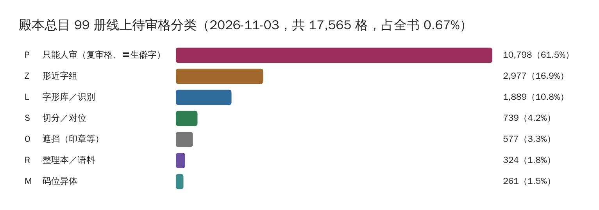

# 第三步　AI 文意判字、标点、专名

v0.1 之后，AI 按段读文意，一遍做三件事：
1. **判字**：靠文意才能定的形近字（日曰、己已巳、千干…），写裁定库、重放进 book-text；
2. **标点**：每个点号挂在字格上，书名号、引号成对；
3. **专名**：人名、书名、官名、地名、朝代年号，匹配中心库实体。

放行很保守：两路独立会话盲读同字、有文意依据、机器校验通过、金标抽样 0 错才放；推翻已确认机器字的改字只给提示。判不了的留给第四步网站人审，待审单上带着标点专名句子和 AI 倾向字。

每批写完裁定跑 `guji rulings-hits`，查裁定有没有在产物里命中（重放时窗口变了会漏）。

上图是殿本总目线上待审格按原因的分类：形近字组、字形库、切分几类是算法和 AI 还能再降的部分。

操作手册：[doc/3-AI文意判字标点专名](https://github.com/open-guji/guji-manager/blob/dev/doc/3-AI文意判字标点专名/README.md)。
