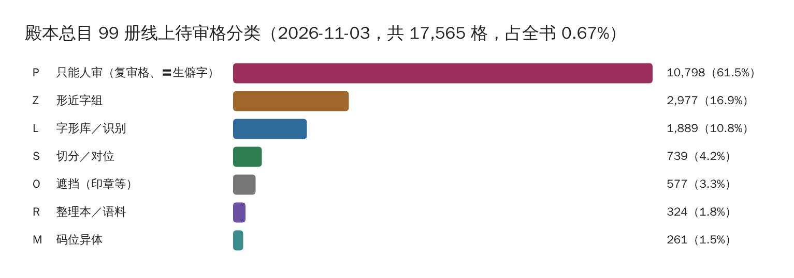

# 第三步　文意与知识（text）

v0.1 之后，AI 按段读文意，一遍做三件事：
1. **判字**：靠文意才能定的形近字（日曰、己已巳、千干…），写裁定库、重放进 book-text；
2. **标点**：每个点号挂在字格上，书名号、引号成对；
3. **专名**：人名、书名、官名、地名、朝代年号，匹配中心库实体。

放行很保守：两路独立会话盲读同字、有文意依据、机器校验通过、金标抽样 0 错才放；推翻已确认机器字的改字只给提示。判不了的留给第四步反馈迭代（网站人审），待审单上带着标点专名句子和 AI 倾向字。

终审按「格号＋字」写裁定用 `guji text ctx-ruling write`（键按 seed_admit 的窗口取，写前按 cv 校验版本，不认的整批不写）。有[字格身份账](字格永久编号u与身份账)的册，裁定自动带 `payload.u`，重切后按 u 跟到现格。

每批写完裁定跑 `guji text rulings-hits`，查裁定有没有在产物里命中（重放时窗口变了会漏；带 u 的按 u 找现格）。

上图是殿本总目线上待审格按原因的分类：形近字组、字形库、切分几类是算法和 AI 还能再降的部分。

## 本步教程

- 主文：[文意判字标点专名合并判定](文意判字标点专名合并判定)
- [点校先于精校](点校先于精校)、[标点与专名-步骤](标点与专名-步骤)
- [各册经验](文意与知识-各册经验)、[常见坑](文意与知识-常见坑)

命令：`guji text commands`。规格与验收见 [doc/3-文意与知识](https://github.com/open-guji/guji-manager/blob/dev/doc/3-文意与知识/README.md)。
