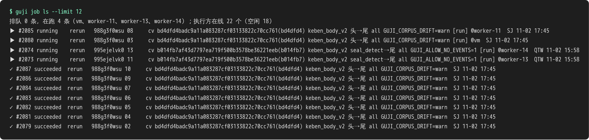
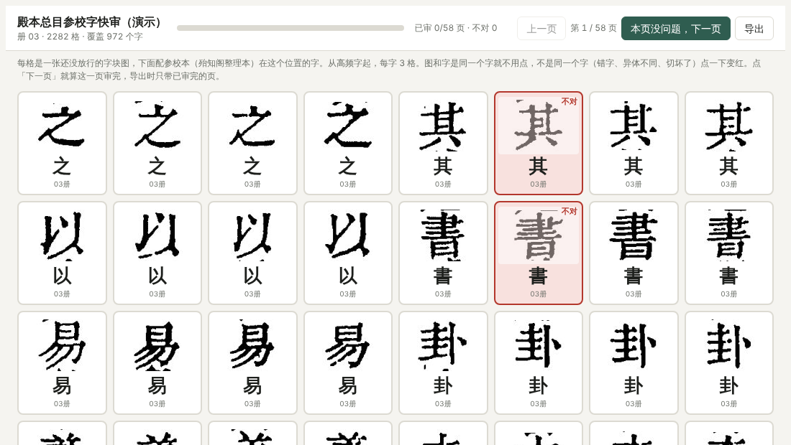
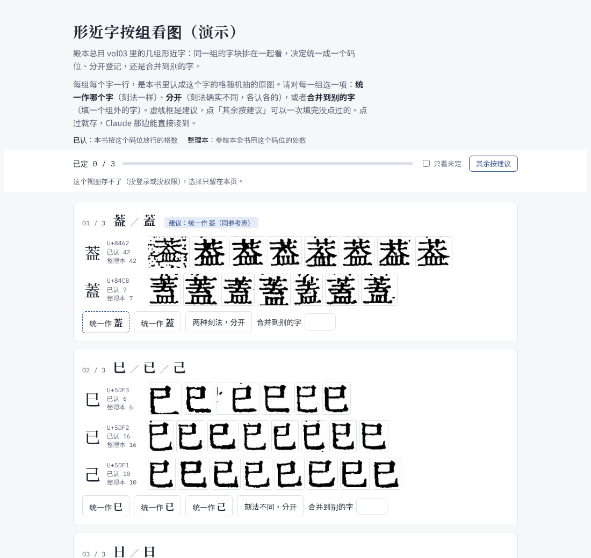
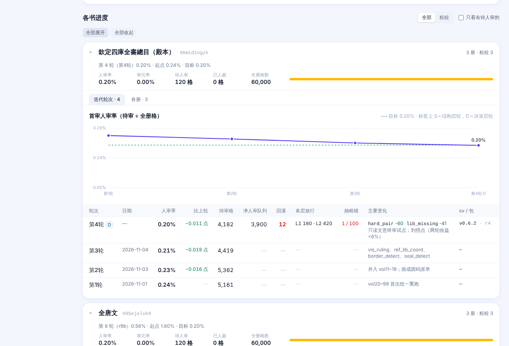

# 第二步　自动化流程（pipeline）

多册分批（一般 10 册一批），每轮统一冻结、发版、重跑一次，再按待审原因把剩下的格派给四个小步。**初期 b–d 人参与多，数据多了要逐步减少。**

## a 跑 CV 管线

一轮的固定动作：收修复 → 冻结发 cv patch 版 → 钉版本（`guji pipeline job precheck`）→ 交任务库 → 取包逐格比对 main → 切分不回退闸、标 main 前硬检查 → 标 main → 收尾 → 按层派活。交单与看结果见 [任务库与重跑](任务库与重跑)，产物包与 main 见 [中心库与产物包](中心库与产物包)。

## b 切分检查与优化

格框对、格号对、配上整理本。`guji pipeline seg check／gate／premain` 给出结构列清单；先查根因台账，修法由便宜到贵：公用算法 → 书仓书级代码 → 本书配置 → 单页单列钉子。

## c 少见字入库、OCR 候选

库里无例、少例的字头补上本书刻例：快速审阅单 → 高置信 → 低置信 → 难认字四层页；认不出的字由 OCR、5b 笔画证据出候选。参校本对上字、还没放行的格先过快审分流减量：

## d 形近字处理

同组字（末未木、入人八…）、异体、码位，能靠字形和规则定的由机器定，**不用 AI**；要读文意的留给第三步。同一种刻法被认成几个码位时按组看图定夺：

## 每轮进后台、逐轮压人审率

本批 b–d 判停（判停三问），出 v0.1、导入 book-text、上网站，下一批沿用本批配置。见 [降人审迭代与人审页](降人审迭代与人审页)。

## 本步教程

- 主文：[迭代流程](迭代流程)；[四层工作法](四层工作法)、[常见坑](自动化流程-常见坑)
- [跑CV管线](跑CV管线)：[重跑需求与执行规范](重跑需求与执行规范)、[两档轮与交单检查](两档轮与交单检查)、[受控重跑方法论](受控重跑方法论)、[收轮检查单](收轮检查单)、[轮报告与验收工具](轮报告与验收工具)
- [切分检查与优化](切分检查与优化)：[切分快筛](切分快筛)、[印章遮挡卡](印章遮挡卡)、[印章遮挡格-校对处理](印章遮挡格-校对处理)
- [少见字入库与OCR候选](少见字入库与OCR候选)：[字形快速入库](字形快速入库)、[快审减量](快审减量)、[放行格回库](放行格回库)、[回库事后核](回库事后核)、[库文一致](库文一致)
- [形近字处理](形近字处理)：[按组看图定夺-细则](按组看图定夺-细则)、[形近字迁移框架](形近字迁移框架)
- [降人审](降人审)：[降人审迭代框架](降人审迭代框架)、[逐轮降人审节奏](逐轮降人审节奏)、[配置爬降](配置爬降)、[决策层漏斗](决策层漏斗)、[人审页模板](人审页模板)、[准确率守则](准确率守则)、[数据与跟踪](数据与跟踪)

命令：`guji pipeline commands` 列出本步命令（`guji pipeline <管线> <册>` 仍是跑管线）。规格见 [doc/2-自动化流程](https://github.com/open-guji/guji-manager/blob/dev/doc/2-自动化流程/README.md)。
