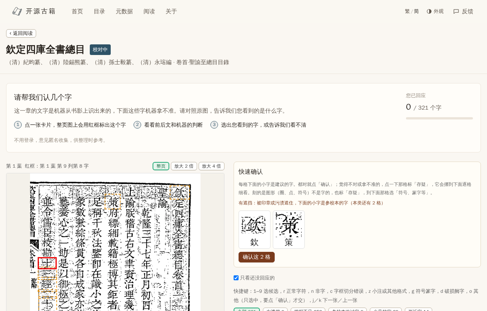
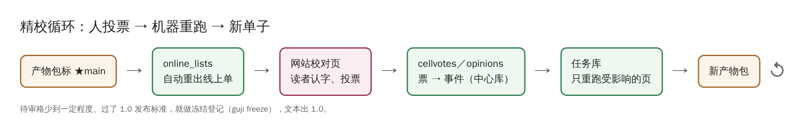

# 第四步　反馈迭代（feedback）

机器和 AI 都判不了的格放到网站上，读者对照原图认字；票落成人裁、更新 book-text，0.x 一版一版升，直到 1.0 冻结；1.0 之后收网站报错和机器反馈，发 1.x。

| 小步 | 做什么 | 命令 |
|---|---|---|
| a 出单上线 | 首发、换单（以最新一轮为准，机器结果不覆盖人裁） | `guji feedback swap run`、`pending` |
| b 收单落票 | 读票→写人裁→定字直接落 book-text→推库→发站核对 | `guji feedback collect` |
| c 更新 book-text | 换包落 book-text，格号变了走格级对照表 | `guji feedback swap book-text` |
| d 升 1.0、冻结 | 按 1.0 发布标准检查、冻结登记 | `guji feedback exit-check`、`freeze` |
| e 1.0 之后的反馈 | 意见→裁决事件→只经 `revise` 落地，一批一个 PR | `guji feedback opinions` |

要点：网站只发 book-text main；人审一人裁即算。0.6.9 起有[字格身份账](字格永久编号u与身份账)的册，裁定事件、待审条目、网站票都挂字格永久编号 u：重切后格号变了票也不漂，`cellvotes` 按 u 认票，格已并掉／删掉的票挂起（`moved`）；没账的册照旧按格号，单子发出后格位层不能再变。推库前用 `guji feedback human-conflicts --books …` 查同一格几批人裁定成不同字的（有冲突退出码 3）。详见 [线上待审单与投票](线上待审单与投票)、[冻结与中心库清理](冻结与中心库清理)。

## 本步教程

- [出单上线](出单上线)：[换线上人审单](换线上人审单)
- [收单落票](收单落票)：[收单](收单)
- [更新book-text](更新book-text)：[换包落book-text-增删格](换包落book-text-增删格)、[标main后收尾](标main后收尾)、[参校本对比查漏](参校本对比查漏)
- [升1.0与冻结](升1.0与冻结)：[精校流程自动化方案](精校流程自动化方案)
- [1.0后的反馈](1.0后的反馈)：[1.0后-步骤](1.0后-步骤)、[1.x册精校票处理](1.x册精校票处理)、[全流程与覆盖优先级](全流程与覆盖优先级)、[1.0后-常见坑](1.0后-常见坑)
- [反馈迭代-步骤](反馈迭代-步骤)、[常见坑](反馈迭代-常见坑)

命令：`guji feedback commands`。规格（1.0 发布标准、待审条目设计）见 [doc/4-反馈迭代](https://github.com/open-guji/guji-manager/blob/dev/doc/4-反馈迭代/README.md)。
