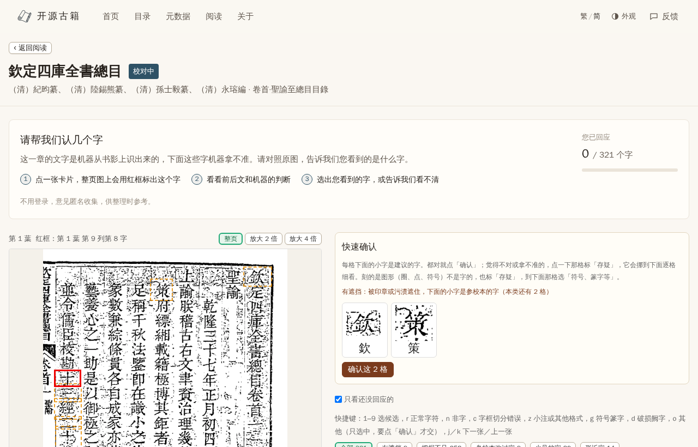
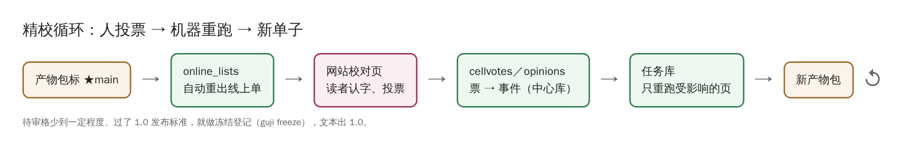

# 第四步　网站人审与版本迭代

机器和 AI 都判不了的格放到网站上，读者对照原图认字；票落成人裁、更新 book-text，0.x 一版一版升，直到 1.0 冻结；1.0 之后收网站报错和机器反馈，发 1.x。

| 小步 | 做什么 | 命令 |
|---|---|---|
| a 出单上线 | 首发、换单（以最新一轮为准，机器结果不覆盖人裁） | `guji swap run`、`guji pending` |
| b 收单落票 | 读票→写人裁→定字直接落 book-text→推库→发站核对 | `guji collect` |
| c 更新 book-text | 换包落 book-text，格号变了走格级对照表 | `guji swap book-text` |
| d 升 1.0、冻结 | 按 1.0 发布标准检查、冻结登记 | `guji exit-check`、`guji freeze` |
| e 1.0 之后的反馈 | 意见→裁决事件→只经 `revise` 落地，一批一个 PR | `guji opinions` |

要点：网站只发 book-text main；人审一人裁即算；单子发出后格位层不能再变，否则票会漂。详见 [线上待审单与投票](线上待审单与投票)、[冻结与中心库清理](冻结与中心库清理)。

操作手册：[doc/4-网站人审与版本迭代](https://github.com/open-guji/guji-manager/blob/dev/doc/4-网站人审与版本迭代/README.md)。
