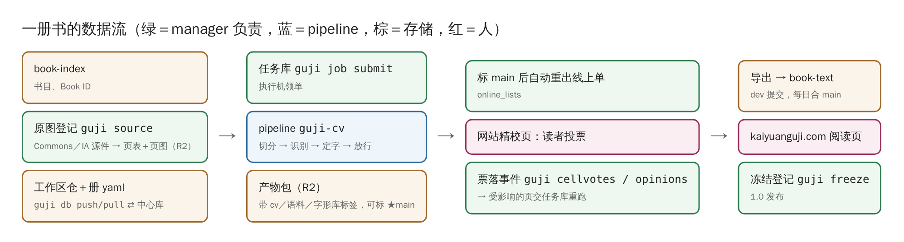

# 系统全景

## 有哪些东西、住在哪

| 东西 | 是什么 | 住哪 |
|---|---|---|
| 书（Work／Book） | 一部作品的一个版本，一书一个 10 位 Book ID（如殿本总目 `96mid1ogzk`） | book-index 仓 |
| 原图 | 以 Wikimedia Commons 文件为根；R2 存源件、页图和页表 | R2 `pack/source/pages/<书id>/<册>/rNNN.json` |
| 工作区 | 一部书一个仓（`guji-workspace` 组织），仓根即工作区 | 工作区仓＋中心库 |
| 册 | 整理的最小单位，一份 `books/<册>.yaml` | 中心库 |
| 产物包 | 一次跑批的全部产物，标签写着 cv／语料／字形库版本，可标 ★main | R2 |
| 语料／参校本 | 逐列整理本，做对位和放行的证据 | 中心库 |
| 字形库 | 认过的字形，分书存，可跨书借 | 中心库 |
| 事件 | 人裁、读者投票落成的追加型记录 | 中心库 |
| 文本成品 | 按册导出的文字、标点、实体层，版本 0.x → 1.0 | book-text 仓 |
| 线上待审单 | 网站校对页的数据 | 中心库 → 网站 |

## 三层存储

- **中心库**（Postgres＋Worker＋R2）：多人要写的数据只有这一个真源。`guji db pull/push` 进出。
- **R2**：大文件，按内容寻址、只增不改——原图页、产物包、语料文件。
- **git**：只放代码和原图；数据一律不再提交进工作区仓。

## manager 在哪几处出手

图里绿色的框都是 manager：原图登记（`guji source`）、派单（任务库）、标 main 后重出线上单（`online_lists`）、读者投票落事件（`guji cellvotes`／`guji opinions`）、冻结登记（`guji freeze`），另有统计待审格并给新书体检（`pending-stats`）、清理中心库（`central-gc`）。

0.4 起拆分完成，**manager 一侧的代码全部在本仓**：中心库客户端与工作区同步（`guji db`）、产物包（`guji products`）、人裁事件的消费与落库（Step8）、审阅卡、评测与校对报告（`eval`、`check`、`collate`）、快照导入（`snap`）、任务库（`guji job` 和执行方）、受控重跑（`guji rerun`）、控制台门面（`guji_manager.console_api`）。蓝色的 pipeline 只做识别：`guji pipeline`／`step`／`status` 在 cv，Step 读人裁、按钉版取模型也在 cv（它们是识别的输入）。

两边怎么接上：

- **命令**：本包经入口点 `guji.commands` 把子命令并进 `guji`，用法和以前一样。
- **钩子**：`guji pipeline` 起跑前（取钉版字形库、模型、语料，预建生僻字索引）、整册跑完（自动存产物包）、`guji status`（收尾闸报告）这几处，cv 调钩子、本包经入口点 `guji.hooks` 登记。没装 manager 时 cv 照跑，只有册钉了字形库／模型／语料时 `guji pipeline` 拒跑并提示装法。
- **名字**：本包用 cv 的东西一律经 cv 的 `manager_api`（本包 `_cv.py` 有同一张表），cv 改内部不会悄悄弄坏 manager。

**详细**：[边界与数据流](https://github.com/open-guji/guji-manager/blob/dev/doc/00-总览/边界与数据流.md)、[中心库](https://github.com/open-guji/guji-manager/blob/dev/doc/参考/中心库.md)、[角色与分工](https://github.com/open-guji/guji-manager/blob/dev/doc/00-总览/角色与分工.md)
