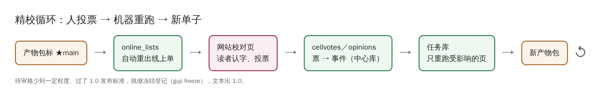
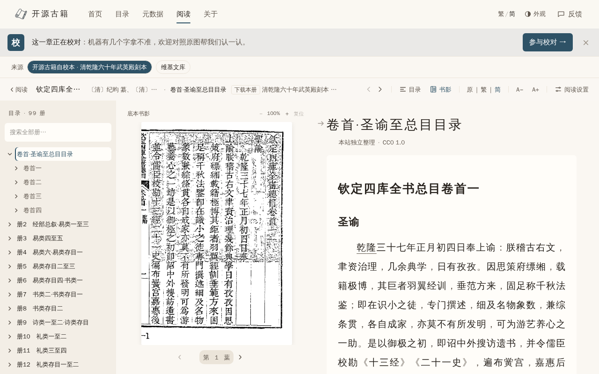
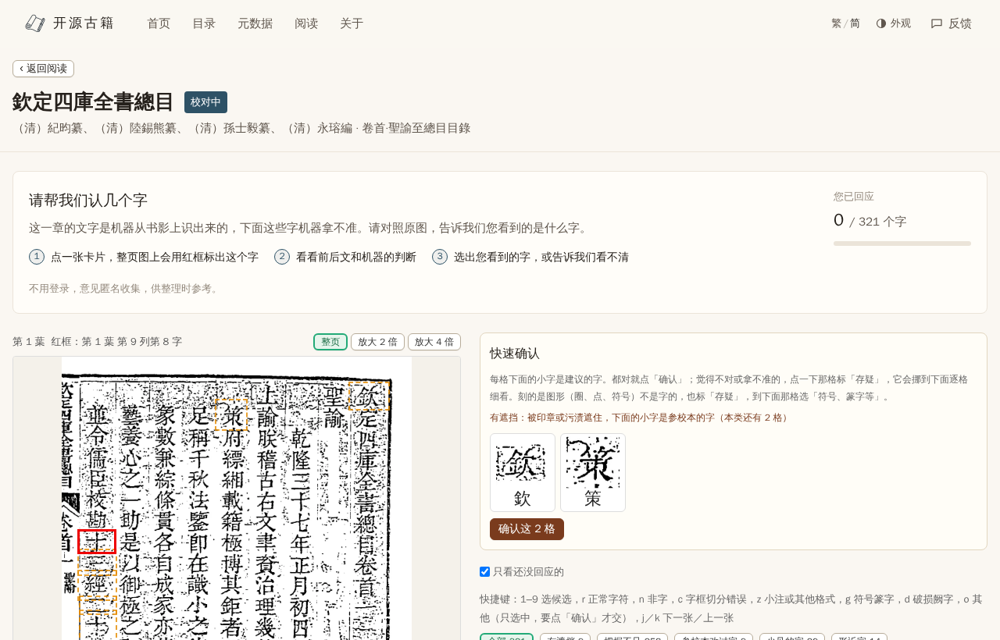

# 线上待审单与投票

精校阶段，机器拿不准的格（待审条目）放到网站上，请读者对照原图认字。这一来一回全由 manager 接起来：

## 读者看到的

阅读页上方会提示「这一章正在校对」：

点「参与校对」进校对页：左边整页原图，红框标出当前这个字；右边一格一张卡片，读者选认出的字，或者说看不清、是印章遮挡、切错了：

不用登录，意见匿名收集。每张卡片背后是一个字格永久编号 `u`，链接也用 `?u=`（如 `/read/<书>/<章>?u=1234`），重切以后旧链接、旧票照样落到同一个字上。

## 背后发生的事

> 2026-11-27 起按「待审条目＋裁定事件」口径重写：**没有批次、没有 rev**，每格一个待审条目，各自增删改；读者的票是意见，落成裁定事件才算。总纲见 [待审条目、裁定事件、book-text 格子](https://github.com/open-guji/guji-manager/blob/dev/doc/00-总览/待审条目-裁定事件-book-text格子.md)。

1. **产物包标 ★main** → manager 按条目逐格对：没变的不动、人工撤下的不放回，只开／改有变化的条目。网站上的「某章待审单」是这章 open 条目的现算视图，已有「算落定」裁定的格（按 `(书, 册, u)` 配）不显示。
2. **网站收件箱**收读者的票和意见（匿名），每张票带条目 `item_id` 和那格的 `u`。
3. **`guji feedback cellvotes draft`** 把票变成裁定事件草稿：按 `(书, 册, u)` 合到现在的格，重切过也认得出；u 已作废（格被删、被并）的票挂起（`moved`）不写；意见不一致的格留作复审。写出的事件带来源：`level`、`by`、`channel=web_vote`。
4. **`guji feedback cellvotes write`** 写进数据目录并消费，`guji db sync` 推库；对应条目标为已裁。
5. 裁定让受影响的页失效，**交任务库只重跑这些页** → 新产物包 → 标 main → 回到第 1 步。

读者在网站「反馈」里写的自由文字意见，走 `guji feedback opinions`：入池、规整、判定、改 book-text、回复读者。

**详细**：[精校·步骤](反馈迭代-步骤)、[4e 1.0 之后的反馈](1.0后的反馈)

> 现行：网站精校页按章读 Worker `pending-doc` 现拼的条目，提交带条目 `id`／`ver`／`u`，票按 `cr:i:<书>:<条目>:<投票人>` 存（旧 `cr:<rev>:…` 键已迁、只读保留）；`proofing-sync` 暂时还靠 land 导出的整张 `<章>.pending.json` 找单格图，是仅剩的过渡项（见总纲第七节）。0.5.0 起网站不再用 KV，票、改字意见都存中心库的网站收件箱（表见 [数据库表一览](数据库表一览)）。`guji feedback cellvotes draft`、`guji feedback opinions ingest`、`guji feedback collect` 不带参数就读收件箱；确要读旧 KV 备份，加 `--from-kv` 或设 `GUJI_VOTES_FROM=kv`。
