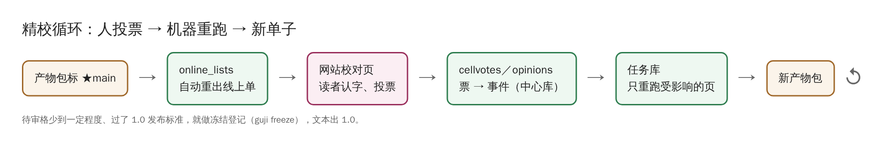
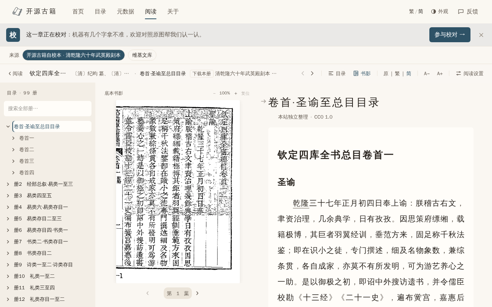
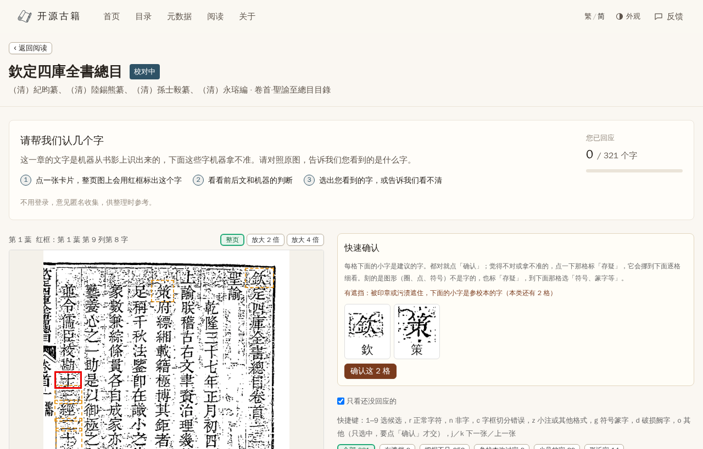

# 线上待审单与投票

精校阶段，机器拿不准的格放到网站上，请读者对照原图认字。这一来一回全由 manager 接起来：

## 读者看到的

阅读页上方会提示「这一章正在校对」：

点「参与校对」进校对页：左边整页原图，红框标出当前这个字；右边一格一张卡片，读者选认出的字，或者说看不清、是印章遮挡、切错了：

不用登录，意见匿名收集。

## 背后发生的事

1. **产物包标 ★main** → manager 的 `online_lists` 钩子自动在后台重出这册的线上单（以前是每 2 小时轮询一次）。挂了标点／实体层、旧单已经有票、还没有线上单的册不自动重出，只提示。
2. **网站每天同步**投票进中心库。
3. **`guji cellvotes draft`** 把票变成人裁事件草稿：对不上格框的（cv 重切过的列）挂起不写，意见不一致的列进 recheck，交下一版单子复审。
4. **`guji cellvotes write`** 写进数据目录并消费，`guji db sync` 推库。
5. 人裁让受影响的页失效，**交任务库只重跑这些页** → 新产物包 → 标 main → 回到第 1 步。

读者在网站「反馈」里写的自由文字意见，走 `guji opinions`：入池、规整、判定、改 book-text、回复读者。

**详细**：[精校·步骤](https://github.com/open-guji/guji-manager/blob/main/doc/03-精校/步骤.md)、[05 反馈迭代](https://github.com/open-guji/guji-manager/blob/main/doc/05-反馈迭代/README.md)
