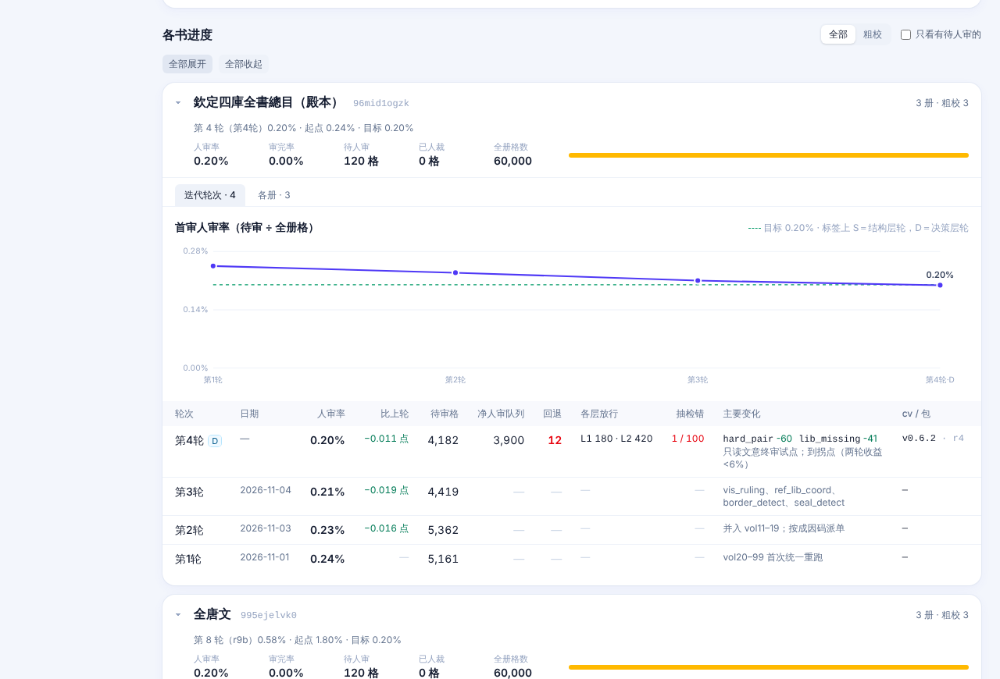

# 降人审迭代与人审页

> 0.5 新增。一部新书从开书到粗校出 v0.1，靠一轮一轮「修 → 统一重跑 → 看人审率」把要人看的格压下去。这页讲每轮的数据怎么自动进后台，以及每一步该用哪种人审页。命令细节见 [doc/02-粗校/降人审迭代框架.md](https://github.com/open-guji/guji-manager/blob/dev/doc/02-粗校/降人审迭代框架.md) 和 [人审页模板.md](https://github.com/open-guji/guji-manager/blob/dev/doc/02-粗校/人审页模板.md)。

## 后台「迭代轮次」

open-guji.com/admin/text 每部书有「迭代轮次」页签：一条人审率曲线（虚线是这本书的目标线，S/D 标轮型，被否的轮画空心红点），下面一张表逐轮列人审率、待审格、全册格、比上轮少了多少。书头和顶部的总数都取**最新一轮**，不再拿各册旧数拼。

数据住在中心库 `progress.metric`：`section='rounds'`，`key='r<N>'` 一行一轮（`value` 是首审人审率，`detail` 存其余字段），`key='target'` 是目标率。

谁写进去：

| 时机 | 命令 | 写什么 |
|---|---|---|
| 每标一册 main（自动） | 标 main 的钩子写完包口径后接 `iterate auto-round` | 按包标签里的 `-rN` 段认轮次，把这一轮已标 main 的各册加起来，更新这一轮那一行；人写的日期、结论、备注保留 |
| 一轮验收后 | `iterate round-report … --push-progress <书>` | 补结论、按层放行数、抽检等 |
| 补历史 | `iterate push-rounds --json … --write` | 从 JSON 回填旧轮 |

包标签没有 `-rN` 段（如 `jobNNN`）的书不自动收，要靠后两条手写。

## 每一步用哪种人审页

人审页模板都在 `guji_manager/review_pages/`，`guji-manager review-pages build` 出页、发布成 Artifact。**同一步固定用同一种页**，要改就改仓里的模板、升版本号，不另写一次性页面。

| 页型 | 版本 | 用在哪步 |
|---|---|---|
| `char_card` 一字一卡 | 1.3.0 | 第一次进库的字确认；难认异体（每格可带多路候选＋来源） |
| `char_grid` 字形快审表 | 1.2.0 | 全对点错的批量快审 |
| `pair_whitelist` 字对白名单抽样 | 1.1.0 | 越过参校本，按组抽样定白名单 |
| `codepoint` 码位定夺 | 2.1.0 | 私用码、缺字码位 |
| `gold_sample` 金标抽样 | 1.1.0 | 每轮金标；含上下文、整理本字、邻格条，可标切分错／看不清／库里无此字 |
| `seg_cause` 切分归因 | 1.1.0 | 切分类待审看图归因 |
| `closeout` 收口单 | 1.0.0 | 一轮收尾，列出没确认的项 |

所有页共用一套通用件：**点一下就存进后台**、重开能读回，「本页其余都对」才把没点的格算作确认；下游（`cp-apply`、`ledger`、`char pull`）只认已确认的项。预填的字只做高亮并写明依据，不预填进手输框。

## 同字对照自检（缺省关）

`review/seg_defect --gate` 拿同一个字在本书别处的切法作对照，找出被切掉一截（clipped）或带了框线（frame_residue）的格，写 `seg_selfcheck.tsv`；cv 出待审单时（`pending_list --seg-flags`）把命中的放行格改归切分待审，原因写「同字对照自检：<kind>」。书级开关在 `SELFCHECK_BOOKS`，殿本、史記两项现在都关着，哪一轮开由用户定。
